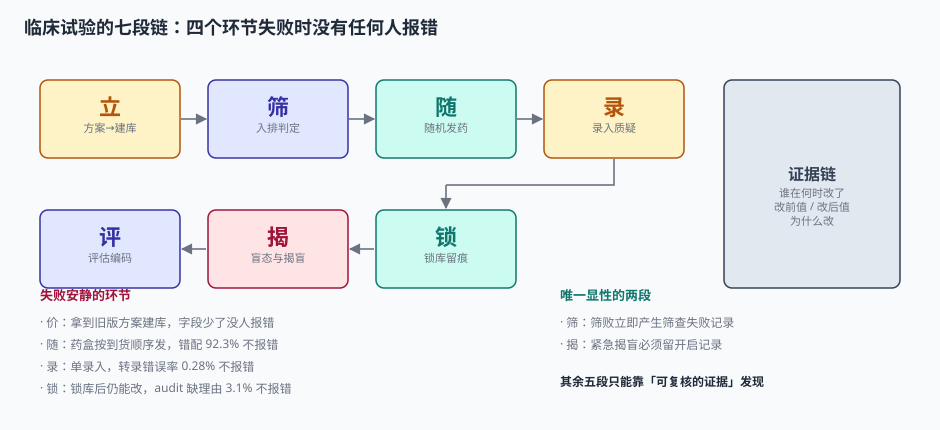
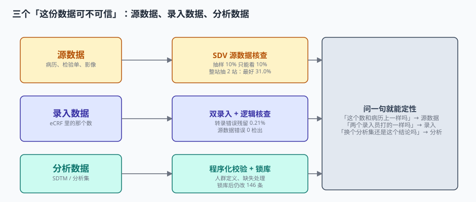
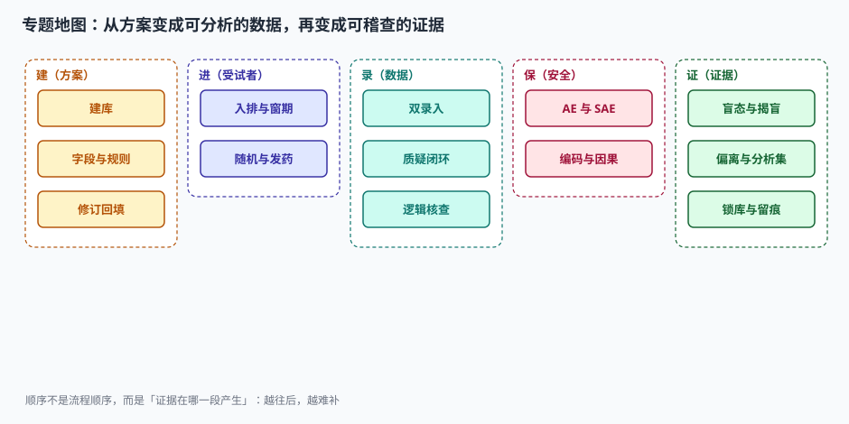

# 临床试验数据管理与盲态工程

一个新药从「有个想法」到「能上市」，中间要经过三期临床试验。第一期几十个人，看安不安全；第二期几百个人，看有没有效；第三期几千个人，看比现有疗法好多少。这些数字最后会变成一张表、一段结论、一个批准文号。

但让监管机构点头的，从来不是那张表，而是**表下面那条证据链**：这个 3.42 分的差值，是从哪 480 个受试者、哪 5,760 次访视、哪 345,600 个数据点算出来的？每一个数据点，是谁在什么时间、依据哪份病历录进去的？改过没有？改的理由是什么？盲态有没有破？分析集是揭盲前定的还是揭盲后定的？

这些问题里**只要有任何一个答不上来，整份数据就不能用**——不是「扣分」，是「作废」。

::: tip 一句话理解
临床试验的数据管理不是「把纸上的数抄进系统」，而是**给每一个数配一条能被独立复核的证据链**：谁录的、依据什么录的、改过没有、为什么改。
:::

## 一、这个专题讲什么

从「方案定稿」到「数据库锁定」，一条数据要走七段：

| 段 | 这一段在做什么 | 产物 | 失败是否安静 |
| --- | --- | --- | --- |
| ① 立 | 把方案翻译成数据库：字段、编码表、核查规则 | 建库规格 + eCRF | **安静**（字段少了一个，没人报错） |
| ② 筛 | 按 14 条入排标准判定「这个人能不能进」 | 筛查记录 + 受试者号 | 显性（筛败的人有记录） |
| ③ 随 | 分配组别、发对应药盒 | 随机号 ↔ 药盒号 | **安静**（发错药盒，药效照样「有结果」） |
| ④ 录 | 双人录入、发质疑、关质疑 | eCRF 数据 + query | **安静**（单录入的错，谁也看不出来） |
| ⑤ 评 | 疗效评估、不良事件编码与因果判定 | 评估表 + MedDRA 编码 | **安静**（编码归错系统，统计照跑） |
| ⑥ 揭 | 维持盲态、处理紧急揭盲 | 盲底 + 揭盲记录 | 半显性（开启信封有记录） |
| ⑦ 锁 | 判定偏离、定分析集、锁库、留痕 | 冻结的数据库 + audit trail | **安静**（锁完还能改，系统不拦） |

七段里**五段的失败是安静的**。它们的共同形态是：数据看着完整、逻辑看着自洽、统计照常出结果，只有「这个数凭什么可信」没人能回答。

最能说明问题的一组本机读数：一份三期方案的数据库有 2,336 个字段、386 条核查规则，规则只覆盖 40.2% 的字段。如果只做「范围 + 日期 + 必填」这类最朴素的检查，620 个人造问题里只能抓到 **59.9%**；把「跨字段」和「单位换算」补上，才到 **93.6%**。而剩下的 6.4%，会在统计分析时以「这个中心的肌酐怎么比别家高 88 倍」的形式冒出来——那时候已经锁库了。

## 二、三个「这份数据可不可信」

| 口径 | 它回答的问题 | 谁在关心 | 常用手段 | 本机实测的检出能力 |
| --- | --- | --- | --- | --- |
| 源数据（Source） | 病历上写的是不是这个数 | 监查员 / 稽查员 | SDV 源数据核查 | 抽 10% 只能看 10%；整站抽 2 站最好 31.0%、最差 0% |
| 录入数据（Entered） | 系统里的数和病历上一致吗 | 数据管理员 | 双人录入 + 逻辑核查 | 转录错误从 0.28% 压到 0.21% 的原始错误，残留 2 个单元格 |
| 分析数据（Analysis） | 换个分析集，结论还成立吗 | 统计师 / 审评员 | 程序化校验 + 锁库 | 同一个试验，FAS 显著、PPS 不显著 |

三者必须分列判断、分列留证。合成一句「数据质量良好」，就再也回答不了「这个数可不可信」——而这句问话，是稽查现场的第一个问题，也是 80% 的数据管理工单的开头。

### 一个必须自己算一遍的例子

受试者 010-012 第 3 次访视体重记录：

| 环节 | 值 | 出了什么问题 | 谁能发现 |
| --- | --- | --- | --- |
| 病历（源数据） | 68 kg | 护士写的是「68」，单位栏空着 | 只有 SDV 到现场看原始记录 |
| 录入（eCRF） | 68 kg | 录入员按 kg 录，其实护士想写的是 lb（磅） | 双录入发现不了（两人都这么理解） |
| 逻辑核查 | 68 kg | BMI 由 22.9 变 10.4，掉出下限 → 触发质疑 | 范围检查能抓 |
| 分析 | 30.8 kg | 若单位被改成 lb 且系统自动折算，体重变成 30.8 kg | 汇总时均值偏移，但没人看单条 |

**四个环节里，只有第三个会报错。** 前两个的失败完全安静——这正是本专题要解决的问题。

::: danger 五件事必须写进数据模型，不能留给「数据管理员细心一点」
1. **受试者号必须定长拼接**：中心 1 序号 12 与中心 11 序号 2，拼起来都是 `112`。真实中心分布下（一家 118 例、一家 62 例、其余 30 例），不补零必然撞号。
2. **随机号与药盒号必须一对一绑定**：37 例筛败后，按「发药顺序」取盒会让之后全部 443 例（92.3%）错配，而系统不会报错。
3. **每一次改动必须留「为什么」**：本机 369,600 行留痕里 3.1%（11,457 行）缺变更理由，按 21 CFR Part 11 全部不可作为稽查证据。
4. **分析集必须在揭盲前写死**：同一个试验，FAS 的 p<0.0001 与 PPS 的 p=0.0011，弱效应下前者 p=0.033、后者 p=0.125——结论会翻。
5. **锁库必须能拒绝写入**：只发通知不拦写入，锁库后 3 天仍能改出 146 条记录。
:::

## 三、专题地图

按「证据在哪一段产生」读，而不是按流程顺序读：

| 阶段 | 页面 | 一句话 |
| --- | --- | --- |
| 建 | [方案到建库](ProtocolBuild/index.md) | 建库不是「照着 CRF 画表格」，是把方案的每一句话翻译成可判定的规则 |
| 进 | [入排与筛选](Eligibility/index.md) | 入排标准不是筛人，是把「临床判断」变成「可复核的记录」 |
| 进 | [随机化与发药](Randomization/index.md) | 随机的保护不在算法里，在「下一个人是谁你猜不到」里 |
| 录 | [双人录入与质疑](DataEntry/index.md) | 双录检查的是「两个人打得一样吗」，不是「病历上就是这个数吗」 |
| 录 | [逻辑核查与单位](EditCheck/index.md) | 规则写得越严，噪音越多；噪音越多，真问题越没人看 |
| 评 | [安全性事件与编码](Safety/index.md) | SAE 报得晚，不是流程慢，是没有「0 小时」这个起点 |
| 揭 | [盲态与揭盲](BlindMaintenance/index.md) | 破盲很少是「有人偷看」，多半是流程给的暗示 |
| 锁 | [偏离、锁库与留痕](LockAudit/index.md) | 锁的不是数据，是「这批人算不算数」 |
| 收口 | [实战：八张表、四个触发器、十三条断言](Practice/index.md) | 能被脚本判定的，才叫设计 |

## 四、和相邻专题的分工

本册只讲「这份数据凭什么可信」。相邻主题各自讲透的部分，这里不重复：

| 相邻专题 | 它讲什么 | 本专题不重复讲 |
| --- | --- | --- |
| [电子签名与存证](../ESignature/Overview/index.md) | 电子签名的法律效力、时间戳、存证链 | 只讲临床试验场景下 Part 11 的「五个必须」，不展开签名算法 |
| [数据质量](../../DB/DataGovernance/DataQuality/index.md) | 通用数据质量六维度、规则引擎 | 只讲「核查规则怎么设计才不制造噪音」，不重复六维度 |
| [字段标准与主数据](../../DB/DataGovernance/StandardsMasterData/index.md) | 编码表、字典、版本治理 | 只讲 MedDRA / WHO Drug 的词典版本切换，不重复主数据流程 |
| [幂等键](../IdempotencyStateMachine/IdempotencyKey/index.md) | 请求级幂等的通用设计 | 只讲随机化系统与发药记录的幂等键，不重复通用方案 |
| [审批流引擎](../WorkflowEngine/ApprovalFlow/index.md) | 多级审批、会签、加签 | 只讲质疑（query）的路由与超时，不重复引擎实现 |
| [权限模型](../Auth/Authorization/index.md) | RBAC / ABAC、最小权限 | 只讲盲态下的「谁能看组别」，不重复通用授权 |
| [数据删除与保留](../../Others/PrivacyEngineering/Deletion/index.md) | 个人信息删除、可携带 | 只讲「受试者要求删除时为什么不能删」，不重复合规框架 |
| [培训与资质](../TrainingQualification/Overview/index.md) | 岗位资质矩阵、证书到期 | 只讲研究者授权表（ delegation log ）与 GCP 培训留痕 |
| [指标平台](../MetricPlatform/Overview/index.md) | 指标口径、语义层、血缘 | 只讲本册的四个分母（筛选率/脱落率/偏离率/查询关闭率） |
| [工单系统](../SupportTicket/Overview/index.md) | 工单状态机、SLA | 只讲质疑像工单但**不能**当工单管的三点差异 |

## 五、版本组织：为什么不建版本目录

本册**不建 `ClinicalTrial/V1` 这类目录**，三条理由：

1. **换代的是规则条文与技术手段，判据一字没变。** 从纸质 CRF 到 EDC 到 eSource，变的只是「数据从哪进来」；「源数据可溯源、改动留痕、盲态不破、分析集前置」这四条，从 1997 年的 ICH E6 到今天的 E6(R3) 完全一致。
2. **并存差异是辖区与阶段，不是代际。** 中国 NMPA、美国 FDA、欧盟 EMA 的差别在**提交格式与时限**（CDISC SDTM/ADaM、eCTD、临床试验登记），不在数据管理链路本身。用版本目录去装「FDA 版」，会把合规差异伪装成代码分支。
3. **真正需要版本目录的是「同一份代码两套写法」。** 本库已有先例：[Spring5](../Java/Frame/Spring/Spring5/index.md) / [Spring6](../Java/Frame/Spring/Spring6/index.md)、[Vue2](../../Frontend/Frame/Vue/Vue2/index.md) / [Vue3](../../Frontend/Frame/Vue/Vue3/index.md)——同一框架两代 API 并存，旧版必须原样保留并标注维护状态。临床试验侧不是这种情形：一套写法接不同辖区，差异落在配置与提交模板里。

::: info 旧标准与旧系统的处置口径
仍在用 CDISC SDTM 1.2 的存量项目、只支持纸质 CRF 的老中心，**不新建章节**，在[方案到建库](ProtocolBuild/index.md)的「标准版本速览」表里加一行，标注「存量项目使用，新项目按 SDTM 2.0 / E6(R3) 起步」。这条口径与 Spring5 / Vue2 的处理一致：旧内容保留、标注状态、不覆盖。
:::

## 六、建议阅读顺序

1. 先读[总览：七段链与三个「可不可信」](Overview/index.md)——把「同一条数据的三个身份」建立起来。
2. 按数据进入的顺序读[方案到建库](ProtocolBuild/index.md) → [入排与筛选](Eligibility/index.md) → [随机化与发药](Randomization/index.md)。
3. 再读三篇「数据怎么变可信」的：[双人录入与质疑](DataEntry/index.md)、[逻辑核查与单位](EditCheck/index.md)、[安全性事件与编码](Safety/index.md)。
4. 最后读两篇「证据怎么保住」的：[盲态与揭盲](BlindMaintenance/index.md)、[偏离、锁库与留痕](LockAudit/index.md)。
5. 落地时照[实战](Practice/index.md)把八张表建出来，跑一遍十三条断言。

## 七、本册的读数从哪来

所有数字来自一台 16 GB 笔记本上的 SQLite 3.50.4 / Python 3.13.12，种子 `20261104`，规模是 12 个中心 × 480 例随机 × 12 次访视 × 60 字段/访视（345,600 个数据单元格），**不是真实试验数据，也不是任何性能承诺**。写进正文的每个数都可以用附录脚本重跑：

| 读数 | 值 | 出现在 |
| --- | --- | --- |
| 字段数（v1.0 → v4.0） | 2,108 → 2,336（+10.8%） | 本页、[方案到建库](ProtocolBuild/index.md) |
| 核查规则 / 覆盖字段 | 386 条 / 40.2% | [逻辑核查与单位](EditCheck/index.md) |
| 规则检出率（朴素 → 完整） | 59.9% → 93.6% | 本页、[逻辑核查与单位](EditCheck/index.md) |
| 访视越窗率（±3 天） | 9.1%（5,280 次访视） | [入排与筛选](Eligibility/index.md) |
| 简单随机组间差 / 区组末位可推 | 均值 18.31 / 100% | [随机化与发药](Randomization/index.md) |
| 药盒错配（按发药顺序） | 443 / 480 = 92.3% | 本页、[随机化与发药](Randomization/index.md) |
| 转录错误 / 源数据错误 | 0.28% / 0.74%（1 : 2.6） | [双人录入与质疑](DataEntry/index.md) |
| query 生命周期 | P50 8 天 / P90 28 天 / P99 71 天 | [双人录入与质疑](DataEntry/index.md) |
| SAE 24 小时内报告 | 83.1%（118 / 142） | [安全性事件与编码](Safety/index.md) |
| 紧急揭盲可避免比例 | 8 / 27 = 29.6% | [盲态与揭盲](BlindMaintenance/index.md) |
| 三集主分析（FAS/PPS/SS） | −3.42 / −2.87 / −3.51 | [偏离、锁库与留痕](LockAudit/index.md) |
| 断言通过 | 13 / 13，退出码 0 | [实战](Practice/index.md) |

::: warning 这些数字不能直接当行业基准
本机模拟的「错误率」是为了让方向显形，不是真实试验的发生率。真实试验的转录错误率通常在 0.1%~1% 之间，源数据错误率随中心质量差异极大——本文用它们判断**方向和量级**（例如「双录入对源数据错误 0 检出」），不用它们承诺任何比例。凡涉及具体数值的结论，文中都标注了「按本机读数」。
:::

## 八、判据族总览

十页各八条，共 **80 条判据**，逐页独立判定：

| 判据族 | 所在页面 | 条数 |
| --- | --- | --- |
| `CTO-A` ~ `CTO-H` | [总览](Overview/index.md) | 8 |
| `CTC-A` ~ `CTC-H` | [方案到建库](ProtocolBuild/index.md) | 8 |
| `CTE-A` ~ `CTE-H` | [入排与筛选](Eligibility/index.md) | 8 |
| `CTR-A` ~ `CTR-H` | [随机化与发药](Randomization/index.md) | 8 |
| `CTD-A` ~ `CTD-H` | [双人录入与质疑](DataEntry/index.md) | 8 |
| `CTK-A` ~ `CTK-H` | [逻辑核查与单位](EditCheck/index.md) | 8 |
| `CTS-A` ~ `CTS-H` | [安全性事件与编码](Safety/index.md) | 8 |
| `CTB-A` ~ `CTB-H` | [盲态与揭盲](BlindMaintenance/index.md) | 8 |
| `CTL-A` ~ `CTL-H` | [偏离、锁库与留痕](LockAudit/index.md) | 8 |
| `CTQ-A` ~ `CTQ-H` | [实战](Practice/index.md) | 8 |

## 参考资料

- ICH E6(R3)《药物临床试验质量管理规范》（2025-01-06 通过 Step 4，2025-07 起进入实施过渡）：数据治理原则、源数据可溯源性（ALCOA+）、计算机化系统的风险管理。
- ICH E9(R1)《临床试验的统计学指导原则附录：估计目标与敏感性分析》（2019-11-20 Step 4）：分析集与伴发事件的处理口径，是「换个分析集结论就变」的规范依据。
- 21 CFR Part 11《Electronic Records; Electronic Signatures》（美国联邦法规，1997 生效，2023 年发布指南问答）：电子记录的生成、修改、维护、归档要求，audit trail 必须包含「谁、何时、改前值、改后值、为什么」。
- NMPA《药物临床试验质量管理规范》（2020 年第 57 号公告，2020-07-01 施行）：源文件与源数据、计算机化系统、盲态保持的具体条款。
- CDISC SDTM IG 3.4 / SDTM 2.0（2025 年发布，过渡期至 2027 年）：同一条数据的「采集形态」与「提交形态」如何映射。
- 与本册相邻：[电子签名与存证](../ESignature/Overview/index.md)、[数据质量](../../DB/DataGovernance/DataQuality/index.md)、[幂等键](../IdempotencyStateMachine/IdempotencyKey/index.md)。
