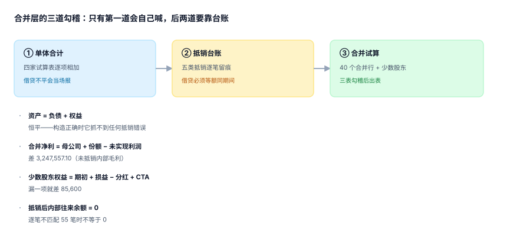

# 合并试算、三道勾稽与出表

合并试算表是这段旅程的终点站，也是所有人都会看的那张表。它的危险在于**太像真的**：行列齐整、科目熟悉、合计左右相等。而「左右相等」在合并里是最廉价的一种正确——把任何一笔抵销整笔漏掉，它依然相等。

::: tip 一句话理解
**合并不靠「试算平」验收，靠三道勾稽：单体合计 → 抵销台账 → 合并试算**。三道门各有自己的失败信号，任一失败就阻断出表；顺序不能反，因为越往后越难定位。
:::

## 一、三道勾稽，各抓什么



| 门 | 检查 | 抓什么 | 失败的典型原因 |
| --- | --- | --- | --- |
| ① 单体合计 | 每家 `借 = 贷`，且合计口径一致 | 报表包本身的错 | 某家少记一行、币种未折 |
| ② 抵销台账 | 五类抵销齐全、逐行借贷相等、幂等 | 抵销漏项与重复 | 漏商誉、跑两次、漏存货未实现 |
| ③ 合并试算 | 资产 = 负债 + 权益，且净利归属闭合 | 汇总层的错 | 少数股东比例错、CTA 未归属、映射重复 |

三门的强度递增，但**①最弱、③最强**这句话是错的。真实情况是：**① 几乎总能过（报表包本身通常是对的），② 最能抓真问题，③ 只能抓「一边有一边没有」的错**。所以工程上的顺序应当是「先跑 ②，再跑 ③，最后才看 ①」——把最弱的一门放在最后看一眼即可。

## 二、第二道门：抵销台账的四个数

| 检查 | 通过条件 | 本机读数 |
| --- | --- | --- |
| 五类规则都有分录 | 5/5 | 权益 / 往来 / 存货 / 固定资产 / 收入成本各至少 1 行 |
| 逐行借贷相等 | 每行 `abs(dr−cr) < 0.005` | 1,000 行里 6 对不平，逐行能抓、合计抓不到 |
| 幂等 | 重跑两次行数不变 | 无唯一键时 5 → 10 行 |
| 金额合计对得上 | 抵销合计 − 应抵金额 = 尾差 | 4,059,446.45 vs 4,059,446.38（+0.07） |

第三行那个「1,000 行里 6 对不平」是本机注入 1% 错误后的读数。关键在于：**如果只比「借方合计 = 贷方合计」，这 6 对里有一半会因为互相抵消而漏掉**。逐行校验不是洁癖，是唯一能定位到笔的手段。

## 三、第三道门：净利归属闭合

合并净利有一个必须成立的身份：

```text
合并净利 = 母公司净利 + 子公司净利 × 有效持股 − 未实现利润 × 有效持股
```

本机三个口径：

| 口径 | 算法 | 读数 | 差 |
| --- | --- | --- | --- |
| 逐层有效持股 | 600 万 + 240 万×80% + 100 万×56% | **8,480,000.00** | 基准 |
| 只算单层持股 | 600 万 + 240 万×80% + 100 万×70% | 8,620,000.00 | **+140,000.00** |
| 再减未实现利润份额 | 8,480,000 − 4,059,446.38×80% | **5,232,442.90** | **−3,247,557.10** |

第二行的 140,000 是「少数股东比例算错」的金额，第三行的 3,247,557.10 是「漏抵内部毛利」的金额。两个数都不影响资产负债表平衡——**它们只影响利润表**，而利润表恰恰是唯一没有「借贷必须相等」这条硬约束的报表。

::: danger 「资产 = 负债 + 权益」为什么抓不到抵销错误
因为抵销分录天然是**成对**的：漏掉一整笔，两边都不写，等式自然还成立。真实能抓错的是下面这个恒等式：

```text
合并资产 − 合并负债 = 母公司权益 + 子公司权益 × 有效持股 + CTA + 商誉 − 未实现利润
```

右边多一项少一项，左边就等不上。本机把 400 万未实现利润全部漏抵时，左边纹丝不动、右边多了 400 万——**差额出现在「权益侧」，而不是「资产负债侧」**。所以合并试算必须按「资产负债表 / 利润表 / 权益变动表」三张分别勾稽，只用一张表去验证，等于放弃了三分之二的信号。
:::

## 四、合并试算表的结构

```sql
CREATE TABLE gr_cons_tb (
  period    TEXT NOT NULL,
  cons_line TEXT NOT NULL,
  amount    NUMERIC(18,2) NOT NULL,
  stage     TEXT NOT NULL CHECK (stage IN ('sum','elim','final')),  -- 加总/抵销后/最终
  PRIMARY KEY (period, cons_line, stage)
);
```

`stage` 那一列是[总览](../Overview/index.md)里「三个合并数必须分开存」的落地：同一期间同一合并行留三份快照，差额才可解释。

| stage | 含义 | 与前一列的差 |
| --- | --- | --- |
| `sum` | 四家单体直接相加 | 基准 |
| `elim` | 加总 − 抵销 | 差的绝对值 = 抵销总额 |
| `final` | `elim` + 折算重述 − 少数股东 | 差的绝对值 = 折算与归属调整 |

有了这三行，任何一个合并行的金额都能回答「它怎么来的」；只有 `final` 一行的系统，永远只能回答「它就是这么多」。

## 五、出表前的八项检查

| 项 | 检查 | 失败处理 |
| --- | --- | --- |
| 1 | 三家单体包 `closed` | 阻断 |
| 2 | 映射覆盖 100% | 阻断 |
| 3 | 三组汇率齐备 | 阻断 |
| 4 | 五类抵销齐全 | 阻断 |
| 5 | 逐行借贷相等 | 阻断 |
| 6 | 抵销后内部往来 = 0 | 阻断 |
| 7 | 少数股东损益 + 母公司损益 = 合并净利 | 阻断 |
| 8 | 资产 = 负债 + 权益 且 CTA 已归属 | 警告 + 说明 |

第 8 项刻意定为「警告」而不是「阻断」：它是构造性恒等式，只要前七项都对，它一定成立；它不平说明前七项里有没被检查到的东西，需要人看，而不是机器拦。

## 六、比较期与重述

合并报表要出两期（本期 + 上期）。上期数在三种情况下会变：

1. **合并范围变了**（新增/处置子公司）→ 上期不重述，只在附注说明「本期与上期不可比」。
2. **会计政策变了** → 上期重述，且要重算抵销（用新政策重跑一遍上期）。
3. **发现前期差错** → 追溯重述，走「以前年度损益调整」。

三种处理在系统里对应三个不同动作，混用会让「上期数」既不是原始值也不是重述值。判据 `GRT-G` 要求：重述必须留版本，且原值与重述值都可查。

## 判据

本页判据族 `GRT-A` ~ `GRT-H`，共 8 条，逐条可判定：

| 编号 | 判据 | 怎么判 |
| --- | --- | --- |
| `GRT-A` | 合并试算按 `sum / elim / final` 三阶段各存一份 | 三行齐备，缺一即不通过 |
| `GRT-B` | 三道勾稽按「台账 → 勾稽 → 试算」顺序执行，任一失败阻断出表 | 执行日志含顺序与结果 |
| `GRT-C` | 抵销台账逐行校验借贷相等，不只看合计 | 逐行校验的失败行数 = 0 |
| `GRT-D` | 合并净利 = 母公司 + 份额 − 未实现利润份额，差额 < 0.005 | 恒等式校验 |
| `GRT-E` | 抵销后内部往来余额（分主体对）为 0 | 逐对校验 |
| `GRT-F` | 少数股东损益 + 母公司损益 = 合并净利润 | 合计校验 |
| `GRT-G` | 比较期重述有版本，原值与重述值都可查 | 重述表含 `version` 与 `reason` |
| `GRT-H` | 出表动作幂等：同期间重跑，合并试算 `diff` 为空 | 重跑比对 |

## 验证方式

```shell
# 1) 三个净利口径与两个差额
python3 - <<'PY'
pp, ap, cp = 6_000_000, 2_400_000, 1_000_000
m1 = pp + ap*0.8 + cp*0.56
m3 = pp + ap*0.8 + cp*0.70
unreal = 54_125_951.67*0.30*0.25
print("逐层份额 =", m1, "| 只算单层 =", m3, "| 差 =", m3-m1)
print("再减未实现利润份额 =", round(m1 - unreal*0.8, 2), "| 差 =", round(unreal*0.8, 2))
print("资产=负债+权益 差 =", 48_200_000 - 26_400_000 - 21_800_000, "（构造正确时恒为 0）")
PY

# 2) 出表门必须按顺序执行（台账失败时不进入试算）
python3 /tmp/cons_practice.py 2>/dev/null | grep -E '^C[1-5]|^NEGATIVE|^EXIT'
```

预期输出：第一条打印 `逐层份额 = 8480000.0 | 只算单层 = 8620000.0 | 差 = 140000.0`，第二行 `再减未实现利润份额 = 5232442.9 | 差 = 3247557.1`，第三行 `差 = 0`；第二条打印 `C1`~`C5` 五项读数与 `NEGATIVE 5/5`、`EXIT=0`。

## 参考资料

- [抵销分录引擎与抵销台账](../Elimination/index.md)
- [少数股东权益与超额亏损](../Minority/index.md)
- [实战：10 张表跑通一个月的合并](../Practice/index.md)
- IFRS 10 附录 B——合并程序与一致会计政策：<https://www.ifrs.org/issued-standards/list-of-standards/ifrs-10-consolidated-financial-statements/>
- IAS 8《Accounting Policies, Changes in Accounting Estimates and Errors》——重述的口径：<https://www.ifrs.org/issued-standards/list-of-standards/ias-8-accounting-policies-changes-in-accounting-estimates-and-errors/>
