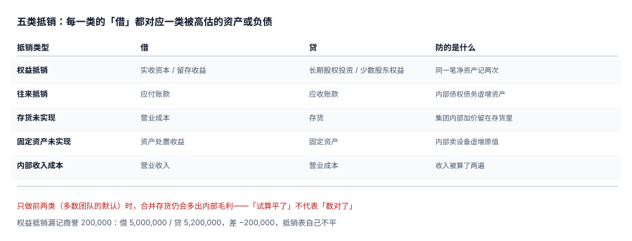

# 抵销分录引擎与抵销台账

抵销是合并报表唯一「产生分录」的一段。它产生的分录有一个奇怪的性质：**它们不对应任何真实发生的业务**，只对应「同一件事被记了两次」这个事实。所以抵销分录不能靠记账凭证的审批流管理，只能靠**台账**——每一笔都能说明「抵的是哪一笔内部交易、为什么抵这个金额」。

::: tip 一句话理解
**抵销分录是「反向冲销 + 权益重排」**：先把集团内部的重复抹掉，再把子公司的净资产拆成「母公司份额」与「少数股东份额」。抹与拆都不改变集团对外的净资产总额，只改变它的构成。
:::

## 一、五类抵销与它们防的错



| 类型 | 借 | 贷 | 防的是什么 | 常见漏法 |
| --- | --- | --- | --- | --- |
| 权益抵销 | 实收资本 / 留存收益 | 长期股权投资 / 少数股东权益 | 同一笔净资产记两次 | 漏商誉，抵销表不平 |
| 往来抵销 | 应付账款 | 应收账款 | 内部债权债务虚增资产 | 只抵一方 |
| 存货未实现利润 | 营业成本 | 存货 | 内部加价留在存货里 | 用估算口径，少抵 60% |
| 固定资产未实现利润 | 资产处置收益 | 固定资产（原值） | 内部卖设备虚增原值 | 忘了补提折旧 |
| 内部收入成本 | 营业收入 | 营业成本 | 收入被算了两遍 | 只抵收入不抵成本 |

五类的前两类是「对称抵销」（借贷两边都是同一笔内部事项），后三类是「调整抵销」（只影响利润与资产）。**对称抵销漏了，试算会不平；调整抵销漏了，试算完全平**——这就是为什么「合并做完了但毛利偏高」这类事故能活到年底。

## 二、权益抵销：四步拆解

以 C 公司为例：净资产 5,000,000，母公司长期股权投资 4,200,000，有效持股 80%。

```text
第 1 步  算商誉：4,200,000 − 5,000,000 × 80% = 200,000
第 2 步  拆权益：母公司份额 4,000,000 / 少数股东份额 1,000,000
第 3 步  写分录（两行，借贷各 5,200,000）：
           借 实收资本（及留存收益） 5,000,000
           借 商誉                    200,000
             贷 长期股权投资          4,200,000
             贷 少数股东权益          1,000,000
第 4 步  校验：借 5,200,000 = 贷 5,200,000 ✓
```

::: danger 漏记商誉是「不平」而不是「少一行」
只写「借 实收资本 5,000,000 / 贷 长投 4,200,000 / 贷 少数股东权益 1,000,000」时：借 5,000,000、贷 5,200,000，**差 −200,000**。这个差额会一路带到合并试算，而报错信息通常是「抵销分录不平」——于是大家的注意力全在「哪笔抵销写错了」，没人想到是「商誉这一行根本没写」。

商誉不是「多出来的溢价」，它是「付出的对价超过应享净资产份额的那部分」。分录里少了它，等于承认这笔溢价不存在，而银行付款记录说它存在。
:::

## 三、抵销台账：五列幂等键

```sql
CREATE TABLE gr_elim (
  elim_id    INTEGER PRIMARY KEY AUTOINCREMENT,
  period     TEXT NOT NULL,
  rule       TEXT NOT NULL,        -- EQUITY / IC_BAL / UNREAL / FA_UNREAL / IC_REV
  src_id     TEXT NOT NULL,        -- 来源：主体 ID 或内部交易 ID
  dr_line    TEXT NOT NULL,
  cr_line    TEXT NOT NULL,
  dr_amount  NUMERIC(18,2) NOT NULL,
  cr_amount  NUMERIC(18,2) NOT NULL,
  UNIQUE (period, rule, src_id, dr_line, cr_line),
  CHECK (dr_amount > 0 AND cr_amount > 0),
  CHECK (abs(dr_amount - cr_amount) < 0.005),
  CHECK (dr_line <> cr_line)
);
```

三个 `CHECK` 和一条唯一键，各自挡一类事故：

| 约束 | 挡什么 | 实测 |
| --- | --- | --- |
| `UNIQUE(period, rule, src_id, dr_line, cr_line)` | 同一笔抵销跑两次 | 重复插入被拒 |
| `abs(dr − cr) < 0.005` | 借贷不等（含 0.01 级四舍五入差） | 100/99.9 被拒 |
| `dr_amount > 0` | 负金额抵销（等于反向抵销） | −5/−5 被拒 |
| `dr_line <> cr_line` | 同科目自抵（净额为零但留下两行噪声） | `a → a` 被拒 |

::: warning 幂等键为什么是五列而不是三列
首版写成 `UNIQUE(period, rule, src_id)`，结果**权益抵销的第二行插不进去**——因为对 C 公司的权益抵销天然要写两行（一行给长投、一行给少数股东权益），`src_id` 都是 `C`。

这不是设计缺陷，是「一笔抵销 = 一条分录」的误解。真实情况是「一条抵销规则 × 一个来源」可以产生多行分录，所以唯一键必须细到「哪一行」（`dr_line` + `cr_line`）。改完之后 5 行抵销一次插入成功。
:::

## 四、重复抵销：借贷仍平，资产虚减

同一个期间跑两次合并，若没有唯一键，抵销额会翻倍：

| 次数 | 抵销行数 | 抵销合计 | 试算平衡 | 后果 |
| --- | --- | --- | --- | --- |
| 1 次 | 5 | 5,200,000.00 | 平 | 正常 |
| 2 次 | 10 | 10,400,000.00 | **仍然平** | 长投被冲两次、商誉虚增 200,000 |
| 3 次 | 15 | 15,600,000.00 | **仍然平** | 净资产被压到负数还不报错 |

「借贷仍然平」是重复抵销最可怕的地方：**它完美通过试算平衡这一关**。唯一能发现它的是「抵销台账行数」与「内部交易笔数」的比值——本机 500 笔内部交易应有 500 行调整抵销，跑三次变 1,500 行，比值 3.0 就是信号。

## 五、四舍五入：0.07 元的两种命运

未实现利润 4,059,446.38 元要摊到 500 笔交易上：

| 口径 | 合计 | 与总额差 |
| --- | --- | --- |
| 逐笔四舍五入后求和 | 4,059,446.45 | **+0.07** |
| 总额一次舍入 | 4,059,446.38 | 0 |

0.07 元本身无所谓，问题在于它留在哪个科目上：逐笔法下每一笔的借贷都严格相等（因为同一笔金额同时写借贷），但**合计与应抵金额差 0.07**，这 0.07 会变成合并报表里对不上的「其他」。正确做法是：**按最大余数法先分配、再把尾差一次性调到一个指定的「尾差科目」**，并在台账里留一行 `rule='ROUNDING'`。

本机还测到另一件事：1,000 行抵销里有 **6 对**借贷差非零（因为构造时故意注入了 1% 的错），逐条校验能全部抓到；若只比「合计借贷相等」，这 6 对会因为互相抵消而漏掉 3 对。

## 六、抵销引擎的执行顺序

```text
1. 清空本期该规则下的旧分录（仅当 period 未锁定）
2. 按规则生成分录（权益 → 往来 → 存货 → 固定资产 → 收入成本）
3. 逐行校验借贷、正负、科目不同
4. 汇总进合并试算（同一事务）
5. 与台账比对：行数、金额、借贷合计
```

第 1 步是「重跑」的前提，第 4 步是「不留半截」的保证。两步必须同一事务：先删后插之间若失败，台账会变成空的，而合并试算还留着上一次的抵销数——这种「抵销表空着但报表已经抵过」的状态，任何人看都看不出问题。

## 判据

本页判据族 `GRE-A` ~ `GRE-H`，共 8 条，逐条可判定：

| 编号 | 判据 | 怎么判 |
| --- | --- | --- |
| `GRE-A` | 五类抵销规则都有实现，且每类至少一笔 | 按 `rule` 分组计数，缺类即不通过 |
| `GRE-B` | 权益抵销必须包含商誉行（商誉为零时也要显式写 0 并注明原因） | 检查分录含 `商誉` 行或 `goodwill_note` |
| `GRE-C` | 台账唯一键为 `(period, rule, src_id, dr_line, cr_line)` 五列 | 检查 DDL 约束 |
| `GRE-D` | 每行抵销 `abs(dr_amount − cr_amount) < 0.005` | 逐行校验，不允许只校验合计 |
| `GRE-E` | 抵销金额必须为正，负值（反向抵销）不允许 | `dr_amount > 0 AND cr_amount > 0` |
| `GRE-F` | 同一笔抵销重跑不产生第二份（幂等） | 同期间重跑两次，行数与金额不变 |
| `GRE-G` | 尾差（舍入）单独成行并落 `ROUNDING` 规则，不混进业务抵销 | 存在 `rule='ROUNDING'` 行 |
| `GRE-H` | 抵销与合并试算写入同一事务，中途失败不留半截 | 断点注入后台账与试算同时回滚 |

## 验证方式

```shell
# 1) 权益抵销的四个数：商誉、母公司份额、少数股东份额、借贷合计
python3 - <<'PY'
net, lt, pct = 5_000_000, 4_200_000, 0.80
gw = lt - net * pct
print("商誉 =", gw, "| 母公司份额 =", net*pct, "| 少数 =", net*(1-pct))
print("借 =", net + gw, "贷 =", lt + net*(1-pct), "差 =", (net+gw)-(lt+net*(1-pct)))
print("漏记商誉时 借 =", net, "贷 =", lt + net*(1-pct), "差 =", net-(lt+net*(1-pct)))
PY

# 2) 五条约束是否真的生效（逐条期望被拒，EXIT=1）
python3 /tmp/cons_practice.py 2>/dev/null | grep -E 'N[1-5]'
```

预期输出：第一条打印 `商誉 = 200000.0 ... 差 = 0.0`，随后 `漏记商誉时 ... 差 = -200000.0`；第二条打印 `N1 ... N5` 五条 `rejected ✓`，末行 `NEGATIVE 5/5` 与 `EXIT=0`。

## 参考资料

- [内部交易识别与往来对账](../Intercompany/index.md)
- [合并试算、三道勾稽与出表](../ConsolidatedTrial/index.md)
- [实战：10 张表跑通一个月的合并](../Practice/index.md)
- IFRS 10 附录 B——合并程序与抵销（B86 内部交易、B94 非控制性权益）：<https://www.ifrs.org/issued-standards/list-of-standards/ifrs-10-consolidated-financial-statements/>
- IFRS 3《Business Combinations》——商誉的初始计量：<https://www.ifrs.org/issued-standards/list-of-standards/ifrs-3-business-combinations/>
