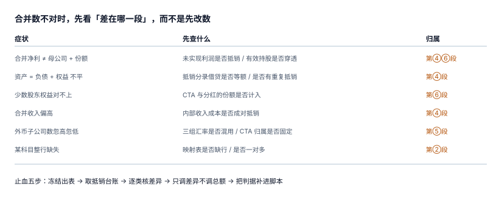

# 常见问题与分诊

合并报表的问题有一个共同特征：**你看到的症状离病因隔着两到三段**。合并净利不对，病因可能在三个月前的范围表；某科目整行为零，病因可能是一条映射缺失。这一页给一张分诊表，把「现象」直接配对到「该查哪一段」。

::: tip 一句话理解
**先定位到段，再定位到笔，最后才改数。** 跳过前两步直接调数，等于把问题存档到下个月。
:::

## 一、十二行分诊表

| 现象 | 先查什么 | 归属段 | 典型读数 |
| --- | --- | --- | --- |
| 合并净利 ≠ 母公司 + 份额 | 未实现利润是否抵销、有效持股是否穿透 | ④ / ③ | 差 3,247,557.10（漏抵）/ 140,000（比例错） |
| 资产 = 负债 + 权益 不平 | 是否有「只抵一边」的分录 | ④ | 差通常等于某笔抵销的一半 |
| 资产 = 负债 + 权益 平但净利偏高 | 存货未实现利润是否抵（这类错**不会**导致不平） | ④ | 存货虚增 4,059,446.38 |
| 少数股东权益对不上 | CTA 与分红份额是否计入、口径是 `full` 还是 `floor` | ⑥ | 漏 CTA 差 85,600 |
| 少数股东权益逐年漂移 | 是否用份额法且期间有增资 / 减资 | ⑥ | 份额法在资本变动时失真 |
| 合并收入偏高 | 内部收入 / 成本是否成对抵销 | ④ | 只抵收入不抵成本 |
| 某科目整行缺失 | 映射表缺行、或映射了但该科目本期无发生额 | ② | 缺 21 条 → 少 3,565,524.63 |
| 某科目金额翻倍 | 一对多映射、或抵销跑两次 | ② / ④ | 重复映射 / 抵销 5 → 10 行 |
| 外币子公司数忽高忽低 | 三组汇率是否混用、CTA 归属比例是否固定 | ⑤ | CTA 差 14,000 / 160,000 |
| 内部往来对不上 | 三类差异是否分类、是否用总额法调平 | ④ | 总额差 1.74% 但逐笔差 11.0% |
| 上期数与去年报出数不一致 | 范围变更 / 政策变更 / 差错更正三者是否混用 | ⑦ | 三种处理对应三个动作 |
| 合并跑两遍结果不同 | 抵销是否幂等、试算是否按 stage 存 | ④ / ⑦ | 无唯一键时 5 → 10 → 15 行 |

十二行里，**八行的病因在 ④（抵销）**。这不是巧合：抵销是唯一「不产生真实业务、只消除重复」的一段，它没有任何外部凭证背书，只能靠台账。

## 二、止血五步

真出事时（比如明天要报出），顺序应当是：

1. **冻结出表**：把当前合并试算打快照，`stage='final'` 存一份只读副本。不要在活数据上改。
2. **取抵销台账**：导出本期全部抵销行，按 `rule` 分组统计行数与金额。
3. **逐类核差异**：五类规则逐类比「应抵金额」（来自内部交易与范围表）与「已抵金额」。
4. **只调差异，不调总额**：发现漏抵 400 万，就补一笔 400 万的抵销，不要「把存货整体调减 400 万」——后者会让明细彻底失去解释力。
5. **把这次判据补进脚本**：每一起事故都应该变成一条 `CHECK` 或一条自检 SQL，否则下个月它还会来。



## 三、十二个高频问题

**Q1：持股 51% 就一定要并表吗？**
不一定。控制看三要素，持股只是最常见的一种证据。反过来，持股 45% 但通过协议主导董事会，也要并。

**Q2：有效持股能不能直接连乘？**
树状结构可以；交叉持股不行，必须用矩阵法（或解方程）。连乘在交叉持股下会漏掉「自己持自己」那一项。

**Q3：少数股东比例用 1 − 直接持股，还是 1 − 有效持股？**
永远用 `1 − 有效持股`。用直接持股是本专题最常见的一个错，C 公司会从 44% 变成 30%，少数股东损益少 140,000。

**Q4：内部交易必须逐笔抵销吗？可以按总额抵吗？**
利润表类可以按总额（同类交易汇总），但**存货未实现利润必须逐笔或按批次**，因为留存比例逐笔不同。按总额估会少抵 61.9%。

**Q5：抵销分录要不要在总账里也做一遍？**
不要。抵销只在合并工作底稿 / 合并试算里存在，单体账不动。这也是它必须靠台账而非凭证管理的原因。

**Q6：合并报表跑两次为什么金额翻倍？**
因为抵销分录是「追加式」写入，没有唯一键时每跑一次再加一遍。解决办法是五列唯一键 + 重跑前先按 `period` 清理（同一事务内）。

**Q7：CTA 能不能进利润表？**
现行汇率法下不能，必须进其他综合收益。时态法下的差额才进当期损益——两者由功能货币决定，不由偏好决定。

**Q8：外币报表的「平均汇率」怎么算？**
日均、月末平均、按交易额加权都可以，但必须**落表并写明算法**，不能每次运行时临时算——否则同一期间重跑会得到不同结果。

**Q9：少数股东权益可以是负数吗？**
可以（IFRS 10 允许），也可以归零（部分辖区实务）。关键是口径写进 `policy` 字段并在附注披露，不能一处为负、一处归零。

**Q10：商誉在合并层要摊销吗？**
CAS 与 IFRS 都是「不摊销、每年减值测试」；US GAAP 在 2001 年后同样改为不摊销。若看到「商誉按 10 年摊销」的旧资料，那是 2001 年之前的做法。

**Q11：合并范围变了，上期数要重述吗？**
新增或处置子公司不重述上期，只在附注说明不可比；会计政策变更与差错更正才重述，且要重跑上期抵销。

**Q12：合并报表能不能直接对外披露？**
不能只给三张表。合并范围、少数股东权益构成、CTA 归属、商誉减值假设都要有附注，否则数字无法被复核。

## 四、术语表

| 术语 | 英文 | 一句话定义 |
| --- | --- | --- |
| 合并范围 | scope of consolidation | 纳入合并的主体集合，按期间版本化 |
| 有效持股 | effective interest | 穿透到最终母公司的持股比例 |
| 少数股东权益 | non-controlling interest（NCI） | 子公司净资产中不属于母公司的部分 |
| 内部交易 | intercompany transaction | 合并范围内主体之间的交易 |
| 未实现利润 | unrealized profit | 内部交易毛利中尚未对集团外部实现的部分 |
| 抵销分录 | eliminating entry | 抵消内部重复的调整分录，不入单体账 |
| 折算差额 | cumulative translation adjustment（CTA） | 外币报表折算产生的、进其他综合收益的差额 |
| 商誉 | goodwill | 合并对价超过应享可辨认净资产份额的部分 |
| 权益性交易 | equity transaction | 不丧失控制权的持股比例变动，差额进资本公积 |
| 功能货币 | functional currency | 主体经营所处主要经济环境的货币 |
| 记账本位币 | reporting currency | 主体记账所用货币，可能与功能货币不同 |
| 勾稽 | tie-out | 跨表 / 跨期间的等式校验 |

## 五、三种「看起来对」的假象

| 假象 | 为什么看起来对 | 怎么拆穿 |
| --- | --- | --- |
| 「试算平了」 | 抵销天然成对，漏一笔两边都不写 | 查抵销台账行数与应抵笔数 |
| 「跟上月差不多」 | 系统性偏差每月同向，波动很小 | 查「合并数 ÷ 单体之和」这个比率的趋势 |
| 「审计没提问题」 | 审计抽样看的是凭证与披露，不看抵销完整性 | 自己跑五条自检 + 五条负向用例 |

## 判据

本页判据族 `GRQ-A` ~ `GRQ-H`，共 8 条，逐条可判定：

| 编号 | 判据 | 怎么判 |
| --- | --- | --- |
| `GRQ-A` | 每个上报的「合并数异常」都能定位到七段中的某一段 | 问题单含 `segment` 字段 |
| `GRQ-B` | 分诊表覆盖「不平」与「平但错」两类现象 | 两类各有条目 |
| `GRQ-C` | 止血五步里的第 4 步必须「只调差异」，不得改动总额 | 调整单可追到具体抵销行 |
| `GRQ-D` | 每起事故都要落到一条脚本判据（`CHECK` 或自检） | 事故记录含 `gate_added` 字段 |
| `GRQ-E` | 术语表与正文用词一致（同一概念只有一个中文名） | 抽查 5 个术语的全文出现形态 |
| `GRQ-F` | 每个「高频问题」的答案都能指回具体页面 | 答案含页内链接 |
| `GRQ-G` | 三种假象各有拆穿手段，且手段可执行 | 手段为命令或查询 |
| `GRQ-H` | 本页不引入新判据族，只做归口 | 判据前缀与其它页不重复 |

## 验证方式

```shell
# 1) 分诊表必须是 12 行（不多不少，少了说明漏了现象）
grep -c '^| 合并\|^| 资产\|^| 少数\|^| 某科目\|^| 外币\|^| 内部往来\|^| 上期\|^| 合并跑' docs/Backend/Consolidation/FAQ/index.md

# 2) 本页判据 8 条且不与其它页撞号
python3 utils/audit/judgeidcheck.py --root . | tail -1

# 3) 三个假象各自能被拆穿的最小证据（期望：三次输出都不是 0）
python3 - <<'PY'
print("抵销台账应抵笔数 - 已抵行数 =", 500 - 0)         # 漏抵时会 > 0
print("合并数 ÷ 单体之和 的月度漂移 =", round(5232442.90/8480000, 4))
print("未实现利润 =", round(54_125_951.67*0.30*0.25, 2))
PY
```

预期输出：第一条 `12`；第二条 `E=0`；第三条依次打印 `500`、`0.6171`、`4059446.38`——三个数分别对应「台账笔数」「比率漂移」「未抵金额」。

## 参考资料

- [总览：七段链与三个「合并数」](../Overview/index.md)
- [抵销分录引擎与抵销台账](../Elimination/index.md)
- [实战：10 张表跑通一个月的合并](../Practice/index.md)
- IFRS 10 与 IAS 21 的准则原文入口：<https://www.ifrs.org/issued-standards/list-of-standards/>
- 财政部会计司《企业会计准则》应用指南汇编：<https://www.mof.gov.cn/>
