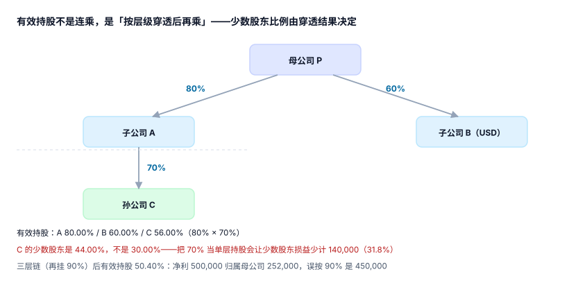

# 合并范围、控制与有效持股

合并范围这个问题，会计教材会用「控制」两个字概括，工程上却必须回答三个可判定的小问题：**谁被并进来**、**并进来多少**、**什么时候开始和停止并**。三个问题里任何一个答错，后面六段的全部计算都会在一个错误的范围上精确运行。

::: tip 一句话理解
**合并范围不是「持股超过 50% 的公司列表」，而是「我能决定它的经营、能拿走它的可变回报、且这两件事有因果关系」的主体集合**；有效持股则是这个集合里每个主体「归母公司多少」的那个小数。
:::

## 一、控制的三要素与它们的证据

| 要素 | 含义 | 落成什么证据 | 最常见的假证据 |
| --- | --- | --- | --- |
| 权力 | 主导被投资方的相关活动 | 董事会席位、表决权协议、关键人事任免权 | 「我们派了财务总监」——不能主导经营 |
| 可变回报 | 享有或承担随业绩波动的回报 | 分红权、管理费、超额收益分成 | 「按成本法确认投资收益」——那只是会计结果 |
| 联系 | 用权力影响回报金额 | 权力与回报指向同一主体 | 两块业务各自独立，却按同一份协议并表 |

三要素必须**同时**成立，缺一条就不是控制。工程上不要用「持股 ≥ 50%」当唯一判据——那只是最常见的一种情形，不是定义。

::: warning 「控制」与「持股比例」是两件事
持股 45% 但通过协议控制董事会，属于控制；持股 55% 但表决权被一致行动协议锁定在别人手里，可能不构成控制。范围表里必须有一列 `control_basis`（`voting` / `agreement` / `de_facto` / `structured`），把「凭什么并」写下来——不然三年后没人能复核。
:::

## 二、有效持股：连乘不是「大概对」，是唯一对

一个三层结构：母公司 P 持子公司 A 80%，A 持孙公司 C 70%，C 再持 D 90%。



| 主体 | 直接持股（上一层） | 有效持股（穿透到 P） | 少数股东比例 |
| --- | --- | --- | --- |
| A | 80% | 80.00% | 20.00% |
| B | 60% | 60.00% | 40.00% |
| C | 70% | 80% × 70% = **56.00%** | **44.00%** |
| D | 90% | 80% × 70% × 90% = **50.40%** | 49.60% |

两个数字必须先分清，混用会直接改变利润归属：

- **把三层直接持股相加**（80 + 60 + 70 = 210%）是纯粹的算术错误，但它在 Excel 里「看起来像合计」。
- **把 C 的少数股东按 30% 算**（1 − 70%）是最常见的错法：只看了 A 对 C 的那一层，忘了 A 自己只有 80% 属于 P。

本机读数：C 净利 1,000,000 时，正确的少数股东损益是 **440,000**，按 30% 算是 **300,000**，差 **140,000（31.8%）**。D 净利 500,000 时，归属母公司 **252,000**，误按 90% 是 **450,000**，差 **198,000**。这两个差额都不会让报表不平，只会让「归属母公司净利润」这一行悄悄变好看。

## 三、有效持股的算法：矩阵法而不是递归乘法

两层结构可以用乘法手算，五层 + 交叉持股就必须用矩阵。原因很直接：**交叉持股会让「连乘」出现环**——A 持 B 30%、B 持 A 20% 时，A 对 A 的有效持股不是 0，而是要通过解方程得到。

```python
# 有效持股：把「直接持股矩阵」变换成「最终归属矩阵」
# own[i][j] = i 直接持有 j 的比例（不含自己）
def effective(own, entities, parent, eps=1e-12, max_iter=100):
    n = len(entities)
    idx = {e: i for i, e in enumerate(entities)}
    # E = own + own @ own + own^2 @ own ... 收敛于 (I - own)^-1 - I
    E = [row[:] for row in own]
    for _ in range(max_iter):
        nxt = [[sum(E[i][k] * own[k][j] for k in range(n)) for j in range(n)]
               for i in range(n)]
        delta = max(abs(nxt[i][j] - E[i][j]) for i in range(n) for j in range(n))
        E = [[E[i][j] + nxt[i][j] for j in range(n)] for i in range(n)]
        if delta < eps:
            break
    return {e: E[idx[parent]][idx[e]] for e in entities if e != parent}
```

对「无环」的树状结构，矩阵法与连乘结果**必须完全一致**——这是最好的单元测试：拿四层树跑一遍，两种算法差超过 `1e-9` 就说明矩阵写错了。

::: danger 三个常见实现错误
1. **用浮点数存比例**：`0.8 * 0.7 = 0.5600000000000001`，累计到第五层会出现「少数股东比例 43.99999999%」。比例请在库里存 `NUMERIC(9,6)`，展示时再格式化。
2. **把「直接持股」当「有效持股」写进抵销分录**：权益抵销要拆成「归属母公司」与「归属少数股东」两行，用错比例会让两行之和仍等于净资产——**抵销照样平**，只是归属全错了。
3. **忽略库存股与相互持股**：子公司持有母公司股份时，这部分要按库存股处理，不计入有效持股分母。
:::

## 四、范围变更：三种情形，三套处理

| 情形 | 判定 | 处理 | 踩坑点 |
| --- | --- | --- | --- |
| 新增子公司 | 本期取得控制 | 购买法：可辨认净资产按公允价值，差额进商誉 | 只并「取得日之后」的损益，不是全年 |
| 处置子公司 | 丧失控制 | 剩余股权按公允价值重估，差额进投资收益 | 处置日前的损益仍要并，处置日后的不并 |
| 持股比例变动但未丧失控制 | 80% → 70% | **权益性交易**：差额调资本公积，不进损益 | 误按处置处理，虚增投资收益 |

第三种最容易错：把「卖 10% 但还控制」当成「处置」，会在利润表上凭空造出一笔收益，而集团的资产与负债一分没变。判据 `GRM-F` 要求「未丧失控制的股权变动，损益表变动为 0」——这条能被一条 SQL 直接验证。

## 五、范围表长什么样

范围不是一个列表，是一张带期间的版本表。核心列：

```sql
CREATE TABLE gr_entity (
  entity_id      TEXT PRIMARY KEY,
  name           TEXT NOT NULL,
  parent_id      TEXT REFERENCES gr_entity(entity_id),
  pct            NUMERIC(9,6) NOT NULL CHECK (pct > 0 AND pct <= 1),  -- 直接持股
  currency       TEXT NOT NULL,        -- 记账本位币
  func_currency  TEXT NOT NULL,        -- 功能货币（可能不同）
  control_basis  TEXT NOT NULL CHECK (control_basis IN
                   ('voting','agreement','de_facto','structured')),
  valid_from     DATE NOT NULL,
  valid_to       DATE,                 -- NULL = 仍在使用
  CHECK (valid_to IS NULL OR valid_to > valid_from)
);
```

`valid_from / valid_to` 是范围表的灵魂：合并 2026 年 6 月，必须取「6 月期间内有效」的那一版范围，而不是「现在这一版」。用当前范围重算历史期间，是「合并数每年都在变」的头号原因。

## 六、范围与「能不能并」的两个边界

- **共同控制与重大影响不进合并范围**：合营（joint venture）与联营（associate）用权益法，只调「长期股权投资」一行，不做逐项抵销。判断依据是 [CAS 2 / IAS 28](https://www.ifrs.org/issued-standards/list-of-standards/ias-28-investments-in-associates-and-joint-ventures/)。
- **结构化主体（SPV）要实质判断**：持股可能只有 5%，但若承担了绝大部分可变回报且能主导相关活动，仍要并表。这一条在工程上没法自动化，只能靠 `control_basis='structured'` + 一段书面判断留痕。

## 判据

本页判据族 `GRM-A` ~ `GRM-H`，共 8 条，逐条可判定：

| 编号 | 判据 | 怎么判 |
| --- | --- | --- |
| `GRM-A` | 每个并表主体都有 `control_basis`，且不是默认值 | 统计 `control_basis` 分布，全为 `voting` 时要求书面说明 |
| `GRM-B` | 合并范围按期间版本化，历史期间可重放 | 范围表带 `valid_from/valid_to`，按期间查询命中唯一版本 |
| `GRM-C` | 有效持股按穿透计算，且与直接持股分列 | 存在 `pct_direct` 与 `pct_effective` 两列，且 `pct_effective ≤ pct_direct` 链上成立 |
| `GRM-D` | 少数股东比例 = 1 − 有效持股，全集团合计校验 | `sum(1 - pct_effective)` 与少数股东权益表逐主体一致 |
| `GRM-E` | 新增子公司只并「取得日之后」的损益 | 损益按天数或按取得日切分，切分点落表 |
| `GRM-F` | 未丧失控制的股权变动，损益影响为 0 | 变动前后合并净利 `diff = 0`，差额进资本公积 |
| `GRM-G` | 交叉持股用矩阵法求解，且树状结构下与连乘一致 | 两种算法结果差 < `1e-9` |
| `GRM-H` | 结构化主体的并表判断有留痕（不是靠持股比例） | 存在判断记录，含判断人、日期、依据 |

## 验证方式

```shell
# 1) 树状结构下「矩阵法」与「连乘」必须一致
python3 - <<'PY'
from decimal import Decimal as D
p = {"A": D("0.80"), "B": D("0.60"), "C": D("0.80")*D("0.70"), "D": D("0.80")*D("0.70")*D("0.90")}
print({k: f"{v*100:.2f}%" for k, v in p.items()})
print("C 的少数股东 =", f"{(1-p['C'])*100:.2f}%")
print("C 净利 1,000,000 的少数股东损益 =", 1000000*(1-p["C"]))
PY

# 2) 范围表必须支持按期间回放（同一主体两版范围，取当期那版）
sqlite3 :memory: "CREATE TABLE gr_entity(entity_id TEXT, valid_from TEXT, valid_to TEXT, pct REAL);
INSERT INTO gr_entity VALUES('C','2026-01-01','2026-06-30',0.70),('C','2026-07-01',NULL,0.60);
SELECT pct FROM gr_entity WHERE '2026-05-15' BETWEEN valid_from AND coalesce(valid_to,'9999-12-31');"
```

预期输出：第一条打印 `A 80.00% / B 60.00% / C 56.00% / D 50.40%`，随后 `C 的少数股东 = 44.00%`、`440000.0000`；第二条输出 `0.7`（取到 5 月生效的那一版，而不是 0.6）。

## 参考资料

- [总览：七段链与三个「合并数」](../Overview/index.md)
- [报表包、科目映射与关账](../ReportingPackage/index.md)
- [少数股东权益与超额亏损](../Minority/index.md)
- IFRS 10《Consolidated Financial Statements》——控制三要素：<https://www.ifrs.org/issued-standards/list-of-standards/ifrs-10-consolidated-financial-statements/>
- IAS 28《Investments in Associates and Joint Ventures》——权益法范围：<https://www.ifrs.org/issued-standards/list-of-standards/ias-28-investments-in-associates-and-joint-ventures/>
- 财政部《企业会计准则第 33 号——合并财务报表》（2014 修订）：<https://www.mof.gov.cn/>
