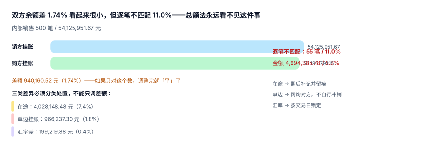

# 内部交易识别与往来对账

内部交易是合并报表里唯一「**必须靠证据而不是靠科目**」才能识别的对象。同一个「营业收入」科目里，既有卖给外部客户的，也有卖给兄弟公司的；从科目上看不出区别，从金额上看不出区别，只有交易对手能说明它是谁。

::: tip 一句话理解
**内部交易对账不是「核对总额差多少」，而是「逐笔配成对」**：总额差 1.74% 可以靠一笔调整抹平，逐笔差 11% 却意味着有 55 笔交易只存在于一方账上——而那 55 笔正是抵销会漏掉的部分。
:::

## 一、五类内部交易与它们的抵销对象

| 类型 | 例子 | 抵销什么 | 会不会留到期末 |
| --- | --- | --- | --- |
| 内部销售（存货） | P 卖原料给 A | 收入 / 成本 / 未实现利润 | 期末存货里会留一部分 |
| 内部销售（固定资产） | P 卖设备给 A | 处置收益 / 原值 / 累计折旧 | 留到设备处置为止 |
| 内部服务 | 总部向子公司收管理费 | 其他业务收入 / 管理费用 | 不留 |
| 内部资金 | 集团资金池拆借 | 利息收入 / 利息支出 | 不留（余额要抵） |
| 内部往来余额 | 应收 / 应付、其他应收 / 其他应付 | 债权 / 债务 | 期末必留 |

前四类影响利润表，第五类影响资产负债表。它们的识别入口不同：**前四类看单据（发票、结算单），第五类看余额（往来明细）**。只做余额对账、不做单据配对，就会漏掉「已经结清但利润尚未实现」的那一批。

## 二、三类差异：为什么总额法永远看不见

本机用 500 笔内部交易（合计 **54,125,951.67 元**）做了注入：8% 在途、3% 单边挂账、外币交易按不同日期汇率。



| 口径 | 读数 | 说明 |
| --- | --- | --- |
| 销方挂账合计 | 54,125,951.67 | 卖方确认的应收 |
| 购方挂账合计 | 53,185,791.15 | 买方确认的应付 |
| 差额 | **940,160.52（1.74%）** | 若只对这个数，调完就「平」了 |
| 逐笔不匹配 | **55 笔 / 11.0%，金额 4,994,385.78（9.2%）** | 真正需要处置的部分 |

差额 1.74% 与不匹配 11.0% 之间的落差，来自**互相抵消的错**：一部分交易只在一方挂账（差额为正），另一部分因汇率不同导致金额偏小（差额为负），两者在总额上部分对冲。这就是总额法的根本缺陷——**它把不同性质的差异加在了一起**。

三类差异必须分类，因为处置方式完全不同：

| 类别 | 读数 | 占比 | 处置 |
| --- | --- | --- | --- |
| 在途（一方已发货记账、另一方未收到） | 4,028,148.48 | 7.4% | 期后补记，并留 `in_transit` 标记 |
| 单边挂账（只有一方记了） | 966,237.30 | 1.8% | 问询对方，**不自行冲销** |
| 汇率差（交易日不同 / 折算日不同） | 199,219.88 | 0.4% | 按交易日汇率锁定，差额进 CTA 或汇兑损益 |

::: danger 不要用「调平差额」代替「分类处置」
最常见的做法是：差额 940,160.52 元，做一笔「借 其他应收款 / 贷 应收账款」，账平了，问题也消失了——直到下个月它以同样的金额再次出现。

三类差异里，**只有汇率差是可以自动处理的**（规则明确）；在途需要期后凭证支持；单边挂账必须人工确认，因为它的成因可能是对方记错了对手方、也可能是诈骗。把三类混成一笔调整，等于放弃了唯一能发现舞弊的信号。
:::

## 三、配对算法：先用业务键，再用金额 + 日期

内部交易的配对键按可靠性排序：

| 键 | 可靠性 | 适用 |
| --- | --- | --- |
| `(seller, buyer, doc_no)` 单据号 | 最高 | 有正式单据的内部销售 |
| `(seller, buyer, contract_no, period)` | 高 | 框架协议下的分期结算 |
| `(seller, buyer, amount, doc_date ± 3d)` | 中 | 无单据号的杂项 |
| `(seller, buyer, amount)` | 低 | 仅在金额唯一时才可用 |

```sql
-- 逐笔配对：先按单据号，再按「金额 + 3 天窗口」兜底
WITH matched AS (
  SELECT s.ic_id AS sell_id, b.ic_id AS buy_id,
         row_number() OVER (PARTITION BY s.ic_id ORDER BY abs(julianday(b.doc_date) - julianday(s.doc_date))) AS rn
    FROM gr_ic_txn s
    JOIN gr_ic_txn b
      ON b.seller = s.buyer AND b.buyer = s.seller      -- 互为对手方
     AND b.amount BETWEEN s.amount * 0.98 AND s.amount * 1.02
     AND abs(julianday(b.doc_date) - julianday(s.doc_date)) <= 3
)
SELECT count(*) FROM matched WHERE rn = 1;               -- 配成对的数量
```

注意 `rn = 1`：一个卖方单据可能同时匹配多个买方记录（金额相近、日期相近），取最近的一条，其余进「待人工」池。**不要用「全部匹配」**——那会把一笔交易配成三对，抵销额直接翻三倍。

## 四、未实现利润：内部交易里唯一「跨期」的部分

内部销售产生的毛利，只有「买方已经卖给外部客户」的那部分才算实现。留在期末存货里的那部分，必须从存货与营业成本里同时减掉。

| 口径 | 算法 | 本机读数 |
| --- | --- | --- |
| 逐笔法 | 逐笔内部销售 × 该笔留存比例 × 该笔毛利率 | **4,059,446.38** |
| 估算口径 | 期末存货余额 × 综合毛利率 | 1,548,000.00 |
| 差额 | — | **−2,511,446.38（−61.9%）** |

估算口径差 61.9%，方向是**少抵**——它用的是「全部存货 × 全部毛利率」，而实际上只有一部分存货来自内部采购。用估算口径的集团，合并存货会系统性偏高，且偏高的幅度随采购结构变化，无法用固定比例修正。

::: warning 逐笔法需要什么数据
要算逐笔，内部交易表必须带三个字段：`is_goods`（是不是存货）、`gm_rate`（该笔毛利率，或能算出成本的字段）、`retained_ratio`（买方期末留存比例，通常来自存货批次或按品类估算）。

三个字段缺一个，就只能退回估算口径——所以这一条要在**系统设计阶段**定，不能等月末。
:::

## 五、往来余额表：双方都要报，且必须报对手方

```sql
CREATE TABLE gr_ic_balance (
  period       TEXT NOT NULL,
  entity_id    TEXT NOT NULL,          -- 本方
  counterparty TEXT NOT NULL,          -- 对手方（集团内主体 ID）
  ar           NUMERIC(18,2) NOT NULL DEFAULT 0,   -- 本方应收
  ap           NUMERIC(18,2) NOT NULL DEFAULT 0,   -- 本方应付
  PRIMARY KEY (period, entity_id, counterparty),
  CHECK (ar >= 0 AND ap >= 0),
  CHECK (entity_id <> counterparty)
);
```

`counterparty` 必须存**主体 ID** 而不是名称字符串——名称会改、会有别名、会有「XX 分公司」这类同一主体的两种写法。前面几册反复踩过这个坑：用名称匹配，对账率永远卡在 90% 上下。

`CHECK (entity_id <> counterparty)` 挡的是「自己和自己对账」：集团内主体把对手方填成自己，会造出一条永远对不上的记录。

## 判据

本页判据族 `GRI-A` ~ `GRI-H`，共 8 条，逐条可判定：

| 编号 | 判据 | 怎么判 |
| --- | --- | --- |
| `GRI-A` | 内部交易必须能定位到「卖方 + 买方 + 单据号」三元组 | 三元组非空，缺失行数为 0 |
| `GRI-B` | 往来余额的对手方存主体 ID，不存名称 | 字段类型/取值域校验 |
| `GRI-C` | 逐笔配对率与金额覆盖率同时披露 | 两个数都出，不能只报一个 |
| `GRI-D` | 三类差异（在途 / 单边 / 汇率）分类入账，不允许合并成一笔调整 | 差异表有 `diff_type` 列且三值都有 |
| `GRI-E` | 单边挂账不得自行冲销，必须走人工确认留痕 | 处置记录含确认人、确认时间 |
| `GRI-F` | 存货类内部交易必须带 `gm_rate` 与 `retained_ratio`，否则不得用估算口径 | 缺字段时阻断出表 |
| `GRI-G` | 外币内部往来按交易日汇率折算，折算日与交易日差异单独标记 | 存在 `fx_basis` 标记 |
| `GRI-H` | 抵销后内部往来余额合计必须为 0（分主体对） | 逐对校验 `ar − ap = 0` |

## 验证方式

```shell
# 1) 总额差 vs 逐笔不匹配：两个数必须一起看
python3 - <<'PY'
sell, buy = 54_125_951.67, 53_185_791.15
print("双方差额 =", round(sell - buy, 2), f"({(sell-buy)/sell*100:.2f}%)")
print("逐笔不匹配 55 笔 / 11.0%，金额 4,994,385.78 (9.2%)")
print("在途 4,028,148.48 (7.4%) / 单边 966,237.30 (1.8%) / 汇率 199,219.88 (0.4%)")
PY

# 2) 自己和自己对账必须写不进（期望 EXIT=1）
sqlite3 :memory: "CREATE TABLE gr_ic_balance(period TEXT, entity_id TEXT, counterparty TEXT,
  ar REAL DEFAULT 0, ap REAL DEFAULT 0, CHECK(entity_id <> counterparty));
INSERT INTO gr_ic_balance(period, entity_id, counterparty, ar) VALUES('2026-12','A','A',100);"; echo "EXIT=$?"
```

预期输出：第一条依次打印 `双方差额 = 940160.52 (1.74%)` 与三类差异读数；第二条报 `CHECK constraint failed` 并 `EXIT=1`。

## 与「组织与任职」专题的分工（第 238 天补充）

本页判**内部交易怎么识别、怎么抵销**，组织与任职册判**这个人在借调期间算哪个主体的人**。

| 你关心的问题 | 该读哪一册 | 为什么不是本页 |
| --- | --- | --- |
| 内部收入与成本怎么配对抵销 | 本页 | 判**抵销分录** |
| 未实现利润怎么处理 | 本页 | 判**存货与资产口径** |
| 借调的人员工资记哪个主体 | [成本归属：按天分摊与整月归属](../../OrgPeople/CostAllocation/index.md) | 那册判**归属与分摊** |
| 借调结束那天算谁的 | [异动：一次原子替换，不是两次更新](../../OrgPeople/Transfer/index.md) | 那册判**区间拼接** |

::: danger 本页特有的一处坑：借调结算抵了，成本没抵
母公司发工资、向子公司收「人力服务费」。合并时若只抵销「其他业务收入 / 管理费用」这一对结算分录，而人工成本仍留在母公司，集团口径是对的；但若把人工成本也整笔抵掉，集团人工成本就凭空少了一份。

判定式只有一条：**抵的是结算，不是成本**。借调期间的成本归属必须唯一（通常留原主体），借入方只在管理报表里体现工时占用。本机 8,000 人里有 190 人（2.7%）同时挂两个组织，这类人一旦在两边的成本表都出现，合并抵销就要多抵一层。
:::

## 参考资料

- [报表包、科目映射与关账](../ReportingPackage/index.md)
- [抵销分录引擎与抵销台账](../Elimination/index.md)
- [成本核算与月末结账](../../CostAccounting/Overview/index.md)——内部毛利与成本口径的另一端
- IFRS 10 附录 B86–B88——内部交易抵销的准则要求：<https://www.ifrs.org/issued-standards/list-of-standards/ifrs-10-consolidated-financial-statements/>
- 财政部《企业会计准则第 33 号——合并财务报表》应用指南「内部交易的抵销」：<https://www.mof.gov.cn/>
