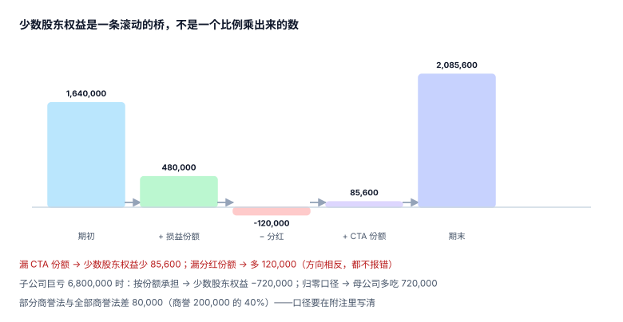

# 少数股东权益与超额亏损

少数股东权益是合并报表里唯一「**不属于母公司却必须出现在合并报表上**」的科目。它既不是负债（不用还），也不是母公司的权益（不能分），所以在资产负债表上永远卡在两者之间——而正是这个尴尬位置，让它成为最容易被算错、又最不容易被发现的一行。

::: tip 一句话理解
**少数股东权益是一条滚动的桥**：期初 + 应享损益 − 应享分红 + 应享其他综合收益 = 期末。它不是「期末净资产 × 少数比例」，虽然大多数时候两者相等——正是「大多数时候相等」让它看起来不需要桥。
:::

## 一、两个算法，什么时候会分叉

| 算法 | 公式 | 优点 | 什么时候失效 |
| --- | --- | --- | --- |
| 滚动法 | 期初 + 损益份额 − 分红份额 + CTA 份额 | 任何情况都对，可逐期核对 | 期初余额错一次，错误会永久传递 |
| 份额法 | 期末净资产 × 少数比例 + CTA 份额 | 简单，可校验 | 期间内有资本变动（增资、减资）时失真 |

本机读数（子公司期初净资产 4,100,000、净利 1,200,000、分红 300,000、期末 5,000,000、少数比例 40%）：

```text
滚动法：1,640,000 + 480,000 − 120,000 = 2,000,000
份额法：5,000,000 × 40%            = 2,000,000
```

两个数完全相等——因为这一期没有 CTA、没有资本变动。加上 CTA 85,600 后两法仍相等（都是 2,085,600）；但**若份额法漏了 CTA 份额，就差 85,600**，而滚动法只要期初余额对，就不会漏。



::: warning 为什么必须用滚动法做主口径
份额法在三种情况下会失真，而三种都不报错：

1. **期间内增资**：子公司增资时，少数股东若未同比例跟投，比例变化，期末净资产 × 新比例 ≠ 期初 + 损益份额。
2. **期间内分红**：份额法用的是**期末**净资产（已扣分红），只要分红已入账就等价；但如果分红在期后被追溯调整，期末数就变了。
3. **CTA 与重述**：份额法容易只乘「净资产」，忘了 CTA 是单独一栏。

滚动法是「逐笔动因累加」，天然把这些原因分开；份额法是「快照乘比例」，只适合做**交叉校验**——两者不等时，差额就是「本期有资本变动或漏项」的信号。
:::

## 二、CTA 归属：与折算页的接口

| 项目 | 母公司份额 60% | 少数股东份额 40% | 合计 |
| --- | --- | --- | --- |
| 当期 CTA | 128,400.00 | **85,600.00** | 214,000.00 |
| 少数股东权益（含 CTA） | — | **2,085,600.00** | — |

CTA 归属必须在两张表之间对齐：折算页算出 CTA 总额，本页按有效持股拆分。两处用不同比例（比如一处用 60%、一处用 56%），差额会同时出现在「其他综合收益」与「少数股东权益」两个科目上，而合并不平——那时人们会去查抵销，其实错在比例。

## 三、超额亏损：两种口径，差 720,000

子公司巨亏 6,800,000，少数股东期初权益 2,000,000，按 40% 应承担 2,720,000：

| 口径 | 少数股东权益 | 母公司承担 | 依据 |
| --- | --- | --- | --- |
| 全额承担（允许为负） | **−720,000** | 4,080,000 | IFRS 10：少数股东分担亏损可超过其权益份额 |
| 归零（不承担超额部分） | 0 | 4,800,000 | 部分辖区实务，需章程或协议支持 |

两种口径下**母公司损益差 720,000**，而合并净利润总额不变（只是归属不同）。所以这不是「算法问题」，是「归属问题」——一旦选定，必须在附注中写明，并在系统里落成 `loss_allocation_policy` 配置项，而不是散落在代码的 `if` 里。

::: danger 归零口径的三个后遗症
1. **恢复分配**：子公司后续盈利时，超额亏损部分要先补回给母公司，再恢复少数股东分配——这条规则常被漏掉，导致少数股东权益「凭空长出来」。
2. **附注义务**：归零口径必须在附注披露「未确认的少数股东分担亏损金额」。
3. **口径漂移**：不同子公司用不同口径（有的归零、有的为负），合并层无法用一条公式汇总。
:::

## 四、商誉的两种口径：差 80,000

| 口径 | 商誉确认 | 少数股东权益 | 说明 |
| --- | --- | --- | --- |
| 部分商誉法 | 只确认母公司份额 200,000 | 2,000,000 | CAS 现行做法 |
| 全部商誉法 | 确认全部商誉 200,000 ÷ 80% = 250,000 | **2,080,000** | IFRS 允许选择 |

两者差 80,000，恰好是「商誉 200,000 × 少数比例 40%」。这不是计算错误，是**准则选择**——选了哪个，商誉与少数股东权益同时变，且后续商誉减值时两者的分摊也不同。

## 五、母公司个别报表：权益法 vs 成本法

合并前要先解决一个前置问题：母公司账上的「长期股权投资」是成本法还是权益法？

| 方法 | 长期股权投资 | 母公司净利 | 合并时怎么处理 |
| --- | --- | --- | --- |
| 成本法 | 4,200,000（持有成本） | 不含子公司损益 | 直接抵销 |
| 权益法 | 4,200,000 + 1,920,000 − 480,000 = **5,640,000** | 含 1,440,000 份额 | **必须先还原成成本法**再抵销 |

若用权益法且不还原，合并时会「再确认一次子公司损益」，合并净利虚增 1,440,000——而抵销分录仍然平（因为长投与权益都被放大了同样的金额）。这是合并里最隐蔽的一类重复：**它由两笔正确的分录组成，只是不该同时存在**。

## 六、少数股东权益表

```sql
CREATE TABLE gr_minority (
  period      TEXT NOT NULL,
  entity_id   TEXT NOT NULL,
  min_begin   NUMERIC(18,2) NOT NULL,     -- 期初
  share_profit NUMERIC(18,2) NOT NULL,    -- 应享损益（可为负）
  dividend    NUMERIC(18,2) NOT NULL,     -- 应享分红
  cta_share   NUMERIC(18,2) NOT NULL DEFAULT 0,
  min_end     NUMERIC(18,2) NOT NULL,     -- 期末（= 上四项之和）
  policy      TEXT NOT NULL CHECK (policy IN ('full','floor')),
  PRIMARY KEY (period, entity_id),
  CHECK (abs(min_begin + share_profit - dividend + cta_share - min_end) < 0.005)
);
```

那条 `CHECK` 就是「滚动桥必须闭合」的机器版本：四个动因加起来不等于期末，数据写不进去。`policy` 列把超额亏损口径落成数据，而不是注释。

## 判据

本页判据族 `GRN-A` ~ `GRN-H`，共 8 条，逐条可判定：

| 编号 | 判据 | 怎么判 |
| --- | --- | --- |
| `GRN-A` | 少数股东权益用滚动法计算，四项动因齐全 | `min_end = 期初 + 损益 − 分红 + CTA`，差 < 0.005 |
| `GRN-B` | 份额法作为交叉校验，与滚动法差额必须可解释 | 差额表有「原因」列 |
| `GRN-C` | CTA 归属比例与范围表有效持股一致，合计 100% | 逐主体比对 |
| `GRN-D` | 超额亏损口径（`full` / `floor`）落成数据字段 | 字段非空，且与附注一致 |
| `GRN-E` | 归零口径下，后续盈利先补母公司再恢复少数分配 | 恢复记录可追 |
| `GRN-F` | 商誉口径（部分 / 全部）明确，且商誉与少数股东权益同时反映 | 两处口径一致 |
| `GRN-G` | 母公司长投若为权益法，合并前必须还原为成本法 | 还原标记 + 还原额落表 |
| `GRN-H` | 少数股东损益 + 母公司损益 = 合并净利润 | 合计校验，差 < 0.005 |

## 验证方式

```shell
# 1) 滚动桥闭合 + 两种口径的差
python3 - <<'PY'
eq0, prof, div, pct = 4_100_000, 1_200_000, 300_000, 0.40
min0, share, dv = eq0*pct, prof*pct, div*pct
print("滚动 =", min0, "+", share, "-", dv, "=", min0 + share - dv)
print("份额法 =", (eq0+prof-div)*pct)
print("含 CTA 85,600 后 =", min0 + share - dv + 85_600)
print("巨亏 6,800,000 时 =", min0 + share - dv - 6_800_000*pct, "（floor 口径为 0，母公司多吃", 6_800_000*pct - (min0+share-dv), "）")
PY

# 2) 滚动桥不闭合必须写不进（期望 EXIT=1）
sqlite3 :memory: "CREATE TABLE gr_minority(period TEXT, entity_id TEXT, min_begin REAL,
  share_profit REAL, dividend REAL, cta_share REAL, min_end REAL,
  CHECK(abs(min_begin+share_profit-dividend+cta_share-min_end) < 0.005));
INSERT INTO gr_minority VALUES('2026-12','C',1640000,480000,120000,0,2000000);
INSERT INTO gr_minority VALUES('2026-12','D',1640000,480000,120000,0,2100000);"; echo "EXIT=$?"
```

预期输出：第一条打印 `滚动 = 1640000.0 + 480000.0 - 120000.0 = 2000000.0`、`份额法 = 2000000.0`、`含 CTA 85,600 后 = 2085600.0`、`巨亏 ... = -720000.0（floor 口径为 0，母公司多吃 720000.0）`；第二条第一行插入成功、第二行报 `CHECK constraint failed` 且 `EXIT=1`。

## 参考资料

- [合并范围、控制与有效持股](../GroupStructure/index.md)
- [外币报表折算与 CTA](../Translation/index.md)
- [合并试算、三道勾稽与出表](../ConsolidatedTrial/index.md)
- IFRS 10 B94–B96——非控制性权益的计量与亏损分担：<https://www.ifrs.org/issued-standards/list-of-standards/ifrs-10-consolidated-financial-statements/>
- IFRS 3——商誉的「全部商誉法」选择权：<https://www.ifrs.org/issued-standards/list-of-standards/ifrs-3-business-combinations/>
