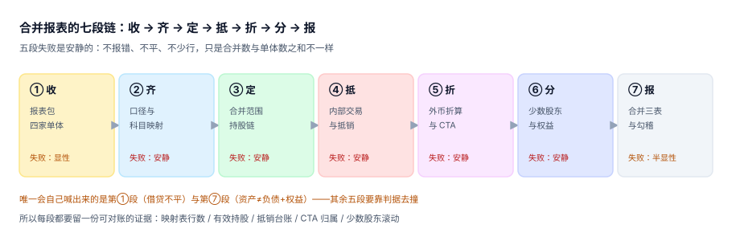

# 总览：七段链与三个「合并数」

合并报表被误解得最彻底的一点是：它看起来像一次**加法**，实际是一次**减法**。四家公司的试算表相加得到的是一个不存在的经济体——它同时拥有对内和对外的收入、同时欠自己钱、同时持有一笔被记了两遍的净资产。合并要做的，是把这个幻觉一层层削掉，然后证明削干净了。

::: tip 一句话理解
**合并 = 加总 − 内部重复 + 折算重述 − 少数股东份额。** 减号后面的三样，就是本专题十页的全部内容。
:::

## 一、七段链：每段的产物与失败方式

| 段 | 输入 | 关键动作 | 产物 | 失败方式 |
| --- | --- | --- | --- | --- |
| ① 收 | 各单体试算表 | 校验借贷、期间、币种、关账 | 报表包 | 交不上来会被催，**是唯一显性的一段** |
| ② 齐 | 报表包 | 统一政策、科目映射、汇率落表 | 合并行 | 缺映射只少一行，不报错 |
| ③ 定 | 股权结构 | 判断控制、算有效持股 | 合并范围 + 比例表 | 少并一家，报表照样平 |
| ④ 抵 | 内部交易与往来 | 识别、配对、生成五类抵销 | 抵销台账 | 漏抵销只是数偏大 |
| ⑤ 折 | 外币报表 | 三组汇率折算、算 CTA | 折算后报表 | 汇率混用不报错 |
| ⑥ 分 | 子公司权益 | 拆母公司份额与少数股东份额 | 少数股东滚动表 | 比例算错不报警 |
| ⑦ 报 | 合并试算 | 三道勾稽、出表、附注 | 合并三表 | 不平会红，**但平了不代表对** |



### 为什么顺序不能换

`④ 抵` 必须在 `⑤ 折` 之后重做一次，或者 `⑤ 折` 必须明确「内部往来按交易日汇率折」——两者只能选一个，不能都不想。本机实测：40 万美元的内部往来，先折后抵与先抵后折相差 **28,000 元**，而这 28,000 会安静地留在合并报表的「其他应付款」里，两边都平。

`③ 定` 必须在 `④ 抵` 之前，因为抵销的对象是「范围内的主体之间的交易」。先抵后定，等于把一笔与外部第三方的交易当成内部交易抵掉了——这是合并里最贵的一种错，因为它会同时让收入和成本变少，而**利润率看起来毫无变化**。

## 二、三个「合并数」必须分开存

同一个月份，「集团赚了多少」可以有三种答案：

| 口径 | 算法 | 2026-12 读数（本机） | 用途 |
| --- | --- | --- | --- |
| 加总净利 | 四家净利直接相加 | 8,480,000.00 + 未抵内部毛利 | 不能对外，只能做核对起点 |
| 抵销后净利 | 减内部收入成本、减未实现利润 | 5,232,442.90 | 内部干净，但未拆归属 |
| 合并净利（归属母公司） | 再减少数股东损益 | 见 [少数股东权益](../Minority/index.md) | 对外披露的口径 |

三者差额里，**只有第一段差额是「重复」**（可抵销），第二段差额是「归属」（要拆分）。把它们记在同一个 `adjustment` 字段里，审计时一定拆不开——所以 `GRO-C` 要求三个数各自有列，不允许只存最终数。

## 三、四个必失接缝

合并的错几乎不发生在段内，全发生在段与段之间。四个接缝，每一个都有「看起来对」的假象：

1. **包与映射之间**：报表包按 `600` 个科目交上来，映射表缺 `21` 条，合并报表少 `21` 行金额（本机 **3,565,524.63 元，占 1.62%**）。没人报错，因为少的那几行本来就不该被单独看见。
2. **映射与抵销之间**：映射表出现「一对多」（同一科目进两行），金额被重复计入，而试算**仍然是平的**——因为两行都进了资产侧。
3. **抵销与折算之间**：外币子公司的内部往来在折算后金额变了，抵销额却还是按原币乘旧汇率算的，差额悬在往来科目上。
4. **折算与少数股东之间**：CTA 只归了母公司，少数股东权益少了 `85,600`；两个数都「有来源」，只是一个按 100% 归、一个按 60% 归。

::: danger 四个接缝的共同点：都不产生「不平」
合并试算平衡只能证明「借贷相等」，不能证明「抵销完整」。本机把 4,059,446.38 元未实现利润全部漏抵，合并资产、负债、权益三者依然严丝合缝——**因为漏抵的分录两边都没写**。

正确的做法是给每个接缝配一条**独立于试算平衡**的判据：

1. 映射表行数 = 报表包去重科目数（`GRP-C`）
2. 每个科目在映射表中的行数恒为 1（`GRP-D`）
3. 抵销台账的 key 五列唯一（`GRE-C`）
4. CTA 分摊比例之和 = 100%（`GRC-F`）
:::

## 四、三个「对上了」的不同含义

| 说法 | 证据 | 强度 |
| --- | --- | --- |
| 试算平了 | `sum(借) = sum(贷)` | 最弱：漏抵、重复抵都平 |
| 勾稽过了 | 资产 = 负债 + 权益，且合并净利 = 母公司 + 份额 − 未实现利润 | 中：能抓到「只抵一边」 |
| 抵销台账对上了 | 每笔内部交易都有对应抵销行，且抵销后内部往来余额为 0 | 强：能定位到笔 |

出表前的门应该按这个顺序卡：**台账对不上，就别看勾稽；勾稽不过，就别看试算**。反过来做（先看试算平不平）是最常见的自欺——试算几乎总是平的。

## 五、本专题的边界

合并报表站在「集团」这个虚构主体上，容易越界去管别册的事。四条边界写死在这里：

- **不管单家的账怎么做**：分录、科目、期末结转属 [复式记账与分录](../../Ledger/DoubleEntry/index.md)。
- **不管单笔外币业务按哪个汇率入账**：属 [多币种与汇率折算](../../MultiCurrency/Overview/index.md)；本册只管「整张报表折成母币」。
- **不管税务口径**：合并报表是会计口径，税务合并（合并纳税）是另一套规则，属 [税务发票与红冲](../../TaxInvoice/Overview/index.md)。
- **不管经营分析**：管理口径的「集团贡献毛利」可以自定义分摊，本册只出法定口径。

## 六、一个最小的合并算术

假设只有母 P 与子 A（持股 80%），P 卖货给 A 1,000,000（成本 750,000），A 期末全部未售出。三张表各是什么样：

```text
单体 P：收入 +1,000,000   成本 +750,000   存货 0        净利 +250,000
单体 A：存货 +1,000,000   应付 +1,000,000              净利 0
加总：  收入 1,000,000    成本 750,000    存货 1,000,000 净利 250,000

抵销 1：借 营业收入 1,000,000 / 贷 营业成本 1,000,000   ← 内部交易本身
抵销 2：借 营业成本   250,000 / 贷 存货      250,000   ← 未实现利润
抵销 3：借 应付账款 1,000,000 / 贷 应收账款 1,000,000   ← 内部往来

合并：  收入 0            成本 0          存货 750,000   净利 0
```

三笔抵销里，**第 1 笔和第 3 笔是「同一件事的两面」，第 2 笔才是真正的调整**。绝大多数「合并做完了但毛利偏高」的事故，都是只做了第 1、3 笔，忘了第 2 笔——因为它不影响任何平衡关系，只影响存货与利润。

## 判据

本页判据族 `GRO-A` ~ `GRO-H`，共 8 条，逐条可判定：

| 编号 | 判据 | 怎么判 |
| --- | --- | --- |
| `GRO-A` | 七段链的每一段都有明确产物，且产物落到具体表或文件 | 逐段对照本页第一张表，缺产物即不通过 |
| `GRO-B` | 三个「合并数」（加总 / 抵销后 / 归属母公司）各自独立存储 | 合并试算表按 `stage` 分列，不允许只存最终数 |
| `GRO-C` | 每个合并行都能回溯到「哪几家单体 + 哪几条抵销」 | 明细表可按 `(period, cons_line)` 下钻到来源 |
| `GRO-D` | 四个接缝各有一条与试算平衡无关的独立判据 | 见第三节四条 |
| `GRO-E` | 「试算平 / 勾稽过 / 台账对上」三档在 UI 上分开展示 | 只显示一个绿勾即不通过 |
| `GRO-F` | 合并范围变更有版本号与生效期间，历史期间可按旧范围重放 | 范围表带 `valid_from / valid_to` |
| `GRO-G` | 任意一期合并可重跑，结果与首次一致（幂等） | 同期间重跑两次，合并试算 `diff` 为空 |
| `GRO-H` | 出表前必须同时通过「台账 / 勾稽 / 试算」三道门，任一失败阻断 | 关门为硬阻断，不是警告 |

## 验证方式

先确认本页的结构性事实（七段齐全、三档分开、判据 8 条），再确认「平 ≠ 对」这个论断能被复现：

```shell
# 1) 本页判据 8 条，编号连续
grep -o 'GRO-[A-H]' docs/Backend/Consolidation/Overview/index.md | sort -u | wc -l

# 2) 全库判据不撞号
python3 utils/audit/judgeidcheck.py --root . | tail -1

# 3) 复现「漏抵销但资产=负债+权益仍平」
python3 - <<'PY'
assets, liab, equity = 48_200_000, 26_400_000, 21_800_000
print("差额 =", assets - liab - equity)     # 期望 0：平得像没出错
print("漏抵的未实现利润 =", round(54_125_951.67 * 0.30 * 0.25, 2))
PY
```

预期输出：第一条 `8`；第二条 `E=0`；第三条先打印 `差额 = 0`，再打印 `漏抵的未实现利润 = 4059446.38`——两个数同时成立，就是本页要说明的那件事。

## 参考资料

- [合并范围、控制与有效持股](../GroupStructure/index.md)
- [抵销分录引擎与抵销台账](../Elimination/index.md)
- [合并试算、三道勾稽与出表](../ConsolidatedTrial/index.md)
- 财政部《企业会计准则第 33 号——合并财务报表》应用指南（2014）：<https://www.mof.gov.cn/>
- IFRS 10《Consolidated Financial Statements》结论基础（控制三要素的立法意图）：<https://www.ifrs.org/issued-standards/list-of-standards/ifrs-10-consolidated-financial-statements/>
