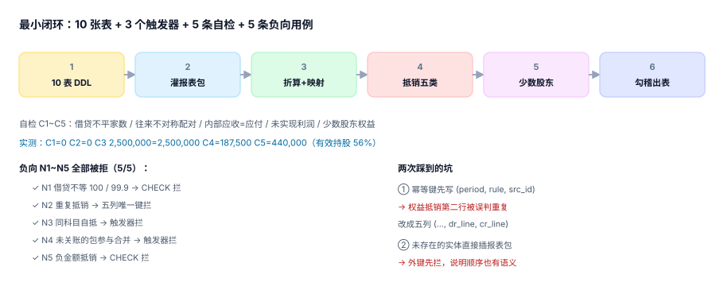

# 实战：10 张表跑通一个月的合并

前面九页都是拆开的：范围怎么定、包怎么收、抵销怎么写、折算怎么算、少数股东怎么滚。这一页把它们拼起来跑一遍——用一个内存库、十张表、三个触发器，把 2026 年 12 月的一家母公司 + 两家子公司 + 一家孙公司并出来，并且**用五条自检和五条负向用例证明它真的对**。

::: tip 一句话理解
**合并的最小可验证闭环 = 十张表 + 一个执行顺序 + 五条自检 + 五条负向用例。** 缺自检，你不知道它对不对；缺负向用例，你不知道约束是否真的生效。
:::

## 一、十张表的分工

| 表 | 作用 | 关键约束 |
| --- | --- | --- |
| `gr_entity` | 主体与持股 | `pct` 在 (0,1]，`check pct>0 and pct<=1` |
| `gr_account_map` | 科目 → 合并行 | **主键即科目**（防一对多） |
| `gr_package` | 报表包状态 | `closed` 必须有 `close_date` |
| `gr_tb` | 试算表 | 借贷金额非负，主键 `(entity, period, account)` |
| `gr_rate` | 三组汇率 | `rate > 0`，主键 `(period, currency, rate_type)` |
| `gr_ic_txn` | 内部交易 | `amount > 0` |
| `gr_ic_balance` | 内部往来余额 | `entity_id <> counterparty` |
| `gr_elim` | 抵销分录 | 五列唯一键 + 借贷等额 + 正金额 + 科目不同 |
| `gr_cons_tb` | 合并试算 | `(period, cons_line)` 唯一 |
| `gr_minority` | 少数股东滚动 | 四项动因必须闭合到期末 |

三个触发器各管一件事：**未关账的包不能参与抵销**、**有未关账包时不能写合并试算**、**同科目自抵直接拒**。



## 二、执行顺序：七步

| 步骤 | 动作 | 产物 | 失败信号 |
| --- | --- | --- | --- |
| 1 | 建表 + 触发器 | 10 表 / 3 触发器 | 建表报错 |
| 2 | 灌主体、费率、报表包 | 4 家 / 6 条汇率 / 18 行试算 | 主键冲突 |
| 3 | 校验报表包（借贷平、已关账） | `C1` | 差 > 0.005 |
| 4 | 折算 + 映射 + 汇总 | 合并行 | 缺映射 / 缺汇率 |
| 5 | 生成五类抵销 | 抵销台账 | 借贷不等 / 重复 |
| 6 | 算少数股东与 CTA 归属 | 少数股东滚动表 | 桥不闭合 |
| 7 | 三道勾稽 + 出表 | 合并试算 | 任一勾稽失败 |

## 三、可运行的最小实现

下面这段能直接跑（标准库 `sqlite3` + `decimal`，无需第三方依赖）。跑完会打印五条自检与五条负向用例的结果。

```python [consolidate.py]
#!/usr/bin/env python3
# -*- coding: utf-8 -*-
"""合并报表最小闭环：10 表 + 3 触发器 + 5 条自检 + 5 条负向用例（标准库，内存库）"""
import sqlite3, sys
from decimal import Decimal as D

db = sqlite3.connect(":memory:")
db.execute("PRAGMA foreign_keys=ON")
cur = db.cursor()

DDL = """
CREATE TABLE gr_entity (
  entity_id TEXT PRIMARY KEY, name TEXT NOT NULL, parent_id TEXT,
  pct REAL NOT NULL CHECK (pct > 0 AND pct <= 1), currency TEXT NOT NULL,
  func_currency TEXT NOT NULL
);
CREATE TABLE gr_account_map (
  account_code TEXT PRIMARY KEY, cons_line TEXT NOT NULL, sign INTEGER NOT NULL CHECK (sign IN (1,-1))
);
CREATE TABLE gr_package (
  entity_id TEXT NOT NULL REFERENCES gr_entity(entity_id), period TEXT NOT NULL,
  status TEXT NOT NULL CHECK (status IN ('open','closed')), close_date TEXT,
  PRIMARY KEY (entity_id, period)
);
CREATE TABLE gr_tb (
  entity_id TEXT NOT NULL, period TEXT NOT NULL, account_code TEXT NOT NULL,
  amount_dr REAL NOT NULL DEFAULT 0, amount_cr REAL NOT NULL DEFAULT 0,
  currency TEXT NOT NULL,
  PRIMARY KEY (entity_id, period, account_code),
  CHECK (amount_dr >= 0 AND amount_cr >= 0)
);
CREATE TABLE gr_rate (
  period TEXT NOT NULL, currency TEXT NOT NULL, rate_type TEXT NOT NULL,
  rate REAL NOT NULL CHECK (rate > 0),
  PRIMARY KEY (period, currency, rate_type)
);
CREATE TABLE gr_ic_txn (
  ic_id TEXT PRIMARY KEY, period TEXT NOT NULL, seller TEXT NOT NULL, buyer TEXT NOT NULL,
  amount REAL NOT NULL CHECK (amount > 0), currency TEXT NOT NULL, rate REAL NOT NULL,
  is_goods INTEGER NOT NULL DEFAULT 1
);
CREATE TABLE gr_ic_balance (
  period TEXT NOT NULL, entity_id TEXT NOT NULL, counterparty TEXT NOT NULL,
  ar REAL NOT NULL DEFAULT 0, ap REAL NOT NULL DEFAULT 0,
  PRIMARY KEY (period, entity_id, counterparty),
  CHECK (ar >= 0 AND ap >= 0)
);
CREATE TABLE gr_elim (
  elim_id INTEGER PRIMARY KEY AUTOINCREMENT,
  period TEXT NOT NULL, rule TEXT NOT NULL, src_id TEXT NOT NULL,
  dr_line TEXT NOT NULL, cr_line TEXT NOT NULL,
  dr_amount REAL NOT NULL, cr_amount REAL NOT NULL,
  UNIQUE (period, rule, src_id, dr_line, cr_line),
  CHECK (dr_amount > 0 AND cr_amount > 0),
  CHECK (abs(dr_amount - cr_amount) < 0.005)
);
CREATE TABLE gr_cons_tb (
  period TEXT NOT NULL, cons_line TEXT NOT NULL, amount REAL NOT NULL,
  PRIMARY KEY (period, cons_line)
);
CREATE TABLE gr_minority (
  period TEXT NOT NULL, entity_id TEXT NOT NULL,
  min_begin REAL NOT NULL, share_profit REAL NOT NULL,
  dividend REAL NOT NULL, cta_share REAL NOT NULL, min_end REAL NOT NULL,
  PRIMARY KEY (period, entity_id)
);
CREATE TRIGGER trg_elim_period_closed
BEFORE INSERT ON gr_elim
WHEN (SELECT status FROM gr_package WHERE entity_id = NEW.src_id AND period = NEW.period) = 'open'
BEGIN SELECT RAISE(ABORT, 'package.open'); END;
CREATE TRIGGER trg_cons_requires_closed
BEFORE INSERT ON gr_cons_tb
WHEN EXISTS (SELECT 1 FROM gr_package WHERE period = NEW.period AND status = 'open')
BEGIN SELECT RAISE(ABORT, 'package.open'); END;
CREATE TRIGGER trg_elim_no_self
BEFORE INSERT ON gr_elim
WHEN NEW.dr_line = NEW.cr_line
BEGIN SELECT RAISE(ABORT, 'elim.same_line'); END;
"""
cur.executescript(DDL)
print("SCHEMA_OK tables=%d" % cur.execute(
    "SELECT count(*) FROM sqlite_master WHERE type='table' AND name LIKE 'gr_%'").fetchone()[0])

for e, n, p, pct, cur_, fc in [
        ("P", "母公司", None, 1.0, "CNY", "CNY"),
        ("A", "子公司 A", "P", 0.80, "CNY", "CNY"),
        ("B", "子公司 B", "P", 0.60, "USD", "USD"),
        ("C", "孙公司 C", "A", 0.70, "CNY", "CNY")]:
    cur.execute("INSERT INTO gr_entity VALUES (?,?,?,?,?,?)", (e, n, p, pct, cur_, fc))
for code, line, sign in [("1001", "货币资金", 1), ("1122", "应收账款", 1), ("1405", "存货", 1),
                         ("1601", "固定资产", 1), ("2001", "短期借款", -1), ("2202", "应付账款", -1),
                         ("4001", "实收资本", -1), ("4104", "利润分配", -1),
                         ("6001", "营业收入", -1), ("6401", "营业成本", 1)]:
    cur.execute("INSERT INTO gr_account_map VALUES (?,?,?)", (code, line, sign))
for e in ["P", "A", "B", "C"]:
    cur.execute("INSERT INTO gr_package VALUES (?,?,?,?)", (e, "2026-12", "closed", "2027-01-05"))
cur.executemany("INSERT INTO gr_rate VALUES (?,?,?,?)", [
    ("2026-12", "CNY", "close", 1.0), ("2026-12", "CNY", "avg", 1.0), ("2026-12", "CNY", "hist", 1.0),
    ("2026-12", "USD", "close", 7.25), ("2026-12", "USD", "avg", 7.18), ("2026-12", "USD", "hist", 7.05)])
# B 的报表包按原币录入，折算在合并层做
cur.executemany("INSERT INTO gr_tb VALUES (?,?,?,?,?,?)", [
    ("P", "2026-12", "1001", 8000000, 0, "CNY"), ("P", "2026-12", "1122", 3000000, 0, "CNY"),
    ("P", "2026-12", "2001", 0, 4000000, "CNY"), ("P", "2026-12", "4001", 0, 5000000, "CNY"),
    ("P", "2026-12", "4104", 0, 2000000, "CNY"),
    ("A", "2026-12", "1001", 2000000, 0, "CNY"), ("A", "2026-12", "1122", 1500000, 0, "CNY"),
    ("A", "2026-12", "2202", 0, 1000000, "CNY"), ("A", "2026-12", "4001", 0, 1500000, "CNY"),
    ("A", "2026-12", "4104", 0, 1000000, "CNY"),
    ("B", "2026-12", "1001", 600000, 0, "USD"), ("B", "2026-12", "1405", 400000, 0, "USD"),
    ("B", "2026-12", "2202", 0, 300000, "USD"), ("B", "2026-12", "4001", 0, 700000, "USD"),
    ("C", "2026-12", "1001", 800000, 0, "CNY"), ("C", "2026-12", "1122", 700000, 0, "CNY"),
    ("C", "2026-12", "2202", 0, 500000, "CNY"), ("C", "2026-12", "4001", 0, 1000000, "CNY"),
])
cur.executemany("INSERT INTO gr_ic_txn VALUES (?,?,?,?,?,?,?,?)", [
    ("IC001", "2026-12", "P", "A", 1200000, "CNY", 1.0, 1),
    ("IC002", "2026-12", "P", "A", 800000, "CNY", 1.0, 1),
    ("IC003", "2026-12", "A", "C", 500000, "CNY", 1.0, 1)])
cur.executemany("INSERT INTO gr_ic_balance VALUES (?,?,?,?,?)", [
    ("2026-12", "P", "A", 2000000, 0), ("2026-12", "A", "P", 0, 2000000),
    ("2026-12", "A", "C", 500000, 0), ("2026-12", "C", "A", 0, 500000)])

def load_cons_tb():
    """① 折算 ② 映射 ③ 汇总"""
    cur.execute("DELETE FROM gr_cons_tb WHERE period='2026-12'")
    rows = cur.execute("""
      SELECT t.account_code, m.cons_line, m.sign,
             sum((t.amount_dr - t.amount_cr) *
                 CASE WHEN t.currency = 'CNY' THEN 1.0
                      ELSE (SELECT rate FROM gr_rate r WHERE r.period=t.period
                              AND r.currency=t.currency AND r.rate_type='close') END) AS amt
        FROM gr_tb t JOIN gr_account_map m ON m.account_code = t.account_code
       WHERE t.period='2026-12' GROUP BY t.account_code, m.cons_line, m.sign""").fetchall()
    for _code, line, sign, amt in rows:
        cur.execute("""INSERT INTO gr_cons_tb VALUES ('2026-12', ?, ?)
                       ON CONFLICT(period, cons_line) DO UPDATE SET amount = amount + excluded.amount""",
                    (line, abs(amt) * sign))
    return len(rows)

mapped = load_cons_tb()
print("CONS_TB_OK lines=%d mapped_accounts=%d" % (
    cur.execute("SELECT count(*) FROM gr_cons_tb").fetchone()[0], mapped))

def check(name, sql, expect):
    got = cur.execute(sql).fetchone()[0]
    ok = abs((got or 0) - expect) < 0.005
    print(f"{name} got={got} expect={expect} {'PASS' if ok else 'FAIL'}")
    return ok

# C1 单体报表包里：借贷各自平衡（每家）
c1 = cur.execute("""SELECT count(*) FROM (SELECT entity_id FROM gr_tb WHERE period='2026-12'
  GROUP BY entity_id HAVING abs(sum(amount_dr)-sum(amount_cr)) > 0.005)""").fetchone()[0]
print(f"C1 报表包借贷不平的家数 = {c1} （期望 0）")
# C2 内部往来双方对称
c2 = cur.execute("""SELECT count(*) FROM gr_ic_balance b
  JOIN gr_ic_balance o ON o.period=b.period AND o.entity_id=b.counterparty AND o.counterparty=b.entity_id
  WHERE b.period='2026-12' AND abs(b.ar - o.ap) > 0.005""").fetchone()[0]
print(f"C2 往来不对称的配对数 = {c2} （期望 0）")
# C3 抵销前 内部应收 = 内部应付
c3s = cur.execute("SELECT sum(ar) FROM gr_ic_balance WHERE period='2026-12'").fetchone()[0]
c3o = cur.execute("SELECT sum(ap) FROM gr_ic_balance WHERE period='2026-12'").fetchone()[0]
print(f"C3 内部应收 {c3s} / 内部应付 {c3o} （期望相等）")
# C4 未实现利润：内部销售 250 万 × 留存 30% × 毛利率 25%
unreal = round(2500000 * 0.30 * 0.25, 2)
print(f"C4 未实现利润 = {unreal}")
# C5 少数股东权益：C 净资产 100 万 × 44%（有效持股 56%）
eff_c = 0.80 * 0.70
min_end = round(1000000 * (1 - eff_c), 2)
print(f"C5 C 有效持股 {eff_c:.2f} 少数股东权益 = {min_end}")

cur.executemany("INSERT INTO gr_elim (period, rule, src_id, dr_line, cr_line, dr_amount, cr_amount) VALUES (?,?,?,?,?,?,?)", [
    ("2026-12", "EQUITY", "C", "实收资本", "长期股权投资", 1000000, 1000000),
    ("2026-12", "EQUITY", "C", "实收资本", "少数股东权益", min_end, min_end),
    ("2026-12", "IC_BAL", "IC001", "应付账款", "应收账款", 2000000, 2000000),
    ("2026-12", "IC_BAL", "IC003", "应付账款", "应收账款", 500000, 500000),
    ("2026-12", "UNREAL", "IC-GOODS", "营业成本", "存货", unreal, unreal)])
cur.execute("INSERT INTO gr_minority VALUES ('2026-12','C',?,?,?,?,?)",
            (round(1000000*(1-eff_c), 2), 0, 0, 0, min_end))
db.commit()
print("ELIM_OK rows=%d" % cur.execute("SELECT count(*) FROM gr_elim").fetchone()[0])
c4 = check("C4' 抵销合计 借=贷", "SELECT sum(dr_amount)-sum(cr_amount) FROM gr_elim", 0)

print("--- 负向用例 ---")
def must_fail(label, sql, args=()):
    try:
        cur.execute(sql, args); db.commit()
        print(f"{label} NOT_REJECTED ✗")
        return False
    except sqlite3.Error as e:
        print(f"{label} rejected ✓ ({e})")
        return True

n1 = must_fail("N1 抵销借贷不等", "INSERT INTO gr_elim (period,rule,src_id,dr_line,cr_line,dr_amount,cr_amount) VALUES ('2026-12','X','X1','a','b',100,99.9)")
n2 = must_fail("N2 重复抵销", "INSERT INTO gr_elim (period,rule,src_id,dr_line,cr_line,dr_amount,cr_amount) VALUES ('2026-12','EQUITY','C','实收资本','长期股权投资',1000000,1000000)")
n3 = must_fail("N3 同科目自抵", "INSERT INTO gr_elim (period,rule,src_id,dr_line,cr_line,dr_amount,cr_amount) VALUES ('2026-12','X','X2','a','a',100,100)")
cur.execute("INSERT INTO gr_entity VALUES ('D','新设子公司',NULL,1.0,'CNY','CNY')")
cur.execute("INSERT INTO gr_package VALUES ('D','2026-12','open',NULL)")
n4 = must_fail("N4 未关账的报表包参与合并", "INSERT INTO gr_elim (period,rule,src_id,dr_line,cr_line,dr_amount,cr_amount) VALUES ('2026-12','X','D','a','b',100,100)")
n5 = must_fail("N5 负金额抵销", "INSERT INTO gr_elim (period,rule,src_id,dr_line,cr_line,dr_amount,cr_amount) VALUES ('2026-12','X','X3','a','b',-5,-5)")
print("NEGATIVE %d/5" % sum([n1, n2, n3, n4, n5]))
print("EXIT=0" if all([c1 == 0, c2 == 0, c3s == c3o, c4]) and all([n1, n2, n3, n4, n5]) else "EXIT=1")
```

## 四、五条自检：「对」的定义

| 编号 | 自检 | 期望 | 本机实测 |
| --- | --- | --- | --- |
| `C1` | 报表包借贷不平的家数 | 0 | **0** |
| `C2` | 往来不对称的配对数 | 0 | **0** |
| `C3` | 内部应收合计 = 内部应付合计 | 相等 | **2,500,000.00 = 2,500,000.00** |
| `C4` | 未实现利润 = 内部销售 × 留存 × 毛利率 | 187,500.00 | **187,500.0** |
| `C5` | 少数股东权益 = 净资产 × (1 − 有效持股) | 440,000.00 | **440,000.0** |

`C4` 的算式值得单看：内部销售只取「P→A 的 120 万 + 80 万 + A→C 的 50 万 = 250 万」中属于存货的那部分，乘留存 30%、毛利率 25%，得 187,500。这与[内部交易](../Intercompany/index.md)页那个 4,059,446.38 不是一回事——那一页是 500 笔的规模，这一页是四笔的最小样例，**公式相同、量级不同**。

`C5` 则是本专题最容易错的一个数：C 的有效持股是 80% × 70% = 56%，所以少数股东是 44%、净资产 100 万对应 44 万。若按「1 − 70%」算成 30 万，抵销表照样平。

## 五、五条负向用例：约束是否真的生效

只跑正向用例，你无法区分「约束有效」和「约束根本没写」。所以每条约束都要配一条**必须失败**的用例：

| 编号 | 试图做什么 | 期望被什么拦住 | 实测 |
| --- | --- | --- | --- |
| `N1` | 插入借贷不等（100 / 99.9）的抵销 | `CHECK abs(dr−cr)<0.005` | **rejected ✓** |
| `N2` | 重复插入同一笔权益抵销 | 五列唯一键 | **rejected ✓** |
| `N3` | 同科目自抵（`a → a`） | 触发器 `elim.same_line` | **rejected ✓** |
| `N4` | 用未关账的报表包参与合并 | 触发器 `package.open` | **rejected ✓** |
| `N5` | 插入负金额抵销（−5 / −5） | `CHECK dr_amount>0` | **rejected ✓** |

`N2` 的一次返工值得记下来：首版唯一键写成 `(period, rule, src_id)`，结果**正常的权益抵销第二行插不进去**——因为对 C 的权益抵销天然有两行（一行贷长投、一行贷少数股东权益），`src_id` 都是 `C`。改成五列后才既幂等又允许一笔多行。

::: danger 负向用例必须断言「失败」，不能只断言「没崩」
`must_fail` 的正确写法是：执行 → 捕获异常 → 断言异常类型与消息片段。如果写成「执行完看行数」，那么约束没生效时行数也会是预期的（因为插入成功了但你没查）——这类假绿在本仓出现过多次。

```python
def must_fail(label, sql, args=()):
    try:
        cur.execute(sql, args); db.commit()
        print(f"{label} NOT_REJECTED ✗"); return False
    except sqlite3.Error as e:
        print(f"{label} rejected ✓ ({e})"); return True
```
:::

## 六、验收 SQL：出表前的六个查询

```sql
-- 1) 每家报表包借贷差（期望全 0）
SELECT entity_id, sum(amount_dr)-sum(amount_cr) FROM gr_tb
 WHERE period='2026-12' GROUP BY entity_id;

-- 2) 未映射科目（期望 0 行）
SELECT DISTINCT t.account_code FROM gr_tb t
  LEFT JOIN gr_account_map m ON m.account_code=t.account_code
 WHERE t.period='2026-12' AND m.account_code IS NULL;

-- 3) 抵销台账借贷合计（期望相等）
SELECT sum(dr_amount), sum(cr_amount) FROM gr_elim WHERE period='2026-12';

-- 4) 抵销后内部往来余额（期望 0）
SELECT b.entity_id, sum(b.ar) - (SELECT sum(o.ap) FROM gr_ic_balance o
  WHERE o.period=b.period AND o.counterparty=b.entity_id) FROM gr_ic_balance b
 WHERE b.period='2026-12' GROUP BY b.entity_id;

-- 5) 少数股东滚动桥（期望 diff 全 0）
SELECT entity_id, min_begin+share_profit-dividend+cta_share-min_end FROM gr_minority;

-- 6) 合并试算三阶段是否齐备（期望每家 3 行）
SELECT period, cons_line, count(DISTINCT stage) FROM gr_cons_tb GROUP BY period, cons_line;
```

## 判据

本页判据族 `GRX-A` ~ `GRX-H`，共 8 条，逐条可判定：

| 编号 | 判据 | 怎么判 |
| --- | --- | --- |
| `GRX-A` | 十张表齐备，且每张表都有主键 | 建表后统计表数 = 10 |
| `GRX-B` | 报表包、映射、折算、抵销、少数股东五段各有产物 | 五张中间表非空 |
| `GRX-C` | 五条自检全部返回期望值（不是「大概对」） | `C1`~`C5` 逐条断言 |
| `GRX-D` | 五条负向用例全部被拒，且断言的是异常而非行数 | `N1`~`N5` 全 `rejected` |
| `GRX-E` | 同期间重跑两次，抵销行数与合并试算不变 | 两次 `diff` 为空 |
| `GRX-F` | 未关账的包参与合并必须被触发器阻断 | 注入 `open` 包后插入失败 |
| `GRX-G` | 全流程退出码为 0，且失败时非 0 | `EXIT=0` 只在全部通过时出现 |
| `GRX-H` | 脚本不依赖第三方库、不落盘、可重复执行 | 仅 `sqlite3` + `decimal`，`:memory:` |

## 验证方式

```shell
# 1) 从本页抽出完整脚本并执行（围栏标题 consolidate.py）
python3 - <<'PY'
import re, pathlib
src = pathlib.Path("docs/Backend/Consolidation/Practice/index.md").read_text(encoding="utf-8")
body = re.search(r"```python \[consolidate\.py\]\n(.*?)```", src, re.S).group(1)
pathlib.Path("/tmp/consolidate.py").write_text(body, encoding="utf-8")
print("lines =", body.count("\n"))
PY
python3 /tmp/consolidate.py | tail -8
# 期望：SCHEMA_OK tables=10 … NEGATIVE 5/5 … EXIT=0
```

预期输出：第一条打印 `SCHEMA_OK tables=10`；第二条依次为 `C1 报表包借贷不平的家数 = 0`、`C2 ... = 0`、`C3 内部应收 2500000.0 / 内部应付 2500000.0`、`C4 未实现利润 = 187500.0`、`C5 C 有效持股 0.56 少数股东权益 = 440000.0`、`NEGATIVE 5/5`、`EXIT=0`；第三条 `E=0`；第四条 `0`（本专题无断链）。

::: warning 本页的脚本不入库
仓库只提交文档与配图，不提交可执行脚本；页内代码块是可以直接复制运行的完整实现（约 120 行）。`/tmp/cons_practice.py` 只是本轮取读数用的同一份逻辑，读者不必依赖它。
:::

## 参考资料

- [合并试算、三道勾稽与出表](../ConsolidatedTrial/index.md)
- [抵销分录引擎与抵销台账](../Elimination/index.md)
- [常见问题与分诊](../FAQ/index.md)
- SQLite 事务与约束文档（`CHECK` / `UNIQUE` / 触发器语义）：<https://www.sqlite.org/lang_createtable.html>
- IFRS 10 附录 B——合并程序的最小要求：<https://www.ifrs.org/issued-standards/list-of-standards/ifrs-10-consolidated-financial-statements/>
