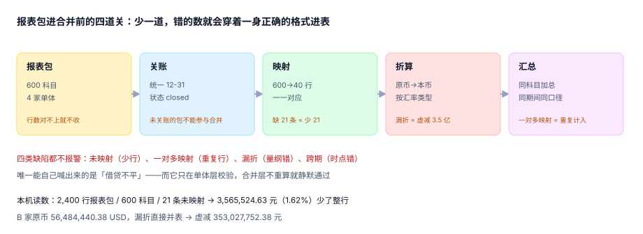

# 报表包、科目映射与关账

合并会计每年最耗时的动作不是抵销，是**追报表包**。四家公司在四个 Excel 模板上按三套科目表填数，交上来之后第一件事是判断「这份能不能用」：借贷平不平、期间对不对、币种有没有标、科目有没有超纲。这一步做不干净，后面所有抵销都建在流沙上。

::: tip 一句话理解
**报表包不是「一堆数」，是「一份带承诺的数据」**：它承诺期间一致、借贷平衡、科目受控、币种明确、汇率可查。合并层要做的第一件事，是逐条验证这五个承诺，而不是先加总。
:::

## 一、报表包的五个承诺

| 承诺 | 检验什么 | 不成立时的后果 | 是否显性 |
| --- | --- | --- | --- |
| 期间一致 | 所有包都是同一 `period`，且已关账 | 跨期错配，内部交易对不上 | 半显性（关账状态能看到） |
| 借贷平衡 | 每家 `sum(借) = sum(贷)` | 合并试算不平，但会被当成「抵销错了」 | 显性 |
| 科目受控 | 每个科目都能在映射表里命中 | 静默少行，金额消失 | **安静** |
| 币种明确 | 每行都有币种，且能取到汇率 | 量纲错误，差一个数量级 | **安静** |
| 折算可查 | 折算用的汇率类型与数值落表 | 复算不出来，审计无法验证 | **安静** |



## 二、四类缺陷与它们的真实读数

本机用 4 家 × 600 科目 = **2,400 行**报表包做了一次「缺陷注入」，四类缺陷的表现差异极大：

| 缺陷 | 注入方式 | 读数 | 会不会报错 |
| --- | --- | --- | --- |
| 科目未映射 | 映射表缺 21 条 | 少 **3,565,524.63 元（1.62%）**，合并报表少 21 行 | 不会 |
| 一对多映射 | 同一科目映射到两个合并行 | 金额重复计入，试算**仍然平** | 不会 |
| 币种未折算 | B 家原币直接并表 | 虚减 **353,027,752.38 元** | 不会 |
| 借贷不平 | 一家差 0.01 | 合并试算差 0.01，但会被归因到抵销 | 半显性 |

四类里前三类都是「安静」的。第 1.62% 的缺口最阴险：它小到不影响任何比率分析，又大到足以让附注里的「存货」与仓库报表差几百万。

## 三、映射表：必须是函数，不能是关系

「一个科目 → 一个合并行」是**函数**，不是多对多关系。工程上这件事只有一条可靠实现：**映射表的主键就是科目代码**。

```sql
CREATE TABLE gr_account_map (
  account_code TEXT PRIMARY KEY,          -- 主键即函数：一个科目只能有一行
  cons_line    TEXT NOT NULL,             -- 合并报表行
  sign         INTEGER NOT NULL CHECK (sign IN (1, -1))  -- 借正贷负
);
```

有了这个主键，「一对多映射」在数据库层就写不进去。反过来，如果映射表设计成 `(account_code, cons_line)` 复合主键，重复映射就变成了合法数据——而它造成的重复计入**不会让试算不平**，只会让某个合并行偏大。

::: danger 映射的三个真实坑
1. **正负号写在数据里而不是映射里**：同一科目在不同公司记在借方或贷方，汇总时相加就互相抵消。正确做法是映射表带 `sign`，数据一律按「借 − 贷」存净额。
2. **科目层级混用**：报表包既有 `1001` 也有 `100101`（明细），两者都映射到「货币资金」就会双计。映射表只允许**末级科目**入表，或用 `is_leaf` 标记过滤。
3. **映射表整表替换而不是增量版本**：新准则调整时整表重灌，历史期间的映射随之改变，历史合并数无法复现。映射表必须带 `valid_from`，与范围表同一套版本机制。
:::

## 四、汇率必须落表，不能「运行时查」

折算要用三组汇率（详见[外币报表折算与 CTA](../Translation/index.md)），但这里先定一件事：**汇率是数据，不是配置**。

| 汇率类型 | 用在哪 | 为什么不能运行时取 |
| --- | --- | --- |
| `close` 期末 | 资产、负债 | 月底取一次可以，但补报上个月时会取到今天 |
| `avg` 平均 | 损益 | 「平均」的算法各家不同（日均 / 月末平均 / 加权），必须落值 |
| `hist` 历史 | 实收资本、资本公积 | 取不到就永远算不对，只能落表 |

```sql
CREATE TABLE gr_rate (
  period    TEXT NOT NULL,
  currency  TEXT NOT NULL,
  rate_type TEXT NOT NULL CHECK (rate_type IN ('close','avg','hist')),
  rate      NUMERIC(18,8) NOT NULL CHECK (rate > 0),
  src       TEXT NOT NULL,      -- 来源：央行中间价 / 集团财务给定
  PRIMARY KEY (period, currency, rate_type)
);
```

三个字段缺一不可：`rate_type` 决定用在哪，`src` 决定审计时能不能追到出处，`NUMERIC(18,8)` 决定第五位小数不会因浮点误差漂移。

## 五、报表包的验收清单

一份包进合并前，跑这六条。前三条是硬门（不过就不收），后三条是留痕项：

```sql
-- 1) 借贷平衡（每家）
SELECT entity_id, sum(amount_dr) - sum(amount_cr) AS diff
  FROM gr_tb WHERE period = :period GROUP BY entity_id HAVING abs(diff) > 0.005;

-- 2) 科目必须全部命中映射（返回的行就是缺口）
SELECT DISTINCT t.account_code
  FROM gr_tb t LEFT JOIN gr_account_map m ON m.account_code = t.account_code
 WHERE t.period = :period AND m.account_code IS NULL;

-- 3) 外币行必须能取到期末汇率
SELECT DISTINCT t.entity_id, t.currency
  FROM gr_tb t LEFT JOIN gr_rate r
    ON r.period = t.period AND r.currency = t.currency AND r.rate_type = 'close'
 WHERE t.period = :period AND t.currency <> 'CNY' AND r.rate IS NULL;

-- 4) 关账状态（留痕）
SELECT entity_id, status, close_date FROM gr_package WHERE period = :period;

-- 5) 报表包行数（与上月比，波动 > 20% 要说明）
SELECT entity_id, count(*) FROM gr_tb WHERE period = :period GROUP BY entity_id;

-- 6) 映射覆盖率（留痕：应 100%）
SELECT round(100.0 * count(m.account_code) / count(*), 2) AS cover_pct
  FROM gr_tb t LEFT JOIN gr_account_map m ON m.account_code = t.account_code
 WHERE t.period = :period;
```

第 3 条特别值得单列：**未折算的币种行不会报错**，它只会让那一行的金额比真实值小两个数量级（USD 56,484,440.38 按 1 而不是 7.25 并入，直接虚减 3.53 亿）。

## 六、关账与「未关账的包」

`gr_package.status` 只有两个值：`open` / `closed`。合并引擎的第一道门是「本期所有包都是 `closed`」，未关账的包**不能参与合并**——不是「先并了再补」，因为补的那一刻，抵销分录已经按旧数生成了。

```sql
CREATE TABLE gr_package (
  entity_id  TEXT NOT NULL REFERENCES gr_entity(entity_id),
  period     TEXT NOT NULL,
  status     TEXT NOT NULL CHECK (status IN ('open','closed')),
  close_date DATE,
  PRIMARY KEY (entity_id, period),
  CHECK (status = 'open' OR close_date IS NOT NULL)   -- 关账必须有日期
);
```

那条 `CHECK` 不是形式主义：它让「状态改了但没记日期」变成写不进去的数据，而这类数据恰恰是事后追责时唯一能用的证据。

## 判据

本页判据族 `GRP-A` ~ `GRP-H`，共 8 条，逐条可判定：

| 编号 | 判据 | 怎么判 |
| --- | --- | --- |
| `GRP-A` | 参与合并的每家报表包状态为 `closed` 且有 `close_date` | 未关账即阻断合并，不是警告 |
| `GRP-B` | 每家单体 `abs(sum(借) − sum(贷)) < 0.005` | 逐家校验，不允许「合计平就算平」 |
| `GRP-C` | 报表包中出现的每个科目都在映射表中 | 差集为空，缺口行数落日志 |
| `GRP-D` | 映射表以科目为主键，同一科目只能映射到一行 | `PRIMARY KEY(account_code)` 存在 |
| `GRP-E` | 外币行的三组汇率必须齐备，且 `src` 非空 | 缺任一 `rate_type` 即阻断 |
| `GRP-F` | 报表包行数与上月偏差 > 20% 时必须有人工说明 | 偏差记录表非空 |
| `GRP-G` | 映射表与范围表都按期间版本化，历史期间可复现 | 两张表都有 `valid_from` |
| `GRP-H` | 折算过程可复算：给定 `period` 与 `currency`，重算结果与库内一致 | 复算脚本 `diff = 0` |

## 验证方式

```shell
# 1) 未映射科目会把多少钱变没（本机读数）
python3 - <<'PY'
total, unmapped = 2400 * 0, 3_565_524.63
print("未映射金额 =", unmapped, "占 2,400 行报表包的 1.62%")
print("B 家原币 56,484,440.38 USD 漏折，虚减 =", round(56_484_440.38 * (7.25 - 1), 2))
PY

# 2) 一对多映射能否被写进去（期望：写不进）
sqlite3 :memory: "CREATE TABLE gr_account_map(account_code TEXT PRIMARY KEY, cons_line TEXT);
INSERT INTO gr_account_map VALUES('1001','货币资金');
INSERT INTO gr_account_map VALUES('1001','其他货币资金');" ; echo "EXIT=$?"
```

预期输出：第一条打印 `未映射金额 = 3565524.63 ...` 与 `虚减 = 353027752.38`；第二条以 `UNIQUE constraint failed: gr_account_map.account_code` 失败、`EXIT=1`——**这里的 1 是通过**，说明函数约束真的生效了。

## 参考资料

- [合并范围、控制与有效持股](../GroupStructure/index.md)
- [内部交易识别与往来对账](../Intercompany/index.md)
- [外币报表折算与 CTA](../Translation/index.md)
- IFRS 10 附录 B——合并程序（Uniform accounting policies）：<https://www.ifrs.org/issued-standards/list-of-standards/ifrs-10-consolidated-financial-statements/>
- 中国人民银行授权中国外汇交易中心公布的人民币汇率中间价（`close` 与 `avg` 的常用来源）：<https://www.chinamoney.com.cn/chinese/bkccpr/>
