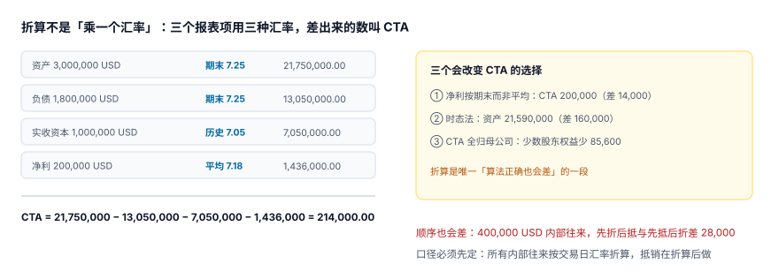

# 外币报表折算与 CTA

折算这一段有个非常反直觉的性质：**它没有「正确答案」，只有「选定的口径」**。同一张美元报表，净利按平均汇率折是 1,436,000，按期末汇率折是 1,450,000，两个都能找到理由；差额 14,000 既不属于利润也不属于资本，只能塞进一个专门的科目——累计折算差额（CTA）。

::: tip 一句话理解
**折算不是「乘一个汇率」，而是「三个报表项各用各的汇率，差出来的那块叫 CTA」**。CTA 是折算的塞子，不是折算的误差：它必须能被算出来、被归属、被结转，而不是被抹平。
:::

## 一、三组汇率，各管一段

| 报表项 | 用的汇率 | 为什么 | 本机（USD 子公司） |
| --- | --- | --- | --- |
| 资产 | 期末汇率 `close` | 资产负债表日是唯一有意义的时点 | 3,000,000 × 7.25 = **21,750,000.00** |
| 负债 | 期末汇率 `close` | 同上 | 1,800,000 × 7.25 = **13,050,000.00** |
| 实收资本 / 资本公积 | 历史汇率 `hist` | 出资当时的汇率，不能被后续波动改写 | 1,000,000 × 7.05 = **7,050,000.00** |
| 损益类 | 平均汇率 `avg` | 全年均匀发生，用平均最接近 | 200,000 × 7.18 = **1,436,000.00** |

四个数一摆，CTA 就自动出来了：

```text
CTA = 资产 − 负债 − 权益（历史汇率） − 本期净利（平均汇率）
    = 21,750,000 − 13,050,000 − 7,050,000 − 1,436,000
    = 214,000.00
```



## 二、三个会改变 CTA 的选择

CTA 214,000 不是唯一的答案。三个口径选择都能让它变，而且**每个选择看起来都合理**：

| 选择 | CTA | 与基准差 | 什么时候会这么选 |
| --- | --- | --- | --- |
| 基准（损益用平均汇率） | 214,000.00 | — | 现行汇率法，最常见 |
| 损益也用期末汇率 | 200,000.00 | **−14,000.00** | 简化实现，或损益发生极不均匀 |
| 时态法（货币性期末、非货币性历史） | 资产变为 21,590,000 | 资产差 **−160,000.00** | 功能货币 = 母币时的重述 |

三个数都「算得对」，差别在**口径是否写明**。所以判据 `GRC-B` 要求：CTA 表必须记录 `rate_basis`（`current` / `temporal`），以及每类汇率的取值来源。没有这一列，第二年换个人做合并，CTA 会对不上，而没人知道是口径变了还是算错了。

::: danger 时态法 vs 现行汇率法不是「精度选择」
两者的适用条件由**功能货币**决定，不是由「哪个好算」决定：

1. 子公司功能货币 = 记账本位币（通常是当地币）时，用**现行汇率法**，差额进 CTA（其他综合收益）。
2. 子公司功能货币 = 母公司报告货币时，用**时态法**，差额进**当期损益**（汇兑损益），不进 CTA。

选错法不是「差 160,000」，而是**把本该进损益的钱放进了权益**——利润表好看，权益悄悄变化，且两者都不会报错。
:::

## 三、CTA 的归属：不是全归母公司

CTA 214,000 里，有 40% 属于少数股东（B 公司有效持股 60%）：

| 归属 | 金额 | 记在哪 |
| --- | --- | --- |
| 母公司 | 214,000 × 60% = **128,400.00** | 合并「其他综合收益—外币报表折算差额」 |
| 少数股东 | 214,000 × 40% = **85,600.00** | 合并「少数股东权益」 |

漏掉归属这一步，少数股东权益会少 85,600，而合并权益总额不变（因为 CTA 全进了母公司那一栏）。后果是：**少数股东权益与少数股东损益的比例关系对不上**，做比率分析时会被当成「少数股东权益异常波动」。

## 四、折算与抵销的顺序：28,000 元的差

外币子公司与母公司之间有 400,000 美元的内部往来。两种做法：

| 顺序 | 做法 | 差额 |
| --- | --- | --- |
| 先折后抵 | 内部往来按期末汇率折成 2,900,000，抵销 2,900,000 | 基准 |
| 先抵后折 | 先把 400,000 美元抵掉，再折余额 | 与基准差 **28,000.00** |

28,000 = 400,000 × (7.25 − 7.18)，即期末汇率与平均汇率之差。它不会让任何一张表不平，只会让「其他应付款」多出 28,000，且明年这笔往来若已结清，这 28,000 会变成「汇兑损益」凭空出现。

::: warning 定一条规则，写进系统
**所有内部往来按交易日汇率折算，抵销在折算后做，差额进 `fx_basis='trade_date'` 标记的 CTA 调整行。**

反过来（先抵后折）也能自洽，但要求「抵销额也按平均汇率重算」，实现复杂度更高，且中间状态（抵销已生成、折算未完成）无法对账。
:::

## 五、CTA 不能进损益，也不能被「抹平」

CTA 有三个常见错误处理：

1. **把 CTA 当成汇兑损益进利润表**：违反 CAS 19 / IAS 21 对现行汇率法的要求，且会让利润随汇率波动。
2. **把 CTA 留在「待处理财产损溢」之类过渡科目**：报表上看得见，但归属不明，第二年没人敢动。
3. **用「其他」科目把 CTA 抹平**：CTA 必须可计算、可归属、可结转（处置子公司时转入损益），抹平等于放弃了这条链路。

处置境外经营时，与该境外经营相关的 CTA 要在处置当期**全额转入损益**——这一条是 CTA 存在意义的另一半：它只是「延迟确认」，不是「永不确认」。

## 六、折算的最小实现

```sql
-- 折算：按行取该行币种对应的汇率，逐行折，再按合并行汇总
WITH fx AS (
  SELECT currency, rate_type, rate FROM gr_rate WHERE period = :period
)
SELECT t.account_code, m.cons_line, m.sign,
       sum((t.amount_dr - t.amount_cr) *
           CASE t.currency WHEN 'CNY' THEN 1.0 ELSE f.rate END) AS amt
  FROM gr_tb t
  JOIN gr_account_map m ON m.account_code = t.account_code
  JOIN fx f ON f.currency = t.currency
   AND f.rate_type = CASE
         WHEN m.cons_line IN ('实收资本','资本公积') THEN 'hist'
         WHEN m.cons_line IN ('营业收入','营业成本','管理费用') THEN 'avg'
         ELSE 'close' END
 WHERE t.period = :period
 GROUP BY t.account_code, m.cons_line, m.sign;
```

关键在于 `CASE` 按**合并行**决定汇率类型，而不是按科目代码前缀——科目表会变，合并行不会。

## 判据

本页判据族 `GRC-A` ~ `GRC-H`，共 8 条，逐条可判定：

| 编号 | 判据 | 怎么判 |
| --- | --- | --- |
| `GRC-A` | 三组汇率（`close` / `avg` / `hist`）分别落表，且各有 `src` | 缺任一类型即阻断 |
| `GRC-B` | CTA 表记录 `rate_basis`（`current` / `temporal`）与折算方法 | 字段非空 |
| `GRC-C` | 资产、负债按期末汇率；权益按历史汇率；损益按平均汇率 | 抽样复算，逐项匹配 |
| `GRC-D` | CTA 必须由「资产 − 负债 − 权益 − 损益」倒算，不允许手工填 | CTA 行有 `computed=1` 标记 |
| `GRC-E` | CTA 按有效持股比例归属母公司与少数股东，两者之和 = CTA 总额 | 分配表合计校验 |
| `GRC-F` | CTA 归属比例之和 = 100%，且与范围表的有效持股一致 | 逐主体比对 |
| `GRC-G` | 内部往来按交易日汇率折算，`fx_basis` 标记齐全 | 缺标记即阻断 |
| `GRC-H` | 处置境外经营时 CTA 全额转入损益，且转入额可追 | 处置记录含 `cta_recycled` 字段 |

## 验证方式

```shell
# 1) CTA 三个口径与两个归属
python3 - <<'PY'
a, l, eq, pr = 3_000_000*7.25, 1_800_000*7.25, 1_000_000*7.05, 200_000*7.18
cta = a - l - eq - pr
print("CTA =", cta)
print("若损益按期末汇率 =", a - l - eq - 200_000*7.25, "差", cta - (a - l - eq - 200_000*7.25))
print("归属 母公司/少数 =", cta*0.6, "/", cta*0.4, "合计", cta*0.6 + cta*0.4)
print("先折后抵 vs 先抵后折 差 =", 400_000*(7.25-7.18))
PY

# 2) 缺 avg 汇率时折算必须失败而不是静默用 close
sqlite3 :memory: "CREATE TABLE gr_rate(currency TEXT, rate_type TEXT, rate REAL);
INSERT INTO gr_rate VALUES('USD','close',7.25),('USD','hist',7.05);
SELECT rate FROM gr_rate WHERE currency='USD' AND rate_type='avg';" ; echo "EXIT=$?"
```

预期输出：第一条打印 `CTA = 214000.0`、`若损益按期末汇率 = 200000.0 差 14000.0`、`归属 母公司/少数 = 128400.0 / 85600.0 合计 214000.0`、`先折后抵 vs 先抵后折 差 = 28000.0`；第二条**无输出且 `EXIT=0`**——这正是危险之处：查询成功返回空集，一个不检查行数的实现会静默取到 `NULL` 并把整行金额算成 0。所以折算前必须先校验「三组汇率齐备」。

## 参考资料

- [报表包、科目映射与关账](../ReportingPackage/index.md)
- [少数股东权益与超额亏损](../Minority/index.md)
- [多币种与汇率折算](../../MultiCurrency/Overview/index.md)——单笔业务折算的另一端
- IAS 21《The Effects of Changes in Foreign Exchange Rates》：<https://www.ifrs.org/issued-standards/list-of-standards/ias-21-the-effects-of-changes-in-foreign-exchange-rates/>
- 财政部《企业会计准则第 19 号——外币折算》：<https://www.mof.gov.cn/>
