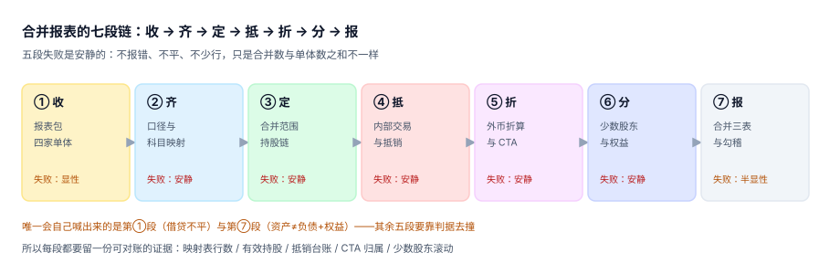
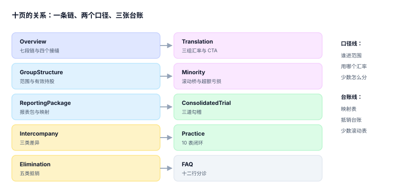

# 合并报表与内部抵销

<p style="text-align:center;"></p>

集团财务每个月都要回答一个看起来很简单的问题：**我们一共赚了多少、一共欠多少**。把四家公司的试算表加起来只要一秒，难的是加完之后那些数互相矛盾——母公司卖给子公司的一批货，在同一张合并利润表里既是收入又是成本；母公司账上的「长期股权投资」和子公司账上的「实收资本」，说的是同一笔钱；美元子公司的报表按哪个汇率折，能折出三个不同的净利。

::: tip 一句话理解
**合并不是「把数加起来」，而是「先把同一件事在集团内部造成的重复抹掉，再证明抹干净了」。** 抹的过程叫抵销，证明的过程叫勾稽，两件事都不产生新的经济事实，只消除幻觉。
:::

## 这个专题讲什么

一份合并报表从「收报表」到「出三表」要过七段。本专题按这七段组织，每段都标出产物与失败方式：

| 段 | 这一段在做什么 | 产物 | 失败是否安静 |
| --- | --- | --- | --- |
| ① 收 | 向每家单体收报表包，确认关账状态与期间 | 报表包 + 关账标记 | 显性（交不上来会催） |
| ② 齐 | 统一会计政策与科目，把 600 个科目映射到 40 个合并行 | 映射表 + 合并行 | **安静**（缺一条映射只少一行金额） |
| ③ 定 | 判断谁进合并范围、有效持股是多少 | 持股树 + 有效比例 | **安静**（少并一家，报表依然「平」） |
| ④ 抵 | 识别内部交易，生成五类抵销分录 | 抵销台账 | **安静**（漏抵销只是数偏大） |
| ⑤ 折 | 外币报表按三组汇率折算，差额进 CTA | 折算后报表 + CTA | **安静**（汇率用错不报错） |
| ⑥ 分 | 把子公司权益拆成母公司份额与少数股东份额 | 少数股东权益滚动表 | **安静**（比例算错不报警） |
| ⑦ 报 | 合并试算、三表勾稽、出表与附注 | 合并三表 | 半显性（不平会红，但平了不代表对） |



七段里**五段的失败是安静的**。它们的共同形态是：**数还是那些数，格式还是那个格式，只是合并数与「单体之和」的差额没人解释得清**。而唯一会自己喊出来的第 ⑦ 段最容易被误解——「资产 = 负债 + 权益」在构造正确时**恒平**，它对抵销错误零敏感度。本机实测：把 400 万元未实现利润全部漏抵，合并净利多出 324.76 万，而资产负债表依然平得像刚熨过。

## 三个「合并数」，只有一个能拿去报

| 说法 | 谁在说 | 怎么算出来的 | 能不能对外 |
| --- | --- | --- | --- |
| 加总表 | Excel | 四家试算表直接相加 | 不能，内部交易被算了两次 |
| 抵销表 | 合并会计 | 加总后逐笔抵销 | 内部交易干净、折算与少数股东未必对 |
| 合并报表 | 出表 | 抵销 + 折算 + 少数股东 + 勾稽 | **只有这个能报** |

三者的差额不是误差，是三类不同性质的重复与错配：**内部交易造成的重复**（可抵销）、**汇率与口径造成的重述**（进 CTA 或重述比较期）、**权益归属造成的拆分**（进少数股东权益）。把三者混在一个「调整数」里，是合并报表最常见的失败方式——因为它再也拆不开了。

## 与其它专题的分工

库里写「钱」的册子很多，问的问题完全不一样。先看这张表再决定读哪一册：

| 你关心的问题 | 该读哪一册 | 为什么不是本册 |
| --- | --- | --- |
| 「一笔业务怎么拆成借贷两腿」 | [复式记账与分录](../Ledger/DoubleEntry/index.md) | 那册判**单家主体内借贷横平**，本册判**跨主体同一笔钱只留一份** |
| 「账上 100 万、银行 98 万，差在哪」 | [对账与差异归因](../Ledger/Reconciliation/index.md) | 那册判**两套记录谁对**，本册判**两套账该不该同时存在** |
| 「这个月该确认多少收入」 | [收入确认与递延收入](../RevenueRecognition/Overview/index.md) | 那册判**义务消没消**，本册判**集团内部这笔销售算不算数** |
| 「外币业务按哪个汇率入账」 | [多币种与汇率折算](../MultiCurrency/Overview/index.md) | 那册判**单笔业务折算**，本册判**整张外币报表折成母币** |
| 「这家公司值多少钱、商誉怎么摊」 | [资产台账与折旧摊销](../FixedAsset/Overview/index.md) | 那册判**单项资产折旧**，本册只判**商誉在合并层的口径** |
| 「产品成本怎么归集」 | [成本核算与月末结账](../CostAccounting/Overview/index.md) | 那册判**金额守恒式**，本册判**内部毛利该不该留在存货里** |
| 「发票开给谁、税怎么算」 | [税务发票与红冲](../TaxInvoice/Overview/index.md) | 那册判**票面合规**，本册不管票，只管票背后的内部交易 |
| 「集团现金够不够、什么时候缺」 | [资金管理与现金流预测](../Treasury/Overview/index.md) | 那册判**余额的时间**，本册判**余额的归属** |
| 「子公司业绩怎么考核」 | [薪酬核算与个税社保](../Payroll/Overview/index.md) | 那册判**发多少钱**，本册判**赚的钱归谁** |

::: info 为什么不并入「复式记账」或「多币种」
三册共用同一批科目与汇率，但判据一条都不重合：复式记账判「**Δ借 = Δ贷**」，多币种判「**同一笔钱在两种币种下的换算可追溯**」，本册判「**同一笔钱在集团内部只被数一次，且归属可拆**」。

一组最直观的反例：合并资产负债表可以完全平（借贷平衡、资产 = 负债 + 权益），同时把 400 万内部毛利留在存货里、把 44% 的少数股东当成 30%。三个错误各自都满足另外两册的全部判据。
:::

## 本专题的章节

- [总览：七段链与三个「合并数」](Overview/index.md)
- [合并范围、控制与有效持股](GroupStructure/index.md)
- [报表包、科目映射与关账](ReportingPackage/index.md)
- [内部交易识别与往来对账](Intercompany/index.md)
- [抵销分录引擎与抵销台账](Elimination/index.md)
- [外币报表折算与 CTA](Translation/index.md)
- [少数股东权益与超额亏损](Minority/index.md)
- [合并试算、三道勾稽与出表](ConsolidatedTrial/index.md)
- [实战：10 张表跑通一个月的合并](Practice/index.md)
- [常见问题与分诊](FAQ/index.md)



## 判据族与页面对应

本专题共 **10 族 80 条判据**，每页 8 条，逐页独立、不跨页复用：

| 页面 | 判据族 | 这一族在判什么 | 条数 |
| --- | --- | --- | --- |
| 总览 | `GRO-A` ~ `GRO-H` | 七段是否齐全、三个「合并数」是否分开存 | 8 |
| 范围 | `GRM-A` ~ `GRM-H` | 控制三要素是否留证、有效持股是否穿透 | 8 |
| 报表包 | `GRP-A` ~ `GRP-H` | 包是否关账、映射是否一一对应、汇率是否落表 | 8 |
| 内部交易 | `GRI-A` ~ `GRI-H` | 三类差异是否分类、逐笔是否可定位 | 8 |
| 抵销 | `GRE-A` ~ `GRE-H` | 五类抵销是否成对、台账是否幂等可追 | 8 |
| 折算 | `GRC-A` ~ `GRC-H` | 三组汇率是否分开、CTA 归属是否固定 | 8 |
| 少数股东 | `GRN-A` ~ `GRN-H` | 滚动桥是否闭合、超额亏损口径是否写明 | 8 |
| 试算 | `GRT-A` ~ `GRT-H` | 三道勾稽是否都跑、勾稽失败是否阻断出表 | 8 |
| 实战 | `GRX-A` ~ `GRX-H` | 十表闭环能否一次跑通、负向用例是否被拒 | 8 |
| 分诊 | `GRQ-A` ~ `GRQ-H` | 现象能否定位到段、口径争议能否当场判 | 8 |

::: warning 判据不是清单，是「能被下一次合并检验的断言」
`GRE-C` 写的是「抵销分录必须带 `(period, rule, src_id, dr_line, cr_line)` 五列唯一键」，不是「注意别重复抵销」。前者能被一条 DDL 判定，后者只能靠自觉。
:::

## 事实与依据速览（2026-11 核对）

| 项 | 现行口径 | 与本专题的关系 |
| --- | --- | --- |
| 合并财务报表准则（中国） | CAS 33《合并财务报表》（2014 修订，现行有效） | 控制定义、合并范围、抵销要求 |
| 国际准则 | IFRS 10《合并财务报表》（2011 发布，2024 年仍现行，未见替代版） | 「控制」三要素的原始表述 |
| 企业合并 | CAS 20 / IFRS 3（2024 年 IFRS 3 有一次修订，涉及披露） | 商誉确认、分步取得 |
| 外币折算 | CAS 19 / IAS 21 | 现行汇率法、CTA 归属 |
| 合营与联营 | CAS 2 / IAS 28、IFRS 11 | 权益法而非合并 |
| 信息披露 | CAS 41 / IFRS 12 | 合并范围变动的附注要求 |

::: danger 版本事实有保质期
上表每一行都会过期。落到系统里时把**准则编号 + 生效版本 + 核对日期**一起存（例如 `standard_ref='CAS33-2014'`、`checked_at='2026-11-02'`），否则下一次准则修订后没人知道这套抵销规则是按哪一版写的。
:::

## 为什么本专题不建版本目录

本专题**不设** `V1/`、`V2/` 这类版本目录。三条理由：

1. **换代的是准则解释与披露要求，不是判据**：CAS 33 从 2006 版到 2014 修订，改的是「控制」的定义与结构化主体的处理，而「内部往来必须两侧同时抵销」一字未变。
2. **并存的差异是辖区而不是代际**：CAS、IFRS、US GAAP 对少数股东（非控制性权益）的列示位置不同，那是**同一套判据的三种配置**，不是三条内容线。
3. **真正需要版本目录的是「同一份代码两套写法」**：库内按大版本组织的先例是 [Spring5](../Java/Frame/Spring/Spring5/index.md) 与 [Spring6](../Java/Frame/Spring/Spring6/index.md)、[Vue2](../../Frontend/Frame/Vue/Vue2/index.md) 与 [Vue3](../../Frontend/Frame/Vue/Vue3/index.md)——同一框架两代 API 并存，旧版本保留并标注维护状态。本专题写的是单据模型与抵销规则，不存在两代并存。

涉及准则差异时，本专题的做法是**在正文里给出对照表并注明版本**，而不是复制一份会过期的条款全文。

## 建议阅读顺序

| 你的角色 | 建议路径 |
| --- | --- |
| 第一次做合并 | 总览 → 范围 → 抵销 → 试算（先把「平」与「对」分开） |
| 要从 Excel 迁到系统 | 报表包 → 抵销 → 实战（十表 DDL） |
| 被「合并数对不上」困住 | 内部交易 → 抵销 → 分诊 |
| 有外币子公司 | 折算 → 少数股东（CTA 归属决定少数股东权益） |
| 审计或复核 | 试算 → 抵销台账 → 分诊 |

## 验证方式

本页是目录页，验证落在「入口齐全、判据不撞号」两件事上：

```shell
# 1) 十一个页面文件都在，且每页只有一个 H1
ls docs/Backend/Consolidation/*/index.md | wc -l
grep -c '^# ' docs/Backend/Consolidation/*/index.md

# 2) 判据族不撞号（E=0 才算通过）
python3 utils/audit/judgeidcheck.py --root .

# 3) 目录页的族数与各页声明一致（本专题应输出 10 族 80 条）
python3 utils/audit/judgesumcheck.py --root .
```

预期输出：第一条 `10`；第二条每个文件都是 `1`；第三条 `judgeidcheck` 的 `E=0`；第四条不出现 `docs/Backend/Consolidation` 相关告警。

## 参考资料

- [总览：七段链与三个「合并数」](Overview/index.md)
- [实战：10 张表跑通一个月的合并](Practice/index.md)
- 财政部《企业会计准则第 33 号——合并财务报表》（2014 年修订）：<https://www.mof.gov.cn/>
- IFRS 10 Consolidated Financial Statements（IASB 项目页）：<https://www.ifrs.org/projects/completed-projects/2011/consolidation/>
- IAS 21 The Effects of Changes in Foreign Exchange Rates（IASB 准则页）：<https://www.ifrs.org/issued-standards/list-of-standards/ias-21-the-effects-of-changes-in-foreign-exchange-rates/>
