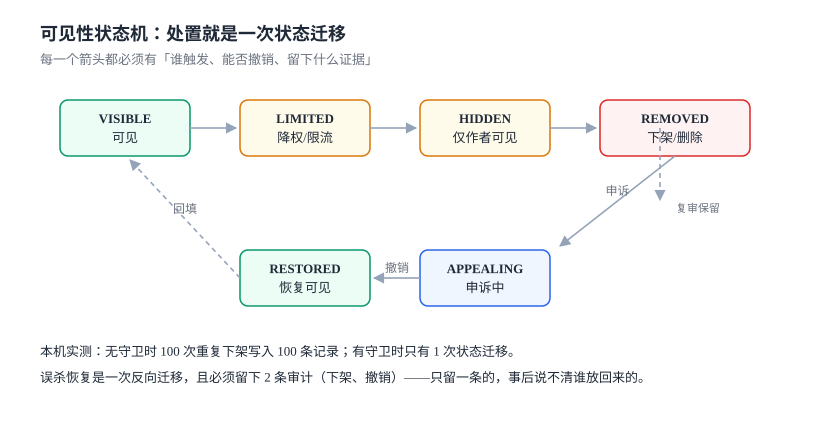
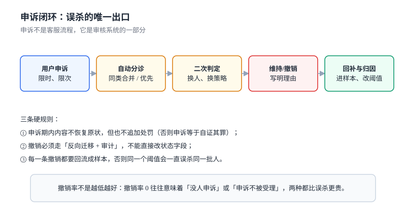

# 处置与撤销：删了之后怎么放回来

审核系统的所有设计，最终都收敛到两个动作：**改可见性** 和 **改回来**。前者决定风险，后者决定你能不能用这套系统。

很多团队只做了前者。结果是第一次误杀就变成事故——不是因为误杀多，而是因为**没有恢复路径**，只能靠人工改数据库。

本页判据族 `CME-A` ~ `CME-H`，共 8 条。



## 一、六个状态

| 状态 | 谁能看见 | 进入条件 | 常见误用 |
| --- | --- | --- | --- |
| `VISIBLE` | 所有人 | 判定通过或申诉撤销 | — |
| `LIMITED` | 所有人，但不进推荐流 | 低置信度违规 | 当成「软删除」用，实际仍有流量 |
| `HIDDEN` | 仅作者 | 中置信度、待复核 | 与 `REMOVED` 混用，导致恢复时找不到原文 |
| `REMOVED` | 无人 | 高置信度违规或人工确认 | 直接物理删除（不可恢复） |
| `APPEALING` | 按原状态 | 用户申诉 | 申诉期间加严（等于「申诉即认罪」） |
| `RESTORED` | 所有人 | 复核撤销 | 直接改成 `VISIBLE`，审计里看不出「曾经被下架」 |

六态里最容易被合并的是 `HIDDEN` 与 `REMOVED`。它们的区别不是「程度」，而是**恢复成本**：`HIDDEN` 的内容还在、可一键恢复；`REMOVED` 如果连存储都删了，就只能靠备份。

::: tip 一句话理解
「删」是一个**状态**，不是一个**动作**。把删除做成状态，恢复才是一次迁移；把删除做成动作，恢复就是一次考古。
:::

## 二、迁移表比状态图重要

状态图告诉你「有哪些状态」，迁移表告诉你「谁能让它变」。后者才是实现依据：

| 从 | 到 | 触发者 | 可撤销 | 必须留的证据 |
| --- | --- | --- | --- | --- |
| `VISIBLE` | `LIMITED` | 机审（低置信） | 是 | 分数、策略版本 |
| `VISIBLE` | `HIDDEN` | 机审（中置信）/ 人审 | 是 | 审核员 ID、理由码 |
| `VISIBLE` | `REMOVED` | 人审 / 法务指令 | 是（有备份） | 指令来源、批次号 |
| `LIMITED` / `HIDDEN` | `REMOVED` | 人审复核 | 是 | 复核记录 |
| `HIDDEN` / `REMOVED` | `APPEALING` | 作者申诉 | — | 申诉单号、时限 |
| `APPEALING` | `RESTORED` | 复核员（第二人） | 是 | 撤销理由、原判定对照 |
| `APPEALING` | 原状态 | 复核员（维持） | 是 | 维持理由 |

**「撤销只能由第二人执行」** 是这张表里最贵也最值钱的一行。它挡住的不只是误判，还有内部滥用——一个人既能下架又能恢复，审计上就无法区分「纠错」与「放水」。

## 三、幂等：重复下架会写坏审计

下架请求的重试、批量操作的重跑、后台的重复点击，都会让同一个动作执行多次。没有守卫时，每一次都会写一条审计，于是「这条内容被下架过 100 次」这种记录会出现在申诉材料里。

本机实测（SQLite，同一内容重复下架 100 次）：

| 实现 | 审计条数 | 状态迁移次数 | 后果 |
| --- | --- | --- | --- |
| 无守卫（每次直接 `UPDATE` + `INSERT`） | **100** | 100 | 审计失真、版本号暴涨 |
| 有守卫（`WHERE visibility <> ?`） | **1** | 1 | 审计可信 |

守卫的写法只有一句：

```sql
UPDATE content
   SET visibility = 'REMOVED', ver = ver + 1
 WHERE id = :id AND visibility <> 'REMOVED';
-- changes() = 0 表示「已经是该状态」，不写审计
```

注意顺序：**先 `UPDATE` 再看 `changes()`，不要先 `SELECT` 再 `UPDATE`**。后者在并发下会双通过（两个请求都读到 `VISIBLE`），这正是[报名接口](../../../../project/Complete/LearningHub/EnrollmentAPI/index.md) 里「20 线程写 5 条」的同一个 bug。

## 四、级联：删一条内容会牵动什么

一条帖子被删，至少牵动四类对象：

| 对象 | 处理策略 | 风险 |
| --- | --- | --- |
| 评论 | 跟随父内容不可见（不改自身状态） | 恢复父内容后评论自动回来，符合直觉 |
| 转发/引用 | 保留壳、去掉引用内容 | 直接删转发会误伤转发者的合规表达 |
| 通知 | 撤回未读通知 | 通知里的摘要可能含违规文本 |
| 搜索索引 | 异步删除，SLA 内生效 | 索引延迟会造成「已删仍可搜」 |

四条里最容易漏的是**搜索索引**。它是异步的，删完内容后仍可能被搜到几分钟到几小时。这段时间里，「已处置」在用户看来是假的。所以级联必须带一条可验证的判据：**处置后 N 分钟内搜索不到**，并把 N 写进 SLA。

## 五、申诉：误杀的唯一出口

申诉不是客服流程，它是审核系统的一部分：



五个环节的硬要求：

1. **入口可达**：处置通知里必须带申诉入口与时限。用户找不到入口的申诉，等于没有申诉。
2. **分诊**：同类申诉合并（同一策略、同一批次），避免 1,000 条同因申诉占满队列。
3. **二次判定换人**：复核员不能是原判定人，且不应看到原判定结论（双盲），否则只是「确认一遍」。
4. **撤销走反向迁移**：`APPEALING → RESTORED`，并写两条审计（原下架、本次撤销）。本机实测一次误杀恢复会产生 **2 条**审计，这是「事后能说清谁放回来的」的最低要求。
5. **回流样本**：每一条撤销都要变成一条标注样本，进入策略评估集。否则同一个阈值会一直误杀同一批人。

::: danger 申诉期内的两个反向操作
1. **申诉期间加严**（把 `HIDDEN` 改成 `REMOVED`）：等于「申诉即认罪」，会让用户放弃申诉，从而让你的误杀率永远测不出来。
2. **申诉成功但内容已被物理删除**：撤销变成「恢复一条不存在的记录」，只能道歉。这也是「删除是状态不是动作」的第二个理由。
:::

## 六、通知与告知

处置必须告知，且告知内容要能支撑申诉：

| 告知内容 | 必须 | 理由 |
| --- | --- | --- |
| 处置类型（限流/隐藏/下架） | 是 | 用户要知道严重程度 |
| 触发的规则类别（不必给具体词表） | 是 | 否则用户无法自查 |
| 申诉入口与时限 | 是 | 时限是权利的一部分 |
| 判定时间 | 是 | 用于计算 SLA 与申诉时效 |
| 审核员身份 | 否 | 内部信息，不对外 |

只写「您的内容违反社区规范」是最差的通知：它既不能帮用户改正，也不能支撑申诉，只会让用户去猜。

## 七、本页判据

| 编号 | 判据 | 为什么要它 | 怎么验证 |
| --- | --- | --- | --- |
| `CME-A` | 处置只有状态迁移，没有物理删除 | 物理删除让恢复变成考古 | 处置接口无 `DELETE`，只有状态参数 |
| `CME-B` | 每次迁移先 `UPDATE` 后判 `changes()` | 先查再改在并发下双通过 | 100 次重复下架只留 1 条审计 |
| `CME-C` | 撤销只能由第二人执行 | 同一人可下架可恢复则无法审计滥用 | 撤销接口校验 `operator <> original_operator` |
| `CME-D` | 申诉期间状态不变（不加严、不恢复） | 加严会让用户放弃申诉 | 申诉中内容的 `visibility` 与申诉前一致 |
| `CME-E` | 一次恢复产生两条审计（原下架 + 本次撤销） | 只留一条说不清谁放回来的 | 恢复后按 `case_id` 查审计，条数 ≥ 2 |
| `CME-F` | 级联覆盖评论、转发、通知、搜索索引四类 | 漏掉索引会出现「已删仍可搜」 | 处置后 N 分钟内搜索无结果 |
| `CME-G` | 每一条撤销都回流成标注样本 | 否则同一阈值反复误杀 | 撤销后评估集条数增加 |
| `CME-H` | 处置通知包含类型、类别、入口、时限、时间 | 缺一项就无法支撑申诉 | 通知模板逐项核对 |

## 八、验证方式

```sql
-- 1) 重复下架幂等：审计只留一条
UPDATE content SET visibility='REMOVED', ver=ver+1
 WHERE id='c1' AND visibility<>'REMOVED';
SELECT changes();           -- 第一次：1
UPDATE content SET visibility='REMOVED', ver=ver+1
 WHERE id='c1' AND visibility<>'REMOVED';
SELECT changes();           -- 第二次：0
SELECT COUNT(*) FROM moderation_action_log WHERE content_id='c1' AND action='REMOVED';
-- 预期：1
```

```sql
-- 2) 恢复必须留下两条审计
SELECT case_id, COUNT(*) AS acts,
       SUM(action='REMOVED') AS removed, SUM(action='RESTORED') AS restored
  FROM moderation_action_log
 GROUP BY case_id HAVING restored > 0 AND (removed < 1 OR acts < 2);
-- 预期：0 行
```

```sql
-- 3) 申诉期内状态未变（对比申诉前快照）
SELECT a.case_id FROM moderation_appeal a
  JOIN moderation_case c ON c.case_id = a.case_id
 WHERE a.state = 'OPEN' AND c.visibility <> a.visibility_at_appeal;
-- 预期：0 行
```

```shell
# 4) 处置后搜索索引在 SLA 内失效（示例：5 分钟）
curl -s "http://localhost:8080/api/search?q=示例内容" | jq '.total'
# 预期：0（处置完成 5 分钟后）
```

## 九、参考资料

- [《网络信息内容生态治理规定》](https://www.gov.cn/zhengce/zhengceku/2020-03/02/content_5487840.htm)：平台处置义务与用户申诉权利
- [《个人信息保护法》](https://www.gov.cn/xinwen/2021-08/20/content_5632486.htm)：删除权与「删除后不得再次处理」的要求（第 47 条）
- [SQLite: changes()](https://www.sqlite.org/lang_corefunc.html#changes)：受影响行数，判断幂等是否命中的基础
- [PostgreSQL: UPDATE ... RETURNING](https://www.postgresql.org/docs/current/sql-update.html)：替代 `changes()` 的写法
- [Google SRE Book: Managing Incidents](https://sre.google/sre-book/managing-incidents/)：处置动作的审计与复盘纪律（本页只借「留痕」部分）
