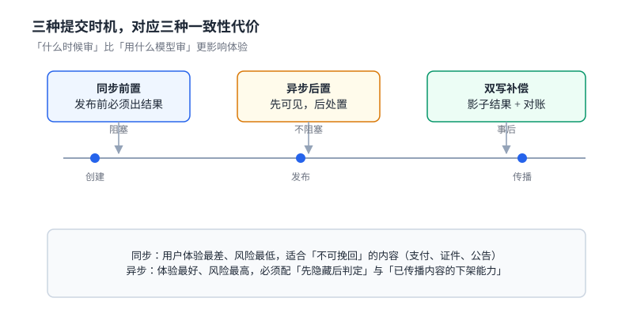

# 接入与提交契约：同一条内容只该被审一次

审核系统的第一笔成本不在模型上，在**重复提交**上。客户端超时重试、用户连点发布、编辑后重新提交、同一张图被切成四张发——每一次都会触发一次机审调用和一条审核单。

接入层要解决的就是这件事：**把「提交」和「内容」区分开，让同一条内容只被审一次，让每一次「真的改了」都能被重审。**

本页判据族 `CMI-A` ~ `CMI-H`，共 8 条。



## 一、三种时机

「什么时候审」比「用什么模型审」更影响体验，因为它决定了用户在等什么：

| 时机 | 用户看到什么 | 一致性 | 适合 |
| --- | --- | --- | --- |
| **同步前置** | 转圈等到结果，违规直接报错 | 强（发布即可见的一定审过） | 证件、公告、支付附言等「不可挽回」的内容 |
| **异步后置** | 立即发布，标记「审核中」，事后处置 | 最终一致（存在可见窗口） | 社区帖子、评论、商品评价 |
| **双写补偿** | 立即发布，但先落「影子结果」，后台对账 | 可度量（窗口内可回滚） | 直播弹幕、高频互动 |

::: tip 一句话理解
同步与异步的差别不是「快慢」，是**「谁承担可见窗口里的风险」**：同步由用户承担（等），异步由平台承担（可能已传播）。
:::

本机实测（5,000 次提交、模拟 8% 客户端重试 / 6% 合法重发 / 3% 不可见字符差异）说明「重复」不是边缘情况：

| 去重口径 | 机审调用 | 相对 5,000 节省 |
| --- | --- | --- |
| 不去重 | 5,000 | — |
| 原文哈希 | 4,581 | **8.4%** |
| 归一化后哈希 | 4,258 | **14.8%** |

第三条省得最多，但它把 323 条「只改了一个标点的重发」合并进了原 case——**省了 14.8% 的钱，丢了这些重发的版本**。所以去重口径必须与「是否重审」分开定，见下一节。

## 二、审核单：一次提交一个 case

```sql [moderation_case 的最小结构]
CREATE TABLE moderation_case(
  case_id      TEXT PRIMARY KEY,              -- uuidv7，可排序、不泄露序号
  tenant_id    TEXT NOT NULL,
  content_id   TEXT NOT NULL,                 -- 业务侧内容 ID（帖子/评论/商品）
  content_hash TEXT NOT NULL,                 -- 归一化内容的 sha256 前 16 字节
  subject_id   TEXT NOT NULL,                 -- 发布者
  scene        TEXT NOT NULL,                 -- post / comment / dm / live / profile
  intent       TEXT NOT NULL,                 -- create / edit / repost / appeal
  state        TEXT NOT NULL,                 -- PENDING / JUDGED / REVIEW / CLOSED
  created_at   TEXT NOT NULL,
  UNIQUE (tenant_id, content_id, intent, content_hash)
);

CREATE INDEX idx_case_pending ON moderation_case(state, created_at);
```

四个字段值得单独解释：

- **`content_hash` 存归一化后的哈希**，不存原文哈希。原文哈希挡不住「加了一个空格的重试」，归一化哈希挡得住。
- **`intent` 是去重的第二维**。同一条内容「创建」和「编辑后重发」是两个 case，不能因为哈希相同就合并。
- **`scene` 决定策略**（见[策略与阈值](../PolicyVerdict/index.md)），但它**不参与唯一键**——同一内容在两个场景里被提交两次，应当复用同一个判定结果。
- **`state` 只有四态**，把「人审中」做成 `REVIEW` 而不是单独一张表，避免两处状态各写一份。

唯一的组合键 `(tenant_id, content_id, intent, content_hash)` 是这一页最硬的一条约束：它让「重复提交」在数据库层就撞墙，而不是靠应用层 `SELECT ... IF NOT EXISTS`（后者在并发下必然双通过）。

## 三、幂等键的三个层次

「幂等」在审核链路上有三个不同粒度的含义，混用会同时造成「漏审」和「重审」：

| 层次 | 键 | 挡住什么 | 挡不住什么 |
| --- | --- | --- | --- |
| 请求级 | `Idempotency-Key`（客户端生成） | 网络重试导致的重复请求 | 用户连点（两个不同的 UUID） |
| 内容级 | `(content_hash, intent)` | 连点、重试、换端重提 | 真正修改后的重发 |
| 决定级 | `(case_id, policy_version)` | 同一策略重复判定 | 策略更新后需要重判 |

三条纪律：

1. **请求级幂等键必须由客户端生成并复用**。让服务端生成等于没有——每次重试都会拿到新键。
2. **内容级唯一键建在库上，不建在代码里**。并发下「先查再插」的双通过率与并发度同阶（[报名接口](../../../../project/Complete/LearningHub/EnrollmentAPI/index.md) 一节里实测过 20 线程写入 5 条）。
3. **决定级要带策略版本**。策略 v3 更新后，旧 case 需要重判；如果键里没有版本，重判会命中幂等直接返回旧结果。

## 四、内容寻址与留存

审核要留存证据：判定依据、原始内容、处置记录。留存的键不是 `case_id`，而是**内容哈希**——同一条内容被审十次，证据只该存一份。

```sql
CREATE TABLE content_blob(
  content_hash TEXT PRIMARY KEY,
  storage_key  TEXT NOT NULL,          -- 对象存储里的键，如 sha256/ab/abcdef...
  mime         TEXT NOT NULL,
  bytes        INTEGER NOT NULL,
  created_at   TEXT NOT NULL,
  retain_until TEXT NOT NULL           -- 到期日，由场景与法域决定
);
```

三个要点：

- **存储键按哈希分片**（`sha256/ab/` 这种两字符前缀），否则同一个桶的前缀会热到打满分区（[对象存储](../../ObjectStorage/Overview/index.md) 里有键空间分布的实测）。
- **`retain_until` 必须落库且可查**，不能只写在生命周期策略里。法域不同留存期不同（例如未成年人相关内容、金融营销内容），写在代码里的常量改不动。
- **删除要能回答「删了什么」**：被遗忘权要求删内容，但审核证据通常有保留义务。正确做法是**分离两份存储**：业务内容可删，审核证据保留但去标识化（`subject_id` 换成哈希），并在删除日志里记录两者的关系。

::: danger 用 `content_hash` 当唯一键去重，会丢版本
本机数据里，323 条「改了一个标点的重发」与原内容归一化后哈希相同，全部被合并。后果不是省钱，是**最终发布的那一版从未被审过**——审的是旧版本。

正确做法：`content_hash` 进唯一键时**必须带 `intent`**，并在编辑场景里让 `intent=edit` 生成新 case；只有当 `intent` 相同且哈希相同时才合并。
:::

## 五、同步等待的预算

同步前置的页面必须给出一个明确的等待预算，否则会被上游的超时链放大成雪崩：

| 环节 | 预算 | 超时后的动作 |
| --- | --- | --- |
| 归一化 + 哈希 | 5 ms | 无（本地计算） |
| 规则/关键词 | 10 ms | 跳过，进模型 |
| 文本模型 | 120 ms | 降级为「待人审」 |
| 图像模型 | 400 ms | 降级为「先发后审」（若场景允许） |
| 写库 + 返回 | 20 ms | 重试一次，仍失败则 503 |

总预算 555 ms 是「最坏情况」而不是「平均值」。设计时按 p99 排，不按均值排——均值 80 ms 的链路，p99 常常是 600 ms。

::: warning 超时不是失败，是「未知」
审核超时后返回 500，会让客户端认为「提交失败」并重试，而实际上审核单已经建好了。正确做法是返回 **202 + `case_id`**，让客户端凭 `case_id` 轮询或订阅结果。这样「超时」在语义上是「已受理、待判定」，与真正的失败（参数错误 400、限流 429）区分开。
:::

## 六、降级与重试

审核链路的降级顺序是固定的，不能临时决定：

1. 模型超时 → 降级为规则判定 + 进人审队列。
2. 人审队列满 → 降级为「先发后审」，并把该场景的抽检比例提高。
3. 策略服务不可用 → 用**上一版策略**（本地缓存），不允许「无策略放行」。
4. 全部不可用 → 拒绝新提交（503），而不是静默放行。

第四条最容易被违反：很多系统在「审核服务挂了」时选择「先放过去」，理由是「不能挡住业务」。这个决定的代价是**在故障窗口里产生的所有内容都没有审核记录**，事后无法补救，也无法统计影响面。

## 七、本页判据

| 编号 | 判据 | 为什么要它 | 怎么验证 |
| --- | --- | --- | --- |
| `CMI-A` | 唯一键包含 `content_hash` 与 `intent`，建在数据库上 | 应用层「先查再插」在并发下双通过 | 20 并发提交同一内容，最终 1 条 case |
| `CMI-B` | `content_hash` 用归一化内容计算 | 原文哈希挡不住空白与不可见字符 | 加空格的同内容提交命中同一哈希 |
| `CMI-C` | 请求级幂等键由客户端生成并可复用 | 服务端生成的键每次都不同 | 同一 `Idempotency-Key` 重放返回同一 `case_id` |
| `CMI-D` | 编辑重发必须生成新 case | 否则最终版本从未被审 | `intent=edit` 的提交计数 > 0 |
| `CMI-E` | 审核内容按哈希寻址存储，证据与业务内容分离 | 删除业务内容不能连带删证据 | 删业务内容后，`content_blob` 仍有记录 |
| `CMI-F` | 同步等待有明确预算，超时返回 202 而非 500 | 500 会触发客户端重试放大 | 注入 1 s 延迟，返回 202 且 `case_id` 非空 |
| `CMI-G` | 降级顺序写死，最后一级是拒绝而不是放行 | 故障窗口的内容事后无法补审 | 断开策略服务，提交返回 503 |
| `CMI-H` | `retain_until` 落库且可按场景查询 | 写在 YAML 里的留存期无法按内容类型区分 | 按 `scene` 分组能查到不同留存期 |

## 八、验证方式

```sql
-- 1) 同一条内容并发提交 20 次，只有 1 条 case
SELECT content_id, intent, COUNT(*) FROM moderation_case
 GROUP BY content_id, intent, content_hash
HAVING COUNT(*) > 1;
-- 预期：0 行
```

```sql
-- 2) 编辑重发产生了新 case，且哈希与旧版不同
SELECT a.content_id, a.intent, a.content_hash, b.content_hash
  FROM moderation_case a JOIN moderation_case b
    ON a.content_id = b.content_id AND a.intent = 'create' AND b.intent = 'edit'
 WHERE a.content_hash = b.content_hash;
-- 预期：0 行（有行说明编辑没有产生新版本）
```

```shell
# 3) 超时返回 202 而不是 500（用一个不存在的模型地址模拟）
curl -s -o /dev/null -w '%{http_code}\n' -X POST http://localhost:8080/api/moderation/cases \
  -H 'Idempotency-Key: 018f3c2a-7d1e-7c3a-9b2f-6a1c2d3e4f50' \
  -H 'Content-Type: application/json' \
  -d '{"content_id":"c-1","text":"示例内容","scene":"post","intent":"create"}'
# 预期：202
```

```shell
# 4) 同一幂等键重放，返回同一个 case_id
for i in 1 2; do
  curl -s -X POST http://localhost:8080/api/moderation/cases \
    -H 'Idempotency-Key: 018f3c2a-7d1e-7c3a-9b2f-6a1c2d3e4f50' \
    -H 'Content-Type: application/json' \
    -d '{"content_id":"c-1","text":"示例内容","scene":"post","intent":"create"}' | jq -r .case_id
done
# 预期：两行完全相同
```

## 九、参考资料

- [RFC 9562](https://www.rfc-editor.org/rfc/rfc9562)：UUIDv7，可排序且不泄露业务序号
- [IETF draft: Idempotency-Key HTTP Header Field](https://datatracker.ietf.org/doc/draft-ietf-httpapi-idempotency-key-header/)：幂等键的语义与重放窗口
- [SQLite: CREATE TABLE](https://www.sqlite.org/lang_createtable.html)：复合唯一约束与 `ON CONFLICT`
- [PostgreSQL: INSERT ... ON CONFLICT](https://www.postgresql.org/docs/current/sql-insert.html)：数据库侧幂等的落地写法
- [OWASP: Unrestricted File Upload](https://owasp.org/www-community/vulnerabilities/Unrestricted_File_Upload)：内容接入时对文件类型与大小的校验边界
