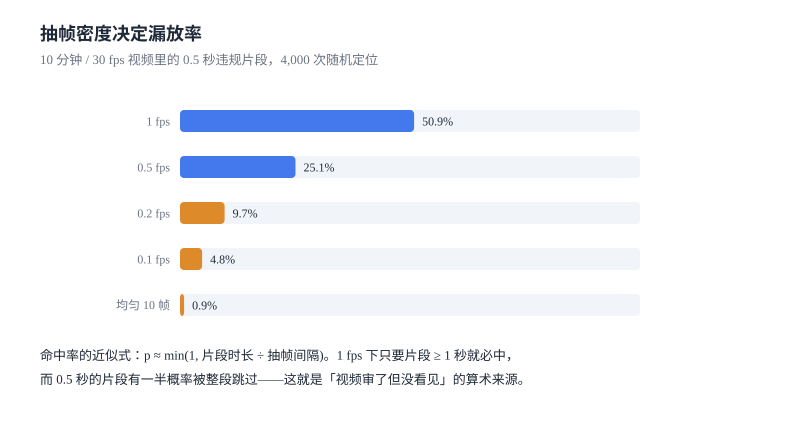

# 媒体审核：抽帧密度就是漏放率

文本审核的漏放来自「写法」，媒体审核的漏放来自**「采样」**：视频是 30 帧/秒的流，你审的永远是其中的一小部分。选错抽样方式，等于在审一条不存在的视频。

本页把「抽多少帧」「怎么抽」写成一个可算的式子，并给出音频与近重复内容的两个不同的解法。

本页判据族 `CMM-A` ~ `CMM-H`，共 8 条。



## 一、三类媒体，三条链路

| 媒体 | 主链路 | 关键参数 | 典型漏放 |
| --- | --- | --- | --- |
| 图像 | 分类模型 + OCR + 哈希库 | 分辨率、裁剪策略 | 二维码嵌在角落、文字极小 |
| 视频 | 抽帧 → 帧级判定 → 时序聚合 | 抽帧间隔、片段合并 | 短片段（<1 秒）整段跳过 |
| 音频 | ASR → 文本判定 + 音频指纹 | 采样率、切分长度 | 背景音、方言、混响 |

三条链路的共同点是**都必须先降维**：图像降到「一张图」，视频降到「若干帧」，音频降到「一段文本」。降维的方式决定了漏放的形状。

## 二、视频：抽帧密度就是漏放率

一个 10 分钟、30 fps 的视频有 18,000 帧。审核不可能逐帧跑模型，只能抽样。抽样命中率有一个近似式：

```text
p ≈ min(1, 违规片段时长 ÷ 抽帧间隔)
```

本机实测（4,000 次随机定位一段 0.5 秒的违规片段）：

| 抽帧策略 | 帧数 | 命中率 | 帧级成本（12 ms/帧） |
| --- | --- | --- | --- |
| 1 fps | 600 | **50.9%** | 7.20 s |
| 0.5 fps | 300 | **25.1%** | 3.60 s |
| 0.2 fps | 120 | **9.7%** | 1.44 s |
| 0.1 fps | 60 | **4.8%** | 0.72 s |
| 均匀 10 帧（封面式） | 10 | **0.9%** | 0.12 s |

同一组实验里，把片段时长从 0.5 秒改成 1 秒，1 fps 的命中率变成 **100%**——因为间隔等于片段长度，必有采样点落进去。

这张表解释了一个常见现象：**「视频都审过了，但违规画面没被发现」**。它不是模型不准，是那 0.5 秒根本没被采样到。

::: danger 三种「看起来更聪明」的错误抽法
1. **只抽封面**：命中率 0.9%，等于没审。封面是作者选的，恰恰最不可能违规。
2. **只抽关键帧（场景切换点）**：静态长镜头（一张图配口播）没有切换点，只抽到 1 帧。处置：关键帧 + 固定间隔双通道，取并集。
3. **按「前 N 秒 + 后 N 秒」抽**：违规内容常放在中段规避审核。处置：均匀分段后每段抽 1 帧，段数不少于 20。
:::

工程上的正确做法是**两段式**：先用低密度（0.2 fps）过一遍拿「可疑片段」，再对可疑片段做高密度（5~10 fps）复核。总成本接近低密度，召回接近高密度。

## 三、图像：分类 + OCR + 哈希库

图像审核不是「一个分类模型」，是三件事并联：

| 手段 | 抓什么 | 漏什么 |
| --- | --- | --- |
| 分类模型 | 暴露、暴力、违禁品等视觉类别 | 文字信息、二维码、极小目标 |
| OCR | 图中文字（导流联系方式、二维码旁的文字） | 艺术字、旋转文字、低分辨率 |
| 哈希库 | 已知违规图的变体（裁剪、加水印、压缩） | 全新内容 |

三者是**并集**，不是串联：任何一路命中都要进灰区或拦截。串联（先分类、通过后再 OCR）会让「图很干净但文字违规」这一类整体逃逸。

## 四、近重复：短文本上的 simhash 陷阱

哈希库要解决「同一张图被改了尺寸/加了水印」的识别。图像有 pHash，文本有 simhash，但两者都有一个**被口口相传错的阈值**。

本机实测（5 组基准文本 × 4 种轻微改动 = 120 对近重复，25 对无关文本）：

| 方法 | 近重复距离 | 无关距离 | 阈值取「经验值」时的召回 |
| --- | --- | --- | --- |
| 64 位 simhash（字符二元组） | min 4 / 中位 **11** / max 19 | min 25 / 中位 31 | 阈值 3：**0.0%**；阈值 10：43.3% |
| 2-gram Jaccard 相似度 | min 0.571 / 中位 **0.635** | max **0.000** | 阈值 0.5：**100%**，误判 0 |

结论很直接：**「汉明距离 ≤ 3」是长文档的经验值，短文本（20 字量级）根本不成立**。同样的数据换成 2-gram Jaccard，阈值 0.5 时召回 100%、误判 0。

原因不难理解：20 个字的文本只有 19 个二元组，改动两个字就换掉 3~5 个，占比 20%，simhash 的多数投票会让十几个 bit 翻转；而 Jaccard 直接算集合交集，改动比例就是相似度损失，直观且单调。

::: tip 一句话理解
simhash 的价值是「用一个整数代替全文」，适合海量库的粗筛；短文本的近重复判定应该用 shingle 集合，不要用汉明距离卡一个固定值。
:::

工程上两者可以组合：simhash 分桶（按前 16 位分桶，桶内比距离），桶内再用 Jaccard 精排。分桶把候选集从「全库」降到「同桶」，Jaccard 把误判压到可接受。

## 五、音频：先转文本，再留指纹

音频审核有两条独立的路：

1. **ASR → 文本判定**：把语音转成文字，复用文本审核的归一化与词表。代价是 ASR 的错字率（方言、背景音、专有名词），以及延迟（10 分钟音频转写通常 10~30 秒）。
2. **音频指纹**：对已知违规音频（如特定歌曲、特定口播）做指纹匹配，抗压缩、抗变速。它抓不到新内容，但对「同一段违规音频被反复上传」极其有效。

两条路都要，因为它们的失效形态互补：ASR 抓新内容但怕噪声，指纹抗噪声但只认旧内容。

## 六、成本：帧是最贵的单位

媒体审核的成本几乎全在「帧」上，而帧数由时长与抽帧率决定：

| 内容 | 抽帧策略 | 帧数 | 成本（12 ms/帧） |
| --- | --- | --- | --- |
| 10 分钟视频 | 1 fps | 600 | 7.2 s |
| 10 分钟视频 | 0.2 fps + 可疑段 5 fps | 120 + 可变 | 1.4 s + 复核 |
| 60 秒短视频 | 2 fps | 120 | 1.4 s |
| 直播（1 小时） | 0.2 fps 滚动 + 事件触发 | 720 | 8.6 s |

直播是特例：它不能「播完再审」，只能滚动抽帧 + 事件触发（弹幕激增、礼物激增、举报激增时临时提高抽帧率）。这也是为什么直播审核的漏放率天然高于点播——**它的采样窗口是未来**，你无法回头补审已经播过的 3 秒。

## 七、本页判据

| 编号 | 判据 | 为什么要它 | 怎么验证 |
| --- | --- | --- | --- |
| `CMM-A` | 抽帧间隔必须 ≤ 目标片段时长，且写在配置里 | 间隔大于片段时长时命中率按比例掉 | 0.5 秒片段在 1 fps 下命中率 ≈ 50% |
| `CMM-B` | 视频审核必须有「低密度初筛 + 可疑段高密度复核」两段 | 单段低密度漏放，单段高密度成本不可承受 | 配置里存在两档抽帧率 |
| `CMM-C` | 关键帧与固定间隔抽帧取并集，不得只用其一 | 静态长镜头没有场景切换 | 一张图配口播的视频仍能抽到 ≥20 帧 |
| `CMM-D` | 图像三路（分类/OCR/哈希）并联，任一命中即进灰区 | 串联会让「干净图 + 违规文字」逃逸 | 关闭 OCR 后，含联系方式的图漏放率上升 |
| `CMM-E` | 短文本近重复不得用固定汉明距离阈值 | 本机短文本近重复中位 11 位，阈值 3 召回 0 | 用 Jaccard 复算同一批样本，召回 ≥95% |
| `CMM-F` | 音频必须同时有 ASR 与指纹两条路 | 两者失效形态互补 | 关闭指纹后，重复上传的违规音频需重新判定 |
| `CMM-G` | 每条媒体判定必须记录「审了哪几帧/哪一段」 | 否则无法解释漏放 | `moderation_frame(case_id, ts_ms, score)` 可查 |
| `CMM-H` | 直播类内容必须有滚动抽帧与事件触发提频 | 直播无法事后补审 | 直播场景配置里存在 `boost_on_report` 开关 |

## 八、验证方式

```python
# 抽帧命中率：与第二节的表对照（10 分钟 / 30 fps / 0.5 秒片段）
import random
random.seed(20261107)
TOTAL, WIN = 30 * 600, 15
def rate(step, trials=4000):
    ok = 0
    for _ in range(trials):
        s0 = random.randrange(0, TOTAL - WIN)
        if any(s0 <= s < s0 + WIN for s in range(0, TOTAL, step)):
            ok += 1
    return ok / trials
print(round(rate(30), 3), round(rate(150), 3))
# 预期：0.509 0.097
```

```python
# 近重复：simhash 与 Jaccard 的对照（与第四节一致）
def grams(t, n=2):
    return {t[i:i + n] for i in range(len(t) - n + 1)}

def jac(a, b):
    A, B = grams(a), grams(b)
    return len(A & B) / len(A | B)

base = "低价出显卡全新未拆支持验货私聊秒回"
near = "超低价出显卡全新未拆支持验货私聊秒回"
far = "求购二手显示器预算有限成色要求不高"
print(round(jac(base, near), 3), round(jac(base, far), 3))
# 预期：0.6 以上与 0.0 —— 近重复与无关之间有明显间隙
```

```sql
-- 媒体判定必须能回答「审了哪几帧」
SELECT case_id, COUNT(*) AS frames, MIN(ts_ms) AS first_ms, MAX(ts_ms) AS last_ms
  FROM moderation_frame GROUP BY case_id HAVING frames < 10;
-- 预期：0 行（低于 10 帧的视频几乎没有覆盖度）
```

## 九、参考资料

- [FFmpeg: fps filter](https://ffmpeg.org/ffmpeg-filters.html#fps)：按固定帧率抽帧的实际语义（丢帧而非插帧）
- [Charikar, M. (2002). Similarity Estimation Techniques from Rounding Algorithms](https://www.cs.princeton.edu/courses/archive/spring04/cos598B/bib/CharikarEstim.pdf)：simhash 的原始论文
- [MinHash / Jaccard similarity](https://en.wikipedia.org/wiki/MinHash)：集合相似度与分桶近邻的标准做法
- [Chromaprint](https://acoustid.org/chromaprint)：音频指纹的常用实现
- [OpenAI Whisper](https://github.com/openai/whisper)：ASR 的公开实现与语言覆盖（转写质量直接决定音频审核的召回）
