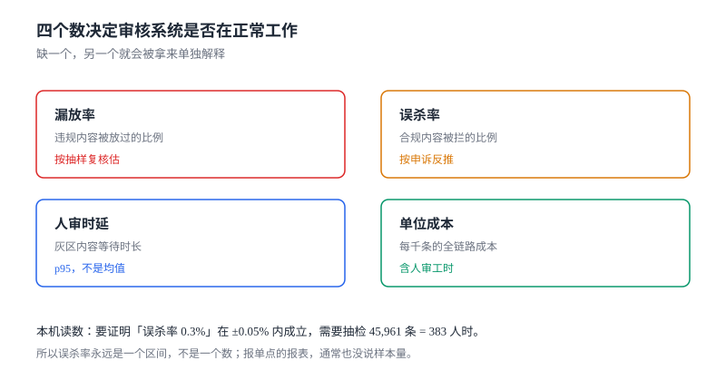

# 度量与成本：四个数，缺一个就会被单独解释

审核系统的报表有个通病：**每个指标都能被单独解释成「在变好」**。漏放率下降可以是「审得更准」，也可以是「抽样更松」；误杀率下降可以是「阈值更准」，也可以是「没人申诉了」。

只有当四个数一起出现时，解释才被约束住。

本页判据族 `CMT-A` ~ `CMT-H`，共 8 条。



## 一、四个数分别回答什么

| 指标 | 回答的问题 | 数据来源 | 常见造假方式 |
| --- | --- | --- | --- |
| 漏放率 | 有多少违规内容被放过了 | 抽样复核（人工） | 抽样只抽「可疑的」 |
| 误杀率 | 有多少合规内容被拦了 | 申诉反推 + 抽检 | 只统计「申诉成功」的 |
| 人审时延 | 灰区内容等了多久 | 队列日志 | 用均值、从进队算 |
| 单位成本 | 每千条花了多少钱 | 调用量 × 单价 + 人时 | 只算机审、不算人审 |

四个数构成一个闭合：要提高召回（降漏放）通常要降阈值，于是人审量和成本上升；要降误杀通常要抬阈值，于是漏放上升。**任何一个指标的改善，都能在另外三个里找到代价。** 找不到代价的改善，通常是口径变了。

## 二、漏放率：只能抽样估

漏放率没有「真值」可算——你不知道没被拦的内容里有多少违规。只能抽「已放行」的内容人工复核：

```text
漏放率 ≈ 抽检样本中的违规条数 ÷ 抽检样本量
```

它的可信度完全取决于样本量。比例估计的样本量公式（正态近似）：

```text
n = z² × p × (1 − p) ÷ e²
```

本机算例：目标误杀/漏放率 `p = 0.3%`，希望半宽 `e = 0.05%`，95% 置信（`z = 1.96`）：

```text
n = 1.96² × 0.003 × 0.997 ÷ 0.0005² ≈ 45,961 条
```

按 30 秒/条，是 **383 人时**——接近一个人两个半月的全职工作。这个数字说明两件事：

1. 大多数团队报的「漏放率 0.1%」都没有统计意义，因为他们的样本量只有几百条。
2. 报指标时必须同时报**样本量与置信区间**，否则这个数字不可用于决策。

::: tip 一句话理解
漏放率永远是一个区间，不是一个点。写「漏放率 0.3%」是错的，写「漏放率 0.30%（95% CI 0.25%~0.35%，n=45,961）」才对。
:::

## 三、误杀率：从申诉反推是有偏的

误杀率通常这样算：`申诉成功数 ÷ 处置总数`。它有一个系统性偏差——**只有愿意申诉的人才会被统计到**。

三类误杀永远不进这个分子：

- 用户没看到处置通知（通知失败、没登录）。
- 用户看到了但懒得申诉（小额、低频、一次性用户）。
- 用户申诉了但被「维持」错了（复核本身有假阴性）。

所以「申诉反推的误杀率」是**下界**，不是估计值。要得到接近真值的数，必须叠加**抽检**：从已处置内容里随机抽 1%~5%，由第二人复核。

| 口径 | 覆盖 | 偏差方向 |
| --- | --- | --- |
| 申诉成功率 | 只覆盖「愿申诉且复核正确」 | 低估真实误杀 |
| 处置内容抽检 | 随机覆盖 | 无偏，但成本高 |
| 两者结合 | 抽检校准 + 申诉监控趋势 | 推荐 |

## 四、人审时延：用 p95，从进队算

时延是唯一「必须用分位数」的指标。均值会被长尾吃掉：p50 是 2 秒、p95 是 71 秒、均值可能是 8 秒——均值既不描述典型体验，也不描述最差体验。

| 统计量 | 本机读数（1,200/h、15 人） | 该不该报 |
| --- | --- | --- |
| p50 | 2.6 s | 参考 |
| p95 | **71.1 s** | **必须报** |
| max | 155.0 s | 参考（受单次抖动影响大） |
| 均值 | 约 8 s | 不报（无消费者） |

起点用「进队时间」而不是「提交时间」，终点用「人工给出结论」。理由：机审耗时属于另一条链路（同步预算），混在一起会让两个团队互相甩锅。

## 五、单位成本：人审才是大头

很多人以为审核成本是「模型调用费」。按本机读数算一遍（20,000 条、灰区 25.5%、30 秒/条）：

| 成本项 | 单条 | 每千条 | 占比 |
| --- | --- | --- | --- |
| 机审（文本 8 ms CPU） | 可忽略 | 约 0.01 元 | < 1% |
| 人审（25.5% × 30 s） | 7.6 s | **2.12 人时** | > 95% |
| 存储与带宽 | 可忽略 | 约 0.02 元 | < 1% |

结论很直接：**审核的成本几乎全在人审**。所以「降本」只有三条路——提高自动判定比例（阈值）、提高人审效率（工具与批处理）、降低灰区规模（更好的模型或更清晰的规则）。前两条会动指标，第三条才是真正的改善。

::: danger 三种把成本算小的口径
1. **只算模型调用，不算人时**：成本表看起来只有几千块，实际是几个人力。
2. **按「已处置」算分母**：处置率低时单位成本被稀释。分母必须是「提交总量」。
3. **把复核（第二人）算成 0**：双盲复核、抽检、申诉复核都是人时，且占比不低。
:::

## 六、报表口径：分母写在哪

同一句「误杀率 0.5%」，分母不同会差一个数量级：

| 分母 | 含义 | 适用 |
| --- | --- | --- |
| 提交总量 | 所有提交内容 | 对外口径、成本核算 |
| 已判定量 | 走完判定的（不含待审） | 系统性能评估 |
| 已处置量 | 被拦/被限的 | 申诉侧分析 |
| 人工审量 | 进过人审的 | 人审质量评估 |

报表必须在**表头写分母**。本仓见过的最典型的错误：周报里误杀率从 0.8% 掉到 0.3%，看起来大幅改善，实际是分母从「已处置」换成了「提交总量」——数字变了，系统没变。

## 七、本页判据

| 编号 | 判据 | 为什么要它 | 怎么验证 |
| --- | --- | --- | --- |
| `CMT-A` | 四个指标同表出现，不允许单独报一个 | 单独报必被解释成「在变好」 | 周报模板含四列 |
| `CMT-B` | 漏放率必须带样本量与置信区间 | 0.3% 需 45,961 条样本 | 报表里能看到 `n` 与 CI |
| `CMT-C` | 误杀率区分「申诉反推」与「抽检估计」 | 前者是有偏下界 | 两个数分别出现在报表里 |
| `CMT-D` | 时延报 p95，不报均值 | 均值被长尾吞掉 | 报表里有 p95 且无均值单列 |
| `CMT-E` | 成本分母是提交总量，且含人时 | 只算机审会低估 95% | 成本表含「人时」一行 |
| `CMT-F` | 每个比率的表头写明分母 | 换分母会造成假改善 | 表头含「分母：提交总量」 |
| `CMT-G` | 指标可按 `scene` 与 `policy_version` 下钻 | 全局平均会掩盖单场景恶化 | 存在两个维度的下钻查询 |
| `CMT-H` | 指标异常必须能追到具体 case | 数字无法定位 = 无法修复 | 从指标点进去能列出样本 case |

## 八、验证方式

```python
# 样本量：与第二节一致
z, p, e = 1.96, 0.003, 0.0005
n = z ** 2 * p * (1 - p) / e ** 2
print(round(n), round(n * 30 / 3600))
# 预期：45961 383
```

```sql
-- 成本分母必须是提交总量（而不是已处置量）
SELECT
  (SELECT COUNT(*) FROM moderation_case) AS submitted,
  (SELECT COUNT(*) FROM moderation_case WHERE state='JUDGED') AS judged,
  (SELECT COUNT(*) FROM moderation_action_log WHERE action<>'RESTORED') AS handled;
-- 判读：算单位成本时用 submitted，不是 handled
```

```sql
-- 时延：p95 与均值并列，验证「均值不可用」
SELECT
  AVG(wait_sec) AS mean_wait,
  (SELECT wait_sec FROM moderation_case
    WHERE state='REVIEW' ORDER BY wait_sec
    LIMIT 1 OFFSET (SELECT COUNT(*)*95/100 FROM moderation_case WHERE state='REVIEW')) AS p95_wait
FROM moderation_case WHERE state='REVIEW';
-- 判读：mean 与 p95 差 3 倍以上时，报表只报 p95
```

```sql
-- 下钻：按场景看漏放（全局平均会掩盖单场景恶化）
SELECT scene,
       SUM(CASE WHEN audited AND leaked THEN 1 ELSE 0 END) * 1.0 / NULLIF(SUM(audited), 0) AS leak_rate,
       SUM(audited) AS n
  FROM moderation_audit_sample GROUP BY scene;
-- 预期：每个场景都有 n，n 过小的行不参与结论
```

## 九、参考资料

- [NIST/SEMATECH e-Handbook: Confidence Intervals](https://www.itl.nist.gov/div898/handbook/)：比例估计与样本量公式
- [Google SRE Book: Monitoring Distributed Systems](https://sre.google/sre-book/monitoring-distributed-systems/)：为什么用分位数而不是均值
- [Prometheus: Histograms and summaries](https://prometheus.io/docs/practices/histograms/)：p95 的工程实现与聚合陷阱
- [Cohen's kappa](https://en.wikipedia.org/wiki/Cohen%27s_kappa)：抽检一致性的校正指标
- [《互联网信息服务算法推荐管理规定》](https://www.gov.cn/zhengce/zhengceku/2022-01/04/content_5666429.htm)：算法效果评估与记录留存的要求
