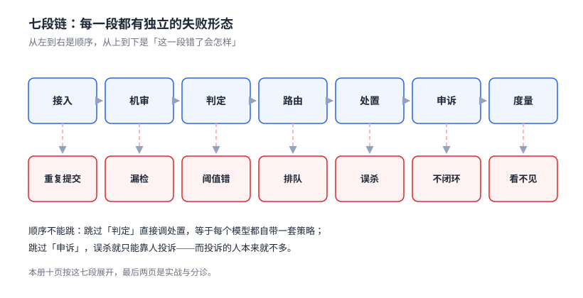

# 总览：四条边界、五个安静的失败与最小起步

审核系统最常见的失败不是「模型不准」，而是**它解决了一个不是自己的问题**：把风控的规则搬进内容判定、把审批流当成申诉、把模型分数当成决策、把删除当成处置的全部。

本页先把边界划清，再把失败形态摆出来，最后给一条不用等预算审批就能走的三步起点。

本页判据族 `CMO-A` ~ `CMO-H`，共 8 条。



## 一、被判定的到底是什么

「内容」不是一个东西，是五类对象的合称。它们的检测手段、误判形态、处置代价完全不同：

| 对象 | 典型违规 | 主要手段 | 误判代价 |
| --- | --- | --- | --- |
| 短文本 | 广告导流、辱骂、涉政涉黄 | 归一化 + 关键词 + 分类模型 | 低（可申诉、可恢复） |
| 长文本 | 软文、伪科学、侵权 | 段落级分类 + 引用检测 | 中（可能已传播） |
| 图像 | 违禁品、暴露、二维码导流 | 分类 + OCR + 哈希库 | 中高（截图会扩散） |
| 音视频 | 口播违规、画面违规、背景音 | 抽帧 + ASR + 音频指纹 | 高（难逐帧复核） |
| 复合内容 | 图文组合暗示、评论区串联 | 多模态 + 上下文 | 最高（单看每一部分都合规） |

第五类是真正的难点：一张普通商品图和一句「私聊有惊喜」都合规，放在一起才是导流。**任何单模态判定在第五类上都会系统性放行**，这不是模型能力问题，是输入不完整。

::: tip 一句话理解
审核的输入不是「一条内容」，是「一条内容 + 它的上下文 + 它的传播状态」。少一样，判定就会偏向放行。
:::

## 二、四条边界

这四条边界不是学术分类，是**排期时会真实撞车**的四件事。划不清的后果是同一套规则被两个团队各实现一遍，然后互相覆盖。

| 边界 | 它判什么 | 判据形态 | 与本册的关系 |
| --- | --- | --- | --- |
| 内容审核 | 这条内容本身是否允许被看见 | 三档动作（通过/人审/拦截） | 本册 |
| 风险决策 | 这个账号/设备/行为是否可疑 | 分数 + 名单 + 拦截动作 | 只借用「分数」概念，见[风险决策](../../RiskDecision/index.md) |
| 业务审批 | 这个操作是否被授权 | 多级签批、加签、会签 | 只借用「工单」形态，见[审批流](../../WorkflowEngine/ApprovalFlow/index.md) |
| 模型护栏 | 模型的输入输出是否安全 | 拒答、改写、脱敏 | 只判用户提交物，见[AI 安全与合规](../../../AI/AISecurityCompliance/index.md) |

四条边界里最容易混的是第一条和第二条。判定标准很简单：**如果处理对象是「内容」，就走审核；如果是「人」，就走风控**。一个账号发了十条合规内容，它不该因为「像营销号」被审核系统拦——那是风控的事；反过来，一条内容明显违规，也不该因为「作者是老用户」被放过——那是审核的事。

::: danger 把风控信号接进审核分数，会让审核不可解释
常见做法是把「账号注册天数」「历史违规次数」加权进审核分数。它确实能提升离线指标，但会让**每一条判定都失去可解释性**：用户申诉时，你无法回答「为什么这条被拦」，只能说「你的账号分低」。

正确做法是**两段式**：审核分数只由内容决定（可解释），风控分数只决定「是否加严复核」（可配置）。判定日志里两个分数分开存，处置时按「内容分优先、风控分只升不降」的规则合并。
:::

## 三、三个反模式

这三个写法在代码 review 里看起来都很合理，上线后都会变成「改不动」：

1. **在业务代码里写 `if (containsBadWord(text))`**：规则和业务耦合，加一个词要发一次版，且没有任何历史可查。正确做法是规则外置成策略表，业务只调一个 `verdict()`。
2. **把「删除」当成唯一的处置动作**：删除不可撤销、不可降级、不可解释。本册的处置是**六态状态机**，删除只是其中一态（见[处置与撤销](../Enforcement/index.md)）。
3. **用「准确率」验收审核系统**：在不平衡语料上（违规率 2%），一个全判合规的模型准确率 98%。必须用**漏放率 + 误杀率 + 人审量**三件套验收，见[度量](../Metrics/index.md)。

## 四、什么时候不需要审核

审核是有成本的：每条内容的机审成本、灰区内容的人审工时、误杀带来的用户流失。下面四条同时成立时，**先别建审核系统**：

- 内容不公开（只有作者自己可见，如个人笔记、草稿箱）。
- 内容量极小（每天几十条，人工过一遍比接模型便宜）。
- 没有外部合规义务（不属于公开传播平台，也不涉及未成年人与金融等强监管场景）。
- 违规的代价可逆（发现了再删，损失可控）。

四条里只要有一条不成立，就需要至少一个「人工兜底 + 事后下架」的最小形态——**它不需要模型，只需要一个能改状态的后台和一条审计**。

## 五、五个安静的失败

审核系统的错误几乎都不报警，因为**它的输出永远是「一个结果」**：通过也是结果、拦截也是结果，两者在监控上都表现为「正常返回」。

| 失败 | 为什么安静 | 本册读数（本机可复跑） |
| --- | --- | --- |
| 归一化把两句话粘成一个关键词 | 每一句都合规，拼起来才命中 | 良性 1,300 条误杀率 **7.69% → 23.08%** |
| 抽帧漏掉短片段 | 视频「审过了」，日志里也有结果 | 0.5 秒片段在 0.2 fps 下命中率 **9.65%** |
| 单阈值当双阈值用 | 调高阈值只看见误杀下降 | 阈值 0.9：召回 **0.108**、误杀 0.092% |
| 重复下架写坏审计 | 状态字段看着是对的 | 100 次重复下架：无守卫 **100 条**、有守卫 **1 条** |
| 短文本照搬「汉明距离 ≤ 3」 | 阈值是行业口口相传的 | 64 位 simhash 近重复中位 **11 位**，阈值 3 召回 **0** |

这五条分别对应五个页面：[文本](../TextNormalization/index.md)、[媒体](../MediaModeration/index.md)、[策略](../PolicyVerdict/index.md)、[处置](../Enforcement/index.md)、[媒体](../MediaModeration/index.md)。第 257 天之后本仓的写法纪律是「每页至少一条本机实测」，本册的实测都写在各页的「本节读数」小段里，命令可复跑。

## 六、最小起步三步

不用等预算、不用选型，两周内可以走完的三步：

1. **先有账本**：建一张 `moderation_case` 表，记录「谁、什么时候、提交了什么、结果是什么」。没有这张表，后面所有指标都算不出来。
2. **再有出口**：做一个能改可见性状态的后台（哪怕只有「下架 / 恢复」两个按钮）和一条审计。**出口比入口重要**——没有出口的系统，第一次误杀就会让你停掉整个审核。
3. **最后接模型**：把机审当成「给灰区排序」的工具，而不是「给内容定罪」的法官。第一批规则用关键词 + 白名单就够，先跑通「灰区→人审→处置→申诉」的闭环。

三步的顺序不能反。先接模型的人，通常会在第一个月就遇到「模型说违规、人工说没问题、但没有后台能恢复」的死结。

## 七、本页判据

| 编号 | 判据 | 为什么要它 | 怎么验证 |
| --- | --- | --- | --- |
| `CMO-A` | 判定对象必须包含上下文，不允许只传正文字段 | 图文组合与评论区串联是最大漏放来源 | 提交接口的必填字段里有 `context` 或 `parent_id` |
| `CMO-B` | 审核分数与风控分数分列存储，不合并成一个「总分」 | 合并后判定不可解释，申诉无法回答 | 判定日志里能分别查到 `content_score` 与 `risk_score` |
| `CMO-C` | 规则外置，新增词条/规则不需要发版 | 写在业务代码里的规则无法审计 | 新增一条关键词后，不重启服务即生效 |
| `CMO-D` | 处置动作必须是状态迁移，不允许物理删除 | 删除不可撤销、不可解释 | 处置接口只有状态参数，没有 `DELETE` |
| `CMO-E` | 存在「无模型也能跑」的兜底通路 | 模型故障时审核不能停摆 | 断开机审服务，提交流程仍能产出「待人审」 |
| `CMO-F` | 验收指标至少三项：漏放率、误杀率、人审量 | 单一准确率在不平衡语料上无意义 | 验收报告含三列，且都带样本量 |
| `CMO-G` | 每条判定必须能回答「命中哪条规则/哪个模型、分数多少」 | 不可解释的拦截等于不可申诉 | 任取一条 case，能查到 `hit_rule` 与 `score` |
| `CMO-H` | 上线前必须有一条「恢复」路径的演练记录 | 误杀是必然而非偶然 | 演练记录含：谁执行、多久恢复、审计几条 |

## 八、验证方式

本页没有 DDL，验证的是「边界有没有被写进结构」。三条命令，都能在读完本册后对着自己的库跑：

```sql
-- 1) 判定日志是否能分开回答「内容」与「风险」
SELECT COUNT(*) FROM moderation_case
 WHERE content_score IS NULL OR risk_score IS NULL;
-- 预期：0。有行 = 两个分数被合并了，或有一条没落库
```

```sql
-- 2) 处置是否只有状态迁移（没有物理删除的痕迹）
SELECT action, COUNT(*) FROM moderation_action_log GROUP BY action;
-- 预期：只有 VISIBLE / LIMITED / HIDDEN / REMOVED / RESTORED 之类的动作名
-- 若出现 DELETE，说明有人绕过了状态机
```

```shell
# 3) 断开机审后，提交仍能落成「待人审」
#    把机审地址指到一个不存在的端口，再提交一条内容
curl -s -o /dev/null -w '%{http_code}\n' -X POST http://localhost:8080/api/moderation/cases \
  -H 'Content-Type: application/json' \
  -d '{"content_id":"c-demo","text":"测试内容","context":{}}'
# 预期：202（已受理、待判定），而不是 500
```

第三条是整套设计的分水岭：**审核挂了，业务不能挂**。允许「先发后审」的产品可以返回 202 并异步补判；不允许的产品要在提交侧做同步等待，但等待的必须是「判定服务」，不是「模型服务」。

## 九、参考资料

- [《网络信息内容生态治理规定》](https://www.gov.cn/zhengce/zhengceku/2020-03/02/content_5487840.htm)：内容分级与平台责任的法条基础
- [《互联网信息服务深度合成管理规定》](https://www.gov.cn/zhengce/zhengceku/2023-01/10/content_5736807.htm)：合成内容标识义务，决定了「审核对象」包含生成物（2026-11-07 核对）
- [NIST AI RMF 1.0](https://www.nist.gov/itl/ai-risk-management-framework)：MEASURE 职能里的「测试集与阈值」写法
- [OWASP Top 10 for LLM Applications](https://owasp.org/www-project-top-10-for-large-language-model-applications/)：LLM 应用的输入输出风险分类
- [Trust & Safety Professional Association](https://www.tspa.org/)：审核运营（队列、SLA、申诉）的行业实践索引
