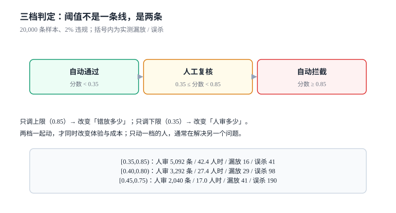

# 策略判定与阈值：两条线，不是一个数

「阈值调到多少」是审核系统里被问得最多、也最容易答错的问题。答错的原因是把它当成**一个数**：调高一点少误杀，调低一点多拦截。

真实的判定有**两条线**，切成三段：低于下限自动通过、高于上限自动拦截、中间进人审。只动一条线的人，通常是在解决另一个问题。

本页判据族 `CMV-A` ~ `CMV-H`，共 8 条。



## 一、策略是一个对象

把策略写成代码里的 `if`，是最容易开始、也最难维护的做法。策略应当是**可版本化的数据**：

```sql
CREATE TABLE policy(
  policy_id   TEXT PRIMARY KEY,          -- 如 ugc.comment.v3
  scene       TEXT NOT NULL,             -- post / comment / dm / live
  version     INTEGER NOT NULL,
  state       TEXT NOT NULL,             -- DRAFT / SHADOW / ACTIVE / RETIRED
  created_at  TEXT NOT NULL,
  UNIQUE (policy_id, version)
);

CREATE TABLE policy_band(
  policy_id   TEXT NOT NULL,
  version     INTEGER NOT NULL,
  band        TEXT NOT NULL,             -- PASS / REVIEW / BLOCK
  lower       REAL NOT NULL,             -- 含
  upper       REAL,                      -- 不含；NULL 表示正无穷
  model       TEXT NOT NULL,             -- 产出该分数的模型/规则集
  PRIMARY KEY (policy_id, version, band)
);
```

三条纪律：

- **`version` 单调递增，`state` 决定生效**。同一 `policy_id` 同时只允许一个 `ACTIVE`，`SHADOW` 可以并存（影子结果只记录不生效）。
- **`band` 的区间必须覆盖 `[0, 1]` 且不重叠**。这条要建在库上（`CHECK` 或应用层校验），否则会出「0.85 落在两条线之间没人管」的空洞。
- **`model` 必须写在 band 里**。同一个策略可能混用规则分与模型分，不写清楚就无法解释「为什么这条是 0.86」。

## 二、两条线各自的含义

| 线 | 名字 | 调高它会发生什么 | 调低它会发生什么 |
| --- | --- | --- | --- |
| 上限（`upper`） | 自动拦截线 | 漏放上升、误杀下降、人审量下降 | 漏放下降、误杀上升、人审量上升 |
| 下限（`lower`） | 自动通过线 | 人审量上升（更多内容进灰区） | 人审量下降、漏放上升 |

两条线一起动，才是「换一个取舍」；只动一条，是「把成本挪到另一个口袋」。

本机实测（20,000 条、违规率 2%、模型分数带噪声）说明了这件事的另一面——**单阈值时，「调高」看起来非常安全**：

| 阈值 | 自动拦截 | 漏放 | 召回 | 误杀 | 误杀率 |
| --- | --- | --- | --- | --- | --- |
| 0.6 | 987 | 132 | 0.668 | 721 | 3.678% |
| 0.7 | 508 | 203 | 0.490 | 313 | 1.597% |
| 0.8 | 216 | 280 | 0.296 | 98 | 0.500% |
| 0.9 | 61 | 355 | 0.108 | 18 | 0.092% |

阈值从 0.6 抬到 0.9，误杀率从 3.678% 掉到 0.092%（看起来好了 40 倍），代价是召回从 0.668 掉到 0.108（**漏掉了 89% 的违规内容**）。如果报表只报误杀率，这个策略会被评价为「越来越准」。

## 三、三段的人审量

加上下限之后，同一批数据变成：

| 区间 | 自动拦截 | 人审量 | 漏放 | 误杀 | 人审工时（30 s/条） |
| --- | --- | --- | --- | --- | --- |
| `[0.35, 0.85)` | 123 | 5,092 | 16 | 41 | **42.4 人时** |
| `[0.40, 0.80)` | 216 | 3,292 | 29 | 98 | 27.4 人时 |
| `[0.45, 0.75)` | 349 | 2,040 | 41 | 190 | 17.0 人时 |

这张表是全册最实用的一张：它把「阈值」翻译成**人时**。选哪一行不是模型问题，是**你有多少审核员**的问题。

- 每天 2 万条内容、用第一行：每天 42.4 人时 ≈ 5.3 个全职审核员。
- 用第三行：每天 17 人时 ≈ 2.1 个全职，代价是漏放从 16 条涨到 41 条、误杀从 41 涨到 190。

::: tip 一句话理解
阈值不是「准确率的旋钮」，是「人力预算的旋钮」。定阈值之前先回答：这个场景每天愿意付多少人时？
:::

## 四、按场景定，不按全局定

同一个分数在两个场景里的含义完全不同：

| 场景 | 违规的代价 | 误杀的代价 | 建议取向 |
| --- | --- | --- | --- |
| 公开帖子 | 传播快、影响大 | 作者流失 | 上限偏低（宁可人审） |
| 私信 | 一对一、隐蔽 | 沟通中断 | 上限偏高（少打扰） |
| 商品评价 | 影响交易决策 | 商家投诉 | 上限偏低 + 商家申诉通道 |
| 未成年人可见内容 | 合规红线 | 体验下降 | 上限极低（宁可误杀） |
| 公告/官方内容 | 几乎不可撤销 | 发布延迟 | 同步前置 + 双人复核 |

这张表要落成**策略表的 `scene` 维度**，而不是写成注释。否则「给未成年人场景加严」这件事会在下一次改动里被忘掉。

## 五、命中解释

「为什么这条被拦」必须能用一个结构化对象回答，而不是一句「模型认为违规」：

```json [判定结果]
{
  "case_id": "018f3c2a-7d1e-7c3a-9b2f-6a1c2d3e4f50",
  "policy": "ugc.comment.v3",
  "band": "BLOCK",
  "score": 0.91,
  "signals": [
    {"type": "keyword", "name": "contact_wechat", "span": [12, 17], "weight": 1.0},
    {"type": "model", "name": "spam_cls_2026_09", "score": 0.88, "weight": 0.8}
  ],
  "decided_at": "2026-11-07T10:12:03Z"
}
```

四个字段缺一不可：

- **`signals` 里要有 `span`**：文本类命中必须给原文字符区间（见[文本归一化](../TextNormalization/index.md)第六节的映射）。
- **`weight` 要能解释聚合方式**：加权和、最大值、还是「任一命中即拦」。聚合方式也要版本化。
- **`policy` 带版本号**：策略更新后，历史 case 的结果必须能按当时的版本复算。
- **`decided_at`**：申诉时限、SLA、报表口径全都依赖它。

## 六、版本、灰度、回滚

策略变更的风险不比代码变更低，但它常常没有发布流程。最小要求是三步：

1. **影子运行（`SHADOW`）**：新策略并行算分，只记录不生效。跑满一个业务周期（至少 7 天，覆盖周末）后对比两版的判定差异率。
2. **灰度（按 `subject_id` 哈希分桶）**：先 1%，再 10%，再 50%。每档观察误杀率（申诉反推）与漏放率（抽检）。
3. **回滚（切回上一 `ACTIVE` 版本）**：回滚必须是**改一行状态**，不是重新发布。做不到「一行回滚」的策略系统，没人敢改它。

::: danger 三种让策略无法回滚的写法
1. **把阈值写在模型里**（模型输出直接带动作）。处置：模型只出分，动作由 band 决定。
2. **改阈值时同时改了聚合方式**。两个变量一起动，出问题分不清是谁的锅。
3. **没有 `SHADOW` 状态**，新版本直接 `ACTIVE`。第一次上线就是全量，等于拿全站做实验。
:::

## 七、本页判据

| 编号 | 判据 | 为什么要它 | 怎么验证 |
| --- | --- | --- | --- |
| `CMV-A` | 判定由三条 band 构成，覆盖 `[0,1]` 且不重叠 | 少一条会出「无人负责」的分数区间 | 遍历 band 边界，求和等于全区间 |
| `CMV-B` | 阈值按 `scene` 配置，不存在全局常量 | 场景代价差异极大 | 改 comment 的阈值不影响 post |
| `CMV-C` | 每条判定带 `policy` 版本号 | 历史结果要能按当时策略复算 | 任取 30 天前的 case，按其版本复算结果一致 |
| `CMV-D` | 新策略必须先 `SHADOW` 至少一个业务周期 | 否则全量上线即全站实验 | 策略表里存在 `state=SHADOW` 的历史记录 |
| `CMV-E` | 灰度按 `subject_id` 哈希分桶，同一用户不跳变 | 同一用户在两版间跳变会造成体验抖动 | 同一 `subject_id` 连续 100 次请求落在同一桶 |
| `CMV-F` | 回滚是切 `state`，不是重新发布 | 做不到一行回滚就没人敢改 | 从 `ACTIVE` 切回上一版耗时 < 1 分钟 |
| `CMV-G` | 判定结果必须含 `signals` 与 `span` | 无 span 无法指出触发位置 | 文本类 case 的 `span` 能在原文上高亮 |
| `CMV-H` | 阈值调整必须同时报告召回与人审量 | 只报误杀会诱导「越调越安全」 | 变更单含三列：召回、误杀率、人审人时 |

## 八、验证方式

```sql
-- 1) band 覆盖完整且不重叠
SELECT policy_id, version, SUM(upper - lower) AS covered
  FROM policy_band
 WHERE upper IS NOT NULL
 GROUP BY policy_id, version
HAVING covered > 1.0001 OR covered < 0.9999;
-- 预期：0 行（最上一条 band 的 upper 为 NULL，单独校验）
```

```sql
-- 2) 同一策略同时只有一个 ACTIVE
SELECT policy_id, COUNT(*) FROM policy
 WHERE state = 'ACTIVE' GROUP BY policy_id HAVING COUNT(*) > 1;
-- 预期：0 行
```

```shell
# 3) 灰度分桶稳定：同一 subject 连续 100 次落在同一桶
for i in $(seq 1 100); do
  curl -s "http://localhost:8080/api/moderation/bucket?subject_id=u-42&policy=ugc.comment.v3"
done | sort -u | wc -l
# 预期：1
```

```sql
-- 4) 误杀率必须能按策略版本分组算出来（用于回滚决策）
SELECT policy_version, COUNT(*) AS appeals, SUM(restored) AS restored
  FROM moderation_appeal GROUP BY policy_version;
-- 预期：每个在役版本都有一行；restored/appeals 即撤销率
```

## 九、参考资料

- [NIST AI RMF 1.0 — MEASURE](https://www.nist.gov/itl/ai-risk-management-framework)：阈值、测试集与不确定性的度量要求
- [Google SRE Workbook: Canarying Releases](https://sre.google/workbook/canarying-releases/)：灰度分桶与回滚闸门
- [《互联网信息服务算法推荐管理规定》](https://www.gov.cn/zhengce/zhengceku/2022-01/04/content_5666429.htm)：算法机制机理审核与备案（策略变更的合规侧要求）
- [SQLite: CHECK constraints](https://www.sqlite.org/lang_createtable.html#check_constraints)：把 band 的覆盖性写进 DDL
- [Precision and recall](https://en.wikipedia.org/wiki/Precision_and_recall)：为什么单一指标会误导（本页第三节的 40 倍误杀改善）
