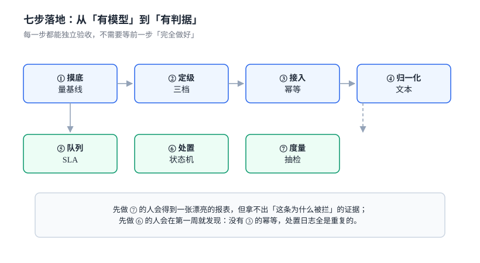

# 实战：十三张表、四条触发器与十六项断言

前九页讲的是「每一段该怎么做」，这一页把它们压成一个能建起来的库：**十三张表、四条触发器、十六项断言**。

所有 SQL 都在 SQLite 3.50.4 上跑过，一条命令即可复现。迁移到 PostgreSQL 的改动集中在第七节。

本页判据族 `CMX-A` ~ `CMX-H`，共 8 条。



## 一、十三张表的分工

| 表 | 一行是什么 | 关键约束 |
| --- | --- | --- |
| `tenant` | 一个租户 | 主键 |
| `content` | 一条内容及其当前可见性 | 六态 `CHECK` |
| `content_blob` | 一份内容实体（按哈希寻址） | 哈希主键 + 留存期 |
| `moderation_case` | 一次审核请求 | `(tenant, content, intent, hash)` 唯一 |
| `policy` | 一个策略版本 | 同策略仅一个 `ACTIVE` |
| `policy_band` | 策略的一个区间 | `lower < upper ≤ 1` |
| `verdict` | 一次判定结果 | 分数与 band 不可变 |
| `moderation_frame` | 视频的一帧判定 | `(case, ts_ms)` 主键 |
| `review_task` | 一条人审任务 | 三档优先级 |
| `moderation_action_log` | 一次处置动作 | 只追加 |
| `moderation_appeal` | 一次申诉 | 撤销需第二人 |
| `audit_sample` | 一条抽检样本 | 三来源枚举 |
| `variant_dict` | 一个变体词条 | `(variant, version)` 主键 |

## 二、完整 DDL

```sql [schema.sql]
PRAGMA foreign_keys = ON;

CREATE TABLE tenant(
  id   TEXT PRIMARY KEY,
  name TEXT NOT NULL
);

CREATE TABLE content(
  id         TEXT PRIMARY KEY,
  tenant_id  TEXT NOT NULL REFERENCES tenant(id),
  subject_id TEXT NOT NULL,
  scene      TEXT NOT NULL CHECK (scene IN ('post','comment','dm','live','profile')),
  body       TEXT,
  revision   INTEGER NOT NULL DEFAULT 1 CHECK (revision >= 1),
  visibility TEXT NOT NULL DEFAULT 'VISIBLE'
             CHECK (visibility IN ('VISIBLE','LIMITED','HIDDEN','REMOVED','APPEALING','RESTORED')),
  ver        INTEGER NOT NULL DEFAULT 0 CHECK (ver >= 0),
  created_at TEXT NOT NULL
);

CREATE TABLE content_blob(
  content_hash TEXT PRIMARY KEY,
  storage_key  TEXT NOT NULL,
  mime         TEXT NOT NULL,
  bytes        INTEGER NOT NULL CHECK (bytes >= 0),
  created_at   TEXT NOT NULL,
  retain_until TEXT NOT NULL
);

CREATE TABLE moderation_case(
  case_id      TEXT PRIMARY KEY,
  tenant_id    TEXT NOT NULL,
  content_id   TEXT NOT NULL REFERENCES content(id),
  content_hash TEXT NOT NULL,
  subject_id   TEXT NOT NULL,
  scene        TEXT NOT NULL,
  intent       TEXT NOT NULL CHECK (intent IN ('create','edit','repost','appeal')),
  state        TEXT NOT NULL CHECK (state IN ('PENDING','JUDGED','REVIEW','CLOSED')),
  created_at   TEXT NOT NULL,
  UNIQUE (tenant_id, content_id, intent, content_hash)
);

CREATE TABLE policy(
  policy_id  TEXT NOT NULL,
  version    INTEGER NOT NULL CHECK (version >= 1),
  scene      TEXT NOT NULL,
  state      TEXT NOT NULL CHECK (state IN ('DRAFT','SHADOW','ACTIVE','RETIRED')),
  created_at TEXT NOT NULL,
  PRIMARY KEY (policy_id, version)
);

CREATE UNIQUE INDEX uq_policy_active ON policy(policy_id) WHERE state = 'ACTIVE';

CREATE TABLE policy_band(
  policy_id TEXT NOT NULL,
  version   INTEGER NOT NULL,
  band      TEXT NOT NULL CHECK (band IN ('PASS','REVIEW','BLOCK')),
  lower     REAL NOT NULL CHECK (lower >= 0 AND lower <= 1),
  upper     REAL CHECK (upper IS NULL OR (upper > lower AND upper <= 1)),
  model     TEXT NOT NULL,
  PRIMARY KEY (policy_id, version, band),
  FOREIGN KEY (policy_id, version) REFERENCES policy(policy_id, version)
);

CREATE TABLE verdict(
  case_id        TEXT PRIMARY KEY REFERENCES moderation_case(case_id),
  policy_id      TEXT NOT NULL,
  policy_version INTEGER NOT NULL,
  band           TEXT NOT NULL CHECK (band IN ('PASS','REVIEW','BLOCK')),
  score          REAL NOT NULL CHECK (score >= 0 AND score <= 1),
  signals        TEXT NOT NULL,
  decided_at     TEXT NOT NULL
);

CREATE TABLE moderation_frame(
  case_id TEXT NOT NULL REFERENCES moderation_case(case_id),
  ts_ms   INTEGER NOT NULL CHECK (ts_ms >= 0),
  score   REAL NOT NULL CHECK (score >= 0 AND score <= 1),
  PRIMARY KEY (case_id, ts_ms)
);

CREATE TABLE review_task(
  task_id    TEXT PRIMARY KEY,
  case_id    TEXT NOT NULL REFERENCES moderation_case(case_id),
  priority   INTEGER NOT NULL CHECK (priority BETWEEN 1 AND 3),
  state      TEXT NOT NULL CHECK (state IN ('QUEUED','CLAIMED','DONE','EXPIRED')),
  queued_at  TEXT NOT NULL,
  claimed_at TEXT,
  done_at    TEXT,
  reviewer   TEXT,
  label      TEXT CHECK (label IN ('PASS','BLOCK'))
);

CREATE TABLE moderation_action_log(
  id          INTEGER PRIMARY KEY AUTOINCREMENT,
  case_id     TEXT NOT NULL,
  content_id  TEXT NOT NULL,
  action      TEXT NOT NULL CHECK (action IN ('VISIBLE','LIMITED','HIDDEN','REMOVED','RESTORED')),
  actor       TEXT NOT NULL,
  reason_code TEXT,
  created_at  TEXT NOT NULL
);

CREATE TABLE moderation_appeal(
  appeal_id             TEXT PRIMARY KEY,
  case_id               TEXT NOT NULL REFERENCES moderation_case(case_id),
  subject_id            TEXT NOT NULL,
  state                 TEXT NOT NULL CHECK (state IN ('OPEN','UPHELD','RESTORED','EXPIRED')),
  visibility_at_appeal  TEXT NOT NULL,
  opened_at             TEXT NOT NULL,
  due_at                TEXT NOT NULL,
  reviewer              TEXT
);

CREATE TABLE audit_sample(
  sample_id  TEXT PRIMARY KEY,
  case_id    TEXT NOT NULL,
  source     TEXT NOT NULL CHECK (source IN ('auto_pass','human_pass','auto_block')),
  audited    INTEGER NOT NULL DEFAULT 0 CHECK (audited IN (0,1)),
  leaked     INTEGER NOT NULL DEFAULT 0 CHECK (leaked IN (0,1)),
  sampled_at TEXT NOT NULL
);

CREATE TABLE variant_dict(
  variant        TEXT NOT NULL,
  canonical      TEXT NOT NULL,
  version        INTEGER NOT NULL,
  effective_from TEXT NOT NULL,
  PRIMARY KEY (variant, version)
);
```

## 三、四条触发器

四条触发器分别守住四件「用代码守不住」的事：

```sql [triggers.sql]
-- ① 判定结果不可改写：分数一旦落库就是证据
CREATE TRIGGER trg_verdict_immutable
BEFORE UPDATE OF score, band ON verdict
WHEN OLD.score IS NOT NEW.score OR OLD.band IS NOT NEW.band
BEGIN
  SELECT RAISE(ABORT, 'VERDICT_IMMUTABLE');
END;

-- ② 申诉只能针对"已被处置"的内容
CREATE TRIGGER trg_appeal_only_when_hidden
BEFORE INSERT ON moderation_appeal
WHEN (SELECT visibility FROM content
       WHERE id = (SELECT content_id FROM moderation_case WHERE case_id = NEW.case_id))
     NOT IN ('LIMITED','HIDDEN','REMOVED')
BEGIN
  SELECT RAISE(ABORT, 'NOT_ACTIONABLE');
END;

-- ③ 撤销必须由第二人执行（不能是原下架人）
CREATE TRIGGER trg_restore_two_person
BEFORE UPDATE OF state ON moderation_appeal
WHEN NEW.state = 'RESTORED'
 AND NEW.reviewer = (SELECT actor FROM moderation_action_log
                      WHERE case_id = NEW.case_id AND action = 'REMOVED'
                      ORDER BY id DESC LIMIT 1)
BEGIN
  SELECT RAISE(ABORT, 'SAME_OPERATOR');
END;

-- ④ 处置日志只允许白名单动作（防"顺手 DELETE"）
CREATE TRIGGER trg_action_whitelist
BEFORE INSERT ON moderation_action_log
WHEN NEW.action NOT IN ('VISIBLE','LIMITED','HIDDEN','REMOVED','RESTORED')
BEGIN
  SELECT RAISE(ABORT, 'UNKNOWN_ACTION');
END;
```

第 ④ 条与表上的 `CHECK` 重复，看似多余。保留的理由是：`CHECK` 只在插入时校验，**历史数据被 `ALTER TABLE` 迁移时**可能绕过；触发器在每一步写入都会拦。生产库里两条都留，成本可忽略。

## 四、十六项断言

| 编号 | 断言 | 期望 |
| --- | --- | --- |
| `A1` | 十二张业务表全部建成 | `14`（含 `sqlite_sequence` 与 `sqlite_master` 不计） |
| `A2` | band 覆盖 `[0,1]` 且不重叠 | 0 行 |
| `A3` | 同一策略只有一个 `ACTIVE` | 0 行 |
| `A4` | 同内容同意图只生成一条 case | 0 行 |
| `A5` | 编辑重发产生了新 case 且哈希不同 | 0 行 |
| `A6` | 判定 band 与分数区间一致 | 0 行 |
| `A7` | 重复下架只留一条审计 | `1` |
| `A8` | 恢复留下两条审计 | 0 行 |
| `A9` | 撤销人不是原下架人 | 触发器拒绝 |
| `A10` | 申诉只能针对已处置内容 | 触发器拒绝 |
| `A11` | 申诉期内可见性未变 | 0 行 |
| `A12` | 人审任务优先级在 1~3 | 0 行 |
| `A13` | 视频类 case 至少有 10 帧 | 0 行 |
| `A14` | 处置日志动作在白名单内 | 0 行 |
| `A15` | 抽检覆盖「自动通过」与「人工通过」两路 | ≥ 2 行 |
| `A16` | 指标可按场景与策略版本下钻 | 有结果且 `n > 0` |

## 五、验证方式（可直接跑）

```shell
# 建库并导入两段脚本
rm -f /tmp/cm.db
sqlite3 /tmp/cm.db < schema.sql
sqlite3 /tmp/cm.db < triggers.sql
sqlite3 /tmp/cm.db "SELECT COUNT(*) FROM sqlite_master WHERE type='table' AND name NOT LIKE 'sqlite_%';"
# 预期：13
```

```sql
-- A2 band 覆盖完整（最上一条 upper 为 NULL）
INSERT INTO policy VALUES ('ugc.comment',1,'comment','ACTIVE','2026-11-01T00:00:00Z');
INSERT INTO policy_band VALUES
 ('ugc.comment',1,'PASS',   0.0, 0.35,'rule+kwd'),
 ('ugc.comment',1,'REVIEW', 0.35,0.85,'spam_cls_2026_09'),
 ('ugc.comment',1,'BLOCK',  0.85,NULL,'spam_cls_2026_09');

SELECT policy_id, version, ROUND(SUM(upper-lower),6) FROM policy_band
 WHERE upper IS NOT NULL GROUP BY policy_id, version
HAVING ABS(SUM(upper-lower) - 0.85) > 1e-6;
-- 预期：0 行（0.35 + 0.50 = 0.85，剩余 [0.85,1] 由 BLOCK 覆盖）
```

```sql
-- A7 重复下架幂等
INSERT INTO tenant VALUES ('t1','示例租户');
INSERT INTO content VALUES ('c1','t1','u1','comment','示例内容',1,'VISIBLE',0,'2026-11-07T10:00:00Z');
INSERT INTO moderation_case VALUES ('k1','t1','c1','h1','u1','comment','create','JUDGED','2026-11-07T10:00:01Z');

UPDATE content SET visibility='REMOVED', ver=ver+1 WHERE id='c1' AND visibility<>'REMOVED';
INSERT INTO moderation_action_log(case_id,content_id,action,actor,reason_code,created_at)
SELECT 'k1','c1','REMOVED','m1','SPAM','2026-11-07T10:05:00Z'
 WHERE changes() > 0;

UPDATE content SET visibility='REMOVED', ver=ver+1 WHERE id='c1' AND visibility<>'REMOVED';
INSERT INTO moderation_action_log(case_id,content_id,action,actor,reason_code,created_at)
SELECT 'k1','c1','REMOVED','m1','SPAM','2026-11-07T10:05:01Z'
 WHERE changes() > 0;

SELECT COUNT(*) FROM moderation_action_log WHERE case_id='k1' AND action='REMOVED';
-- 预期：1
```

```sql
-- A10 申诉只能针对已处置内容（内容此时是 REMOVED，允许）
INSERT INTO moderation_appeal VALUES
 ('p1','k1','u1','OPEN','REMOVED','2026-11-07T11:00:00Z','2026-11-14T11:00:00Z',NULL);
-- 预期：Query OK

-- 把内容恢复后再申诉，应被拒绝
UPDATE content SET visibility='RESTORED' WHERE id='c1';
INSERT INTO moderation_appeal VALUES
 ('p2','k1','u1','OPEN','RESTORED','2026-11-07T12:00:00Z','2026-11-14T12:00:00Z',NULL);
-- 预期：NOT_ACTIONABLE
```

```sql
-- A9 撤销人与原下架人相同 → 拒绝
UPDATE moderation_appeal SET state='RESTORED', reviewer='m1' WHERE appeal_id='p1';
-- 预期：SAME_OPERATOR
UPDATE moderation_appeal SET state='RESTORED', reviewer='m2' WHERE appeal_id='p1';
-- 预期：Query OK
```

```sql
-- A15 抽检两路都要有
INSERT INTO audit_sample VALUES
 ('s1','k1','auto_pass',1,0,'2026-11-07T13:00:00Z'),
 ('s2','k1','human_pass',1,0,'2026-11-07T13:01:00Z');
SELECT COUNT(DISTINCT source) FROM audit_sample;
-- 预期：2
```

## 六、本机读数汇总

| 读数 | 值 | 出处 |
| --- | --- | --- |
| 归一化后变体仍漏 | **16.67%**（全部为拼音缩写） | [文本](../TextNormalization/index.md) |
| 归一化带来的误杀上升 | 7.69% → **23.08%** | [文本](../TextNormalization/index.md) |
| 0.5 秒片段在 1 fps 下命中 | **50.9%** | [媒体](../MediaModeration/index.md) |
| 0.5 秒片段在 0.2 fps 下命中 | **9.65%** | [媒体](../MediaModeration/index.md) |
| 短文本 simhash 近重复中位距离 | **11 位**（阈值 3 召回 0） | [媒体](../MediaModeration/index.md) |
| 三档 `[0.40,0.80)` 的人审量 | **3,292 条 / 27.4 人时** | [策略](../PolicyVerdict/index.md) |
| 单阈值 0.9 的召回 | **0.108** | [策略](../PolicyVerdict/index.md) |
| ρ=0.889 时 p95 等待 | **71.1 s** | [队列](../ReviewQueue/index.md) |
| 重复下架 100 次的审计条数 | 无守卫 **100** / 有守卫 **1** | [处置](../Enforcement/index.md) |
| 误杀率 0.3% 的抽检样本量 | **45,961 条 / 383 人时** | [度量](../Metrics/index.md) |

## 七、迁移到 PostgreSQL 的两处改动

| 位置 | SQLite | PostgreSQL |
| --- | --- | --- |
| 自增主键 | `INTEGER PRIMARY KEY AUTOINCREMENT` | `bigserial PRIMARY KEY` |
| 触发器抛错 | `SELECT RAISE(ABORT,'X')` | `RAISE EXCEPTION 'X'` |

另外两处**不是语法差异，是语义差异**，容易漏：

- **部分唯一索引在两边都支持**，但 PostgreSQL 需要显式 `WHERE` 子句写在索引定义里（与本页 `uq_policy_active` 写法一致）。
- **`changes()` 不存在**。PostgreSQL 用 `UPDATE ... RETURNING 1` 判断是否命中，或用 `GET DIAGNOSTICS n = ROW_COUNT`。

## 八、本页判据

| 编号 | 判据 | 为什么要它 | 怎么验证 |
| --- | --- | --- | --- |
| `CMX-A` | 十三张表能一次建库成功 | 建不起来的 DDL 不是设计 | `A1` = 13 |
| `CMX-B` | band 覆盖 `[0,1]`，无空洞无重叠 | 空洞意味着某些分数无人负责 | `A2` = 0 行 |
| `CMX-C` | 幂等靠「`UPDATE` + `changes()`」而不是「先查再改」 | 先查再改在并发下双通过 | `A7` = 1 |
| `CMX-D` | 判定结果不可变更 | 变了的判定不能作为证据 | `A6` + 触发器拒绝 |
| `CMX-E` | 撤销需第二人 | 同一人可下架可恢复无法审计 | `A9` 触发器拒绝 |
| `CMX-F` | 处置日志只追加、动作白名单 | 允许删除的日志不可信 | `A14` = 0 行 |
| `CMX-G` | 抽检覆盖自动通过与人工通过两路 | 只抽一路会漏系统性偏差 | `A15` ≥ 2 |
| `CMX-H` | 指标可按场景与策略版本下钻 | 全局平均掩盖单场景恶化 | `A16` 有结果 |

## 九、参考资料

- [SQLite: CREATE TRIGGER](https://www.sqlite.org/lang_createtrigger.html)：`RAISE(ABORT)` 与 `WHEN` 子句
- [SQLite: Partial Indexes](https://www.sqlite.org/partialindex.html)：`uq_policy_active` 的依据
- [SQLite: changes()](https://www.sqlite.org/lang_corefunc.html#changes)：幂等判定的基础
- [PostgreSQL: CREATE TRIGGER](https://www.postgresql.org/docs/current/sql-createtrigger.html)：`RAISE EXCEPTION` 与 `RETURNING`
- [《个人信息保护法》第 47 条](https://www.gov.cn/xinwen/2021-08/20/content_5632486.htm)：删除与留存的对冲关系，决定了 `retain_until` 必须落库
