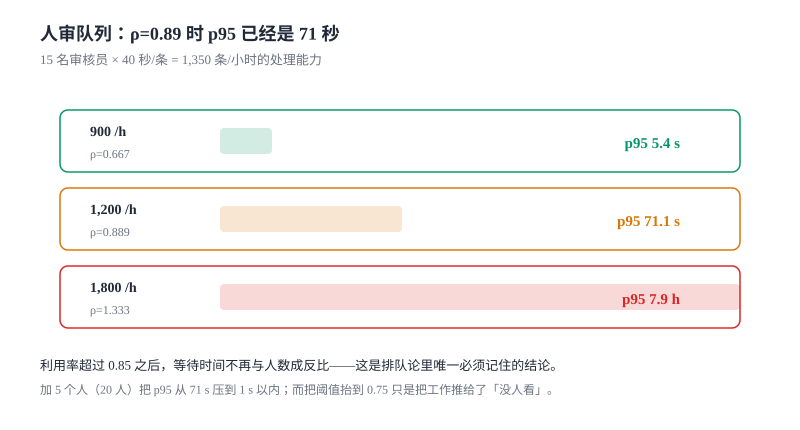

# 人审队列：ρ 超过 0.85 之后，加人不线性

灰区内容进人审队列，队列是审核系统里**唯一有物理上限**的环节：机审可以加机器，人审只能加人，而人需要招聘、培训、排班。

于是排队时间成了这套系统最真实的指标——它比漏放率更早暴露问题，也比误杀率更难作假。

本页判据族 `CMQ-A` ~ `CMQ-H`，共 8 条。



## 一、队列不是 FIFO

把人审队列做成先进先出，等于让「一条待审的广告」和「一条可能涉及未成年人的内容」排同一个队。真实的队列至少有三个优先级维度：

| 维度 | 取值 | 为什么要影响顺序 |
| --- | --- | --- |
| 风险 | 高（可能违法）/ 中 / 低 | 高风险内容每多挂 1 分钟，传播面线性增长 |
| 时效 | 直播/热帖/大 V / 普通 | 已经有人看的内容，晚一分钟就是多几千次曝光 |
| 申诉 | 是 / 否 | 申诉有法定或承诺时限，逾期即违约 |

优先级不是「加权求和成一个分数」，而是**分层队列**：高风险单独一个队列，申诉单独一个队列，其余按时间。理由很实际——加权分数在实现时总会退化成「谁的分高谁先」，而运营需要的是「高风险队列永远不会被普通内容挤爆」。

## 二、ρ 与等待：唯一必须记住的结论

人审系统的产能是 `审核员数 × 3600 ÷ 单条处理秒数`。15 名审核员、40 秒/条，产能是 1,350 条/小时。

本机模拟（泊松到达、指数服务时间、24 小时）：

| 到达率 | 利用率 ρ | 等待 p50 | 等待 p95 | 最长等待 |
| --- | --- | --- | --- | --- |
| 900 /h | 0.667 | 0.0 s | **5.4 s** | 44.3 s |
| 1,200 /h | 0.889 | 2.6 s | **71.1 s** | 155.0 s |
| 1,200 /h（20 人） | 0.667 | 0.0 s | **< 1 s** | 28.7 s |
| 1,800 /h | 1.333 | 15,023 s | **28,623 s** | 29,871 s |

两件事一眼可见：

1. **ρ 从 0.667 到 0.889，等待 p95 从 5.4 秒涨到 71 秒（13 倍）**，而产能只用了 89%。利用率看起来「还有余量」，体验已经崩了。
2. **ρ 超过 1 之后不是「慢一点」，是「永远追不上」**：p95 近 8 小时，队列长度随时间线性增长，直到有人工干预（加人、放宽阈值、批量处理）。

::: tip 一句话理解
ρ = 0.85 是人审队列的经验红线。超过它，等待时间对到达率的敏感度是发散的——**排队系统在临界点附近没有「稍微慢一点」这个状态**。
:::

## 三、SLA 时钟从哪算

「人审 SLA 4 小时」这句话有四种算法，结果差一倍以上：

| 起点 | 终点 | 适用 | 陷阱 |
| --- | --- | --- | --- |
| 用户提交 | 人工给出结论 | 同步前置场景 | 含机审耗时，模型慢会把 SLA 吃掉 |
| 进入队列 | 人工给出结论 | 异步场景 | 不含排队前的时间，容易「好看」 |
| 内容发布 | 人工给出结论 | 已上线内容的事后审核 | 最严格，也最接近用户感知 |
| 申诉提交 | 复核结论 | 申诉通道 | 与内容审核 SLA 是两条独立的线 |

选哪一种要写进 SLA 文档，并且**报表按同一种算**。本仓见过的最常见错误是：SLA 按「进队」算，报表按「提交」算，于是同一个系统在两张报表上分别是 98% 与 71%。

## 四、路由：按场景、语言、技能分池

一个队列服务所有内容，会造成两个后果：审核员什么都要会（培训成本高），以及高风险内容被普通内容堵住（优先级失效）。

分池的三个维度：

- **场景池**：帖子 / 评论 / 私信 / 直播。不同场景的判定标准与话术不同。
- **语言池**：中文 / 英文 / 其他。跨语言审核的准确率显著低，必须单独排班。
- **技能池**：普通 / 未成年保护 / 法律敏感 / 大 V。高风险内容只进高技能池。

分池的代价是**池间不均衡**：某个池空了，另一个池排长队。解法不是合并池，而是允许**溢出**（池空时按技能降级接单），并记录溢出率——溢出率超过 20% 说明分池维度设计错了。

## 五、一致性与双盲

人审最大的隐性成本是**同一批内容、不同的人、不同的结论**。衡量它是 Cohen's kappa，不是「一致率」：

```text
po = 实际一致率
pe = 两人各自判定分布的乘积之和（随机一致的期望）
kappa = (po − pe) / (1 − pe)
```

一个真实感很强的例子：200 条内容、两名审核员，表面一致率 85%（170 条相同），其中双方都判违规 20 条、双方都判通过 150 条，甲单独判违规 10 条、乙单独判违规 20 条。

- `po = 0.85`
- 甲违规率 0.15、乙违规率 0.20 → `pe = 0.15 × 0.20 + 0.85 × 0.80 = 0.71`
- `kappa = (0.85 − 0.71) / (1 − 0.71) = **0.483**`

**表面一致率 85%，kappa 只有 0.48。** 原因是违规率低（15%~20%），大部分「一致」来自「双方都判通过」，而这部分在随机情况下也会高度一致。

::: danger 用「一致率」验收人审质量的三个后果
1. 违规率越低，一致率越好看——**越是审核宽松的团队，指标越漂亮**。
2. 一致率无法区分「都判对」与「都判错」。两个人一起放过同一条违规内容，一致率仍然是 100%。
3. 一致率不随样本量变化，kappa 会——后者才能告诉你「这个数字可信吗」。
:::

一致性低于 0.6 时，先查三件事：判定标准是否有可执行的判据（不是「凭感觉」）、培训样本是否覆盖边界情况、双盲是否真的双盲（后审的人能看到前一个人的结论就不是双盲）。

## 六、抽检与产能

人审的产出要能自我校验。两个常规动作：

- **已判内容抽检**：从「自动通过」和「人工通过」里各抽 1%~5%，由第二人复核。它估计的是**漏放率**。
- **一致性抽检**：同一批内容让两人独立判，算 kappa。它估计的是**判定稳定性**。

抽检比例与样本量的关系是硬约束。要证明「误杀率 0.3%」在 ±0.05% 内成立，需要抽检 **45,961 条**（95% 置信、比例估计），按 30 秒/条是 **383 人时**。这个数字解释了为什么大多数团队报的误杀率都是「拍脑袋」：他们抽了几百条，误差比指标本身还大。

## 七、本页判据

| 编号 | 判据 | 为什么要它 | 怎么验证 |
| --- | --- | --- | --- |
| `CMQ-A` | 高风险与申诉必须有独立队列，不被普通内容挤占 | 加权队列会退化成单队列 | 高风队队列长度与普通队列分别可查 |
| `CMQ-B` | ρ 有监控与告警，红线 0.85 | 超过后等待时间发散 | 到达率提升到 1.2 倍产能时告警触发 |
| `CMQ-C` | SLA 的起点与终点写死在文档与报表同一处 | 四种算法差一倍以上 | 报表口径与 SLA 文档逐字一致 |
| `CMQ-D` | 分池允许溢出，且溢出率可观测 | 池间不均衡会让某个池排长队 | 溢出率指标存在且 < 20% |
| `CMQ-E` | 人审质量用 kappa，不用一致率 | 本机示例一致率 85%、kappa 0.48 | 抽检报表同时给出一致率与 kappa |
| `CMQ-F` | kappa 低于 0.6 必须触发标准复核 | 低 kappa 意味着判定不可复制 | 低于阈值时有复核工单 |
| `CMQ-G` | 自动通过与人工通过都要抽检 | 只抽人工通过会漏掉机审的系统性偏差 | 两路抽检比例都可配 |
| `CMQ-H` | 抽检样本量按置信区间算，不按「感觉够了」 | 0.3% 误杀率需 45,961 条 | 抽检计划里写明置信水平与半宽 |

## 八、验证方式

```python
# 队列模拟：与第二节的表对照（15 人 / 40 秒 / 24 小时）
import random
random.seed(20261107)

def queue(lam, rv=15, svc=40, hours=24):
    t, arrive = 0.0, []
    for _ in range(int(lam * hours)):
        t += random.expovariate(lam / 3600)
        arrive.append(t)
    free, waits = [0.0] * rv, []
    for a in arrive:
        i = min(range(rv), key=lambda k: free[k])
        s = max(a, free[i])
        waits.append(s - a)
        free[i] = s + random.expovariate(1 / svc)
    waits.sort()
    return lam / (rv * 3600 / svc), waits[len(waits) // 2], waits[int(len(waits) * .95)]

for lam in (900, 1200):
    print([round(x, 1) for x in queue(lam)])
# 预期：第一行 ρ≈0.67、p95 个位数秒；第二行 ρ≈0.89、p95 数十秒
```

```sql
-- ρ 的实时口径：过去 15 分钟的平均进队速率 ÷ 产能
SELECT COUNT(*) / 15.0 / 60 AS per_sec,
       COUNT(*) / (15.0 * 60 * 1350 / 3600) AS rho
  FROM moderation_case
 WHERE state = 'REVIEW' AND created_at >= datetime('now', '-15 minutes');
-- 判读：rho > 0.85 时应当已经触发告警
```

```sql
-- 抽检覆盖：两路都要有
SELECT source, COUNT(*) FROM moderation_audit_sample GROUP BY source;
-- 预期：至少两行（auto_pass / human_pass），且比例接近配置值
```

## 九、参考资料

- [Little's Law](https://en.wikipedia.org/wiki/Little%27s_law)：队列长度、到达率与等待时间的关系（`L = λW`）
- [M/M/c queue](https://en.wikipedia.org/wiki/M/M/c_queue)：多服务台排队的等待时间公式（本页 ρ 红线的来源）
- [Cohen's kappa](https://en.wikipedia.org/wiki/Cohen%27s_kappa)：一致性指标的定义与「为什么一致率不够」
- [Google SRE Book: Handling Overload](https://sre.google/sre-book/handling-overload/)：过载时的降级与拒绝策略
- [Trust & Safety Professional Association](https://www.tspa.org/)：审核运营的排班、SLA 与质量抽检实践
