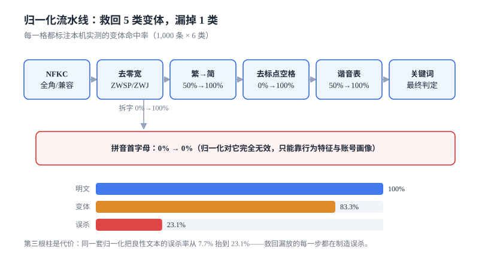

# 文本对抗与归一化：救回 5 类变体，漏掉 1 类

「加个零宽字符就能绕过」不是段子，是**审核系统最稳定的漏放来源**：它不依赖攻击者有多聪明，只依赖你的流水线少了一步。

本页把文本对抗拆成六类变体，量出每一类在归一化前后的命中率，并给出那条最容易被忽略的代价——**归一化救回漏放的同时，会制造误杀**。

本页判据族 `CMN-A` ~ `CMN-H`，共 8 条。



## 一、六类变体

| 变体 | 例子（原文「代开发票」） | 攻击成本 | 归一化能否救回 |
| --- | --- | --- | --- |
| 繁简混写 | 代開發票 | 极低（输入法自带） | 能（繁→简表） |
| 拆字加符号 | 代-开-发-票 / 代 开 发 票 | 极低 | 能（去标点与空白） |
| 零宽字符 | `代[ZWSP]开[ZWSP]发[ZWSP]票` | 极低（复制即得） | 能（删 ZWSP/ZWJ/BOM） |
| 全角/兼容字符 | ＡＢＣ１２３（对中文关键词无效） | 低 | 能（NFKC） |
| 谐音替换 | 代开发嘌 / 加威信 | 中（要挑字） | 部分（取决于词表覆盖） |
| 拼音首字母 | dkfp / jwx | 中 | **不能**（归一化对它完全无效） |

前四类是**编码层**的变形，可以用确定性规则完全还原；后两类是**语义层**的变形，还原需要词典或模型，而词典永远补不全——这正是它们的价值所在。

::: tip 一句话理解
归一化能把「同一个字的六种写法」变成一个，但变不出「同一个意思的六种说法」。前者是工程问题，后者是模型问题。
:::

## 二、顺序不能反

归一化是一条流水线，步骤顺序错了会互相破坏：

```text
原始文本
  ↓ NFKC 兼容分解（全角→半角、兼容字符→标准字符）
  ↓ 删零宽与方向控制符（U+200B/200C/200D/FEFF）
  ↓ 转小写（只对拉丁字母有意义）
  ↓ 繁→简（按字映射，不做词组替换）
  ↓ 谐音/变体词表（variant → canonical）
  ↓ 去空白与标点（**放在最后**）
归一化文本
```

`去空白与标点` 必须在最后，因为它**不可逆**：一旦把所有标点删掉，就无法再区分「代开。发票请找财务」和「代开发票」。而这一步恰恰是误杀的来源（见第四节）。

`繁→简` 必须按**单字**映射而不是词组，否则「发」在「头发」与「发票」里会被映射成同一个字，虽然这里恰好都对，但换一组字（如「干」）就会出错。

## 三、每一步救回多少

本机实测：8 个违规关键词 × 125 条样本 = 1,000 条明文，分别施加六类变体，再用同一套归一化处理。

| 变体 | 变体后直接匹配 | 归一化后 | 结论 |
| --- | --- | --- | --- |
| 繁体 | 50.0% | **100%** | 单字映射即可完全还原 |
| 拆字加符号 | 0.0% | **100%** | 去标点即可 |
| 零宽字符 | 0.0% | **100%** | 删控制符即可 |
| 插空格 | 0.0% | **100%** | 去空白即可 |
| 谐音 | 50.0% | **100%**（本机词表覆盖了全部 5 个变体） | 覆盖多少救多少 |
| 拼音首字母 | 0.0% | **0.0%** | 归一化无解 |

六类合计 6,000 条变体，归一化后仍漏 1,000 条（**16.67%**），**全部来自拼音首字母**。

这个数字很重要：它说明「把归一化做全」最多能把漏放压到 16.67%，剩下的部分只能靠**行为特征**（同一账号短时间大量发同类缩写）、**账号画像**（新号 + 高频 + 模板化文案）或**语义模型**。指望词表解决缩写，是一个永远不会收敛的工程。

## 四、代价：误杀从 7.69% 涨到 23.08%

同一套归一化，跑在 1,300 条良性文本上（其中 300 条是「句中含关键词但语义合规」的陷阱句）：

| 口径 | 误杀率 | 说明 |
| --- | --- | --- |
| 直接匹配 | **7.69%** | 只有字面完全相同的才误杀 |
| 归一化后匹配 | **23.08%** | 去标点把跨句文本粘成了关键词 |

典型陷阱句：

- 「我不会代开。发票请找财务，别问我」——去标点后变成「我不会代开发票请找财务」，命中「代开发票」。
- 「刷单。据说是违规的，平台会封号」——去标点后命中「刷单」，而这句话是在**劝阻**。

这两句揭示了归一化的本质：**它把「句子」压成了「字符流」，而违规判断需要「句子」**。压缩得越狠，召回越高，误杀也越高。

::: danger 三个常见的「归一化做过头」
1. **删掉全部标点**：跨句拼接产生假阳性（本机把误杀从 7.69% 抬到 23.08%）。处置：只删「分隔型」标点（空格、`·`、`-`、`_`、`*`），保留句末标点（`。！？`）作为句子边界。
2. **全量繁→简后再匹配简体词表**：会把港澳台用户的正常用字误判（例如「幹」→「干」后与「干扰」类词表撞车）。处置：繁简表只用于**匹配**，不改写原文；原文永远保留。
3. **把 emoji 全部剥掉**：emoji 本身是导流与暗示的常用载体（如特定 emoji 序列代表联系方式）。处置：把 emoji 映射成短代码（`:wechat:` 之类）参与匹配，而不是删除。
:::

## 五、规则还是模型

两条路的适用边界，用「命中形态」判断比用「准确率」判断更可靠：

| 形态 | 关键词/规则 | 分类模型 |
| --- | --- | --- |
| 明确词表（违禁品、联系方式） | **首选**，可解释、可枚举 | 不必要 |
| 变体与拼写 | 归一化 + 词表 | 词表补不全时兜底 |
| 语义暗示（「私聊有惊喜」） | 几乎无效 | **首选** |
| 上下文依赖（图文组合） | 无效 | 必须多模态 |
| 新出现的黑话 | 需要人工持续运营 | 泛化能力取决于训练分布 |

工程上正确的组合不是「二选一」，而是**规则打底、模型补灰区**：规则负责「确定违规」和「确定合规」（白名单），模型只负责把剩下的灰区排序，交给人工。这样即使模型整体漂移，规则那部分的判定仍然稳定。

## 六、可解释：命中位置要能回到原文

归一化之后，「命中在哪」这件事会失真。用户申诉时你要能回答「哪几个字触发了规则」，而 `normalized.index(keyword)` 给出的位置与原文对不上。

正确做法是**在归一化时保留字符映射**（每个归一化字符记录它来自原文的哪个下标），命中后把区间映射回原文，给出高亮：

```python
def normalize_with_map(text):
    out, pos = [], []
    for i, ch in enumerate(text):
        if ch in "\u200b\u200c\u200d\ufeff":
            continue
        for c in unicodedata.normalize("NFKC", ch):
            if c.isspace() or unicodedata.category(c).startswith("P"):
                continue
            out.append(c)
            pos.append(i)
    return "".join(out), pos
```

命中后 `pos[start:end]` 就是原文的区间。这段代码只有十几行，但它是「可申诉」与「不可申诉」的分界线——没有它，你只能告诉用户「系统认为你违规」。

## 七、本页判据

| 编号 | 判据 | 为什么要它 | 怎么验证 |
| --- | --- | --- | --- |
| `CMN-A` | 归一化顺序固定，去标点必须在最后 | 顺序反了会破坏后续步骤 | 用「代开。发票」测：句子边界应保留 |
| `CMN-B` | 零宽与方向控制符必须删除 | 它们是成本最低的绕过手段 | 插入 U+200B 的样本命中率与明文一致 |
| `CMN-C` | 繁简映射只用于匹配，不改写原文 | 改写会破坏证据与展示 | 判定日志里的原文与提交内容逐字节一致 |
| `CMN-D` | 归一化必须保留「原文字符位置」映射 | 否则申诉无法指出触发位置 | 命中后能给出原文区间 |
| `CMN-E` | 谐音/变体词表必须有版本号与生效期 | 词表变更需要可回溯 | `variant_dict(version, effective_from)` 可查 |
| `CMN-F` | 拼音缩写类变体不得用词表硬扛，须有行为特征兜底 | 词表永远补不全（本机漏放 16.67%） | 抽 100 条缩写样本，看行为规则命中比例 |
| `CMN-G` | 归一化后的误杀率必须有上界并与明文对比 | 本机从 7.69% 涨到 23.08% | 同一批良性样本跑两个口径，差值可解释 |
| `CMN-H` | 匹配命中必须记录「命中词 + 归一化文本 + 原文区间」 | 三者缺一，复核时无法复现 | 任取一条 case，三个字段非空 |

## 八、验证方式

下面这段脚本可以在本机直接跑，输出与第三节的表一致（省略了样本生成的长文本）：

```python
import unicodedata

BAD = ["代开发票", "刷单", "博彩", "私彩", "加微信", "高仿", "套现", "外挂"]
S2T = {"发": "發", "单": "單", "现": "現", "挂": "掛", "开": "開"}
T2S = {v: k for k, v in S2T.items()}
HOMO = {"刷单": "唰单", "博彩": "博采", "私彩": "私采", "加微信": "加威信"}

def norm(s):
    s = unicodedata.normalize("NFKC", s)
    s = s.replace("\u200b", "").replace("\ufeff", "").lower()
    s = "".join(T2S.get(c, c) for c in s)
    for origin, variant in HOMO.items():
        s = s.replace(variant, origin)
    return "".join(c for c in s if not (c.isspace() or unicodedata.category(c).startswith("P")))

print(norm("代-开-发-票"))          # 代开发票
print(norm("加威\u200b信"))          # 加微信
print(norm("代開發票"))              # 代开发票
print(norm("我不会代开。发票请找财务"))  # 我不会代开发票请找财务 —— 这就是误杀来源
```

预期输出：

```text
代开发票
加微信
代开发票
我不会代开发票请找财务
```

最后一行不是 bug，是**必须被看见的代价**：它在告诉你「去标点」这一步把两句粘成了一句。修复方式不是删掉这一步，而是在匹配时要求「命中区间不跨句末标点」——即先用 `。！？` 切句，再逐句归一化与匹配。

## 九、参考资料

- [Unicode Standard Annex #15: Normalization Forms](https://www.unicode.org/reports/tr15/)：NFKC 与 NFKD 的差别，以及为什么「兼容分解」是归一化的第一步
- [Unicode U+200B ZERO WIDTH SPACE](https://www.unicode.org/charts/PDF/U2000.pdf)：零宽字符的码位与常见用途
- [Python: unicodedata](https://docs.python.org/3/library/unicodedata.html)：`normalize` 与 `category` 的实际行为
- [OpenCC](https://github.com/BYVoid/OpenCC)：繁简转换的常用实现（注意它默认做词组转换，用于匹配时应改为字级）
- [《网络信息内容生态治理规定》](https://www.gov.cn/zhengce/zhengceku/2020-03/02/content_5487840.htm)：违规内容类型的法定口径，词表应以此为纲
