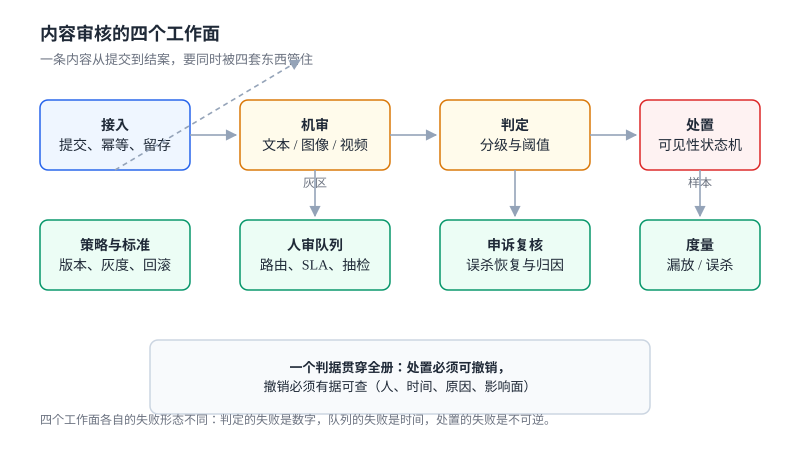

# 内容审核与安全策略工程

**内容审核要回答的不是「这条内容违不违规」，而是「在多少人力、多少延迟、多少误杀的约束下，把违规内容挡在多少人前面」。**

前半个问题有模型可以买，后半个问题只能自己算。一条内容从提交到结案，要穿过五道彼此独立的关口：**接入**（同一条内容被提交了几次）、**机审**（抽了多少帧、归一化了几个变体）、**判定**（阈值切在哪）、**人审**（队列排到第几位）、**处置**（能不能撤销）。这五道关口各自的失败形态完全不同——前两道失败是**数字**（漏放率、误杀率），第三道失败是**形状**（阈值曲线），第四道失败是**时间**（p95 排队），第五道失败是**不可逆**（删了就是删了）。

这一册只写这五道关口怎么被写成可判定的东西，以及它们在**没有舆情、没有投诉、没有报警**的情况下如何悄悄失效。

## 章节

- [总览：四条边界、五个安静的失败与最小起步](Overview/index.md) —— 审核与风控/审批/模型的边界、什么时候不需要审核、三步起步
- [接入与提交契约：同一条内容只该被审一次](Intake/index.md) —— 同步/异步/双写三种时机、幂等键、内容寻址、留存与删除
- [文本对抗与归一化：救回 5 类变体，漏掉 1 类](TextNormalization/index.md) —— 繁简、拆字、零宽、插空格、谐音、拼音缩写，以及归一化换来的误杀
- [媒体审核：抽帧密度就是漏放率](MediaModeration/index.md) —— 抽帧、哈希库、OCR 补文本、音频、封面与时长成本
- [策略判定与阈值：两条线，不是一个数](PolicyVerdict/index.md) —— 三档判定、按场景定阈值、策略版本与灰度、命中解释
- [人审队列：ρ 超过 0.85 之后，加人不线性](ReviewQueue/index.md) —— 路由、优先级、SLA 时钟、双盲与一致性
- [处置与撤销：删了之后怎么放回来](Enforcement/index.md) —— 六态状态机、幂等、级联、审计、申诉闭环与样本回流
- [度量与成本：四个数，缺一个就会被单独解释](Metrics/index.md) —— 漏放/误杀/时延/单位成本、抽检样本量、延迟预算
- [实战：十二张表、十八条约束与十六项断言](Practice/index.md) —— 完整 DDL、可运行脚本、逐条读数
- [常见问题与分诊](FAQ/index.md) —— 分诊表、十二问、止血五步、术语表

## 判据族一览

十族共 80 条，每页八条（`-A` ~ `-H`），定义在各页「本页判据」一节：

| 页面 | 族 | 约定 | 条数 |
| --- | --- | --- | --- |
| 总览 | `CMO` | 边界、失败归因、起步顺序、不做清单 | 8 |
| 接入 | `CMI` | 幂等、内容寻址、时机、留存 | 8 |
| 文本归一化 | `CMN` | 归一化顺序、变体覆盖、误杀上界、可解释 | 8 |
| 媒体 | `CMM` | 抽帧、哈希、OCR、音频、成本 | 8 |
| 策略与阈值 | `CMV` | 三档、按场景、版本、灰度、解释 | 8 |
| 人审队列 | `CMQ` | 路由、优先级、SLA、一致性、抽检 | 8 |
| 处置与撤销 | `CME` | 状态机、幂等、级联、审计、申诉与回流 | 8 |
| 度量 | `CMT` | 四指标、样本量、成本口径、报表 | 8 |
| 实战 | `CMX` | 分层约束、反向探针、断言、验收 | 8 |
| 常见问题 | `CMF` | 分诊可定位、止血顺序、术语 | 8 |

## 五个安静的失败

选这个专题的理由不是「审核难」，而是它的错误几乎都不报警：

| 失败 | 为什么安静 | 本册读数 |
| --- | --- | --- |
| 归一化把两句话粘成一个关键词 | 每句都合规，拼起来才「命中」 | 良性 1,300 条误杀率 **7.69% → 23.08%** |
| 抽帧漏掉短片段 | 视频「审过了」，日志里也有结果 | 0.5 秒片段在 0.2 fps 下命中率 **9.65%** |
| 单阈值当双阈值用 | 调高阈值只看见误杀下降 | 0.9 时召回 **0.108**、误杀 0.092%——看起来「很安全」 |
| 重复下架写坏审计 | 状态看着是对的 | 100 次重复下架：无守卫 **100 条**记录，有守卫 **1 条** |
| 短文本照搬「汉明距离 ≤ 3」 | 阈值是行业口口相传的 | 64 位 simhash 短文本近重复中位 **11 位**，阈值 3 召回 **0** |

五个失败的共同点是：**它们都发生在「两个口径之间」**——明文与变体之间、帧与秒之间、召回与人力之间、状态与日志之间、经验阈值与语料之间。所以本册每一页的写法都一样：先把口径写死成一条能落进 `WHERE` 或一个能跑的函数，再谈实现。

## 七段链

| 段 | 一句话 | 错了会怎样 | 页面 |
| --- | --- | --- | --- |
| 接入 | 把一次提交变成一条可追踪的审核单 | 同一条内容审三次，成本 ×3 | [接入](Intake/index.md) |
| 归一化 | 把变体还原成可比对的形态 | 漏放，且漏得很稳定 | [文本](TextNormalization/index.md) |
| 机审 | 文本、图像、音频各自出分 | 分数量纲不同却直接比较 | [媒体](MediaModeration/index.md) |
| 判定 | 分数 → 三档动作 | 阈值一刀切，场景全错 | [策略](PolicyVerdict/index.md) |
| 路由 | 灰区内容进人审队列 | 队列爆掉，SLA 失效 | [队列](ReviewQueue/index.md) |
| 处置 | 改变可见性并留痕 | 误杀无法撤销 | [处置](Enforcement/index.md) |
| 申诉 | 让被误杀的人有出口（处置页第五节） | 误杀永远不被发现 | [处置](Enforcement/index.md) |

第七段之后还有一段：**度量**。它不是链上的一环，而是把前七段的输出压成四个数——[度量](Metrics/index.md)。

## 与本册相邻的专题

内容审核横跨安全、风控、运营、存储四个域，本册刻意只写「一条内容怎么被判定、被处置、被复核」，其余交给相邻专题：

| 这件事 | 本册负责 | 隔壁专题负责 |
| --- | --- | --- |
| 交易与账号风险 | 只判「内容本身」 | [风险决策](../RiskDecision/index.md) 判人、设备、行为序列 |
| 模型输出侧的护栏 | 只判用户提交的内容 | [AI 安全与合规](../../AI/AISecurityCompliance/index.md)、[提示词安全](../../AI/PromptSecurity/index.md) 判模型输入输出 |
| 业务审批流 | 只借用「工单」形态 | [审批流](../WorkflowEngine/ApprovalFlow/index.md) 管多级签批与加签 |
| 用户投诉 | 只处理「对处置结果的申诉」 | [工单系统](../SupportTicket/index.md) 管服务与履约投诉 |
| 转码与分发 | 只取帧、只读元数据 | [媒体分发](../MediaDelivery/index.md) 管转码、切片与 CDN |
| 内容与证据的存放 | 只定「留多久、按什么键查」 | [对象存储](../ObjectStorage/index.md) 管桶、生命周期与授权 |
| 通知触达 | 只产出「该通知谁、通知什么」 | [通知投递](../NotificationDelivery/index.md) 管渠道、重试与抑制 |
| 请求幂等 | 只借用一个幂等键 | [幂等状态机](../IdempotencyStateMachine/index.md) 管通用幂等设计 |
| 主体与账号 | 只认 `subject_id` | [客户身份](../CustomerIdentity/index.md) 管归并与主数据 |
| 删除与留存合规 | 只声明「审核日志留多久」 | [隐私工程](../../Others/PrivacyEngineering/index.md) 管被遗忘权与最小化 |
| 多租户与配额 | 只假设每张表有 `tenant_id` | [多租户 SaaS](../MultiTenantSaaS/index.md) 管隔离与配额 |

::: warning 说明
本册所有 DDL 以 SQLite 语法给出，便于用 `sqlite3` 一条命令复跑；迁移到 PostgreSQL 需要改三处（`AUTOINCREMENT` → `GENERATED`、布尔 `INTEGER` → `boolean`、触发器里的 `RAISE(ABORT)` → `RAISE EXCEPTION`），[实战](Practice/index.md) 第七节给出对照。文中所有读数来自 Python 3.13.12 标准库 + SQLite 3.50.4，固定种子 `20261107`，脚本不入库，命令与预期输出都写在页内。
:::

## 为什么这一册不建版本目录

本仓的判据是「同一份代码两套写法」才建版本目录——[Spring5](../Java/Frame/Spring/Spring5/index.md) / [Spring6](../Java/Frame/Spring/Spring6/index.md)、[Vue2](../../Frontend/Frame/Vue/Vue2/index.md) / [Vue3](../../Frontend/Frame/Vue/Vue3/index.md) 都是这个理由。内容审核**不满足**这条判据，三条理由：

1. **换代的是模型，不是判据。** 从关键词到小模型到多模态大模型，判据一条没变：三档、可撤销、可解释、可回溯。换模型只改「谁出分」，不改「分怎么用」。
2. **并存差异是场景与法域，不是代际。** 社区、电商、直播、未成年保护各自阈值不同，但差异写在**策略表**里，不写在目录里。给每个场景建一个版本目录，会让 80% 正文重复。
3. **真正需要版本目录的是「同一 API 两套互斥写法」。** 本册的接口契约只依赖「提交 → 结果 → 申诉」三步，任何一代模型都接得进去。

模型与法规的演进落点是**行内标注**：凡涉及版本或法条的结论都带核对日期，例如「《互联网信息服务深度合成管理规定》自 2023-01-10 施行，2026-11-07 核对」，存量口径保留在正文、不删除也不覆盖。

## 参考资料

- [《网络信息内容生态治理规定》](https://www.gov.cn/zhengce/zhengceku/2020-03/02/content_5487840.htm)：内容生产者、平台、用户三方责任与「九不准」
- [《互联网信息服务算法推荐管理规定》](https://www.gov.cn/zhengce/zhengceku/2022-01/04/content_5666429.htm)：算法备案、显著告知与用户关闭选项
- [《互联网信息服务深度合成管理规定》](https://www.gov.cn/zhengce/zhengceku/2023-01/10/content_5736807.htm)：深度合成内容标识义务（2023-01-10 施行）
- [《未成年人网络保护条例》](https://www.gov.cn/zhengce/content/202310/content_6911288.htm)：未成年人模式与内容分级（2024-01-01 施行）
- [NIST AI RMF 1.0](https://www.nist.gov/itl/ai-risk-management-framework)：测量、治理、可追溯的风险框架（审核阈值与抽检设计的参照）
- [OWASP Top 10 for LLM Applications](https://owasp.org/www-project-top-10-for-large-language-model-applications/)：模型输出与提示注入的风险分类
