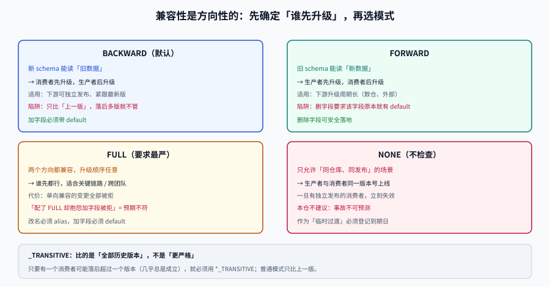

# 异步契约：消息与 schema 兼容模式

**一句话定位**：同步接口的兼容性能靠「同时在线两个版本」兜住，消息不能——**消息一旦写入就躺在日志里，等消费者来读，而消费者可能是三天后才启动的**。这一页讲消息体怎么改才不打断它们。

## 判据族声明

本页判据族 `CEA-A` ~ `CEA-H`，共 8 条。定义表在第七节。



## 一、为什么异步契约比同步更难

| 维度 | 同步接口 | 异步消息 |
| --- | --- | --- |
| 失败时机 | 立即（调用方当场看到 500） | **延迟**（消费者处理时才发现） |
| 失败范围 | 单次请求 | **一批**（一个分区积压几千条） |
| 版本共存 | 新旧实例同时在跑，各自响应 | 新旧消息**同时躺在同一个 topic 里** |
| 回滚 | 切流量 | 已经投递的消息无法收回 |
| 谁在读 | 你知道（日志里有 `client_id`） | 可能是三年后新接入的数仓任务 |

第三行是最本质的差异：一个 topic 里会**长期同时存在多个 schema 版本的消息**。消费者必须能处理「老消息 + 新消息」的混合流，而不是「一次只有一种格式」。

::: danger 一条必须接受的现实
**消息的保留期（retention）决定了你必须兼容多久之前的数据。**
retention = 7 天，意味着任何一个新消费者启动时，**可能读到 7 天前按老 schema 写的消息**。所以「新版本上线后老格式就没人写了」这句话对消息**不成立**。
:::

## 二、四种兼容模式：先确定「谁先升级」

兼容性在消息场景里是**方向性**的，方向由「生产者先升级还是消费者先升级」决定。四个模式的正式定义来自 Schema Registry 体系：

| 模式 | 含义（一句话） | 谁可以先升级 | 典型场景 |
| --- | --- | --- | --- |
| **BACKWARD** | 用**新 schema 能读旧数据** | **消费者先升级** | 默认选项；下游可独立发布 |
| **FORWARD** | 用**旧 schema 能读新数据** | **生产者先升级** | 下游升级周期长（数仓、外部） |
| **FULL** | 两个方向都能 | **任意顺序** | 关键链路、跨团队 |
| **NONE** | 不检查 | —— | 仅限「消费者与生产者同仓库同发布」 |

三个 `_TRANSITIVE` 变体（`BACKWARD_TRANSITIVE` 等）的区别是**比较范围**：普通模式只与**最近一版**比较，`_TRANSITIVE` 与**所有历史版本**比较。

| 模式 | 比较对象 | 何时必须用 |
| --- | --- | --- |
| `BACKWARD` | 上一版 | 消费者总是紧跟最新版 |
| `BACKWARD_TRANSITIVE` | 全部历史版本 | 存在长期不升级的消费者（最常见） |

::: warning 「默认 BACKWARD 就够」是个危险的默认
`BACKWARD` 只保证「新 schema 能读**上一版**数据」。如果某个消费者落后了 5 个版本，它读到的消息可能是 5 版之前的格式——`BACKWARD` 不管这个。

所以：**只要你的 topic 有任何一个消费者可能落后超过一个版本，就必须用 `_TRANSITIVE`。** 判断方法见第五节（消费者滞后）。
:::

## 三、具体规则：Avro 与 Protobuf

### 3.1 Avro：默认值是兼容性的开关

Avro 靠 **reader schema 解析 writer schema** 实现兼容，所以「有没有默认值」直接决定方向：

| 变更 | BACKWARD（新读旧） | FORWARD（旧读新） | 要求 |
| --- | --- | --- | --- |
| **新增字段** | ✅ 兼容 | ❌ 不兼容 | 新字段必须有 `default`（旧数据没有这个字段，读时用默认值） |
| **删除字段** | ❌ 不兼容 | ✅ 兼容 | 删除前该字段必须已有 `default`（否则老数据里它是必填） |
| **字段改名** | ❌ 不兼容 | ❌ 不兼容 | 必须用 `aliases` 声明曾用名 |
| **类型提升**（`int`→`long`） | ✅ | ❌ | Avro 规定 `int→long→float→double` 单向可提升 |
| **新增枚举值** | ⚠️ 取决于 reader 的 `default` | ⚠️ | enum 必须声明 `default`，否则遇未知符号报错 |

一条能记住的口诀：

```text
加字段要 default（否则老数据读不出来）
删字段也要 default（否则新数据缺必填）
改名要 alias（否则等于删+加）
```

### 3.2 Protobuf：编号是永久契约

Protobuf 的兼容性规则更简单，但也更容易犯**不可逆**的错：

| 变更 | 兼容性 | 规则 |
| --- | --- | --- |
| 新增字段（新编号） | ✅ 双向 | 老消息缺该字段 → 取默认值 |
| 删除字段 | ✅ 双向 | **必须 `reserved` 掉编号和名字** |
| 复用已删除的编号 | ❌ **静默数据错乱** | 绝不允许 |
| 改字段类型（`int32`→`string`） | ❌ | 编码不同，解析出错或得到垃圾值 |
| 改字段名 | ✅ 兼容（线上） | 但 JSON 映射会变，见下 |
| `optional` → `repeated` | ❌ | 编码不兼容 |

::: danger 复用编号是「不报错」的那一类错误
Protobuf 用编号做 wire format 的键。你把 `field 3` 删了，半年后新同事又加了 `field 3`（类型不同），结果：

- 老消息里的 3 号字段被**按新类型解析**，得到一个看起来合法但完全错误的值；
- 不抛异常、不报错、日志干净；
- 直到某个业务指标异常才被发现。

所以删字段的规范动作是**两步**：

```protobuf
// 第一步：标记 reserved（保留编号与名字）
message Order {
  reserved 3, 7;
  reserved "legacy_status", "old_amount";
}
```

`reserved` 会让编译器**拒绝**任何复用该编号/名字的定义——把「靠自觉」变成「编译期报错」。
:::

### 3.3 事件里要不要带 `schema_version`

两种做法各有代价：

| 做法 | 优点 | 缺点 |
| --- | --- | --- |
| **靠 Schema Registry 的 ID**（消息头带 `schema_id`） | 无需改消息体；registry 统一管兼容 | 消费者必须能访问 registry；离线回放依赖 registry 可用 |
| **消息体里带 `schema_version` 字段** | 自描述，回放不依赖外部系统 | 每个事件多一个字段；版本可能被写错 |
| **两者都有**（推荐给关键链路） | registry 管演进，字段管排障 | 需保证两者一致 |

关键点：**`schema_version` 一旦成为字段，就永远不能删**——它自己也是契约的一部分。

## 四、消费者滞后：决定「什么时候能删字段」

这是异步场景里最重要、也最容易被跳过的一步。

**字段什么时候可以从 schema 里删掉？** 答案不是「发布后 N 天」，而是：

```text
所有消费者都已经消费到「第一条不含该字段的消息」之后
```

而这个时刻由三个量决定：

| 量 | 含义 | 怎么拿 |
| --- | --- | --- |
| `retention` | 消息在 topic 里保留多久 | topic 配置 |
| `max_lag` | 最慢消费者落后多少 | 消费组 lag 监控 |
| `offline_window` | 消费者可能停机多久（发版、故障、周末无人值守） | 运维记录 + 保守估计 |

安全删除时间 ≈ **retention + max_lag + offline_window**，且取**所有**消费组里的最大值。

一个具体的算例：

| 消费组 | 当前 lag | 历史最长停机 | 安全删除时间 |
| --- | --- | --- | --- |
| `search-indexer` | 2 分钟 | 4 小时 | 7 天 + 4 小时 |
| `dw-etl` | 3 小时 | **3 天**（周末故障无人值守） | **7 天 + 3 天 = 10 天** |
| `risk-scoring` | 30 秒 | 1 小时 | 7 天 + 1 小时 |

结论：这个 topic 的字段必须保留 **≥ 10 天**，由最慢的那个消费组决定。

::: danger 「lag 为 0 就可以删」为什么错
lag 为 0 只说明「此刻追平了」，不说明「它不会再落后」。一个每天凌晨跑批的消费者，白天 lag 一直是 0——但它明天可能停机一天。

判据要写成：**「该消费组的最长停机时长」已被记录，且删除时间 ≥ retention + 该时长**。这个数据只能从历史事故/发版记录里取，监控指标给不出来。
:::

## 五、毒丸消息：反序列化失败不能阻塞分区

一个消费者因为一条消息反序列化失败而无限重试，整个分区就卡住了（顺序消费场景下尤其致命）。这是异步契约破坏的**次生灾害**。

| 策略 | 做法 | 代价 |
| --- | --- | --- |
| **跳过 + 落死信** | 反序列化失败 → 写 DLQ → 提交位移 | 需要人工/自动补偿 |
| **重试 N 次后落 DLQ** | 区分「暂时性」与「永久性」错误 | 需要错误分类 |
| **宽容解析** | 未知字段忽略、未知枚举降级为 `UNKNOWN` | 可能掩盖真实问题 |
| **停住分区**（默认行为） | 什么都不做 | **整个分区停摆** |

推荐组合：**宽容解析 + 失败落 DLQ + 监控 DLQ 深度**。

```java
// 宽容解析：未知枚举不抛异常
public Status parseStatus(String raw) {
    try { return Status.valueOf(raw.toUpperCase()); }
    catch (IllegalArgumentException e) {
        metrics.counter("enum.unknown", "field", "status", "value", raw).increment();
        return Status.UNKNOWN;      // 保留原始值到 rawStatus 字段，便于回溯
    }
}
```

这个写法有一个必须配的观测：`enum.unknown` 计数器。**它从 0 变成非 0 的那一刻，就是别人上了新枚举值的时刻**——这是发现「上游偷偷改契约」最灵敏的信号。

## 六、把兼容性判定变成一条命令

有了模式与规则，判定就可以自动化。核心逻辑是一张**方向 × 变更类型**的矩阵：

```text
变更          BACKWARD   FORWARD   FULL
加字段(有默认)   ✅         ❌        ❌
加字段(无默认)   ❌         ❌        ❌
删字段(已默认)   ❌         ✅        ❌
删字段(无默认)   ❌         ❌        ❌
改字段名(无alias)❌         ❌        ❌
加枚举值(有默认) ⚠️         ⚠️        ⚠️
复用编号         ❌         ❌        ❌
```

注意 `FULL` 那一列几乎全是 ❌——**`FULL` 不是「什么都兼容」，而是「要求最严」**：任何单向兼容的变更在 `FULL` 下都不合格。这也是很多人配了 `FULL` 之后发现「加个字段都被拒」的原因。

## 七、判据定义表

| 判据 | 约定 | 定错了会怎样 | 怎么验证 |
| --- | --- | --- | --- |
| `CEA-A` | 每个 topic 显式声明兼容模式，不允许默认值兜底 | 模式与消费者升级节奏不匹配 | registry 配置可枚举，无 `NONE` |
| `CEA-B` | 存在落后 > 1 版本的消费者时用 `_TRANSITIVE` | 落后多版的消费者读不了 | 模式为 `*_TRANSITIVE` |
| `CEA-C` | 新增字段必须带默认值（Avro）或新编号（Proto） | 老数据读不出/新数据缺必填 | schema diff 中新增字段均有 `default` |
| `CEA-D` | 删除 Protobuf 字段必须 `reserved` 编号与名字 | 编号复用导致静默数据错乱 | schema 中有 `reserved` 声明 |
| `CEA-E` | 枚举必须声明默认值，消费者未知值降级为 `UNKNOWN` | 新枚举值导致消费崩溃 | 有 `enum.unknown` 指标且可告警 |
| `CEA-F` | 删除字段的时间 ≥ retention + 最长停机 + max_lag | 停机消费者恢复后读不懂 | 有该算式与各消费组取值 |
| `CEA-G` | 反序列化失败必须落 DLQ 并提交位移，不得阻塞分区 | 单条毒丸消息卡死整个分区 | DLQ 深度指标存在，分区 lag 不因单条消息停滞 |
| `CEA-H` | 关键链路事件体同时带 registry ID 与 `schema_version` | 回放依赖外部系统，排障困难 | 事件头/体两处均有版本信息 |

## 如何验证

```shell
# ① 兼容性方向判定：给定一次变更，输出它在三种模式下的结论
/Users/cuifendemac/.workbuddy/binaries/python/envs/default/bin/python3 - <<'PY'
# 变更 -> (BACKWARD 是否兼容, FORWARD 是否兼容)
rules = {
    "add_field_with_default":    (True,  False),
    "add_field_no_default":      (False, False),
    "drop_field_with_default":   (False, True),
    "rename_field_no_alias":     (False, False),
    "promote_int_to_long":       (True,  False),
    "reserved_and_removed":      (True,  True),
}
def verdict(change):
    b, f = rules[change]
    return {"BACKWARD": "✅" if b else "❌",
            "FORWARD":  "✅" if f else "❌",
            "FULL":     "✅" if (b and f) else "❌"}
for c in rules:
    v = verdict(c)
    print(f"{c:26s} BACKWARD={v['BACKWARD']} FORWARD={v['FORWARD']} FULL={v['FULL']}")
PY
```

**预期输出**：`add_field_with_default` 为 `BACKWARD=✅ FORWARD=❌ FULL=❌`，`reserved_and_removed` 为三列全 ✅。判读：**`FULL` 的通过率最低**——如果你的团队配了 `FULL` 又抱怨「加字段总被拒」，那是配置与预期不符，不是工具的问题。

```shell
# ② 安全删除时间：按消费组取最大值，而不是拍一个「7 天后删」
python3 - <<'PY'
retention_days = 7
groups = [
    ("search-indexer", 2/1440, 4/24),    # lag 2 分钟、最长停机 4 小时
    ("dw-etl",         3/24,   3),        # lag 3 小时、最长停机 3 天
    ("risk-scoring",   0.5/1440, 1/24),
]
for name, lag_d, offline_d in groups:
    days = retention_days + lag_d + offline_d
    print(f"{name:16s} lag {lag_d*1440:6.1f} 分钟 停机 {offline_d*24:5.1f} 小时 -> 最早可删 {days:5.2f} 天")
print("topic 级最早可删 =", f"{max(retention_days + l + o for _, l, o in groups):.2f} 天")
PY
```

**预期输出**：`dw-etl` 为 `10.13 天`，末行 `topic 级最早可删 = 10.13 天`。判读：**取最大值，不是平均值**——按平均算会得到约 9 天，比最慢消费者需要的少一天。

## 参考资料

- [Confluent Schema Registry · Schema Compatibility](https://docs.confluent.io/platform/current/schema-registry/fundamentals/schema-evolution.html)：四种模式与 `_TRANSITIVE` 的正式定义
- [Avro 规范 · Schema Resolution](https://avro.apache.org/docs/current/specification/#schema-resolution)：默认值与类型提升规则
- [Protobuf · Language Guide（`reserved`）](https://protobuf.dev/programming-guides/proto3/#reserved)
- [Kafka · Consumer Configs（`auto.offset.reset` 与 lag）](https://kafka.apache.org/documentation/#consumerconfigs)
- 相邻页：[消息队列 · 概览](../../MessageQueue/Overview/index.md)（投递语义）、[契约门禁](../ContractGate/index.md)（怎么把 registry 检查接进 CI）、[库表演进](../SchemaEvolution/index.md)（同步世界的对应做法）
