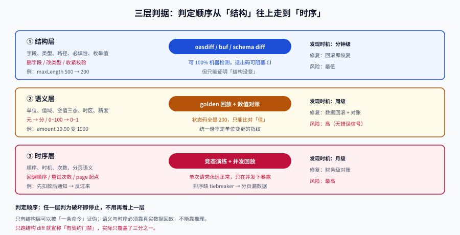

# 兼容性判定：加法、语义与时序

**一句话定位**：这一页给出一张可以直接照着打勾的判据表，回答「这次改动到底算不算破坏」，并解释为什么**「只做加法」并不总是安全**。

## 判据族声明

本页判据族 `CEC-A` ~ `CEC-H`，共 8 条。定义表在第六节。



## 一、三层判据表

判定的顺序是**从下往上**：先看结构（机器能查），再看语义（要靠人），最后看时序（要靠演练）。任何一层判定为「破坏」，就不用往下问了。

### 1.1 结构层：字段、类型、路径、约束

| 改动 | 判定 | 理由 |
| --- | --- | --- |
| 新增**可选**请求参数，且有与旧行为一致的默认值 | ✅ 兼容 | 老调用方不传时行为不变 |
| 新增**可选**请求参数，但默认值与旧行为**不同** | ❌ 破坏 | 老调用方不传，行为却变了 |
| 新增响应字段 | ⚠️ 通常兼容 | 依赖消费者忽略未知字段，见第二节 |
| 新增枚举值 | ⚠️ 通常兼容 | 依赖消费者有未知值兜底 |
| 删除响应字段 | ❌ 破坏 | 消费者取到 `undefined`/`null` |
| 字段改名 | ❌ 破坏 | 等价于「删 + 加」，且新字段无人填 |
| `optional` → `required` | ❌ 破坏 | 老请求变 400 |
| 放宽校验（200 → 500） | ✅ 兼容 | 原本合法的仍合法 |
| 收紧校验（500 → 200） | ❌ 破坏 | 原本合法的变非法 |
| 类型放宽（`integer` → `number`） | ⚠️ 双向风险 | 见下方「类型放宽的陷阱」 |
| 类型收窄（`number` → `integer`） | ❌ 破坏 | 小数被截断或拒绝 |
| 新增必填请求头 | ❌ 破坏 | 所有老调用方 400 |
| 路径新增段（`/posts` → `/posts/v1`） | ❌ 破坏 | 老路径 404 |

::: danger 类型放宽的陷阱：`integer` → `number` 不是单向安全
看起来「放宽」总是安全的，但**强类型客户端**（Java `Long`、Go `int64`、C# `long`）在收到 `19.9` 时会反序列化失败。所以：

- 服务端放宽 = 对**弱类型消费者**安全，对**强类型消费者**是破坏；
- 判定要写「**放宽后的取值是否会超出消费者类型的表示范围**」，而不是「是不是放宽」。

正确的做法是**新增一个精度更高的字段**（`amount_cents: integer`），而不是把老字段的类型改宽。
:::

### 1.2 语义层：字段还在，意思变了

这一层**没有任何自动化工具能可靠检测**，只能靠一张固定的问题清单。

| 问题 | 破坏示例 | 检查方式 |
| --- | --- | --- |
| **单位/量纲变了吗** | 元 → 分；秒 → 毫秒；KB → KiB | 字段名里有没有单位后缀？没有就必须在契约里写 `description` |
| **值域变了吗** | `0~100` 的百分比改成 `0~1` 的小数 | 契约里有没有 `minimum`/`maximum` |
| **空值语义变了吗** | `null`（明确置空）→ 缺失（不改）；`""` → `null` | PATCH 类接口必须定义三态 |
| **时区/格式变了吗** | `date` → `date-time`；本地时间 → UTC | 契约里 `format` 是否显式 |
| **排序稳定吗** | `ORDER BY created_at` 无 tiebreaker | 同值行在两次查询里顺序不同 → 分页漏数据 |
| **精度变了吗** | 金额 `19.90` → `19.9`；浮点求和顺序变 | 对账断言比对到分 |
| **编码/转义变了吗** | HTML 转义策略变化；emoji 的字节长度 | 快照测试 |

::: warning 「空值三态」是最常被忽略的语义契约
一个 `PATCH /users/me` 接口，`{"nickname": null}` 到底表示「清空昵称」还是「不改昵称」？

- 如果表示**清空**，那么「不改」就必须用**字段缺失**表达；
- 如果表示**不改**，那么「清空」就必须用别的机制（如 `""` 或专门的 `clearFields` 数组）。

两种设计都能自洽，但**一旦上线就不能改**——因为老客户端已经按其中一种语义写死了。改语义不会报错，只会让用户的昵称在某次保存后被悄悄清空。
:::

### 1.3 时序层：顺序、时机、次数

| 改动 | 破坏示例 | 消费者感知 |
| --- | --- | --- |
| 分页起点变化 | `page=1` 起 → `0` 起 | 第一页重复或整页丢失 |
| 回调顺序变化 | 「先扣款后通知」→「先通知后扣款」 | 收到通知时余额还没变 |
| 重试次数变化 | 1 次 → 3 次 | 非幂等消费者重复处理 3 次 |
| 超时时间变化 | 30s → 5s | 长任务被中断，客户端看到 504 |
| 限流阈值变化 | 100 rps → 20 rps | 批量任务开始大面积 429 |
| 批处理窗口变化 | 每 100ms flush → 每 1s flush | 实时性要求高的消费者延迟变大 |

时序破坏的共同点是：**单次请求完全正常**，只有并发、批量或长跑场景才暴露。所以只能用**回放**验证，见第五节。

## 二、四种「看似安全」的加法

### 2.1 新增可选参数，但默认值悄悄改了行为

```yaml
# 改前
GET /posts?page=1&size=10
# 改后：新增 sort 参数，默认按 created_at DESC
GET /posts?page=1&size=10&sort=created_at:desc
```

如果改前的实现其实按 `id DESC` 排序，而 `created_at` 与 `id` 不完全同序（补数据、导入历史数据都会破坏同序），那么**不传 `sort` 的老客户端拿到的顺序变了**。分页在第一页看不出来，翻到第 5 页开始漏数据。

判据：**新增可选参数的默认值，必须逐字等于「当前生产行为」**，而不是「更合理的行为」。

### 2.2 新增响应字段，撞上严格解析器

```java
// 一个「很规范」的客户端配置，会让新增字段变成破坏
objectMapper.configure(DeserializationFeature.FAIL_ON_UNKNOWN_PROPERTIES, true);
```

```go
// 同理
dec := json.NewDecoder(r.Body)
dec.DisallowUnknownFields()
```

这类配置在「防御性编程」的语境下看起来是优点，实际效果是**把服务端的加法变成了客户端的故障**。所以：

::: danger 对接文档必须写死这一条
**客户端必须忽略未知字段。** 这不是建议，是接入的前置条件。SDK 模板里要显式配置成「忽略」，并在 README 里写明「不要开启严格模式」。

如果对方的运行时**无法**忽略未知字段（比如某些低代码平台的固定 schema），那这个消费者的兼容性就只能靠**服务端按消费者版本裁剪响应**——成本高得多，必须在 [消费者清单](../ConsumerInventory/index.md) 里单独登记。
:::

### 2.3 新增枚举值，撞上 `Enum.valueOf`

```java
// 服务端新增 status = "archived"
public enum Status { DRAFT, PUBLISHED }   // 老客户端只有两个值
Status.valueOf("ARCHIVED");                // IllegalArgumentException
```

正确做法是**两道保险一起上**：

1. 服务端：新增枚举值与**公告**同批上线，给消费者留出适配窗口；
2. 客户端：解析失败时降级为 `UNKNOWN` 并原样保留原始字符串，界面上显示「其他」。

### 2.4 放宽校验，但下游没放宽

服务端把 `maxLength` 从 200 放宽到 500，接口层通过了，但：

- 数据库列还是 `varchar(200)` → 插入报错（或静默截断，更糟）；
- 搜索索引的字段长度限制没变 → 长文本搜不到；
- 前端的输入框还限 200 字 → 用户根本输不进来。

**放宽校验是一次跨层变更**，不是接口层单点改动。判据：放宽校验的 PR 必须同时列出「数据库、索引、前端、下游」四处的对应改动。

## 三、语义兼容的两个真实陷阱

### 3.1 排序不稳定导致的「分页漏数据」

这是最典型、也最难自证的时序破坏。

```sql
-- 有问题的写法：只按 created_at 排序
SELECT id, title, created_at FROM post
ORDER BY created_at DESC
LIMIT 20 OFFSET 40;
```

假设某一秒内有 3 条帖子（批量导入很常见），PostgreSQL 对这 3 行的返回顺序**不保证稳定**。第 1 页拿到的可能是 `A, B, C`，第 3 页的 `OFFSET` 窗口里这 3 行又出现一次或全部跳过。

用一组构造数据可以把这个现象变成确定的读数：

| 页 | 请求 | 返回 id（不稳定排序） | 返回 id（加 `id DESC` tiebreaker） |
| --- | --- | --- | --- |
| 1 | `OFFSET 0 LIMIT 2` | `3, 2` | `3, 2` |
| 2 | `OFFSET 2 LIMIT 2` | `1, 5` | `1, 4` |
| 3 | `OFFSET 4 LIMIT 2` | `4, 1` ← **1 重复，4 迟到** | `5` |

判据：**任何对外分页接口的 `ORDER BY` 必须包含唯一列作为 tiebreaker**（通常是主键），否则「分页不漏不重」这条契约在并发写入下不成立。这条纪律与 [分区分表与冷热分离](../../../DB/PartitionArchival/index.md) 的 keyset 分页是同一条，只是这里关心的是**语义契约**而不是性能。

### 3.2 时区与格式漂移

```json
// 改前：date（只有日期）
{ "published_on": "2026-10-19" }

// 改后：date-time（带时区）
{ "published_on": "2026-10-19T00:00:00+08:00" }
```

在 JSON 层面都是字符串，结构检查完全通过。但：

- 用 `datetime.strptime("%Y-%m-%d")` 的消费者直接抛异常；
- 用 `new Date("2026-10-19")` 的 JS 消费者会按 **UTC** 解析，在东八区显示成 10-18；
- 存储层如果原来是 `date` 类型，改成 `timestamptz` 会触发一次全表重写。

判据：**时间字段的 `format` 必须显式写在契约里**，且修改 `format` 一律按破坏性变更处理。

## 四、把判定固化成评审清单

判定不能靠记忆。下面这张表建议直接做成 PR 模板的勾选项：

| # | 问题 | 若「是」 |
| --- | --- | --- |
| 1 | 有没有删除/改名任何字段、路径、枚举值？ | 破坏 → 走版本或保留旧字段 |
| 2 | 有没有新增必填参数或收紧校验？ | 破坏 → 改为可选或新端点 |
| 3 | 有没有改默认值、分页语义、排序规则？ | 破坏 → 新参数 + 显式默认 |
| 4 | 有没有改单位、值域、空值语义、时区？ | 破坏 → 新字段 |
| 5 | 有没有改回调顺序、重试次数、超时、限流？ | 时序破坏 → 演练 + 公告 |
| 6 | 契约文件（OpenAPI/Proto/Avro）是否已更新？ | 必须与代码同 PR |
| 7 | 是否已跑 `N-1` 客户端兼容用例？ | 必须为绿 |

## 五、怎么证明兼容：三值断言

只断言状态码是不够的（见 [总览](../Overview/index.md) 的算例：单位变化时两次都是 200）。完整的断言要覆盖**三个值**：

```text
① 状态码      200 仍是 200，不要变成 204
② 结构        字段集合是旧集合的超集（不丢字段、不换类型）
③ 数值/语义   同一输入下，数值按预期相等（或按声明的比例变化）
```

第三项是关键，也是最容易被跳过的一项。一个可执行的形态：

```shell
# 拿上一版契约生成的桩当「老客户端」，打新服务，逐字段比对
python3 - <<'PY'
old = {"id": 1, "title": "a", "amount": 19.90}
new = {"id": 1, "title": "a", "amount": 1990, "coupon": None}

missing = set(old) - set(new)
changed = {k: (old[k], new[k]) for k in old if k in new and old[k] != new[k]}
print("缺失字段:", missing or "无")
print("数值变化:", changed or "无")
print("判定:", "结构兼容 + 数值漂移" if not missing and changed else ("结构兼容" if not missing else "结构破坏"))
PY
```

**预期输出**：`缺失字段: 无` / `数值变化: {'amount': (19.9, 1990)}` / `判定: 结构兼容 + 数值漂移`。

判读：**「结构兼容」不等于「兼容」**。这段输出的价值就在于把两个结论分开——结构门禁会放行，而业务已经错了。

## 六、判据定义表

| 判据 | 约定 | 定错了会怎样 | 怎么验证 |
| --- | --- | --- | --- |
| `CEC-A` | 新增可选参数的默认值必须逐字等于当前生产行为 | 老调用方不传参数却拿到新行为 | 灰度期对比「不传参」的响应与基线 |
| `CEC-B` | 对接文档必须要求消费者忽略未知字段 | 服务端加法变成客户端故障 | 文档含该条款，SDK 模板有对应配置 |
| `CEC-C` | 新增枚举值必须提供未知值兜底要求 | 强类型客户端抛异常 | 枚举变更 PR 附带兜底说明 |
| `CEC-D` | 放宽校验必须同步数据库、索引、前端、下游 | 接口过了但落库失败或截断 | PR 列出四处改动 |
| `CEC-E` | 分页 `ORDER BY` 必须含唯一列 tiebreaker | 并发写入下分页漏数据/重复 | 同一秒多条数据翻页无重复 id |
| `CEC-F` | 时间字段 `format` 显式声明，修改按破坏处理 | 时区漂移，日期差一天 | 契约含 `format`，diff 可见 |
| `CEC-G` | 空值三态（缺失/null/空串）必须在契约里定义 | 用户数据被静默清空 | PATCH 接口有三态说明与用例 |
| `CEC-H` | 兼容性断言必须覆盖状态码、结构、数值三值 | 结构门禁绿但数据错 | 用例里有数值断言 |

## 如何验证

```shell
# ① 排序稳定性：同一秒多条数据，翻页是否漏/重
/Users/cuifendemac/.workbuddy/binaries/python/envs/default/bin/python3 - <<'PY'
rows = [  # (id, created_at) 三条同秒
    (1, "2026-10-19 10:00:00"), (2, "2026-10-19 10:00:00"),
    (3, "2026-10-19 10:00:00"), (4, "2026-10-19 09:59:00"),
    (5, "2026-10-19 09:58:00"),
]
def page(data, off, lim, tiebreak):
    key = (lambda r: (r[1], r[0])) if tiebreak else (lambda r: r[1])
    return [r[0] for r in sorted(data, key=key, reverse=True)[off:off+lim]]
for tb in (False, True):
    seen = []
    for off in (0, 2, 4):
        seen += page(rows, off, 2, tb)
    print(f"tiebreaker={tb}: 翻页结果 {seen} 去重后 {len(set(seen))} 条 / 期望 5 条")
PY
```

**预期输出**：`tiebreaker=False` 时去重后条数可能小于 5（漏或重）；`tiebreaker=True` 时恒为 5。判读：**只要出现 `< 5`，就说明分页契约在并发写入下不成立**。

```shell
# ② 单位漂移检测：把「结构兼容」与「数值兼容」分开判
python3 - <<'PY'
pairs = [(19.90, 1990), (5.00, 500), (0.01, 1)]
ratios = {round(n / o, 6) for o, n in pairs if o}
print("比例集合:", ratios)
print("判定:", "存在统一倍率 → 疑似单位变更" if len(ratios) == 1 and ratios != {1.0} else "无统一倍率")
PY
```

**预期输出**：`比例集合: {100.0}`、`判定: 存在统一倍率 → 疑似单位变更`。判读：**统一倍率是单位变更的指纹**——非单位变更的数值漂移很少呈现整齐的比例，这条对账断言可以直接挂到夜间任务上。

## 参考资料

- [Google AIP-180 · Backwards compatibility](https://google.aip.dev/180)：字段与枚举变更的官方清单
- [RFC 9110 · HTTP Semantics](https://www.rfc-editor.org/rfc/rfc9110.html)：`PATCH` 与空值语义的讨论
- [JSON Merge Patch (RFC 7386)](https://www.rfc-editor.org/rfc/rfc7386.html)：`null` 表示删除的语义来源
- [oasdiff · Breaking changes 清单](https://github.com/Tufin/oasdiff/blob/main/BREAKING-CHANGES.md)
- 相邻页：[总览](../Overview/index.md)、[库表演进](../SchemaEvolution/index.md)（语义变更在库层的对应做法）、[契约门禁](../ContractGate/index.md)
