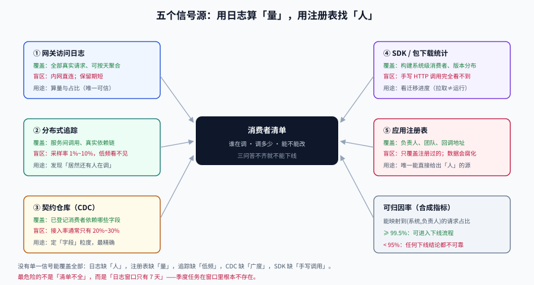

# 消费者清单：谁在调用我

**一句话定位**：下线、改版本、停用字段，这三个动作的前置条件都是同一个——**你手上有一份能追到人的调用方清单**。没有它，所有「兼容性讨论」都只是猜测。

## 判据族声明

本页判据族 `CEI-A` ~ `CEI-H`，共 8 条。定义表在第七节。



## 一、下线的三个前置问题

在动任何「停用」按钮之前，团队必须能当场回答：

| # | 问题 | 答不上来的后果 |
| --- | --- | --- |
| 1 | **谁在调**（系统名 + 团队 + 负责人） | 公告发给了一堆不知道是谁的邮箱 |
| 2 | **调多少**（近 30 天调用量、占比、趋势） | 分不清「长尾噪声」与「关键客户」 |
| 3 | **能不能改**（对方有没有升级能力、多久发一次版） | 定了一个对方根本做不到的迁移期 |

这三个问题的答案**只能从流量里来**，不能从「我们发过公告」里来。

::: danger 一个反直觉的事实
**公告的到达率远低于你的估计。** 调用方是代码，改代码的人可能已经离职、团队可能已经重组、服务可能三年没人动过。所以清单必须是**从流量反推**的，公告只是清单建好之后的**通知手段**，不是清单本身。
:::

## 二、五个信号源与各自的盲区

没有任何单一信号能覆盖全部消费者。实践中要叠加使用，并且**明确知道每个源的盲区**。

### 2.1 网关 / API 网关的访问日志

最可靠的一手数据。关键是要在日志里留下**可归因的三个字段**：

```text
client_id    调用方身份（API Key / OAuth client_id / 应用注册 ID）
app_version  调用方版本（SDK 版本或 App 版本）
route        被调用的路由（含版本前缀，如 /api/v1/posts）
```

| 优点 | 盲区 |
| --- | --- |
| 覆盖全部真实请求，包括你不知道的调用方 | **内网直连**绕过网关的流量完全看不到 |
| 可按天聚合、可看趋势 | 日志保留期通常只有 7~30 天，看不到「季度级低频调用」 |
| 能区分版本与路由 | 未注册的调用方 `client_id` 为空或为默认值 |

::: warning 「低频调用」是清单里最危险的部分
一个每季度跑一次的月末对账任务，在 7 天日志窗口里**根本不存在**。下线时它一定第一个炸。

对策：**日志保留期 ≥ 业务最长周期**（月末/季末/年末三种周期都要覆盖），或者用「按天去重的调用方集合」做**月度累积**（每天只记 `client_id` 集合的增量，存储成本极低）。
:::

### 2.2 分布式追踪（trace）

服务间调用**不经过对外网关**，只能从 trace 里看。

```text
service.name = order-service  →  POST /api/v1/posts   （来自 trace 的父子 span）
```

| 优点 | 盲区 |
| --- | --- |
| 能发现**内部服务**消费方 | 采样率通常 1%~10%，**低频调用方可能一次都没被采到** |
| 能看调用链上的真实依赖 | 采样策略偏向「错误与慢请求」，不代表流量分布 |

所以 trace 的用途是**发现**（「居然还有人在调这个」），不是**度量**（「它调了多少」）。两者不能混用。

### 2.3 契约仓库 / CDC 登记

如果用了消费者驱动契约（Pact 一类），消费者会在 broker 上**主动登记**自己的期望。

| 优点 | 盲区 |
| --- | --- |
| 有明确的「消费者 → 期望」映射，且带验证状态 | **只覆盖接入了 CDC 的消费者**，通常是最规范的那 20% |
| `can-i-deploy` 能直接拦住破坏性发布 | 没接入的 80% 完全隐形 |

这份清单的价值不在覆盖率，而在**质量**：它给出的是「这个消费者依赖哪些字段」的精确答案，而下线时你需要的正是这个粒度。

### 2.4 SDK / 包的下发统计

内部 SDK 从私有仓库下载时，能拿到「哪个应用拉取了哪个版本」。

| 优点 | 盲区 |
| --- | --- |
| 能定位到**构建系统**级别的消费者 | 只覆盖用你 SDK 的人；手写 HTTP 调用的完全看不到 |
| 版本分布直接对应迁移进度 | 拉取 ≠ 运行（CI 缓存、依赖锁定会失真） |

### 2.5 数据库里的应用注册表

很多团队有一张 `app_registry`（应用名、负责人、回调地址、密钥），API Key 就来自这里。

| 优点 | 盲区 |
| --- | --- |
| 直接给出**负责人**，这是另外四个源都没有的 | 只覆盖注册过的调用方 |
| 可 join 到 CMDB / 工单系统 | 数据会腐化（负责人离职、应用下线但记录还在） |

::: tip 组合用法
**用日志算「量」，用注册表找「人」，用 trace 找「漏」，用 CDC 定「字段」，用 SDK 统计看「进度」。**
五个源的职责不重叠，缺一个就会在某个环节瞎掉。
:::

## 三、把流量变成一份可执行的清单

目标产物是一张表，每行一个消费者：

| client_id | 系统名 | 团队 | 负责人 | 近 30 天调用 | 占比 | 最老版本 | 能否升级 | 备注 |
| --- | --- | --- | --- | --- | --- | --- | --- | --- |
| `bi-metabase` | 经营分析 | 数据 | 张三 | 1,204,331 | 41.2% | v1 | 可（月度发版） | **只读**，走只读库 |
| `app-ios` | 客户端 iOS | 移动 | 李四 | 980,220 | 33.5% | v1.2 | 可（强制更新） | 有 8% 用户不升级 |
| `partner-a` | 外部合作方 | —— | 王五（对接人） | 402,118 | 13.8% | v1.0 | **难**（对方季度发版） | 合同约定 12 个月过渡 |
| `ops-cron` | 月末对账 | 财务 | 赵六 | 1,208 | 0.04% | v1 | 难（无人维护） | **季度跑一次**，日志窗口看不见 |
| `unknown-ua` | 未识别 | —— | —— | 42,113 | 1.4% | —— | —— | 需人工排查 |

这张表的四列是关键判据：**量**（决定优先级）、**最老版本**（决定迁移难度）、**能否升级**（决定时间表）、**备注**（记录合同/技术约束）。

::: warning 「占比」这个列最容易骗人
外部合作方只占 13.8%，但它是**合同约束**的，不能按流量大小决定下线顺序；`ops-cron` 只占 0.04%，但它一旦失败就是**财务差错**。

所以下线排序的正确依据是「**流量 × 业务影响 × 迁移难度**」的三维判断，不是单纯按调用量从低到高。
:::

## 四、无法识别的流量怎么处理

真实系统里总有一部分流量归不到人。常见三类与对策：

| 类型 | 特征 | 对策 |
| --- | --- | --- |
| **默认 UA**（`curl/8.x`、`okhttp/4.x`、`python-requests/2.x`） | 没有自定义 UA，无法区分 | 要求新接入必须带 `client_id`；存量按**源 IP 段**归类 |
| **健康检查 / 探针** | 高频、只打 `/health`、固定 IP | 单独列出并排除，不计入「消费者」 |
| **内网直连** | 源 IP 在集群网段内，不经网关 | 从 trace 或服务端访问日志补；或**强制走网关**（推荐） |

::: danger 一个必须做的决定：无法识别的流量，能不能下线？
这个决定必须在**下线之前**做，不能在下线当天做。三个选项：

1. **保守**：`unknown` 占比 > 阈值就暂停下线，先补清单；
2. **激进**：把 `unknown` 当外部客户处理，给足过渡期；
3. **切割**（推荐）：先**阻断**未带 `client_id` 的请求（返回 401 并记录），逼出真实调用方，再走正常流程。

第三个选项看起来粗暴，但它是唯一能在两周内把「未知」变成「已知」的办法。前提是**提前 30 天公告**，并留一个白名单给确实改不动的老系统。
:::

## 五、覆盖率：把「清单完整」变成可度量的数

清单永远不可能 100% 完整，所以需要一个指标来判断「够不够用」：

```text
可归因率 = 能映射到 (系统名, 负责人) 的请求数 / 总请求数
```

| 可归因率 | 含义 | 能不能下线 |
| --- | --- | --- |
| ≥ 99.5% | 清单可信，剩余是探针噪声 | ✅ 可以进入下线流程 |
| 95%~99.5% | 有盲区，但可枚举 | ⚠️ 先排查盲区再下线 |
| < 95% | 清单不可信 | ❌ 任何下线结论都不可靠 |

这个指标要**按周采集**，因为新接入方会不断出现。把它挂到看板上，比写一份「消费者清单」文档有用得多——文档会过期，指标不会。

## 六、清单的保鲜：三条机制

| 机制 | 做法 | 频率 |
| --- | --- | --- |
| **强制身份** | 网关拒绝无 `client_id` 的请求（白名单例外） | 一次性，长期生效 |
| **新接入登记** | 发 API Key 时必须填「系统名 + 团队 + 负责人 + 预期调用量」 | 每次接入 |
| **腐化清理** | 季度核对：负责人是否在职、应用是否还在跑 | 每季度 |

第三条最容易被跳过。一个可执行的判据是：**清单里任意一行的负责人字段，如果 90 天内没有被任何工单/告警触达过，就标记为「待核实」**。这比「每年盘一次」更容易坚持。

## 七、判据定义表

| 判据 | 约定 | 定错了会怎样 | 怎么验证 |
| --- | --- | --- | --- |
| `CEI-A` | 每个请求必须带可归因的 `client_id` 与 `app_version` | 下线时找不到人 | 日志里两字段非空率 ≥ 99.5% |
| `CEI-B` | 日志保留期 ≥ 业务最长周期，或有按天累积的调用方集合 | 季度任务在清单里不存在 | 存在月度累积表且覆盖 ≥ 12 个月 |
| `CEI-C` | 清单每行必须有系统名、团队、负责人三项 | 公告发给「运维群」 | 抽样 10 行，三项齐全 |
| `CEI-D` | 清单必须包含「最老版本」与「能否升级」两列 | 定出对方做不到的时间表 | 两列非空率 100% |
| `CEI-E` | 下线排序依据是流量 × 业务影响 × 迁移难度，不是纯流量 | 先停掉财务任务的依赖 | 下线计划含三维评估 |
| `CEI-F` | 无法识别流量的处置策略在下线前已确定 | 下线当天才发现有 5% 未知流量 | 存在书面策略与阈值 |
| `CEI-G` | 可归因率 ≥ 99.5% 才允许进入下线流程 | 清单不可信却已发公告 | 看板有该指标且达标 |
| `CEI-H` | 清单按季度核对负责人与运行状态 | 负责人已离职半年 | 有核对记录，`待核实` 项已清零 |

## 如何验证

下面两段用**合成日志**演示聚合逻辑，可以直接替换成你的真实日志路径。

```shell
# ① 从访问日志聚合「消费者 × 版本 × 路由」的调用量与占比
/Users/cuifendemac/.workbuddy/binaries/python/envs/default/bin/python3 - <<'PY'
import collections
# 模拟 5 行日志：client_id, app_version, route
log = [
    ("bi-metabase", "v1", "/api/v1/posts"),
    ("app-ios",     "v1.2", "/api/v1/posts"),
    ("app-ios",     "v1.2", "/api/v1/posts"),
    ("partner-a",   "v1.0", "/api/v1/posts"),
    ("",            "-",    "/api/v1/posts"),   # 未识别
]
total = len(log)
c = collections.Counter((r[0] or "<unknown>", r[1]) for r in log)
for (cid, ver), n in c.most_common():
    print(f"{cid:14s} {ver:5s} {n:3d} 次 {n/total:6.1%}")
print("可归因率:", f"{(total - sum(1 for r in log if not r[0]))/total:.1%}")
PY
```

**预期输出**：`app-ios v1.2 2 次 40.0%`、`<unknown> - 1 次 20.0%`，末行 `可归因率: 80.0%`。判读：**80% 远低于 99.5% 的阈值**——此时任何「谁在调 v1」的结论都不可信。

```shell
# ② 低频调用方识别：按「天」去重，找只出现过 1~2 天的调用方
python3 - <<'PY'
# client_id -> 出现过的日期集合（模拟 30 天窗口）
seen = {
    "bi-metabase": {f"10-{d:02d}" for d in range(1, 31)},
    "app-ios":     {f"10-{d:02d}" for d in range(1, 31)},
    "partner-a":   {f"10-{d:02d}" for d in range(1, 31)},
    "ops-cron":    {"10-01"},              # 月末任务，只出现 1 天
    "adhoc-report":{"10-11", "10-12"},     # 临时报表
}
for cid, days in sorted(seen.items(), key=lambda kv: len(kv[1])):
    tag = "⚠️ 低频，下线前必须单独确认" if len(days) <= 2 else ""
    print(f"{cid:14s} 出现 {len(days):2d} 天 {tag}")
PY
```

**预期输出**：`ops-cron 出现 1 天 ⚠️`、`adhoc-report 出现 2 天 ⚠️`，其余为 30 天。判读：**低频调用方的调用量极小，但在「按量排序」的下线清单里排最后**——这正是它们被误判为「可以随便停」的原因。

## 参考资料

- [OpenTelemetry · Semantic Conventions（服务标识与 `service.name`）](https://opentelemetry.io/docs/specs/semconv/)
- [Pact · Pact Broker 与消费者登记](https://docs.pact.io/pact_broker)
- [Google AIP-180 · Backwards compatibility](https://google.aip.dev/180)
- 相邻页：[下线](../Sunset/index.md)（清单的下游用法）、[契约门禁](../ContractGate/index.md)（CDC 那一格）、[总览](../Overview/index.md)
