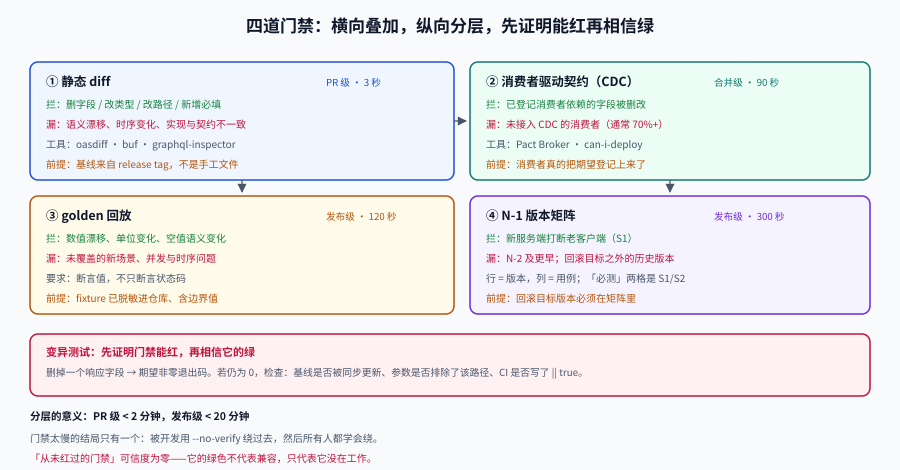

# 契约门禁：让 CI 拦住破坏性变更

**一句话定位**：兼容性不能靠评审时的记忆力。这一页把「不破坏消费者」拆成**四道能自动变红的门禁**，并说明每一道各自漏什么。

## 判据族声明

本页判据族 `CEG-A` ~ `CEG-H`，共 8 条。定义表在第八节。



## 一、四道门禁与它们各自漏掉的东西

| # | 门禁 | 拦什么 | 靠什么数据 | 漏什么 |
| --- | --- | --- | --- | --- |
| 1 | **静态 diff** | 结构破坏（删字段、改类型、改路径） | 契约文件 + 基线 | 语义与时序破坏；实现与契约不一致 |
| 2 | **消费者驱动契约（CDC）** | 「已登记的消费者依赖的字段」被删改 | Pact 一类 broker | 未接入 CDC 的消费者（通常是大多数） |
| 3 | **golden 回放** | 数值/语义漂移 | 录制的真实请求 + 期望响应 | 未覆盖的新场景；并发与时序问题 |
| 4 | **N-1 版本矩阵** | 跨版本组合不可用 | 上一版客户端 × 当前服务端 | 更老的版本（N-2 及以前） |

四道是**叠加**关系，不是替代关系。只上一道就宣称「我们有契约门禁」，等于只防住了四分之一。

::: danger 门禁最常见的失效方式不是「没配」，而是「配了但永远绿」
一条从未红过的门禁，你对它的信任是零。所以本页把**变异测试**（第六节）放在和门禁本身同等重要的位置：**先证明它能红，再相信它的绿。**
:::

## 二、第一道：静态 diff，以及「基线从哪来」

静态 diff 的工具已经成熟：

| 协议 | 工具 | 典型命令 |
| --- | --- | --- |
| OpenAPI | `oasdiff` | `oasdiff breaking openapi.baseline.yaml openapi.yaml` |
| Protobuf | `buf` | `buf breaking --against '.git#branch=main'` |
| Avro / JSON Schema | Schema Registry | 提交时按兼容模式校验 |
| GraphQL | `graphql-inspector` | `graphql-inspector diff old.graphql new.graphql` |

工具本身不是问题，**基线才是**。三种基线来源，质量差别很大：

| 基线来源 | 可信度 | 问题 |
| --- | --- | --- |
| 仓库里的 `openapi.baseline.yaml`（手工更新） | 中 | 会忘记更新，或被人为了「让 CI 变绿」直接覆盖 |
| `git` 的上一个 release tag | **高** | 需要 tag 规范；hotfix 分支要特殊处理 |
| **生产环境实际暴露的契约**（定期抓取并归档） | 最高 | 有额外基础设施成本 |

::: danger 「为了让 CI 通过，把基线换成了新文件」
这是基线机制最典型的腐化方式，而且**从 CI 日志上看不出来**——diff 是空的，所以是绿的。

两条对策，建议都上：

1. **基线文件单独 CODEOWNERS**，改动需要平台组 review；
2. **基线更新必须与新版本发布同一次提交**（release tag 生成时自动归档），不允许独立提交。
:::

## 三、第二道：CDC，只在「已登记」的范围内有效

消费者驱动契约的思路是：消费者声明「我只依赖这些字段」，生产者在 CI 里验证「没有破坏任何一个消费者的期望」。

```shell
# 消费者侧：发布自己的期望
pact-broker publish pacts/ --consumer-app-version "$GIT_SHA" --branch "$GIT_BRANCH"

# 生产者侧：验证所有消费者期望
pact-verifier --provider-base-url http://localhost:8080 --pact-broker-base-url "$BROKER"

# 发布前：这次能不能上
pact-broker can-i-deploy --pacticipant order-service \
  --version "$GIT_SHA" --to-environment production
```

`can-i-deploy` 是这套机制的核心价值：它把「能不能发」变成**一个带退出码的判断**，而不是一场会议。

但它有一个硬前提：**消费者必须把自己的期望登记上来**。现实中接入率通常只有 20%~30%，所以：

| 覆盖率 | 结论 |
| --- | --- |
| < 50% | CDC 只能当「额外保险」，主门禁必须是静态 diff + 回放 |
| 50%~80% | CDC 可作为发布阻塞项，但仍需消费者清单兜底 |
| > 80% | CDC 可以成为主门禁，静态 diff 退化为辅助 |

::: tip 提升接入率的唯一有效办法
**让不接入的人承担后果**：新接入方在申请 API Key 时，必须同时提交一份契约（哪怕是手写的 JSON 片段）。这比发十封「请大家接入 Pact」的邮件有效。
:::

## 四、第三道：golden 回放，专治「结构没变但数变了」

静态 diff 与 CDC 都只看**结构**。语义漂移只能靠回放：

```text
① 录制：把生产环境的真实请求 + 响应（脱敏后）存成 fixture
② 回放：把 fixture 里的请求打到新版本
③ 比对：状态码、字段集合、**数值**三项全等（或按声明的规则变化）
```

关键是第 ③ 步的**数值**。下面这个比对器把「结构通过但数值漂移」单独报出来：

```python
def compare(old, new, path=""):
    issues = []
    if isinstance(old, dict) and isinstance(new, dict):
        for k in old:
            if k not in new:
                issues.append(f"{path}.{k} 缺失")
            else:
                issues += compare(old[k], new[k], f"{path}.{k}")
        for k in new:
            if k not in old:
                issues.append(f"{path}.{k} 新增")
    elif isinstance(old, list) and isinstance(new, list):
        if len(old) != len(new):
            issues.append(f"{path} 长度 {len(old)} -> {len(new)}")
        for i, (a, b) in enumerate(zip(old, new)):
            issues += compare(a, b, f"{path}[{i}]")
    elif old != new:
        issues.append(f"{path} 值 {old!r} -> {new!r}")
    return issues
```

回放的覆盖面取决于 fixture 的质量。三条纪律：

1. **fixture 必须包含边界值**（空列表、`null`、最大长度、负数）；
2. **fixture 必须脱敏**（否则无法进仓库，最后变成「本地才能跑」）；
3. **fixture 要随线上事故补充**——每修一个语义 bug，就把它变成一条 fixture。

## 五、第四道：N-1 矩阵

滚动发布期间，**新服务端会收到老客户端的请求**，这是 S1 兼容性必须被证明的地方。矩阵的行是版本，列是用例：

| 服务端 \ 客户端 | v1（上一版） | v2（当前） | v3（灰度） |
| --- | --- | --- | --- |
| v1 | 基线 | 不测 | 不测 |
| **v2（当前）** | **必测** | 基线 | 可测 |
| v3（灰度） | 可测 | **必测** | 基线 |

「必测」的两格就是 S1 与 S2：

- `v2 服务端 × v1 客户端` → 旧客户端兼容（S1）
- `v3 服务端 × v2 客户端` → 灰度期间的新旧共存

::: warning 「N-1 就够了吗」
对于**只支持滚动发布、不支持回滚两个版本**的系统，N-1 是够的。但如果你需要「回滚到上一版」，那么**新数据必须能被上一版读**——这要求 `N-1 服务端 × N 客户端` 也成立，也就是上面矩阵里的「可测」格要变成「必测」。

判断方法：**回滚预案里写的目标是哪个版本，就要测到那个版本。**
:::

## 六、证明门禁能红：变异测试

这是本页最重要的一节。做法很简单：

```text
① 在契约里删掉一个响应字段（或改一个默认值）
② 跑门禁
③ 期望：非零退出码
④ 如果退出码是 0，说明门禁是摆设——回到第 ① 步排查为什么没检测到
```

常见原因有三个：

| 现象 | 原因 | 修法 |
| --- | --- | --- |
| 删字段后仍绿 | 基线被同步更新了（比较的是同一个文件） | 校验两个文件的哈希不同 |
| 删字段后仍绿 | diff 命令用了 `--flatten`/`--skip` 之类参数，跳过了该路径 | 检查参数，去掉排除规则 |
| 改默认值后仍绿 | 默认值不在 diff 范围内 | 显式声明 `default` 并纳入比对 |
| 全部仍绿 | 门禁命令的退出码没被 CI 采纳（`\|\| true`、`set +e`） | 检查 CI 脚本 |

::: danger `|| true` 是门禁的头号杀手
它常被加在「先观察一段时间，别阻塞发布」的过渡期，然后**永远留在那里**。三个月后没人记得这条门禁其实一直在被忽略。

如果确实需要过渡期，正确做法是**只告警不阻塞，但把告警计入发布检查单**，而不是吞掉退出码。
:::

## 七、把门禁分层：别让 CI 从 3 分钟变 40 分钟

四道门禁全跑一次的成本不低。合理的分层是：

| 阶段 | 跑什么 | 目标时长 | 失败后果 |
| --- | --- | --- | --- |
| **PR 提交** | 静态 diff + 单测 | < 2 分钟 | 阻塞合并 |
| **合并到主干** | 上面 + CDC 验证 | < 8 分钟 | 阻塞发布 |
| **发布前** | 上面 + golden 回放（抽样）+ N-1 矩阵 | < 20 分钟 | 阻塞发布 |
| **发布后（金丝雀）** | 数值对账（全量抽样 1%） | 持续 | 自动回滚 |

一个可参考的时间预算（假设值，按你的实际情况调）：

| 项 | 时长 | 说明 |
| --- | --- | --- |
| 静态 diff | 3 s | 纯文件比对 |
| CDC 验证 | 90 s | 需要起服务 |
| golden 回放（500 条） | 120 s | 串行；并行可降到 30 s |
| N-1 矩阵（2 版本 × 20 用例） | 300 s | 最贵的一项，通常是瓶颈 |

## 八、判据定义表

| 判据 | 约定 | 定错了会怎样 | 怎么验证 |
| --- | --- | --- | --- |
| `CEG-A` | 基线来自 release tag 或生产抓取，不手工维护 | 基线被随手覆盖，门禁恒绿 | 基线更新与新版本发布同一次提交 |
| `CEG-B` | 门禁命令的退出码必须被 CI 采纳 | `\|\| true` 吞掉失败 | CI 脚本无 `\|\| true`、无 `set +e` |
| `CEG-C` | 每次新增门禁必须做一次变异测试 | 门禁从未红过，可信度为零 | 有变异测试记录与预期非零退出码 |
| `CEG-D` | golden 回放必须断言数值，不只断言状态码 | 单位漂移被放行 | 比对器有值比较逻辑 |
| `CEG-E` | N-1 矩阵必须包含「回滚目标版本」那一行 | 回滚后新数据读不了 | 矩阵行覆盖回滚预案目标 |
| `CEG-F` | fixture 脱敏后进仓库，且含边界值 | 只能本地跑，CI 无法复现 | fixture 在仓库内且 CI 可执行 |
| `CEG-G` | CDC 覆盖率低于 50% 时不得作为唯一门禁 | 大量未登记消费者被打断 | 有覆盖率指标与门禁组合策略 |
| `CEG-H` | 门禁分层，PR 级 < 2 分钟 | 门禁太慢被绕过（`--no-verify`） | 各阶段有耗时记录 |

## 如何验证

```shell
# ① 变异测试：删掉一个字段，确认 diff 工具真的会红
/Users/cuifendemac/.workbuddy/binaries/python/envs/default/bin/python3 - <<'PY'
baseline = {"paths": {"/posts": {"get": {"schema": {"properties": {
    "id": {"type": "integer"}, "title": {"type": "string"}}}}}}}
current = {"paths": {"/posts": {"get": {"schema": {"properties": {
    "id": {"type": "integer"}}}}}}}          # 删掉了 title
def props(doc):
    return set(doc["paths"]["/posts"]["get"]["schema"]["properties"])
old, new = props(baseline), props(current)
removed = old - new
print("删除字段:", removed or "无")
print("门禁结论:", "BREAKING（退出码 1）" if removed else "PASS（退出码 0）")
assert removed, "变异无效：没有真的删掉字段"
PY
```

**预期输出**：`删除字段: {'title'}`、`门禁结论: BREAKING（退出码 1）`。判读：**如果这段输出是 `PASS`，不要怀疑业务代码，先怀疑你的比对工具读错了位置**——这是门禁失效最常见的技术原因。

```shell
# ② 基线是否被同步更新（自己比自己 → 恒绿）
python3 - <<'PY'
import hashlib
baseline = b'{"paths":{"/posts":{}}}'
current  = b'{"paths":{"/posts":{}}}'     # 故意做成一样
h = lambda b: hashlib.sha256(b).hexdigest()[:12]
print("baseline", h(baseline), "current", h(current))
print("结论:", "同一份文件，diff 必然为空 —— 门禁失效" if baseline == current else "可比对")
PY
```

**预期输出**：两个哈希相同，结论为「同一份文件，diff 必然为空」。判读：**把这段做成 CI 的前置断言**——两个文件哈希相同就直接失败，比等 diff 结果更早发现问题。

## 与「技术决策与评审」的分工（第 178 天补充）

本页回答「破坏性变更怎么被机械挡住」（`oasdiff` 规则、基线文件、CI 断言的执行顺序）；[技术决策与评审](../../../Others/TechDecision/index.md) 回答「接受这次破坏性变更」这个决定本身该怎么被评审与留痕。

| 这件事 | 归哪边 | 边界在哪 |
| --- | --- | --- |
| `oasdiff` 的破坏性规则 | **能不能过** | 过了不代表有人同意，只代表没触发规则 |
| 基线文件与指纹 | **比较的基准** | 基准更新本身就是一次决策，常被当成「顺手改一下」 |
| 门禁的失败成本排序 | **先红哪一条** | 门禁绿了，评审材料可能还是空的 |
| 版本下线与 `Sunset` 头 | **对外的承诺** | 承诺的期限是承诺型决策，必须 A 档并留复审日 |

本页特有的一个坑：**门禁通过会给人一种「这件事已经被审过了」的错觉。** 门禁只回答「有没有触发规则」，不回答「触发之后为什么还是决定做」。把「门禁绿 + 一条决策编号」写进发布检查单，比再加三条 `oasdiff` 规则有效得多——因为前者补的是证据链的缺口，后者只是在同一条链上加密。
## 参考资料

- [oasdiff · Breaking changes](https://github.com/Tufin/oasdiff/blob/main/BREAKING-CHANGES.md)
- [Buf · Breaking change detection](https://buf.build/docs/breaking/overview)
- [Pact · can-i-deploy](https://docs.pact.io/pact_broker/can_i_deploy)
- [Confluent Schema Registry · 兼容性检查](https://docs.confluent.io/platform/current/schema-registry/fundamentals/schema-evolution.html)
- 相邻页：[兼容性判定](../Compatibility/index.md)（三层判据）、[异步契约](../AsyncContract/index.md)（消息侧门禁）、[API 设计规范 · 治理机制](../../../Tools/APIDesign/Governance/index.md)
