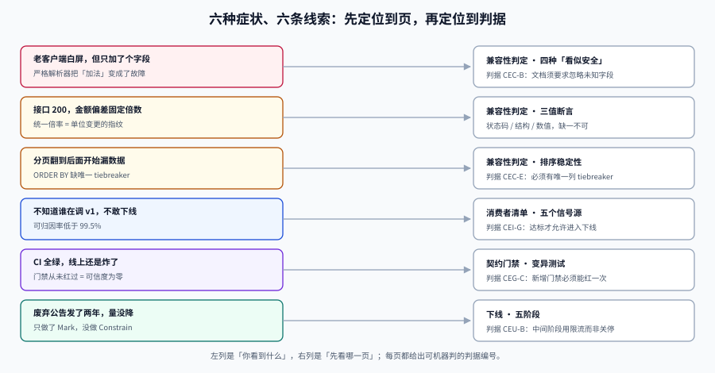

# 常见问题与最佳实践

**一句话定位**：把前面九页最容易踩的坑压缩成一张分诊表 + 十二个高频问题 + 一份上线自查清单。

## 判据族声明

本页判据族 `CEQ-A` ~ `CEQ-H`，共 8 条。定义表在第六节。



## 一、按症状分诊

| 你看到的现象 | 大概率先看 | 关键判据 |
| --- | --- | --- |
| 老客户端白屏 / 反序列化失败，但只是加了个字段 | [兼容性判定](../Compatibility/index.md) | 消费者是否开了严格解析 |
| 接口 200，但金额/时长全部偏差固定倍数 | [兼容性判定](../Compatibility/index.md) 的「三值断言」 | 是否有数值断言 |
| 分页翻到后面开始漏数据 | [兼容性判定](../Compatibility/index.md) 的「排序稳定性」 | `ORDER BY` 是否有唯一 tiebreaker |
| 不知道谁在调 v1，不敢下线 | [消费者清单](../ConsumerInventory/index.md) | 可归因率是否 ≥ 99.5% |
| `if (version == "v1")` 到处都是 | [服务端承载多版本](../ServerVersions/index.md) | 版本判断是否只在路由层 |
| 改了内部字段，对外契约跟着变了 | [服务端承载多版本](../ServerVersions/index.md) 的「共享内核」 | Controller 是否返回 DTO |
| 加列导致写入抖动 / 超时 | [库表演进](../SchemaEvolution/index.md) | 默认值是否为波动值 |
| 回填跑了一晚上还没完，表还变大了 | [库表演进](../SchemaEvolution/index.md) | 是否单条全表 `UPDATE` |
| 下游报反序列化失败，但你只加了字段 | [异步契约](../AsyncContract/index.md) | 新字段是否带默认值 |
| 改了一个字段，老消息全读不出来 | [异步契约](../AsyncContract/index.md) | 兼容模式是 `BACKWARD` 还是 `TRANSITIVE` |
| CI 全绿，线上还是炸了 | [契约门禁](../ContractGate/index.md) | 门禁是否做过变异测试 |
| 废弃公告发了两年，调用量没降 | [下线](../Sunset/index.md) | 是否只做了「Mark」没做「Constrain」 |

## 二、十二个高频问题

### Q1：加了字段为什么还会炸？「只做加法是安全的」不是常识吗？

那条经验的前提是「消费者忽略未知字段」。Go 的 `DisallowUnknownFields`、TS + zod 的 `.strict()`、手写解析器都会失败。而且**新增枚举值**比新增字段更危险——`Enum.valueOf` 直接抛异常。

**做法**：对接文档写死「必须忽略未知字段」，SDK 模板里配好；新增枚举值必须同时给「未知值兜底」。

### Q2：能不能就发 `v2`，别搞什么兼容？

可以，但要接受两个成本：① **v1 必须一直维护到最后一个调用方迁移**（通常是 1~2 年）；② 每次 bug 修复要修两遍。

对**内部单体**、**没有你控制不了的调用方**的系统，发 `v2` 通常是负收益——你只是把重构成本转嫁给了自己。

### Q3：`Deprecation` 和 `Sunset` 都要写吗？

至少要写 `Sunset`（调用方最关心「什么时候不能用」），`Deprecation` 说明「从什么时候起算废弃」，两者配合才能算出宽限期。

**注意两个头的日期格式不同**：`Deprecation: @1767225600`（Unix 秒），`Sunset: Mon, 01 Mar 2027 00:00:00 GMT`（HTTP-date）。混写会静默失效。

### Q4：`BACKWARD` 和 `BACKWARD_TRANSITIVE` 到底差在哪？

`BACKWARD` 只保证新 schema 能读**上一版**数据；`_TRANSITIVE` 保证能读**所有历史版本**。

判据：**只要有任何一个消费者可能落后超过一个版本**（几乎总是成立），就必须用 `_TRANSITIVE`。

### Q5：Protobuf 删字段为什么必须 `reserved`？

因为编号是 wire format 的键。删了 `field 3` 却复用编号，老消息的 3 号字段会被按新类型解析——**不报错，得到垃圾值**。`reserved` 让编译器拒绝复用，把「靠自觉」变成「编译期报错」。

### Q6：库表改列一定要四个阶段吗？小表能不能一步到位？

可以。判据是**表的大小与写入频率**：

| 行数 | 建议 |
| --- | --- |
| < 10 万且可停写 | 一个事务内 `ALTER` + 回填即可 |
| 10 万~1000 万 | 必须分批回填，可省掉「影子读」 |
| > 1000 万或核心交易表 | 四阶段一个不能少 |

### Q7：影子读要观察多久？

**≥ 3 天且覆盖一次业务高峰**。判据不是时长，而是**差异率为 0 且每条历史差异都已归因**。差异率 0.001% 但有 37 条无法解释的差异，比差异率 0 更危险。

### Q8：灰度比例 10%，为什么实际只有一个租户走了新逻辑？

因为哈希分布不均。顺序哈希/字符串 `hashCode` 会让租户挤在相邻桶里，10% 可能覆盖 0 个租户。

**做法**：用 murmur3/xxhash 或对数值主键取模，上线前先验证桶分布的方差。

### Q9：门禁做了，但从来没红过，能信吗？

不能。**从未红过的门禁，可信度是零。** 上线前必须做一次变异测试：删掉一个响应字段，确认门禁非零退出。

常见「假绿」原因：基线被同步更新（自己比自己）、`|| true` 吞掉退出码、diff 参数排除了该路径。

### Q10：v1 只剩 0.3% 流量，能直接停吗？

先看那 0.3% 是谁。如果是**季度任务**或**财务对账**，停掉就是静默缺数（量太小，监控不会报警）。

**做法**：按「流量 × 业务影响 × 迁移难度」三维排序，长尾批次不 410，改为「限流 + 保留最小实现 + 每年复核」。

### Q11：接口下线了，相关的列能一起删吗？

不能。库表的消费者和接口的消费者不是同一批人——BI 直连只读库，按列名写死 SQL。

**「接口下线」与「列删除」是两个独立决策**，后者要等所有直连消费者改造完成（通常一个季度以上）。

### Q12：这次改动到底算不算破坏，怎么快速判断？

用 [总览](../Overview/index.md) 的四步决策树：能不能不改 → 能不能只加法 → 能不能只改一个端点 → 才轮到发版本。

再补一条硬判据：**把上一版客户端原封不动接上新服务，它还能不能正常工作**。答不上来就是破坏。

## 三、上线自查清单

发布前逐条打勾，任何一条「否」都不发。

| # | 检查项 | 判据 |
| --- | --- | --- |
| 1 | 契约文件与代码同 PR 更新 | `git show --stat` 含两份文件 |
| 2 | 静态 diff 通过（基线来自 release tag） | 退出码 0 |
| 3 | 门禁做过变异测试（至少一次红） | 有记录 |
| 4 | N-1 客户端兼容用例为绿 | 矩阵必测格全绿 |
| 5 | 数值对账（不只状态码）通过 | 差异 = 0 |
| 6 | 新增字段有默认值 / 新增枚举有兜底 | 契约 diff 可见 |
| 7 | 库表变更可回滚（或已声明不可逆点） | 回滚预案写明 |
| 8 | 回填脚本可重入（第二次跑 0 行） | 实测 |
| 9 | 灰度开关能秒级生效 | 演练过 |
| 10 | 废弃头部格式正确（两种日期格式） | 网关校验通过 |
| 11 | 消费者清单已更新（新增/下线调用方） | 清单有 diff |
| 12 | 监控含 `enum.unknown` 与 `shadow.mismatch` 指标 | 看板可见 |
| 13 | 下线计划已写退场条件（日期 + 量化） | 版本登记表有 `sunset_condition` |
| 14 | 变更记录标注了 S1/S2 兼容性结论 | 评审单有字段 |

## 四、术语表

| 术语 | 本专题的含义 | 易混点 |
| --- | --- | --- |
| **S1（旧客户端兼容）** | 新服务端能处理老客户端的请求 | 不是「向后兼容」——那个词方向歧义 |
| **S2（旧服务端兼容）** | 新客户端能容忍老服务端的响应 | 灰度/回滚时必须成立 |
| **结构破坏** | 字段、类型、路径、枚举的变化 | 机器可检测 |
| **语义破坏** | 含义、单位、值域、空值语义变化 | 机器不可检测，靠回放 |
| **时序破坏** | 顺序、时机、次数、分页语义变化 | 只能靠演练 |
| **Expand-Contract** | 扩展 → 迁移 → 切读 → 收口 四阶段 | 别名 ParallelChange |
| **`_TRANSITIVE`** | 与所有历史 schema 版本比较 | 不是「更严格的兼容」而是「比较范围更大」 |
| **影子读** | 读新列但不返回，只比对 | 不是「双读」——双读会引入不确定性 |

## 五、三条最值得记住的结论

::: tip 一、兼容性只能被「老客户端」证明
任何「我觉得这个改动是兼容的」的判断，都必须落成一条可执行用例：**上一版客户端 × 当前服务端**。推理正确但实现错误的概率，远高于你的估计。
:::

::: tip 二、能机器拦的只有结构，语义和时序要靠回放
`oasdiff`/`buf` 拦不住「单位从元改成分」。这类破坏只能靠**数值对账**发现——所以回放 fixture 里必须有真实的数值断言。
:::

::: tip 三、下线是流量驱动的，不是公告驱动的
公告第 5 轮仍有约 1% 触达不到。真正让调用方迁移的是**限流曲线**和**410**，公告只是让人少受点惊。
:::

## 六、判据定义表

| 判据 | 约定 | 定错了会怎样 | 怎么验证 |
| --- | --- | --- | --- |
| `CEQ-A` | 分诊表覆盖「结构/语义/时序/流程」四类症状 | 遇到问题只能全库搜 | 每类至少 2 行 |
| `CEQ-B` | 每个回答都指向一页具体判据，不重复正文 | 文档膨胀、口径分叉 | 回答含链接 |
| `CEQ-C` | 自查清单可逐条打勾，且每条有客观判据 | 清单变成口号 | 14 项均有「怎么验证」 |
| `CEQ-D` | 术语表消歧「向后兼容/向前兼容」 | 会议里各说各话 | 术语表含该条 |
| `CEQ-E` | 所有「能不能」类问题给出量化边界 | 回答永远是「看情况」 | 含阈值或行数区间 |
| `CEQ-F` | 清单里的演练项（灰度回滚）必须真跑过 | 事故时才发现开关无效 | 有演练记录 |
| `CEQ-G` | 门禁类问题必须提「变异测试」 | 假绿被当真好 | 含该条 |
| `CEQ-H` | 页面不引入新概念，只做索引与收敛 | 与专题正文口径冲突 | 无新增定义 |

## 如何验证

```shell
# 自查清单的可执行化：把 14 项变成一次检查
/Users/cuifendemac/.workbuddy/binaries/python/envs/default/bin/python3 - <<'PY'
checks = {
    "契约与代码同 PR": True,
    "静态 diff 通过": True,
    "门禁做过变异测试": False,       # 从未红过
    "N-1 兼容用例绿": True,
    "数值对账通过": True,
    "新增字段有默认值": True,
    "库表可回滚": True,
    "回填可重入": True,
    "灰度开关秒级": False,           # 需要重启
    "废弃头格式正确": True,
    "清单已更新": True,
    "监控指标存在": True,
    "退场条件已写": True,
    "标注 S1/S2 结论": True,
}
failed = [k for k, v in checks.items() if not v]
print(f"通过 {len(checks)-len(failed)}/{len(checks)}")
print("未通过:", failed)
print("结论:", "可以发布" if not failed else "不可发布")
PY
```

**预期输出**：`通过 12/14`、`未通过: ['门禁做过变异测试', '灰度开关秒级']`、`结论: 不可发布`。判读：**这两项都属于「没有它也能上线，但出事时救不回来」**——它们恰好是最容易被跳过的两项。

```shell
# 术语一致性：确认正文里没有把 S1/S2 说成「向后/向前兼容」
python3 - <<'PY'
text = "旧客户端兼容 S1；旧服务端兼容 S2；灰度期间两者都要成立"
bad = [w for w in ("向后兼容", "向前兼容") if w in text]
print("歧义词命中:", bad or "无")
print("结论:", "口径一致" if not bad else "改用 S1/S2 表述")
PY
```

**预期输出**：`歧义词命中: 无`、`结论: 口径一致`。判读：**把「向后兼容」写进文档的团队，三个月后一定会在会上为它吵架**——这个词在不同人心里方向相反，值得在术语层面直接禁用。

## 参考资料

- [Google AIP-180 · Backwards compatibility](https://google.aip.dev/180)
- [RFC 9745](https://www.rfc-editor.org/rfc/rfc9745.html) / [RFC 8594](https://www.rfc-editor.org/rfc/rfc8594.html)
- [Martin Fowler · ParallelChange](https://martinfowler.com/bliki/ParallelChange.html)
- [Confluent Schema Registry · Compatibility](https://docs.confluent.io/platform/current/schema-registry/fundamentals/schema-evolution.html)
- 相邻页：[总览](../Overview/index.md)（决策树）、[实战](../Practice/index.md)（完整走一遍）
