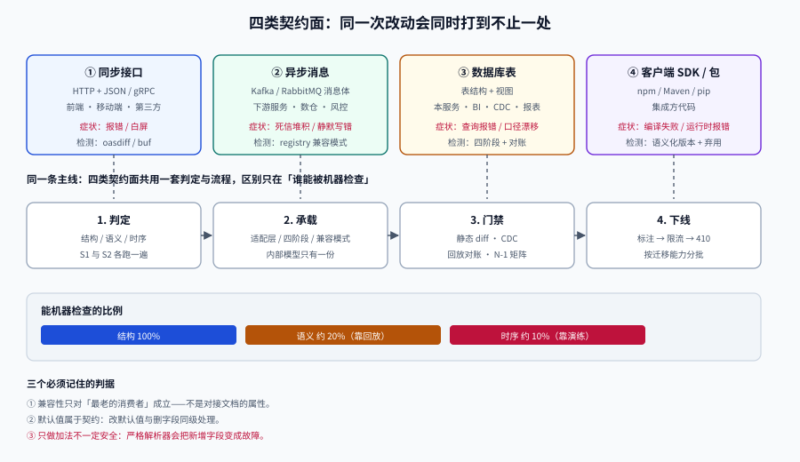

# 总览：四类契约面与三种破坏

**一句话定位**：这一页回答一个问题——**「我这次改动，会不会打到人？」** 以及打到了该怎么分类处理。核心结论是：兼容性不是接口文档的属性，而是**最老的那个消费者**的属性。

## 判据族声明

本页判据族 `CEO-A` ~ `CEO-H`，共 8 条。定义表在第八节。



## 一、契约不止是 HTTP 接口

大多数人听到「契约」只想到 OpenAPI 文档。但在一个真实系统里，**同一个业务字段会同时出现在四个地方**，每一处都是契约：

| 契约面 | 载体 | 谁在消费 | 破坏后的症状 |
| --- | --- | --- | --- |
| **同步接口** | HTTP + JSON / gRPC | 前端、移动端、第三方 | 报错、白屏、字段取不到 |
| **异步消息** | Kafka / RabbitMQ 消息体 | 下游服务、数据平台、风控 | 消费失败、死信堆积、**静默写错** |
| **数据库表** | 表结构 + 视图 | 你的服务、报表、BI、其他团队的只读连接 | 查询报错、报表口径漂移 |
| **客户端 SDK / 包** | npm / Maven / pip 包 | 集成方代码 | 编译失败、运行时 `NoSuchMethod` |

::: danger 最容易被漏掉的是「数据库表」和「只读连接」
你以为表结构是私有的，实际上：

1. **BI / 报表**直连只读库，按列名写死了 SQL；
2. **其他团队**用你库里的表做数据同步（CDC）；
3. **运维脚本**按列位置导数据（`SELECT * INTO OUTFILE`）。

改一个列名，这三类消费者全断，而它们**都不在你的接口文档里**。所以本专题把库表单独列为一类契约面，见 [库表演进](../SchemaEvolution/index.md)。
:::

::: tip 一个自检问题
**「如果我现在把这个字段删掉，谁会报错？」**
如果你不能在 10 分钟内列出**具体的人和系统**，说明你没有消费者清单——先去 [消费者清单](../ConsumerInventory/index.md)，回来再谈版本策略。
:::

## 二、兼容性的定义：只对「消费者」成立

「向后兼容」「向前兼容」这两个词在不同团队里含义相反，讨论时极易鸡同鸭讲。本专题统一用**两个具体场景**表述，不用这两个词：

| 场景 | 谁新谁旧 | 问题 | 术语（本专题） |
| --- | --- | --- | --- |
| **S1** | 服务端新、客户端旧 | 老客户端调新服务，还能不能work | **旧客户端兼容**（发布时必须成立） |
| **S2** | 服务端旧、客户端新 | 新客户端调老服务，还能不能work | **旧服务端兼容**（灰度/回滚时必须成立） |

两者的要求完全不同：

```text
S1（旧客户端兼容）：新服务端必须能处理「不带新字段、不认识新枚举」的请求
S2（旧服务端兼容）：新客户端必须能容忍「老服务端不返回新字段」
```

一次「滚动发布 + 随时可回滚」的系统，**两个都要成立**：

- 灰度期间，新服务端与老服务端**同时在线上**，客户端是同一个版本 → S2 必须成立，否则灰度中的请求打到老实例就报错。
- 灰度期间，新服务端会收到老客户端的请求 → S1 必须成立。

::: warning 「我们只做 S1」的代价
只保证 S1、不保证 S2 的系统，**在发布窗口里是不可回滚的**：一旦新版本出问题，回滚后新写入的数据/新产生的消息老版本读不懂，回滚就成了二次事故。这类系统最终会演化成「发布必须停服」。
:::

## 三、三种破坏：结构、语义、时序

把破坏分成三层，是因为**它们的检测手段完全不同**，混在一起谈就永远只能靠人肉评审。

| 层次 | 定义 | 典型例子 | 能机器检测吗 |
| --- | --- | --- | --- |
| **结构破坏** | 字段、类型、路径、枚举值的变化 | 删字段、`string`→`integer`、`/posts`→`/articles` | **能**（`oasdiff breaking`、`buf breaking`、schema diff） |
| **语义破坏** | 字段还在、类型没变，但**含义变了** | `amount` 从「元」改「分」；`status` 的 `1` 从「待付」变「已付」 | **不能**，只能靠评审与回放 |
| **时序破坏** | 结构语义都没变，但**顺序/时机/次数**变了 | 分页从 `page=1` 起改 `0` 起；回调从「先扣款后通知」改「先通知后扣款」；重试从 1 次变 3 次 | **部分能**（契约测试 + 回放），多数靠演练 |

这张表最重要的推论是：

::: danger 门禁只能拦住三分之一
如果你的兼容性保障只有「CI 里跑 `oasdiff breaking`」，那么你只覆盖了**结构破坏**。语义与时序破坏会以「线上数据不对」的形式出现，而且**没有任何报警**——因为接口成功率是 100%。
:::

一个真实的语义破坏长这样：

```json
// v1：amount 单位是「元」，两位小数
{ "amount": 19.90 }

// v1.1：为了对接支付渠道，amount 改成「分」
{ "amount": 1990 }
```

类型都是 `number`，结构完全兼容，`oasdiff breaking` 一行输出都没有。但所有按「元」渲染的前端会显示 **1990 元**。这类改动必须走新字段（`amount_cents`）或新版本，**不允许原地改单位**。

## 四、五种典型破坏与它们的真实成本

下面五种是复现频率最高的，按「发现得晚不晚」排序——**越靠后越贵**。

| # | 破坏 | 谁会挂 | 发现时机 | 修复成本 |
| --- | --- | --- | --- | --- |
| 1 | 删字段 / 改字段名 | 反序列化失败、页面空白 | 发布后分钟级 | 回滚即恢复 |
| 2 | 收紧校验（`maxLength` 500→200） | 部分用户提交失败 | 发布后天级（要等长输入） | 放宽 + 数据修复 |
| 3 | 新增**必填**字段 | 所有老客户端 400 | 发布后分钟级 | 改回可选 |
| 4 | 改默认值 / 分页语义 | **不报错，数据悄悄错** | 周级（对账时才发现） | 数据回滚 + 对账 |
| 5 | 改字段**单位/量纲** | 金额、时长、百分比全部错 | **月级**（客户投诉时） | 财务级修复 |

第 4、5 类的共同点是**没有错误信号**。它们不会进错误率看板，只会进「用户投诉」和「财务差异」。

::: tip 一条廉价的对冲手段
对第 4、5 类改动，加一条**跨版本对账断言**：同一批请求分别打到新老版本，比对返回值的**数值**而不只是状态码。详见 [契约门禁](../ContractGate/index.md) 的「golden 回放」。
:::

## 五、为什么「加个字段」也会炸

「只做加法是安全的」这句流行话有个隐含前提：**消费者能忽略未知字段**。这个前提在很多技术栈里不成立。

| 技术栈 | 默认行为 | 触发条件 |
| --- | --- | --- |
| Java + Jackson | **默认忽略**未知字段 | 只有显式开 `FAIL_ON_UNKNOWN_PROPERTIES` 才报错 |
| Go + `encoding/json` | 默认忽略 | 用了 `DisallowUnknownFields()` 才报错 |
| Rust + serde | **默认忽略**未知字段 | 显式加 `#[serde(deny_unknown_fields)]` 才报错 |
| TypeScript + zod | **默认剥离**未知字段 | `.strict()` 会报错 |
| Protobuf | 保留未知字段 | 安全 |
| Avro | 依赖 reader/writer schema 解析 | 需要默认值 |

::: danger 上表里最容易搞错的一格
**serde 默认并不拒绝未知字段**——`#[serde(deny_unknown_fields)]` 是**显式开启**的严格模式。很多团队因为「听说 Rust 很严格」而误判，真正的风险点其实在移动端 SDK 与开启了严格模式的手写解析器上。

所以纪律应该反过来写：**不要假设消费者会忽略未知字段，要在对接文档里明确要求它忽略**，并把「容忍未知字段」写进 SDK 模板。

同理，**新增枚举值**也不安全：把值映射到 `enum` 的语言（Java `Enum.valueOf`、C# `Enum.Parse`、TypeScript 的字面量联合类型）会在遇到未知值时抛错或编译失败。
:::

正确的写法是「加法 + 兜底」两件事一起做：

```json
// 新增枚举值不等于安全：要给消费者一个「未知值」出口
{ "status": "archived" }        // 老客户端可能直接崩

// 约定：客户端必须实现 default 分支，显示为「其他（archived）」而不是崩溃
```

## 六、三十秒决策树

拿到一次改动，按这个顺序问四个问题。**顺序不能换**——先问「能不能不改」，再问「能不能只加」，最后才问「要不要发版本」。

```text
Q1 这次改动能不能不改契约？
   ├─ 能（只改内部实现、索引、缓存）→ 直接发布
   └─ 不能 → Q2

Q2 能不能只做「加法」，且老客户端行为不变？
   ├─ 能 → 同一版本发布（记得同步契约与文档）
   └─ 不能 → Q3

Q3 改动是否局限在少数资源/少数消费者？
   ├─ 是 → 新增端点或新增字段，旧路径保留（比发版本轻）
   └─ 否 → Q4

Q4 语义是否发生了不兼容的重构？
   ├─ 是 → 新增版本（并立刻定下退场日期）
   └─ 不确定 → 按「是」处理（不确定本身就是风险信号）
```

::: tip 决策树的使用纪律
**Q2 的「老客户端行为不变」必须能被证明，不能靠推理。** 证明方式是：拿上一版客户端（或上一版契约生成的桩）打新服务，断言响应里的每个字段**值与类型都没变**。这一步在 [契约门禁](../ContractGate/index.md) 里是 `N-1` 矩阵的一行。
:::

## 七、维护成本：为什么必须给旧版本定死期

版本并存的成本不是线性的，而是**按「版本数 × 变更频率」增长**。用一张假设表说明（数值为算例，不是实测）：

| 版本 | 流量占比 | 每月维护人日 | **每 1% 流量分摊的人日** |
| --- | --- | --- | --- |
| v1（3 年前） | 0.4% | 1.5 | **3.75** |
| v2（当前） | 96.0% | 2.0 | 0.021 |
| v3（灰度中） | 3.6% | 1.5 | 0.417 |

读法：v1 只承接 0.4% 的流量，却占掉 1.5 人日/月，**单位流量的维护成本是 v2 的 179 倍**（3.75 ÷ 0.021）。这就是「长尾版本」的真实代价——它不是「顺手维护一下」，而是拿最贵的工程资源服务最少的调用方。

所以本专题的一条硬纪律是：

::: danger 没有退场日期的旧版本 = 永久版本
每新增一个版本，**必须在同一次评审里写下退场条件**（不是日期，而是**条件**）：

- 「v1 的周调用量连续 4 周低于总调用量的 0.1%」→ 进入下线流程
- 「TOP 20 调用方中 ≥ 18 家完成迁移」→ 进入下线流程

只写日期会被业务推着延期，只写条件会永远等不到。**日期 + 条件双触发，先到先算**。
:::

## 八、判据定义表

| 判据 | 约定 | 定错了会怎样 | 怎么验证 |
| --- | --- | --- | --- |
| `CEO-A` | 四类契约面（接口/消息/库表/SDK）各有负责人与变更记录 | 改库表打断 BI，而没人知道 BI 在消费 | 存在一张四行清单，每行有负责人 |
| `CEO-B` | 每次变更必须标注它破坏的是 S1 还是 S2（或都不破坏） | 只保 S1 导致发布窗口不可回滚 | 变更记录里有 `breaks: S1\|S2\|none` 字段 |
| `CEO-C` | 破坏性变更必须归入结构/语义/时序三层之一 | 语义破坏被当成结构变更，门禁放行 | 评审单里有分层字段 |
| `CEO-D` | 语义与量纲变更禁止原地修改，只能新增字段或新版本 | 金额单位错，静默错账 | `git log` 中无「单位变更」类提交 |
| `CEO-E` | 默认值视为契约的一部分，修改默认值按破坏性处理 | 分页/条数语义漂移，数据悄悄变少 | 契约里 `default` 显式声明且被 diff 覆盖 |
| `CEO-F` | 新增枚举值必须同时提供「未知值兜底」要求 | 老客户端遇未知枚举崩溃 | 对接文档含兜底条款，SDK 模板有 default 分支 |
| `CEO-G` | 新增版本必须同时定义退场条件（日期 + 量化条件） | 长尾版本永久存活，维护成本失控 | 版本登记表里每个版本都有 `sunset_condition` |
| `CEO-H` | 兼容性结论必须能被「老客户端打新服务」的用例证明 | 推理正确但实现错误 | 存在 N-1 用例且能跑红 |

## 如何验证

下面三段都可以在本机直接跑，用来把「本页的结论」变成你自己的读数。

```shell
# ① 决策树自检：把最近 20 次契约变更过一遍，统计落在哪一档
/Users/cuifendemac/.workbuddy/binaries/python/envs/default/bin/python3 - <<'PY'
changes = [
    # (描述, 是否需要改契约, 是否纯加法, 是否局限少数资源)
    ("新增可选字段 coupon_id",      True,  True,  True),
    ("amount 单位由元改分",         True,  False, False),
    ("新增 /v2/posts 端点",         True,  False, False),
    ("补索引",                      False, False, False),
    ("删字段 legacy_flag",          True,  False, True),
]
def route(need_change, additive, local):
    if not need_change: return "同版本发布（不动契约）"
    if additive:        return "同版本发布（纯加法）"
    if local:           return "新增端点/字段，保留旧路径"
    return "新增版本 + 定死退场条件"
for d, a, b, c in changes:
    print(f"{d:24s} -> {route(a, b, c)}")
PY
```

**预期输出**：五行各自归到一档，其中「amount 单位由元改分」必须落到**新增版本**——如果它被判成「同版本发布（纯加法）」，说明你的判定逻辑把「类型未变」误当成了「兼容」。

```shell
# ② 语义破坏的静默性：同一批请求打两个版本，比对数值而非状态码
python3 - <<'PY'
old = [{"id": 1, "amount": 19.90}, {"id": 2, "amount": 5.00}]
new = [{"id": 1, "amount": 1990},  {"id": 2, "amount": 500}]
for o, n in zip(old, new):
    ratio = n["amount"] / o["amount"] if o["amount"] else None
    flag = "OK" if ratio == 1 else f"**数值漂移 ×{ratio:g}**"
    print(f"id={o['id']} status=200 {flag}")
PY
```

**预期输出**：`id=1 status=200 **数值漂移 ×100**`、`id=2 status=200 **数值漂移 ×100**`。判读：**两次请求的状态码都是 200**——只断言状态码的门禁对这类破坏完全无效。

```shell
# ③ 长尾版本的成本倍数（把真实人日代进去）
python3 - <<'PY'
rows = [("v1", 0.4, 1.5), ("v2", 96.0, 2.0), ("v3", 3.6, 1.5)]
base = None
for name, share, days in rows:
    per = days / share
    base = base or per
    print(f"{name}: 流量 {share:5.1f}% 维护 {days:4.1f} 人日/月 每 1% 流量 {per:7.3f} 人日")
print(f"最贵 / 最便宜 = {max(d/s for _, s, d in rows) / min(d/s for _, s, d in rows):.0f} 倍")
PY
```

**预期输出**：`v1 ... 3.750`、`v2 ... 0.021`、`v3 ... 0.417`，末行 `最贵 / 最便宜 = 179 倍`。

## 参考资料

- [Google AIP-180 · Backwards compatibility](https://google.aip.dev/180)：字段、资源名、枚举的变更规则清单
- [RFC 9745 · Deprecation](https://www.rfc-editor.org/rfc/rfc9745.html) / [RFC 8594 · Sunset](https://www.rfc-editor.org/rfc/rfc8594.html)
- [Confluent Schema Registry · Schema Compatibility](https://docs.confluent.io/platform/current/schema-registry/fundamentals/schema-evolution.html)：四种兼容模式的正式定义
- [oasdiff · Breaking changes](https://github.com/Tufin/oasdiff/blob/main/BREAKING-CHANGES.md)：结构破坏的完整清单
- 相邻页：[兼容性判定](../Compatibility/index.md)（三层判据展开）、[服务端承载多版本](../ServerVersions/index.md)
