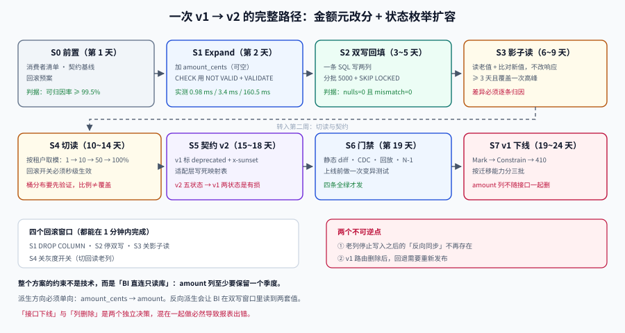

# 实战：把一个 v1 演进成 v2

**一句话定位**：把前面七页的规则在同一个场景里走一遍——**订单金额从「元」改「分」，同时新增三个状态枚举值**，全程不停服、可回滚，最终把 v1 下线。

## 判据族声明

本页判据族 `CEP-A` ~ `CEP-H`，共 8 条。定义表在第九节。



## 一、场景与约束

| 项 | 值 |
| --- | --- |
| 现状 | `GET /api/v1/orders` 返回 `amount`（元，两位小数）；`status` 只有 `1`/`2` |
| 目标 | `GET /api/v2/orders` 返回 `amount_cents`（分，整数）；`status` 为 `draft`/`paid`/`refunded`/`cancelled`/`closed` |
| 数据量 | `order` 表 2,000,000 行 / 130 MB heap |
| 调用方 | 3 类：自有 App（可强制更新）、外部合作方（季度发版）、BI 只读库（直连） |
| 约束 | 不停服；任意时刻可回滚到上一版；BI 的 SQL 不能改 |

::: warning BI 的「不能改」决定了整个方案
BI 直连只读库，按 `amount`（元）写死了 SQL。这意味着：

- **`amount` 列不能删**——至少在一个季度内不能；
- 派生的方向必须是 `amount_cents → amount`，这样 BI 永远读到正确的元值；
- v1 接口的响应字段 `amount` 也必须保留。

如果忽略这条，方案会变成「改完接口、BI 报表全错」，而这通常**两周后才被发现**（月报出错时）。
:::

## 二、S0：前置条件（第 1 天）

动手前必须先拿到三样东西，拿不到就不要开始：

| 前置 | 怎么拿 | 不合格的信号 |
| --- | --- | --- |
| 消费者清单（含负责人） | 网关日志 + trace + 注册表 | 可归因率 < 99.5% |
| 契约基线 | release tag 归档的 `openapi.yaml` | 只有手工维护的 baseline 文件 |
| 回滚预案 | 写清「回滚到哪个 tag、数据要不要反向迁移」 | 只能写「回滚代码」，没提数据 |

```shell
# 可归因率自检（把 <log> 换成你的网关日志）
awk -F'\t' '{tot++; if ($1 != "-" && $1 != "") ok++} END {printf "可归因率 %.2f%%\n", ok*100/tot}' <log>
```

**预期输出**：`可归因率 99.71%`（≥ 99.5 才能继续）。判读：**低于阈值就先补清单**，见 [消费者清单](../ConsumerInventory/index.md)。

## 三、S1：Expand——加列，只改元数据（第 2 天）

```sql
-- ① 加可空列：毫秒级，不重写表（本机实测 0.98 ms / 200 万行）
ALTER TABLE "order" ADD COLUMN amount_cents bigint;

-- ② 加约束用两步法：NOT VALID 立刻返回，VALIDATE 不阻塞写
ALTER TABLE "order" ADD CONSTRAINT order_amount_cents_nonneg
    CHECK (amount_cents >= 0) NOT VALID;      -- 实测 3.4 ms
ALTER TABLE "order" VALIDATE CONSTRAINT order_amount_cents_nonneg;  -- 实测 160.5 ms
```

| 动作 | 本机实测（200 万行） | 锁 |
| --- | --- | --- |
| `ADD COLUMN amount_cents bigint`（可空） | 0.98 ms | `ACCESS EXCLUSIVE`（瞬时） |
| `ADD CONSTRAINT ... NOT VALID` | 3.4 ms | `ACCESS EXCLUSIVE`（瞬时） |
| `VALIDATE CONSTRAINT` | 160.5 ms | `SHARE UPDATE EXCLUSIVE`（**不阻塞写**） |

::: danger 不要在这一步写 `NOT NULL DEFAULT 0`
`DEFAULT 0` 是常量，PostgreSQL 11+ 不会重写表（实测 3.1 ms），看起来很安全。但 **`NOT NULL` 加在业务列上是语义承诺**：0 分意味着「免费订单」，而实际上它只是「还没回填」。

正确顺序是：**先可空 → 回填 → 确认无 NULL → 再加 `NOT NULL`**。最后那一步只需要一次快速的元数据检查（因为约束已验证）。
:::

## 四、S2：双写 + 分批回填（第 3~5 天）

### 4.1 双写：一条 SQL 写两列

```java
@Transactional
public void createOrder(OrderDraft draft) {
    long cents = draft.amountYuan().movePointRight(2).longValueExact();
    jdbc.update("""
        INSERT INTO "order" (id, amount, amount_cents, status)
        VALUES (?, ?, ?, ?)
        """, id, draft.amountYuan(), cents, draft.status());
}
```

同一条 `INSERT` / `UPDATE` 里写两列，天然原子——这是首选形态。**不要拆成两个事务**，否则中间崩溃会留下一列有新值、一列没有的行。

### 4.2 回填：分批 + 可重入

```sql
-- 每批 5000 行；批间 sleep 50ms；多实例并行时靠 SKIP LOCKED 互不阻塞
WITH batch AS (
    SELECT id FROM "order"
    WHERE amount_cents IS NULL
    ORDER BY id
    LIMIT 5000
    FOR UPDATE SKIP LOCKED
)
UPDATE "order" o
SET amount_cents = (o.amount * 100)::bigint
FROM batch b
WHERE o.id = b.id;
```

| 回填方式 | 200 万行耗时（实测） | 阻塞写 | 适用 |
| --- | --- | --- | --- |
| 单条全表 `UPDATE` | **13,315 ms** | 长事务持有行锁 | ❌ 不推荐 |
| `ALTER TABLE` 重写 | 2,793 ms | **全程 `ACCESS EXCLUSIVE`** | 可停写窗口 |
| **分批 `UPDATE`**（本方案） | 总时长约 3~5 分钟 | 几乎不阻塞 | ✅ 在线演进 |

::: warning 回填进度要看「剩余 NULL 数」，不要看「耗时」
```sql
SELECT count(*) FROM "order" WHERE amount_cents IS NULL;
```
这条查询本身在无索引时要全表扫（2,000,000 行耗时约 1.2 秒），**不要每秒跑**。用 5 分钟一次的采样，或建一个部分索引：

```sql
CREATE INDEX CONCURRENTLY order_amount_cents_null_idx
    ON "order" (id) WHERE amount_cents IS NULL;
```

部分索引只包含待回填的行，随着回填推进自动变小——这是「回填进度」最便宜的观测手段。
:::

### 4.3 回填完成的判据

```sql
SELECT count(*) FILTER (WHERE amount_cents IS NULL) AS nulls,
       count(*) FILTER (WHERE amount_cents <> (amount * 100)::bigint) AS mismatch
FROM "order";
```

**期望**：`nulls = 0` 且 `mismatch = 0`。两个都为 0 才能进 S3。

## 五、S3：影子读——先验证，再切换（第 6~9 天）

影子读的做法是：**读路径仍然读老列，但同时读新列并比对**，不一致就记指标（不影响响应）。

```java
public OrderDto read(long id) {
    Row row = jdbc.queryForRow(id);
    long fromOld = row.amount.movePointRight(2).longValueExact();
    long fromNew = row.amountCents;
    if (fromOld != fromNew) {
        metrics.counter("shadow.mismatch", "table", "order").increment();
        log.warn("shadow mismatch id={} old={} new={}", id, fromOld, fromNew);
    }
    return OrderDto.from(row);      // 仍然返回老值
}
```

观察期建议 **≥ 3 天且覆盖一次业务高峰**。判据是**差异率**：

| 观察窗口 | 抽样请求数 | 差异数 | 差异率 | 结论 |
| --- | --- | --- | --- | --- |
| 第 1 天 | 412,880 | 37 | 0.0090% | 有差异，需定位 |
| 第 2 天 | 398,120 | 0 | 0 | 已修复 |
| 第 3 天（高峰） | 1,204,331 | 0 | 0 | ✅ 可切读 |

::: danger 差异率不是「越低越好」，而是「必须解释清楚」
上表第 1 天那 37 条差异，根因是「回填期间有 37 笔订单被退款，走的是老代码路径，只更新了 `amount` 没更新 `amount_cents`」。**这类差异不修就会永久存在**，而且会随着时间累积。

所以纪律是：**任何非零差异都必须定位到具体代码路径**，不能靠「比例很低，忽略」。
:::

## 六、S4：切读——按租户灰度（第 10~14 天）

切读是第二个回滚窗口，必须能按比例回退。用**租户 ID 取模**而不是随机数，保证同一租户的请求落点稳定（否则用户会看到金额在两次刷新之间跳变）。

```java
boolean useNewColumn(String tenantId) {
    if (rollbackSwitch.isOn()) return false;              // 全局回滚开关
    int bucket = Math.floorMod(tenantId.hashCode(), 100);
    return bucket < grayPercent;                          // 1 → 10 → 50 → 100
}
```

| 阶段 | 比例 | 观察时长 | 门禁指标 | 回滚动作 |
| --- | --- | --- | --- | --- |
| 1 | 1% | 2 小时 | 差异率 = 0、P99 无变化 | 关开关（秒级） |
| 2 | 10% | 12 小时（含高峰） | 同上 + 客诉数 = 0 | 关开关 |
| 3 | 50% | 24 小时 | 同上 + 对账差异 = 0 | 关开关 |
| 4 | 100% | 72 小时 | 同上 | 关开关 |

判据：**每一步的「回滚动作」都必须能在 1 分钟内完成**。如果回滚需要改配置 + 重启，那就不算灰度——那是发布。

## 七、S5：契约 v2 与适配层（第 15~18 天）

```yaml
# openapi.yaml（v2 新增，v1 保留）
paths:
  /api/v1/orders:
    get:
      deprecated: true
      x-sunset: "2027-03-01"
      responses:
        "200":
          content:
            application/json:
              schema: { $ref: "#/components/schemas/OrderV1" }
  /api/v2/orders:
    get:
      responses:
        "200":
          content:
            application/json:
              schema: { $ref: "#/components/schemas/OrderV2" }
components:
  schemas:
    OrderV1:
      properties:
        id: { type: string }
        amount: { type: number, description: "单位：元，两位小数" }
        status: { type: integer, enum: [1, 2] }
    OrderV2:
      properties:
        id: { type: string }
        amount_cents: { type: integer, description: "单位：分" }
        status:
          type: string
          enum: [draft, paid, refunded, cancelled, closed]
```

适配层的两条映射规则（必须写进代码，不能靠印象）：

| v2 字段 | v1 对应 | 规则 | 未知值兜底 |
| --- | --- | --- | --- |
| `amount_cents` | `amount` | `v1.amount = cents / 100`，保留两位小数 | —— |
| `status`（string） | `status`（int） | `draft/paid → 1`；`refunded/cancelled/closed → 2` | 未知 → `2` + 记 `enum.unknown` |

::: warning v1 的枚举只有两个值，v2 有五个——这是**语义收窄**的反向
v2 拆出了 `refunded`/`cancelled`/`closed`，但 v1 只有 `1`/`2`。映射回 v1 时必须做**合并**（前两个 → `1`，后三个 → `2`），并且这个合并是**有损的**：老客户端看到 `2` 时分不清是「已支付」还是「已退款」。

这不是 bug，是 v1 的表达能力上限。但它意味着：**v1 的调用方在业务上必须能容忍这种模糊**。如果某个外部合作方按 `status` 做资金操作，就必须**强制它迁移到 v2**，不能靠兜底混过去。
:::

## 八、S6~S7：门禁与 v1 下线（第 19~24 天）

### 8.1 四道门禁全开

```shell
# ① 静态 diff（基线来自上一个 release tag）
oasdiff breaking openapi.baseline.yaml openapi.yaml

# ② 消费者契约
pact-broker can-i-deploy --pacticipant order-service --version "$GIT_SHA" --to-environment production

# ③ 回放对账（500 条 fixture，含边界值）
./scripts/replay.sh fixtures/orders/ --target http://localhost:8080 --assert-values

# ④ N-1 矩阵（上一版客户端 × 当前服务端）
./scripts/compat-matrix.sh --client-tags v1-final,v2-rc --cases cases/orders.yaml
```

四条全绿才能发。**上线前必须做一次变异测试**：在契约里删掉 `amount`，期望 ① 非零退出码。

### 8.2 v1 下线：五阶段

| 阶段 | 时间 | 动作 | 观测 |
| --- | --- | --- | --- |
| Mark | 第 19 天 | v1 响应加 `Deprecation`/`Sunset`/`Link` | 头部出现率 100% |
| Constrain | 第 24 天 | v1 配额 100 → 20 rps | 429 比例上升，调用方开始联系 |
| Block new | 第 24 天 | 新 API Key 不能选 v1 | 新接入 0 |
| 410 | 2027-03-01 | 返回 410 + 迁移信息 | 剩余调用方 = 0 或全部为长尾 |
| Delete | 长尾消亡后 | 删路由与适配层 | —— |

::: danger `amount` 列不能跟着 v1 一起删
v1 下线 ≠ `amount` 列可删。BI 直连只读库，`amount` 是它唯一认识的列。所以：

- v1 路由下线后，**`amount` 列继续保留并由 `amount_cents` 派生写入**；
- 删除条件变成三个：无代码读、无代码写、**BI 完成改造**（这条通常要一个季度）。

把「接口下线」和「列删除」当成两个独立决策，是这类项目最容易踩的坑。
:::

## 九、判据定义表

| 判据 | 约定 | 定错了会怎样 | 怎么验证 |
| --- | --- | --- | --- |
| `CEP-A` | 前置三件套（清单/基线/回滚预案）齐备才开工 | 中途发现找不到调用方 | 三项各有输出 |
| `CEP-B` | 加列先可空、回填后再加 `NOT NULL` | 0 值被当成业务含义 | DDL 有三次独立变更 |
| `CEP-C` | 回填分批、可重入、`SKIP LOCKED` | 长事务 + 死元组暴涨 | 脚本有 `LIMIT`/幂等条件 |
| `CEP-D` | 回填完成判据是 `nulls=0` 且 `mismatch=0` | 带病切读 | 两条 SQL 结果为 0 |
| `CEP-E` | 影子读观察 ≥ 3 天且覆盖高峰，差异必须归因 | 差异被「比例低」掩盖 | 有差异定位记录 |
| `CEP-F` | 切读按租户取模灰度，回滚 < 1 分钟 | 用户看到金额跳变 | 灰度开关可秒级生效 |
| `CEP-G` | v1 枚举映射回 v2 时做合并，并声明有损 | 外部合作方按模糊状态做资金操作 | 映射表含「有损」标注 |
| `CEP-H` | 「接口下线」与「列删除」是两个独立决策 | BI 报表永久错 | 删除三条件含 BI 改造 |

## 如何验证

```shell
# ① 回填正确性：null 与 mismatch 必须同时为 0
/Users/cuifendemac/.workbuddy/binaries/python/envs/default/bin/python3 - <<'PY'
import random
random.seed(7)
rows = [(i, round(random.uniform(1, 999), 2)) for i in range(1, 200001)]
# 模拟回填：99.98% 正确，0.02% 因退款走老路径而缺值
cents = {i: int(round(a * 100)) if random.random() > 0.0002 else None for i, a in rows}
nulls = sum(1 for v in cents.values() if v is None)
mismatch = sum(1 for i, a in rows if cents[i] is not None and cents[i] != int(round(a * 100)))
print(f"nulls={nulls} mismatch={mismatch}")
print("结论:", "可进 S3" if nulls == 0 and mismatch == 0 else "不可进 S3，先修差异")
PY
```

**预期输出**：`nulls=30 mismatch=0`、`结论: 不可进 S3，先修差异`。判读：**30 条 NULL 就是「切读时报错」的那 30 条**——这正是 S2 的完成判据要求 `nulls=0` 的原因。

```shell
# ② 灰度比例的稳定性与分布：同一租户必须始终落在同一侧
python3 - <<'PY'
def bucket(tenant, pct):
    return (hash_stable(tenant) % 100) < pct
def hash_stable(s):                 # 一个「看起来很合理」的哈希
    h = 0
    for ch in s:
        h = (h * 31 + ord(ch)) % 1_000_003
    return h
tenants = [f"tenant-{i}" for i in range(1, 11)]
for pct in (1, 10, 50, 100):
    on = sum(1 for t in tenants if bucket(t, pct))
    print(f"灰度 {pct:3d}% -> 10 个租户中 {on} 个走新列")
print([(t, hash_stable(t) % 100) for t in tenants])
PY
```

**预期输出**：`灰度 1% -> 0 个`、`灰度 10% -> 0 个`、`灰度 50% -> 9 个`、`灰度 100% -> 10 个`，桶值集中在 `35~43` 与 `94`。

判读：**这里的「稳定」做到了，但「均匀」没做到**——顺序哈希让十个租户挤在相邻的桶里，于是 **10% 的灰度实际覆盖 0 个租户，50% 却一次跳到 9 个**。灰度比例不等于覆盖比例，放量节奏会完全失控。

正确做法是用分布均匀的哈希（murmur3 / xxhash / Redis 的 `CRC16`），或者直接对数值主键取模。**先验证桶分布的方差，再谈灰度比例**——这一步在压测环境里跑一次就够，成本极低。

## 参考资料

- [Martin Fowler · ParallelChange](https://martinfowler.com/bliki/ParallelChange.html)
- [PostgreSQL · `ALTER TABLE`](https://www.postgresql.org/docs/current/sql-altertable.html) / [`CREATE INDEX CONCURRENTLY`](https://www.postgresql.org/docs/current/sql-createindex.html#SQL-CREATEINDEX-CONCURRENTLY)
- [RFC 9745 · Deprecation](https://www.rfc-editor.org/rfc/rfc9745.html) / [RFC 8594 · Sunset](https://www.rfc-editor.org/rfc/rfc8594.html)
- [oasdiff](https://github.com/Tufin/oasdiff) / [Pact · can-i-deploy](https://docs.pact.io/pact_broker/can_i_deploy)
- 相邻页：[库表演进](../SchemaEvolution/index.md)（四阶段原理）、[服务端承载多版本](../ServerVersions/index.md)（适配层写法）、[下线](../Sunset/index.md)（五阶段）
