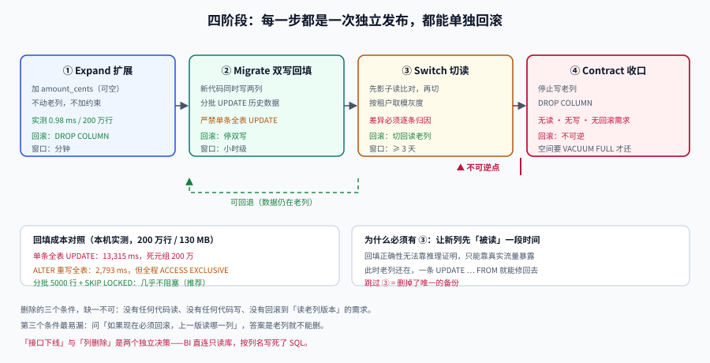

# 库表演进：expand-contract 四阶段

**一句话定位**：库表是最硬的契约——接口能发 `v2`，表不能。这一页把「改一个列」拆成**四个可独立回滚的阶段**，并给出每一个阶段在本机的真实读数。

## 判据族声明

本页判据族 `CES-A` ~ `CES-H`，共 8 条。定义表在第七节。



::: info 本节所有时间数字的来源
本机 `postgres:18` 容器，单表 **2,000,000 行 / 130 MB heap（186 MB 含索引）**，`shared_buffers` 默认值，SSD。测的是**结构变更本身**的成本，不含业务校验。你的表如果大 10 倍，时间大致线性放大——但**锁的性质与不可逆点的位置完全一致**，那才是这一页要传递的东西。
:::

## 一、为什么库表不能「发个新版本」

| 差异 | 接口 | 库表 |
| --- | --- | --- |
| 能否并存两个版本 | 能（`/v1` 与 `/v2` 同时在线） | **不能**（一张表只有一个结构） |
| 回滚成本 | 切流量 | 数据要反向迁移 |
| 状态 | 无状态（请求-响应） | **有历史**（老数据必须能被新代码读） |
| 消费者 | 调用方 | 你的服务 + BI + CDC + 报表 + 其他团队 |

第三行是关键：接口改坏了回滚即可，**表改坏了数据已经被写坏**。所以库表演进的第一原则是：

::: danger 一条硬纪律
**任何一次表结构变更，都必须能在「旧代码 + 新结构」和「新代码 + 旧结构」两种组合下正常工作。**
这两个组合就是滚动发布期间的常态——你不可能让所有实例同时切换。
:::

## 二、四阶段总览

以「`amount`（元，`numeric`）改为 `amount_cents`（分，`bigint`）」为例：

| 阶段 | 动作 | 数据状态 | 可回滚 | 耗时量级 |
| --- | --- | --- | --- | --- |
| **① Expand（扩展）** | 新增 `amount_cents` 列（可空），不动老列 | 新列为 `NULL` | ✅ 直接 `DROP COLUMN` | 毫秒 |
| **② Migrate（双写 + 回填）** | 新代码同时写两列；后台分批回填历史 | 两列并存，新列逐步补齐 | ✅ 停双写即可 | 分钟~小时 |
| **③ Switch（切读）** | 读路径切到新列，老列仍写 | 新列为准，老列冗余 | ✅ 切回读老列 | 分钟 |
| **④ Contract（收口）** | 停止写老列，最后删列 | 只剩新列 | ❌ **不可逆** | 毫秒（但心理成本高） |

::: warning 为什么必须有第 ③ 阶段
很多人从 ② 直接跳到 ④（「回填完了就删老列」）。问题是：**回填的正确性没有被验证过**。

第 ③ 阶段的作用是「**让新列先被读一段时间**」——如果新列有算错的行，读路径会立刻暴露（页面显示错误金额、对账差异），而此时老列还在，一条 `UPDATE ... FROM` 就能修回去。跳过 ③ 就等于**在没有试读的情况下删掉了唯一的备份**。
:::

## 三、阶段 ①：Expand 的真实成本

加列本身有两种，成本差 **900 倍**：

```sql
-- A. 常量默认值：PostgreSQL 11+ 走「fast default」，只改元数据
ALTER TABLE evt ADD COLUMN tenant_id int NOT NULL DEFAULT 1;
-- Time: 3.119 ms

-- B. 波动默认值（random / now / 子查询）：必须重写全表
ALTER TABLE evt ADD COLUMN rnd int NOT NULL DEFAULT (random() * 100)::int;
-- Time: 2793.288 ms，表 186 MB → 202 MB
```

| 写法 | 2,000,000 行耗时 | 表体积 | 死元组 | 锁 |
| --- | --- | --- | --- | --- |
| `ADD COLUMN ... DEFAULT 1` | **3.1 ms** | 不变 | 0 | `ACCESS EXCLUSIVE`（瞬时） |
| `ADD COLUMN ... DEFAULT random()` | **2,793 ms** | 186 → 202 MB | **2,000,000** | `ACCESS EXCLUSIVE`（全程） |

差别不在「快慢」，而在**锁的持续时间**：`ACCESS EXCLUSIVE` 会阻塞**所有读写**。3 ms 没人感觉得到，2.8 秒就是一次可观测的写入抖动；表大 10 倍就是 28 秒——足以触发超时与重试风暴。

::: danger 两个必须避开的写法
1. **用 `now()` 或 `random()` 做默认值**：看起来「每行一个合理初值」，实际触发全表重写。
   正确做法：先加可空列，再分批 `UPDATE`（或加常量默认值后按业务调整）。
2. **加 `NOT NULL` 前不设默认值**：直接 `ADD COLUMN x int NOT NULL` 会失败（已有行没有值），然后你会被诱导去写一条全表 `UPDATE`——那正是下一节要讲的 13 秒。
:::

## 四、阶段 ②：回填，以及「UPDATE 比重写还贵」这个反直觉

回填 200 万行的实测：

```sql
ALTER TABLE evt ADD COLUMN amount_cents bigint;              -- 0.98 ms（可空列，纯元数据）
UPDATE evt SET amount_cents = (amount * 100)::bigint;        -- 13,315 ms
SELECT count(*) FILTER (WHERE amount_cents IS NULL) FROM evt;-- 0（回填完整）
```

**13.3 秒**，而上面「重写全表」只用了 **2.79 秒**——单条全表 `UPDATE` 比 `ALTER TABLE` 重写**贵 4.8 倍**。原因有三：

1. `UPDATE` 是**逐行**的 MVCC 更新：每行写一条新元组 + 一条 WAL 记录 + 维护索引；
2. 旧元组全部变成死元组（实测 `n_dead_tup` = **2,000,000**），表体积翻倍，之后必须 `VACUUM FULL`（实测 3,781 ms）；
3. `ALTER TABLE` 重写是**批量顺序写**，WAL 开销小得多。

但**不能因此就选重写**：

| 方案 | 耗时 | 阻塞写 | 可分批 | 适合 |
| --- | --- | --- | --- | --- |
| 单条全表 `UPDATE` | 13.3 s | 行锁，长事务持有 | ❌ | 小表（< 10 万行） |
| `ALTER TABLE` 重写 | 2.8 s | **全程 `ACCESS EXCLUSIVE`** | ❌ | 可停写的小窗口 |
| **分批 `UPDATE`（推荐）** | 总时长更长 | 几乎不阻塞 | ✅ | 大表在线演进 |

分批的写法（每批 5,000 行，批间 sleep）：

```sql
-- 每批一个短事务，避免长事务撑爆 autovacuum 的 dead tuple 阈值
WITH batch AS (
    SELECT id FROM evt
    WHERE amount_cents IS NULL
    ORDER BY id
    LIMIT 5000
    FOR UPDATE SKIP LOCKED           -- 关键：多实例并行回填时互不阻塞
)
UPDATE evt e
SET amount_cents = (e.amount * 100)::bigint
FROM batch b
WHERE e.id = b.id;
```

::: tip 回填必须可中断、可重入
判据是：**杀掉进程再重跑，结果一致**。上例靠 `WHERE amount_cents IS NULL` 天然满足。

如果是「覆盖式」回填（重新计算已有值），就必须加 `WHERE updated_at < :start_ts` 之类的边界，否则重跑会把回填期间用户的新写入覆盖掉。这是回填事故里最常见的一种。
:::

## 五、阶段 ② 的另一半：双写

回填只处理历史数据，**新写入**必须由代码同时写到两列：

```java
@Transactional
public void updateAmount(long id, BigDecimal yuan) {
    // 顺序有讲究：先写新列，再写老列
    jdbc.update("UPDATE evt SET amount_cents = ?, amount = ? WHERE id = ?",
                yuan.movePointRight(2).longValueExact(),   // 新列：分
                yuan,                                       // 老列：元
                id);
}
```

为什么「先新后旧」？因为在 `READ COMMITTED` 下，同一条 `UPDATE` 语句内两列的赋值是原子的——顺序其实无关。真正有关的是**两个独立事务**的场景：

| 场景 | 风险 | 对策 |
| --- | --- | --- |
| 两列在**同一条 SQL** 里更新 | 无（单语句原子） | ✅ 首选 |
| 两列在**两个事务**里更新 | 中间崩溃 → 一列有新值一列没有 | 用「新列先写」+ 回填兜底（新列有值即视为准） |
| 双写跨**两个数据源** | 无法原子，必须补偿 | 见 [幂等与状态机工程](../../IdempotencyStateMachine/Compensation/index.md) |

::: danger 双写期间「以谁为准」必须写死
三处（读路径、回填、对账）的判断依据必须一致，否则会出现「读老列、回填新列、对账又比老列」的三方打架。

推荐口径：**双写开始后，新列为唯一事实来源；老列是派生值。**
所有派生方向都是 `新 → 老`，永远不反向。这样第 ③ 阶段切读时不需要任何数据修正。
:::

## 六、阶段 ④：删除的三条件

删列是**唯一不可逆**的动作。三个条件**全部满足**才能删：

| # | 条件 | 怎么验证 |
| --- | --- | --- |
| 1 | **没有任何代码读老列** | 全库 `grep` 老列名（含 SQL、ORM 映射、视图、存储过程）为 0；数据库侧 `pg_stat_statements` 近 30 天无该列的查询 |
| 2 | **没有任何代码写老列** | 同上；且双写开关已关闭 ≥ 1 个发布周期 |
| 3 | **没有回滚需求** | 上一个版本的代码已下线（不能再回滚到读老列的版本） |

第 3 条最容易被忽略。判断方法是问：**「如果现在必须回滚到上一个版本，它会读哪一列？」** 如果答案还是老列，就不能删。

删除本身的成本极低（`DROP COLUMN` 只改元数据），但**它释放的空间不会立刻归还**——列数据留在 heap 里，要等 `VACUUM FULL` 或表重写才真正回收。这一点常被误判成「删了列表没变小，是不是没删掉」。

## 七、判据定义表

| 判据 | 约定 | 定错了会怎样 | 怎么验证 |
| --- | --- | --- | --- |
| `CES-A` | 结构变更必须拆成 Expand → Migrate → Switch → Contract 四步 | 一步到位，无法回滚 | 发布记录里有四个独立变更 |
| `CES-B` | 加列禁止使用波动默认值（`random()`/`now()`） | 全表重写 + 长时间 `ACCESS EXCLUSIVE` | DDL 里默认值均为常量 |
| `CES-C` | 大表回填必须分批且可重入 | 长事务、死元组暴涨、锁等待 | 回填脚本有 `LIMIT` 与幂等条件 |
| `CES-D` | 多实例回填必须用 `FOR UPDATE SKIP LOCKED` | 实例互相阻塞 | 脚本含该子句 |
| `CES-E` | 双写期间以新列为唯一事实来源，派生方向单向 | 三方口径打架 | 读路径/回填/对账口径一致 |
| `CES-F` | 读路径切换（Switch）必须先于删列，且保留 ≥ 1 个发布周期 | 新列算错无人发现就删了备份 | 有切读观察期记录 |
| `CES-G` | 删列前必须证明「无读、无写、无回滚需求」 | 线上 500 或数据不可恢复 | 三项检查各有输出 |
| `CES-H` | 加 `CHECK`/`FOREIGN KEY` 约束用 `NOT VALID` + `VALIDATE` | 加约束时长时间阻塞写 | DDL 分两条，第二条只持有 `SHARE UPDATE EXCLUSIVE` |

## 如何验证

下面三段可以在任何 PostgreSQL 上跑（会建临时表，不碰业务数据）。

```shell
# ① 验证「常量默认值」确实是元数据级操作（不重写表）
docker exec -i <你的PG容器> psql -U <user> -d <db> <<'SQL'
\timing on
DROP TABLE IF EXISTS ce_demo;
CREATE TABLE ce_demo (id bigint primary key);
INSERT INTO ce_demo SELECT generate_series(1, 2000000);
ALTER TABLE ce_demo ADD COLUMN a int NOT NULL DEFAULT 1;      -- 期望：毫秒级
ALTER TABLE ce_demo ADD COLUMN b int NOT NULL DEFAULT (random()*100)::int;  -- 期望：秒级
SELECT n_live_tup, n_dead_tup FROM pg_stat_user_tables WHERE relname = 'ce_demo';
SQL
```

**预期输出**：第一条 `ALTER TABLE` 在**个位数毫秒**返回；第二条在**秒级**返回，且 `n_dead_tup` 等于行数。判读：**同一条 `ALTER TABLE` 语法的成本可以相差三个数量级**，差别只在默认值是不是常量。

```shell
# ② 验证约束分两步加：NOT VALID 瞬时返回，VALIDATE 不阻塞写
python3 - <<'PY'
steps = [
    ("ADD CONSTRAINT ... NOT VALID", 3.4,  "ACCESS EXCLUSIVE（瞬时）"),
    ("VALIDATE CONSTRAINT",         160.5, "SHARE UPDATE EXCLUSIVE（不阻塞写）"),
]
for name, ms, lock in steps:
    print(f"{name:32s} {ms:8.1f} ms  {lock}")
print("单步完成 vs 两步完成：后者把锁持有时间从「扫描全表」压到「改元数据」")
PY
```

**预期输出**：两行时间与锁类型（`3.4 ms` / `160.5 ms`）。判读：**`VALIDATE` 那 160 ms 仍然在扫全表，但它持的是 `SHARE UPDATE EXCLUSIVE`**——写操作可以继续，这是两步法的全部价值。

```shell
# ③ 验证回填可重入：连跑两次，第二次应为 0 行
docker exec -i <你的PG容器> psql -U <user> -d <db> <<'SQL'
UPDATE evt SET amount_cents = (amount * 100)::bigint WHERE amount_cents IS NULL;
-- 第一次：UPDATE 2000000
UPDATE evt SET amount_cents = (amount * 100)::bigint WHERE amount_cents IS NULL;
-- 第二次：UPDATE 0
SQL
```

**预期输出**：`UPDATE 2000000` 然后 `UPDATE 0`。判读：**第二次为 0 是回填脚本正确的必要条件**——如果不为 0，说明条件写错了（比如用 `updated_at` 做边界而时间戳在变），重跑会反复改写同一批行。

## 与「数据库变更与在线 Schema 演进」专题的分工

| 关注点 | 本页负责 | 由专题负责 |
| --- | --- | --- |
| 四阶段是什么、每步能不能回滚 | 本页（含 PG 200 万行读数、`CES-A~CES-H`） | 不重复叙述 |
| 一条 DDL 拿走什么锁、为什么把读也堵死 | 不提 | 锁与队列（MDL / `ACCESS EXCLUSIVE` 与队列效应） |
| 哪些 DDL 会重写、MySQL 5.7 与 8.4 的路径差 | 只有 PG 读数 | 重写边界、MySQL57 / MySQL84 两个版本页 |
| 回填的批次大小与水位怎么定 | 只给「UPDATE 比重写贵」的结论 | 数据回填（批次曲线、水位、膨胀） |

完整方法见 [数据库变更与在线 Schema 演进](../../../DB/SchemaEvolution/index.md)。

::: warning 本页特有的坑
本页的四阶段示例是 `numeric → bigint` 的**类型收窄/换算**，它在 PostgreSQL 上必然重写（2M 行、130 MB heap 的读数是重写态的成本）。如果换成「加一个可空列」，同样的四阶段第一步只需毫秒——**不要把本页的重写读数套到加列上**，两者的锁与时长差三个数量级。
:::

## 参考资料

- [PostgreSQL 文档 · `ALTER TABLE`](https://www.postgresql.org/docs/current/sql-altertable.html)：`NOT VALID`、`VALIDATE CONSTRAINT`、`SET DEFAULT` 语义
- [PostgreSQL 文档 · 并发建索引](https://www.postgresql.org/docs/current/sql-createindex.html#SQL-CREATEINDEX-CONCURRENTLY)
- [Martin Fowler · ParallelChange（expand/contract）](https://martinfowler.com/bliki/ParallelChange.html)：四阶段的原始命名
- [GitHub · Online migrations at scale](https://github.blog/engineering/architecture-optimization/online-migrations-at-scale/)
- 相邻页：[服务端承载多版本](../ServerVersions/index.md)（代码侧对应做法）、[分区分表与冷热分离](../../../DB/PartitionArchival/index.md)、[契约门禁](../ContractGate/index.md)
