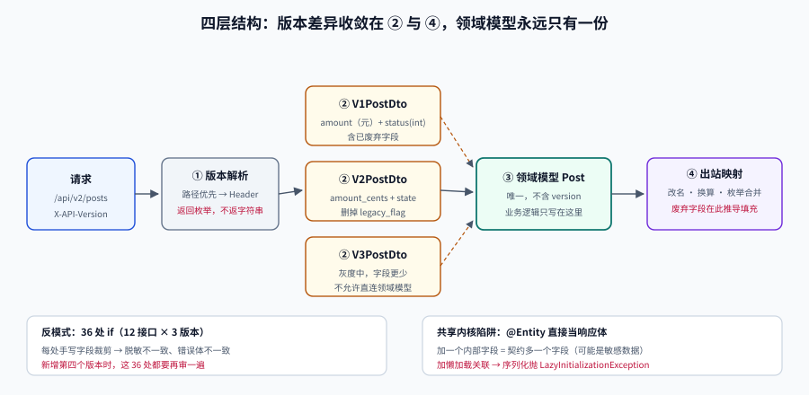

# 服务端承载多版本

**一句话定位**：一旦决定「同时支持 v1 和 v2」，真正的工程问题才刚开始——**多出来的那一套语义，放在代码的哪里**。放错地方，它会长成散落在几十个 `if` 里的意大利面。

## 判据族声明

本页判据族 `CEV-A` ~ `CEV-H`，共 8 条。定义表在第七节。



## 一、三种承载形态

| 形态 | 做法 | 代码量 | 一致性风险 | 适合 |
| --- | --- | --- | --- | --- |
| **整份分支**（fork） | `v1/` 与 `v2/` 两套 controller + service | 100% × N | **极高**：修 bug 要改两处，必然漂移 | 语义完全不兼容、且 v1 即将下线 |
| **版本适配层**（推荐） | 一个内部实现 + 每版本一个 DTO 与 mapper | 100% + 20% × (N-1) | 低：业务逻辑唯一 | 绝大多数情况 |
| **网关转换** | v1 请求在网关转成 v2，响应再转回 | 最低 | 中：复杂语义难以在网关表达 | 差异仅在字段名/包装格式 |

::: danger 「整份分支」的真实代价不是代码量
是**修 bug 要修两遍**。一个线上缺陷从发现到修复，在双分支结构里要：

1. 在 v2 分支修（8 人日）；
2. 在 v1 分支同样修（因为代码不同，不能直接 cherry-pick，6 人日）；
3. 两个分支各跑一遍回归（2 人日）；
4. 两套数据/缓存格式的兼容验证（2 人日）。

同一次修复，成本翻倍还不止——而且**v1 分支的那次修复经常被忘掉**，半年后变成「只在老版本上存在的 bug」。
:::

## 二、反模式：`if (version == 1)` 的蔓延

最常见的起点是一个无害的判断：

```java
@GetMapping("/api/{version}/posts/{id}")
public PostDto get(@PathVariable String version, @PathVariable Long id) {
    Post post = service.findById(id);
    if ("v1".equals(version)) {
        return PostDtoV1.from(post);      // 字段少两个
    }
    return PostDtoV2.from(post);
}
```

问题不在这一处，而在**它的复制速度**。假设有 12 个接口、3 个版本，判断会自然长成 36 个分支，并且每个分支里的「字段裁剪」逻辑各不相同：

| 位置 | 分支数 | 一致性 |
| --- | --- | --- |
| Controller | 12 接口 × 3 版本 = **36** | 每处手写，必然不一致 |
| 序列化/脱敏 | 与 Controller 交叉 | 有的版本脱敏、有的没脱 |
| 错误响应 | 3 套错误体 | 客户端无法统一处理 |
| 文档 | 3 份手写 | 与实现漂移 |

更糟的是**新增第三个版本时**：这 36 处都要再审一遍。这就是「版本数增加导致维护成本非线性上升」的机制。

## 三、正确结构：把版本差异收敛到一层

目标结构只有四层，版本差异**只在第 2 层和第 4 层出现**：

```text
① 入口层      解析版本（路径 / Header / 媒体类型）→ 得到 Version 枚举
② 版本 DTO    V1PostDto / V2PostDto（只描述对外形状，无业务逻辑）
③ 内部模型    Post（领域对象，唯一，不含任何版本概念）
④ 出站映射    Domain → VersionDto（含字段填充、枚举映射、废弃字段兜底）
```

关键纪律：**内部模型（第 ③ 层）里不允许出现 `version` 字段**。一旦出现，版本概念就渗透进了业务逻辑，之后每个 service 方法都要考虑它。

```java
// 版本路由：一张表，而不是散落的 if
public enum ApiVersion { V1, V2 }

@Component
public class VersionResolver {
    // 路径前缀优先，其次 Header，最后落到「钉死的默认版本」（不是「最新版本」）
    public ApiVersion resolve(HttpServletRequest req) {
        String path = req.getRequestURI();          // /api/v2/posts
        Matcher m = Pattern.compile("^/api/(v\\d+)/").matcher(path);
        if (m.find()) return ApiVersion.of(m.group(1));
        String h = req.getHeader("X-API-Version");
        return h != null ? ApiVersion.of(h) : ApiVersion.V2;
    }
}
```

::: warning 「默认落到最新版本」是个陷阱
上例的 `ApiVersion.V2` 兜底看起来友好，实际会让**没有版本标识的请求**在下一个版本发布时静默切到 v3。

正确做法是**默认值钉死在「最近一次大版本升级时定下的那个版本」**，此后不再随新版本发布而移动。或者更干脆：**没有版本标识就返回 400**，逼迫调用方显式声明。后者在内部系统里通常是最省事的选择。
:::

## 四、版本映射表：把差异写成数据

版本差异应该是一张**可读、可测、可 diff** 的表，而不是藏在代码里。

| 字段 | v1 | v2 | 映射规则 |
| --- | --- | --- | --- |
| `id` | `id` | `id` | 同名直传（字符串化） |
| `title` | `title` | `title` | 同名直传 |
| `content` | `content` | `body` | v1 → v2 改名，值不变 |
| `amount` | `amount`（元，两位小数） | `amount_cents`（分，整数） | `×100` 并取整 |
| `status` | `status`（`1`/`2`） | `state`（`draft`/`published`） | 枚举映射表，未知值 → `unknown` |
| `created_at` | `createTime`（`yyyy-MM-dd HH:mm:ss`，本地时区） | `created_at`（RFC 3339，UTC） | 格式化 + 时区转换 |
| `legacy_flag` | `legacy_flag`（boolean） | **不存在** | v1 出站时按 `status` 推导填充 |

这张表有三个必须做到的点：

1. **每一行都要有映射规则**，不能留空——留空意味着「靠印象实现」；
2. **未知值必须有兜底**（`status` 未知 → `unknown`），否则新增枚举值会让老版本直接 500；
3. **表要进版本控制**，改动走 review——它是契约的一部分。

::: danger 出站时「填充已废弃字段」是必须做的，不是可选的
v2 删掉了 `legacy_flag`，但 v1 的响应里还得有它。这个值只能**在 v1 的出站映射里推导出来**：

```java
// v1 映射：用新字段反推老字段
dto.setLegacyFlag(post.getStatus() == Status.LEGACY_MODE);
```

如果这一行忘了写，v1 客户端拿到的是 `null`/`false`，界面上那个开关会**永久显示关闭**——不报错，只是行为不对。这是版本适配里最高频的静默缺陷。
:::

## 五、错误响应也必须版本化

一个常见的疏漏：成功响应做了版本区分，错误响应却共用一套。

```json
// v1 的错误体
{ "code": 1001, "msg": "参数错误" }

// v2 的错误体（按 RFC 9457 problem+json）
{ "type": "https://api.example.com/errors/validation", "title": "Validation failed",
  "status": 400, "detail": "page must be >= 1", "instance": "/api/v2/posts" }
```

如果 v1 的接口在出错时返回了 v2 的格式，老客户端解析 `code` 会拿到 `undefined`——**错误处理路径崩了，比正常路径崩更危险**，因为它把「可恢复的错误」变成了「未捕获异常」。

判据：**错误响应必须走与成功响应相同的版本映射**，且 HTTP 状态码在版本间保持一致（同一原因在 v1 返回 400，在 v2 不能变成 422）。

## 六、共享内核的陷阱：「内部模型就是响应体」

这是多版本系统腐化的头号原因，也是最容易在代码评审里被放过的一条：

```java
// 反例：直接把 JPA 实体当响应体
@GetMapping("/api/v2/posts/{id}")
public Post get(@PathVariable Long id) {     // Post 是 @Entity
    return repository.findById(id).orElseThrow();
}
```

后果是**序列化即契约**：

| 你做的动作 | 实际发生的契约变更 |
| --- | --- |
| 加一个内部字段（`internalScore`） | 响应里多了一个字段（可能是敏感数据） |
| 改字段名（重构） | 契约破坏 |
| 加一个 `@ManyToOne` 关联 | 响应体变大、触发 N+1、可能暴露关联表全部字段 |
| 加一个懒加载字段 | 序列化时抛 `LazyInitializationException` |

判据很硬：**领域模型永不直接序列化出站**，中间必须有一层显式 DTO。这一层的成本是「写一个 mapper」，收益是「契约变更变成一次显式的、可 review 的动作」。

## 七、判据定义表

| 判据 | 约定 | 定错了会怎样 | 怎么验证 |
| --- | --- | --- | --- |
| `CEV-A` | 版本解析集中在一处，返回值是枚举而非字符串 | 各 handler 各自解析，规则不一致 | 全库 `equals("v1")` 只出现在路由层 |
| `CEV-B` | 内部领域模型不含版本概念 | 每个 service 方法都要传 version | 领域模型无 `version` 字段 |
| `CEV-C` | 领域模型不直接序列化出站，必须有显式 DTO | 改内部字段即改契约 | Controller 返回类型均为 `*Dto` |
| `CEV-D` | 版本差异写成映射表（字段/枚举/格式），进版本控制 | 差异靠记忆实现，必然漂移 | 存在映射表且被 review |
| `CEV-E` | 已废弃字段在旧版本出站时按规则推导填充 | 老客户端拿到 `null`，行为静默错误 | 每个废弃字段有推导规则与用例 |
| `CEV-F` | 错误响应走同一套版本映射，状态码跨版本一致 | 老客户端错误处理崩溃 | 各版本错误体均有契约测试 |
| `CEV-G` | 未声明版本的请求行为显式定义（400 或钉死的默认） | 新版本发布时静默切默认 | 用例覆盖「无版本号」请求 |
| `CEV-H` | 每个版本都有独立的契约测试矩阵 | 只测最新版本，老版本腐烂 | 矩阵行 = 版本数 |

## 如何验证

```shell
# ① 映射表覆盖率：每个对外字段是否都有映射规则
/Users/cuifendemac/.workbuddy/binaries/python/envs/default/bin/python3 - <<'PY'
fields = {                      # v2 对外字段 -> v1 对应的映射规则（None 表示未定义）
    "id":        "同名直传",
    "title":     "同名直传",
    "body":      "v1.content ← 改名",
    "amount_cents": "v1.amount = /100",
    "state":     "枚举映射",
    "created_at":"格式化 + 时区",
}
external = ["id", "title", "body", "amount_cents", "state", "created_at", "author"]
missing = [f for f in external if not fields.get(f)]
print("对外字段数:", len(external))
print("无映射规则:", missing or "无")
print("覆盖率:", f"{(len(external)-len(missing))/len(external):.1%}")
PY
```

**预期输出**：`无映射规则: ['author']`、`覆盖率: 85.7%`。判读：**`author` 是 v2 新增字段，v1 需要决定「不返回」还是「用作者 ID 填充」**——留空就等于「靠实现者印象」。

```shell
# ② 版本分支蔓延检测：统计代码里散落的版本判断
python3 - <<'PY'
# 模拟 grep 结果：文件 -> 版本判断次数
hits = {
    "PostController.java": 6,
    "CommentController.java": 5,
    "UserController.java": 4,
    "PostMapper.java": 2,
}
total = sum(hits.values())
print("版本判断总数:", total)
print("涉及文件:", len(hits))
worst = max(hits.items(), key=lambda kv: kv[1])
print("最集中:", worst[0], worst[1], "处")
print("判读:", "超过 20 处，应下沉到适配层" if total > 20 else "在可接受范围")
PY
```

**预期输出**：`版本判断总数: 17`、`判读: 在可接受范围`。判读：把同样的统计跑在你的真实仓库上——**如果某文件的判断数 > 3，说明版本逻辑正在渗进业务代码**，该抽 mapper 了。

## 参考资料

- [Google AIP-180 · Backwards compatibility](https://google.aip.dev/180)
- [Microsoft REST API Guidelines · Versioning](https://github.com/microsoft/api-guidelines/blob/vNext/azure/Guidelines.md)
- [RFC 9457 · Problem Details for HTTP APIs](https://www.rfc-editor.org/rfc/rfc9457.html)：错误体标准化的依据
- [OpenAPI 3.2.0 · 版本与废弃](https://spec.openapis.org/oas/v3.2.0.html#versions-and-deprecation)
- 相邻页：[API 设计规范 · 版本策略](../../../Tools/APIDesign/Versioning/index.md)（对外怎么表达版本）、[库表演进](../SchemaEvolution/index.md)、[契约门禁](../ContractGate/index.md)
