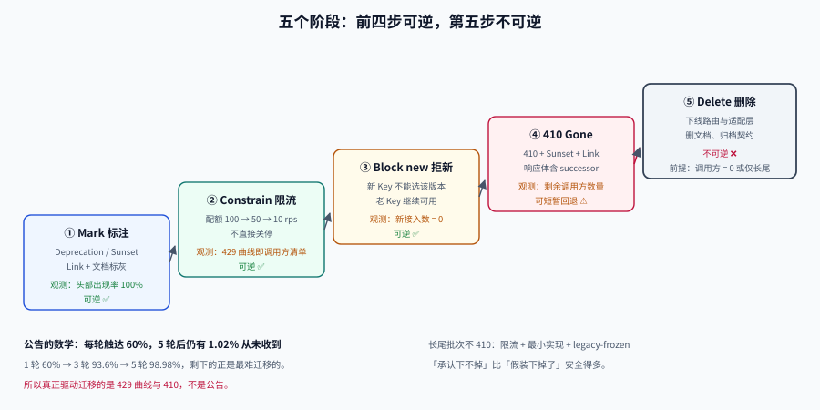

# 下线：把废弃做成可执行的倒计时

**一句话定位**：下线不是「发个公告然后停掉」，而是一条**五个阶段、按消费者分批、每一步都有观测指标**的流水线。核心结论是：**能下线的接口，都是被流量逼下线的，不是被公告说下线的。**

## 判据族声明

本页判据族 `CEU-A` ~ `CEU-H`，共 8 条。定义表在第七节。



## 一、五个阶段

| 阶段 | 动作 | 观测指标 | 可逆 |
| --- | --- | --- | --- |
| **① Mark（标注）** | 响应加 `Deprecation` / `Sunset` / `Link` 头；文档站标灰 | 头部出现率 100% | ✅ |
| **② Constrain（限流降配）** | 逐步降低该版本的配额（如 100 → 50 → 10 rps） | 429 比例、调用量曲线 | ✅ |
| **③ Block new（拒绝新接入）** | 新 API Key 不能选该版本；老 Key 可继续 | 新接入数为 0 | ✅ |
| **④ 410 Gone** | 返回 `410` + `Sunset` + `Link` | 410 比例、剩余调用方数量 | ⚠️ 可短暂回退 |
| **⑤ Delete（删除）** | 下线路由与代码，删文档 | 路由不存在 | ❌ |

::: tip 为什么第 ② 步是「限流」而不是「关停」
限流把「突然全断」变成「慢慢变慢」。对调用方来说：

- 突然 404 → 值班同学半夜被叫起来，情绪对立；
- 逐渐 429 → 白天的批量任务开始失败，**他们有工作时间去改**。

更重要的是，限流会产生**可观测的 429 曲线**——这条曲线就是「还有谁在调」的实时清单，比任何公告都准。
:::

## 二、公告为什么无效：一个乘法

假设有 100 个调用方，每轮通知的真实触达率是 60%（有人离职、邮箱废弃、系统无人维护）：

| 通知轮次 | 累计触达 | 仍未触达 |
| --- | --- | --- |
| 1 | 60% | 40% |
| 2 | 84% | 16% |
| 3 | 93.6% | 6.4% |
| 5 | 98.98% | **1.02%** |

即使发 5 轮，仍有约 1% 的调用方从未收到。而**这 1% 恰恰是最难迁移的那批**（无人维护、无升级能力、合同约束）。

推论：**公告只能覆盖「能改的人」，剩下的必须靠技术手段发现与逼迫**——也就是限流与 410。

## 三、按消费者分批，而不是按日期一刀切

「12 月 31 日全部下线」是最省事、也最容易出事故的做法。分批的依据应该是**迁移能力**，不是时间：

| 批次 | 判定条件 | 处理 |
| --- | --- | --- |
| **第 1 批：可自助迁移** | 有负责人、近 30 天有发版、已确认迁移计划 | 按计划日期，直接进入 ④ |
| **第 2 批：需协调** | 有负责人但发版周期长（季度）、或外部合作方 | 单独约定日期 + 限流兜底 |
| **第 3 批：长尾** | 无负责人 / 无法联系 / 调用量极低但持续 | **不能 410**，改为「长期限流 + 保留最简实现」 |

::: danger 第 3 批是下线流程真正的难点
它们的调用量可能只有总体的 0.03%，但一旦 410 就会造成「某个报表永久缺数」「某个对账任务静默失败半年」。这类事故的**发现成本极高**（因为量太小，监控不会报警）。

所以对第 3 批的正确处理不是「强行下线」，而是**承认它下不掉**，并做三件事：

1. 保留一个**最小实现**（只读、无副作用），把它从主代码路径里隔离出来；
2. 给它单独打标（`legacy-frozen`），任何改动都要重新评估；
3. 每年复核一次，等它自然消亡。

**「承认下不掉」比「假装下掉了」安全得多。**
:::

## 四、410、404、403 的选择

| 状态码 | 语义 | 适用 | 客户端会怎么做 |
| --- | --- | --- | --- |
| **410 Gone** | 曾经存在、已永久移除 | **下线接口的标准答案** | 停止重试（幂等语义上不应再试） |
| 404 Not Found | 不存在 | 路径打错、资源不存在 | 可能持续重试 |
| 403 Forbidden | 存在但无权访问 | 权限问题 | 可能去申请权限 |
| 451 Unavailable For Legal Reasons | 因法律原因不可用 | 合规下架 | 停止重试 |

用 404 下线的问题是**语义污染**：调用方分不清「我路径写错了」和「这个接口没了」，于是会去排查自己的代码，浪费大量时间；有些重试框架还会把 404 当成「暂时不存在」继续重试。

::: warning 410 也要配套响应体
只返回状态码，调用方仍然不知道该做什么。410 的响应体至少要包含：

```json
{
  "error": "endpoint_gone",
  "sunset": "2027-03-01T00:00:00Z",
  "successor": "https://api.example.com/api/v2/posts",
  "migration_doc": "https://docs.example.com/migration/v1-to-v2",
  "contact": "api-support@example.com"
}
```

前三个字段分别回答「为什么」「什么时候没的」「该用哪个」——**这正是 `Sunset` 与 `Link` 头回答的问题**，只是换成了调用方代码更容易解析的形式。
:::

## 五、头部怎么写：两个日期格式不一样

```http
HTTP/1.1 200 OK
Deprecation: @1767225600
Sunset: Mon, 01 Mar 2027 00:00:00 GMT
Link: <https://docs.example.com/migration/v1-to-v2>; rel="deprecation"; type="text/html",
      <https://api.example.com/api/v2/posts>; rel="successor-version"
```

| 头 | 值格式 | 依据 | 常见错误 |
| --- | --- | --- | --- |
| `Deprecation` | 结构化字段日期 `@<Unix 秒>` | RFC 9745 | 写成 HTTP-date，解析器忽略 |
| `Sunset` | **HTTP-date** | RFC 8594 | 写成 `@1767225600`，**静默失效** |
| `Link` | URI + `rel` | RFC 8288 | 漏 `type`，或 `rel` 写错 |

::: danger 两种格式混写是最高频的实现 bug
`Deprecation: @1767225600` 与 `Sunset: Mon, 01 Mar 2027 00:00:00 GMT`——**同一组响应头里两个日期格式不同**，因为两份 RFC 相隔多年没有统一。

混写之后**不会报错**：解析器解析失败就忽略该头，于是「废弃信号」静默消失，而你的监控上「头部注入率 100%」依然是绿的（因为头确实发出去了，只是值不合法）。

对策：在网关出口加一条校验——`Sunset` 必须能被 HTTP-date 解析，`Deprecation` 必须以 `@` 开头且为纯数字。
:::

## 六、审计留痕：为什么必须记

下线是**少数几个「删掉就回不来」的运维动作**。留痕要回答四个问题：

| 记录项 | 为什么需要 |
| --- | --- |
| **谁批准的** | 事故复盘时能定位决策链 |
| **依据什么数据** | 「当时调用量 0.01%」这类结论要可复核 |
| **哪些消费者已确认** | 避免「我以为通知过了」 |
| **回退方式** | 即使标了不可逆，也要写明「怎么恢复」 |

一个可执行的形态是一份 `sunset_record.yaml`，与代码同仓库：

```yaml
endpoint: /api/v1/posts
deprecated_at: 2026-10-19
sunset_at: 2027-03-01
approved_by: [platform-team, api-owner]
evidence:
  traffic_share_30d: 0.004
  consumers_notified: 17
  consumers_confirmed: 15
  unresolved: [ops-cron, adhoc-report]
mitigation: 保留只读最小实现，打标 legacy-frozen
rollback: 恢复 v1 路由与适配层（代码在 tag v1-final）
```

::: tip 把「不可逆」变成「有据可查的可逆」
`rollback` 那一行是关键。写不出回退方式，说明这次下线**没有想清楚**——通常意味着你还没证明「无读、无写、无回滚需求」这三个条件（见 [库表演进](../SchemaEvolution/index.md) 的删除三条件）。
:::

## 七、判据定义表

| 判据 | 约定 | 定错了会怎样 | 怎么验证 |
| --- | --- | --- | --- |
| `CEU-A` | 下线必须走五阶段，不允许从「标注」直接到「删除」 | 调用方无缓冲期，事故集中爆发 | 有阶段时间线记录 |
| `CEU-B` | 中间阶段用限流而非直接关停 | 突然 404，夜间事故 | 有 429 曲线与配额变更记录 |
| `CEU-C` | 下线顺序按迁移能力分批，不按统一日期 | 长尾与外部客户同时被打断 | 有批次划分与依据 |
| `CEU-D` | 长尾（无负责人）不得 410，改为限流 + 最小实现 | 静默缺数半年 | 存在 `legacy-frozen` 标记 |
| `CEU-E` | 下线返回 410 而非 404，并附响应体四要素 | 调用方误判为路径错误 | 410 响应体含 sunset/successor/doc |
| `CEU-F` | `Sunset` 用 HTTP-date，`Deprecation` 用 `@秒` | 废弃信号静默失效 | 网关校验两个头的格式 |
| `CEU-G` | 每次下线必须有 `sunset_record` 含批准人、依据、回退方式 | 事故时无法复盘 | 仓库内有记录文件 |
| `CEU-H` | 下线后保留 410 至少一个消费者最长周期 | 季度任务恢复时只看到 404 | 410 保持时长 ≥ 最长周期 |

## 如何验证

```shell
# ① 公告触达率：算清楚「发 N 轮还剩多少」
/Users/cuifendemac/.workbuddy/binaries/python/envs/default/bin/python3 - <<'PY'
reach = 0.60
for n in range(1, 6):
    covered = 1 - (1 - reach) ** n
    print(f"第 {n} 轮: 累计触达 {covered:6.2%}  未触达 {1-covered:5.2%}")
PY
```

**预期输出**：第 5 轮 `累计触达 98.98% 未触达 1.02%`。判读：**公告永远到不了 100%**——所以必须靠限流与 410 兜住那 1%，不能把「发过公告」当成下线的充分条件。

```shell
# ② 校验响应头：Deprecation 与 Sunset 的格式是否各自合法
python3 - <<'PY'
import re, email.utils
headers = {
    "Deprecation": "@1767225600",
    "Sunset": "Mon, 01 Mar 2027 00:00:00 GMT",
}
ok_dep = bool(re.fullmatch(r"@\d{9,11}", headers["Deprecation"]))
ok_sun = email.utils.parsedate_to_datetime(headers["Sunset"]) is not None
print("Deprecation 合法:", ok_dep)
print("Sunset 合法:", ok_sun)
print("结论:", "两个头都可被解析" if ok_dep and ok_sun else "存在格式错误，废弃信号会静默失效")
PY
```

**预期输出**：两行均 `True`，结论为「两个头都可被解析」。判读：**把 `Sunset` 改成 `@1767225600` 再跑一次**，会得到 `Sunset 合法: False`——这就是线上最常见的那个 bug。

## 参考资料

- [RFC 9745 · The Deprecation HTTP Response Header Field](https://www.rfc-editor.org/rfc/rfc9745.html)
- [RFC 8594 · The Sunset HTTP Response Header Field](https://www.rfc-editor.org/rfc/rfc8594.html)
- [RFC 8288 · Web Linking](https://www.rfc-editor.org/rfc/rfc8288.html)
- [RFC 9110 · 410 Gone](https://www.rfc-editor.org/rfc/rfc9110.html#name-410-gone)
- 相邻页：[消费者清单](../ConsumerInventory/index.md)（下线的输入）、[兼容性判定](../Compatibility/index.md)、[库表演进](../SchemaEvolution/index.md)（删除三条件）
