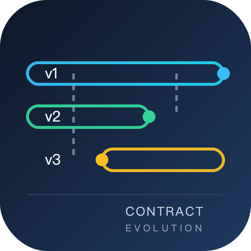

# 契约演进与兼容

接口一旦有人调用，它就不再属于你。**契约演进**（Contract Evolution）处理的正是「契约必须变、但调用方不能被打断」这件事：先判断一次改动到底打不打人，再决定用哪一种机制承载它，最后给旧版本一条可执行的下线路径。

这一页不讲「REST 该怎么设计」——那是 [API 设计规范](../../Tools/APIDesign/Overview/index.md) 的地盘。这里讲的是**已经上线的接口、消息与表结构，怎么在不破坏既有消费者的前提下继续长大**。

## 与相邻专题的分工

| 专题 | 负责什么 | 与本专题的边界 |
| --- | --- | --- |
| 本专题 | **兼容性判定、消费者清单、服务端多版本承载、库表演进的四阶段、异步 schema 兼容模式、门禁、下线执行** | —— |
| [API 设计规范 · 版本策略与兼容性演进](../../Tools/APIDesign/Versioning/index.md) | 对外版本表达（路径/头/媒体类型）、`Deprecation`/`Sunset` 头、`oasdiff` 基线比对 | 那边回答「**对外怎么表达版本**」；本专题回答「**服务端怎么同时承载 N 个版本、库里怎么改、消息怎么改**」 |
| [API 设计规范 · 治理机制](../../Tools/APIDesign/Governance/index.md) | 评审流程、规范落地、组织级约束 | 那边是**人**的流程；本专题是**机器**能拦住的判据 |
| [契约仿真与契约测试](../../Tools/TestDataSimulation/ContractSimulation/index.md) | 用契约生成桩、消费者驱动契约的适用边界 | 那边讲**测试替身**；本专题把 CDC 当成门禁里的**一格**，重点在「谁能阻止发布」 |
| [完整项目交付 · 接口契约先行](../../Others/ProjectDelivery/Contract/index.md) | 新项目从零定义契约、字段命名、错误码 | 那是**绿地**；本专题处理**棕地**——已有调用方的接口 |
| [消息队列](../../Backend/MessageQueue/Overview/index.md) | 投递语义、分区、消费位移 | 消息怎么送归那边；**消息体里的字段怎么改才不打断老消费者**归本专题 |
| [分区分表与冷热分离](../../DB/PartitionArchival/index.md) | 分区策略、在线归档、保留期 | 大表怎么切归那边；**切的过程中 API 语义怎么不变**归本专题 |
| [幂等与状态机工程](../IdempotencyStateMachine/Overview/index.md) | 幂等键、状态机、补偿 | 兼容性变更的**前提**是重试安全，需要时引用那边 |
| [在线协作任务看板 · 接口契约定稿](../../../project/Complete/TeamBoard/Contracts/index.md) | 一个新项目 30 天内的契约取舍 | 那边是**一次成型**的设计；本专题是**第 3 年还在改**的现实 |

::: tip 一句话理解
**兼容不是「不改」，而是「改的方式让老调用方察觉不到」。**
判断标准只有一条：**把新版本部署上去，把最老的客户端原封不动接上去，它还能不能正常工作。**
:::

## 专题导航

- [总览：四类契约面与三种破坏](./Overview/index.md)：契约的四种载体、兼容性的消费者视角定义、五种典型破坏、三十秒决策树
- [兼容性判定：加法、语义与时序](./Compatibility/index.md)：三层判据表、看似安全的四种改动、默认值属于契约、语义漂移
- [消费者清单：谁在调用我](./ConsumerInventory/index.md)：五个信号源、归属与负责人、无法识别的流量怎么处理
- [服务端承载多版本](./ServerVersions/index.md)：路径路由与适配层、内部单一模型、版本间错误码一致、共享内核的陷阱
- [库表演进：expand-contract 四阶段](./SchemaEvolution/index.md)：扩展、双写、影子读、收口，以及那个不可逆点
- [异步契约：消息与 schema 兼容模式](./AsyncContract/index.md)：四种兼容模式的代数、字段编号、消费者滞后决定删除时机
- [契约门禁：让 CI 拦住破坏性变更](./ContractGate/index.md)：provider diff、CDC、can-i-deploy、N-1 矩阵、变异测试证伪
- [下线：把废弃做成可执行的倒计时](./Sunset/index.md)：五阶段、按消费者分批、410 与长尾、审计留痕
- [实战：把一个 v1 演进成 v2](./Practice/index.md)：完整 DDL、双写、影子读、灰度比例、回滚窗口与 S1~S10 验收
- [常见问题与最佳实践](./FAQ/index.md)：十类症状分诊、十二问、上线自查清单、术语表

## 按症状找页面

| 你遇到的现象 | 大概率先看 |
| --- | --- |
| 「就加个字段」结果iOS 老版本全白屏 | [兼容性判定](./Compatibility/index.md) 的「未知字段」一节 |
| 不知道谁在用 v1，不敢下线 | [消费者清单](./ConsumerInventory/index.md) |
| 一个接口里 `if (version == 1)` 越写越多 | [服务端承载多版本](./ServerVersions/index.md) |
| 改字段名要先改库，改库要停服 | [库表演进](./SchemaEvolution/index.md) |
| 消费者报「反序列化失败」，但你只加了个字段 | [异步契约](./AsyncContract/index.md) 的兼容模式矩阵 |
| 门禁是绿的，线上还是炸了 | [契约门禁](./ContractGate/index.md) 的「变异测试」 |
| 废弃公告发了两年，调用量一点没降 | [下线](./Sunset/index.md) |
| 想把整件事从头走一遍 | [实战](./Practice/index.md) |

## 全专题的判据纪律

本专题十页共 **80 条判据**，每页 8 条，逐页独立前缀。判据只回答三件事：**约定是什么 / 定错了会怎样 / 怎么验证它没被破坏**。

| 页面 | 判据族 | 覆盖的约定 | 条数 |
| --- | --- | --- | --- |
| 总览 | `CEO-A` ~ `CEO-H` | 契约面齐全、破坏有分类、决策有顺序 | 8 |
| 兼容性判定 | `CEC-A` ~ `CEC-H` | 加法不越界、默认值是契约、语义变更走版本 | 8 |
| 消费者清单 | `CEI-A` ~ `CEI-H` | 流量可归因、负责人可追、盲区有兜底 | 8 |
| 服务端多版本 | `CEV-A` ~ `CEV-H` | 路由可判、模型唯一、错误码一致 | 8 |
| 库表演进 | `CES-A` ~ `CES-H` | 先扩后收、双写有序、删除有条件 | 8 |
| 异步契约 | `CEA-A` ~ `CEA-H` | 模式显式、编号不复用、滞后可见 | 8 |
| 契约门禁 | `CEG-A` ~ `CEG-H` | 基线可信、门禁能红、矩阵有 N-1 | 8 |
| 下线 | `CEU-A` ~ `CEU-H` | 信号可达、分批可逆、留痕可查 | 8 |
| 实战 | `CEP-A` ~ `CEP-H` | 步骤可执行、比例可复算、回滚可演练 | 8 |
| 常见问题 | `CEQ-A` ~ `CEQ-H` | 分诊可执行、术语不混用、自查可机器判 | 8 |

## 事实与口径速览（2026-10 核对）

| 事实 | 口径 | 对本专题的意义 |
| --- | --- | --- |
| `Deprecation` 响应头 | [RFC 9745](https://www.rfc-editor.org/rfc/rfc9745.html)，值为结构化字段日期 `@<Unix 秒>` | 废弃是**机器可读**的信号，不是公告 |
| `Sunset` 响应头 | [RFC 8594](https://www.rfc-editor.org/rfc/rfc8594.html)，值为 HTTP-date | 与 `Deprecation` **日期格式不同**，混写会静默失效 |
| `Link` 关系类型 | [RFC 8288](https://www.rfc-editor.org/rfc/rfc8288.html)：`rel="deprecation"` / `rel="successor-version"` | 「看哪份文档、新接口在哪」两个问题各有一个头 |
| Schema Registry 兼容模式 | `BACKWARD`（默认）/ `FORWARD` / `FULL` / `NONE`，每种都有 `_TRANSITIVE` 变体 | 兼容性是**方向性**的，先确定「谁先升级」 |
| Protobuf 字段编号 | 编号一经发布不得复用，删除字段要写 `reserved` | 复用编号是**静默数据错乱**，比报错更糟 |
| Google AIP-180 | 明确定义「向后兼容」与资源名、字段、枚举的变更规则 | 大厂公开的兼容性清单，可直接当评审表 |
| 语义化版本 2.0.0 | 主版本 = 破坏性变更 | 契约文件的版本号可用于**机器比对**，但不等同于接口版本 |

::: warning 一个前置结论，能省掉三个月返工
**如果你的接口还没有任何外部调用方，不要做版本管理。** 版本机制的成本是「永久维护 N 套语义」，它只在有**你控制不了的消费者**时才划算。内部单体应用里发 `v2` 通常只是把重构成本转嫁给了自己。
:::

## 建议阅读顺序

| 角色 | 顺序 |
| --- | --- |
| 第一次接触 | 总览 → 兼容性判定 → 服务端多版本 → 实战 |
| 正在被线上事故追 | 兼容性判定 → 异步契约 → 契约门禁 |
| 要下线一个老接口 | 消费者清单 → 下线 → 门禁 |
| 要做一次表结构大改 | 库表演进 → 服务端多版本 → 实战 |
| 只想先判断这次改动安不安全 | 兼容性判定 的三层判据表 → 总览 的决策树 |

## 与本专题的分工（接口契约 vs 法律合同）

- **这里的 `Contract` 指服务之间的接口契约**：字段增删、弃用窗口、消费者清点、兼容性闸门。
- **法律合同的「版本」要求完全不同**：它不是为了「让旧客户端还能跑」，而是为了证明「客户签的是哪一版字节」。接口契约允许并行支持两个版本多年；法律合同一旦签署，那一版就永久冻结，改一个字节即失效。
- 相同点只有一个：**都要有版本号与快照**。但接口契约的版本可以「灰度并行」，合同的版本只能「作废 + 重签」。
- 如果两套东西共用一个「版本号生成器」，会出问题：接口版本号通常是 `v2`、`2026-10-01` 这类粗粒度标识，而合同需要「每次渲染一版」的细粒度编号。

::: danger 这一页特有的一个坑
**把 `Contract` 的重命名当成小事**。接口契约里改一个字段名，有弃用期兜底；法律合同里改一处措辞就是新版本，必须重新走签署。二者共用同一个「模板/契约」表时，一次「顺手优化措辞」会让已签合同的正文与数据库里的模板对不上。正确做法：签署侧只引用**冻结的版本快照**，不引用「当前模板」。见[电子签署 · 合同模型](../ESignature/ContractModel/index.md)。
:::

## 与「开放平台 · 版本与弃用」的分工（第 222 天补充）
| 这一页讲的 | 开放平台专题讲的 |
| --- | --- |
| 内部服务之间怎么加字段、怎么容忍未知字段 | 对外**已经发出去**的版本怎么弃用 |
| 契约是**双方同时升级**的（同一个发布窗口） | 契约是**对方不升级**也要能跑（可能几年） |
| 兼容性靠 CI 里的 breaking-change 检测 | 兼容性靠**公告期 + Sunset 头 + 410** |
| 可以「灰度一个消费者」 | 不能灰度，只能按客户固定版本 |

**这一页特有的一个坑**：把内部的「加字段不算破坏性变更」直接搬到对外接口。对内确实如此（消费者跟着发布）；对外不成立——客户的 `switch` 遇到未知枚举值直接抛异常。所以对外新增枚举值之前，**必须在文档里明确写「客户端必须容忍未知值」**，否则它属于破坏性变更。三类变更的判定表见[版本与弃用](../OpenPlatform/VersionLifecycle/index.md)。

## 参考资料

- [RFC 9745 · The Deprecation HTTP Response Header Field](https://www.rfc-editor.org/rfc/rfc9745.html)
- [RFC 8594 · The Sunset HTTP Response Header Field](https://www.rfc-editor.org/rfc/rfc8594.html)
- [RFC 8288 · Web Linking](https://www.rfc-editor.org/rfc/rfc8288.html)
- [Google AIP-180 · Backwards compatibility](https://google.aip.dev/180)
- [Semantic Versioning 2.0.0](https://semver.org/lang/zh-CN/)
- [Protobuf · Language Guide（字段编号与 reserved）](https://protobuf.dev/programming-guides/proto3/)
- [Confluent Schema Registry · Schema Compatibility](https://docs.confluent.io/platform/current/schema-registry/fundamentals/schema-evolution.html)
- [Pact · can-i-deploy](https://docs.pact.io/pact_broker/can_i_deploy)
- [Buf · Breaking change detection](https://buf.build/docs/breaking/overview)
- [oasdiff · 破坏性变更检测](https://github.com/Tufin/oasdiff)
- 相邻专题：[API 设计规范](../../Tools/APIDesign/Overview/index.md)、[消息队列](../../Backend/MessageQueue/Overview/index.md)、[分区分表与冷热分离](../../DB/PartitionArchival/index.md)
