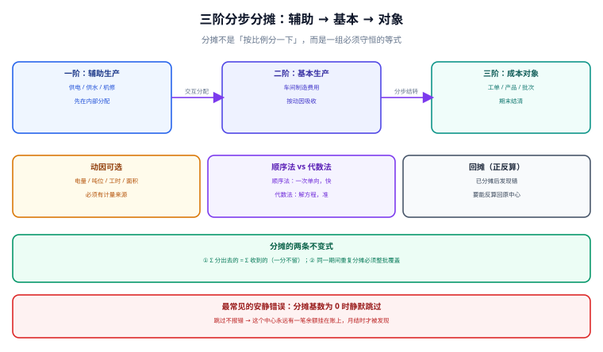

# 辅助生产与分摊

分摊是成本核算里唯一一个「**分出去的钱必须全部落地**」的动作。供电车间花了 10 万、机修车间花了 6 万，这 16 万最后必须一分不差地出现在基本生产或管理费用里——既不能多分（凭空造钱），也不能少分（留下永远挂账的余额）。而这件事最容易出错的地方，恰恰是最不起眼的一步：**分母里要不要剔除「辅助车间自己用掉的那部分」**。

::: tip 一句话理解
**分摊只有一条硬约束：分出去的等于收到的**。所有方法（顺序法、代数法、计划成本法）都只是在「怎么分得更准」上做取舍，谁也不能违反这条守恒。
:::

本页判据族 `CAL-A` ~ `CAL-H`，共 8 条，定义在最后一节。



## 一、为什么不能「按比例一分了事」

先看一组真实会出现的数（本机演算）：

| 车间 | 本月费用 | 计量总量 | 给机修 | 给基本生产 | 给管理 |
| --- | --- | --- | --- | --- | --- |
| 供电 | 100,000.00 | 100,000 kWh | 10,000 kWh | 80,000 kWh | 10,000 kWh |
| 机修 | 60,000.00 | 6,000 h | —（给供电 1,000 h） | 4,000 h | 1,000 h |

注意机修那行：它的 6,000 h 里有 1,000 h 是**给供电部门修的**。这就是「辅助车间互相服务」——不处理它，分摊就会变成一个无穷递归：供电的成本里有机修的成本，机修的成本里又有供电的成本。

## 二、顺序法：先分一个，再分另一个

顺序法的思路是**打断循环**：规定一个分配顺序，先分的那个不考虑「后面那个给我提供的服务」。

以「先供电、后机修」为例：

```text
第一步：供电 100,000 / 100,000 kWh = 1.00 元/kWh
        机修得 10,000 × 1.00 = 10,000.00  → 机修待分成本变为 70,000.00
        基本生产得 80,000 × 1.00 = 80,000.00
        管理得 10,000 × 1.00 = 10,000.00

第二步：机修 70,000 / (6,000 − 1,000) h = 14.00 元/h
        ★ 分母剔除「给供电的 1,000 h」，因为供电已经分完，不能再收钱
        基本生产得 4,000 × 14.00 = 56,000.00
        管理得 1,000 × 14.00 = 14,000.00
```

结果：基本生产 **136,000.00**、管理费用 **24,000.00**，合计 160,000.00 —— 守恒成立。

::: danger 分母不剔自耗的两个后果
1. **分不完**：分母用 6,000，分配率变成 11.6667，分给基本 4,000 h 与 1,000 h 管理只有 58,333.33，剩 11,666.67 无处可去，挂成余额——月结时勾稽差这一笔。
2. **重复计费**：如果硬把这 11,666.67 再塞给基本生产，等于**供电的自耗被算了两次**（第一次作为供电成本的一部分被分出，第二次作为机修成本的一部分被分出）。
:::

## 三、代数法：解方程，把循环算准

代数法把「互相服务」写成一个线性方程组：

```text
S = 100,000 + (1,000 / 6,000) × M      （供电总成本 = 自身费用 + 机修给它的服务）
M =  60,000 + (10,000 / 100,000) × S   （机修总成本 = 自身费用 + 供电给它的服务）
```

代入解得：

```text
S = 111,864.41
M =  71,186.44
基本生产 = 0.8 × 111,864.41 + (4,000/6,000) × 71,186.44 = 89,491.53 + 47,457.63 = 136,949.15
管理费用 = 0.1 × 111,864.41 + (1,000/6,000) × 71,186.44 = 11,186.44 + 11,864.41 =  23,050.85
合计     = 160,000.00
```

与顺序法相比，**基本生产多了 949.15 元（0.70%）**，管理费用少了 949.15 元。差额来自「互相服务」这部分成本在两种方法里的处理方式不同：代数法把它算进了双方的总成本，顺序法把它丢掉了。

| 方法 | 基本生产 | 管理费用 | 适用场景 |
| --- | --- | --- | --- |
| 顺序法（先供电） | 136,000.00 | 24,000.00 | 辅助车间互相服务金额小、追求简单 |
| 顺序法（先机修） | 会得到另一个数（通常差几百元） | — | 同上，但**顺序一变结果就变** |
| 代数法（交互分配） | 136,949.15 | 23,050.85 | 互相服务金额大、要求可解释 |

::: warning 顺序法换顺序会换结果
这是顺序法最反直觉的性质：**「先分谁」是一个会计判断，不是一个实现细节**。判据是「先分金额大的、还是先分服务量大的」，必须在制度里写明；否则同一套数据，两个会计能算出两个不同的产品成本。
:::

## 四、三阶结构：从辅助到对象

实际系统里分摊通常是三阶，每一阶的输入输出都要落表：

| 阶 | 输入 | 规则 | 输出 | 能否跨阶跳 |
| --- | --- | --- | --- | --- |
| 一阶 | 辅助车间（供电、机修、锅炉） | 交互分配 / 顺序法 | 辅助车间之间结清 | 否，必须结清才进二阶 |
| 二阶 | 基本车间制造费用 | 按动因吸收（机时、工时、产量） | 车间成本池 | 否 |
| 三阶 | 车间成本池 → 成本对象 | 按工单工时 / 产量 | 对象成本 | 否 |

「不能跨阶跳」的理由是**可解释性**：如果辅助车间的费用直接跳到产品上，中间少了一次「车间吸收」，一旦产品结构变化（多品种小批量），成本就会失真，而且**没法回答「这个车间的费用吸收率是多少」**。

## 五、落库与重跑

```sql
-- 分摊结果：按「期间 + 任务 + 版本」唯一，重跑覆盖
CREATE TABLE cost_alloc (
  id            INTEGER PRIMARY KEY,
  period        TEXT    NOT NULL,
  run_no        INTEGER NOT NULL,          -- 任务序号（1 一阶 / 2 二阶 / 3 三阶）
  version       INTEGER NOT NULL,
  from_center   TEXT    NOT NULL,
  to_center     TEXT    NOT NULL,
  driver        TEXT    NOT NULL,          -- kwh / hour / qty
  driver_qty    NUMERIC NOT NULL,
  rate          NUMERIC NOT NULL,          -- 分配率，全精度
  amount        NUMERIC NOT NULL,
  UNIQUE (period, run_no, version, from_center, to_center)
);

-- 守恒校验视图：每个 from_center 分出去的应等于它的待分成本
CREATE VIEW v_alloc_check AS
SELECT a.period, a.run_no, a.from_center,
       ROUND(SUM(a.amount), 2) AS allocated,
       ROUND(c.pool_amount, 2) AS pool,
       ROUND(SUM(a.amount) - c.pool_amount, 2) AS diff
FROM cost_alloc a
JOIN cost_pool c
  ON c.period = a.period AND c.center_code = a.from_center
GROUP BY a.period, a.run_no, a.from_center;
```

判据就是查 `v_alloc_check` 里 `diff != 0` 的行数——**必须为 0**，且这条要在月结门禁里跑，不是「事后看看」。

::: danger 分摊实现里四个安静的坑
1. **基数为 0 时静默跳过**：某个车间本月没有计量（表坏了），分配率为 0 或除零异常被 `try/except` 吞掉，结果这笔成本永远留在池子里。正确做法：基数为 0 必须**抛错并列出该中心**。
2. **按 `ROUND` 后的分配率再乘**：分配率保留 2 位（14.00 看似没问题），但 6,000 小时的项目里，保留 2 位会带来几十元的累计误差。分配率必须全精度，只在最后一笔做尾差调整。
3. **尾差丢给「第一个对象」**：金额小、但每次都是同一个对象背，月度累计后该对象成本系统性偏高。尾差应给**金额最大的对象**或**最后一个对象**，并在制度里写死。
4. **分摊后再改上游**：一阶分完又调整了辅助车间费用，没有重跑二三阶，结果二阶吸收的还是一阶的旧数。**上游变更必须触发下游重算**，靠在 `cost_pool` 上加 `version` 并比对实现。
:::

## 六、判据族

| 编号 | 判据 | 怎么验 |
| --- | --- | --- |
| `CAL-A` | 每个中心的「分出合计 = 待分成本」，差 0.00 | 查 `v_alloc_check`，`diff != 0` 行数为 0 |
| `CAL-B` | 顺序法分母剔除自耗，代数法不解自耗 | 分配率 × 分母 = 待分成本 |
| `CAL-C` | 分配顺序记录在配置里且可按期间追溯 | 配置表含 `period` 与 `order_no` |
| `CAL-D` | 基数为 0 时抛错并列出中心，不静默跳过 | 构造 0 基数用例，接口返回失败 |
| `CAL-E` | 分摊结果幂等：同期间同版本重跑结果逐行相同 | 连跑两次，`diff` 为空 |
| `CAL-F` | 上游变更触发下游重算（版本联动） | 改一阶费用后二阶版本号递增 |
| `CAL-G` | 尾差有固定归属规则并留痕 | 尾差行带 `is_rounding=1` |
| `CAL-H` | 三阶不能跳级：每个对象成本都能追到车间池 | 抽查 5 个对象，链路完整 |

## 验证方式

```shell
# 1) 守恒：应输出 0 行
sqlite3 /tmp/cost.db "SELECT * FROM v_alloc_check WHERE ABS(diff) > 0.001;"
# 期望：无输出

# 2) 顺序法读数：基本生产 136000.00、管理 24000.00
sqlite3 /tmp/cost.db "SELECT to_center, ROUND(SUM(amount),2) FROM cost_alloc
  WHERE period='2026-10' AND run_no=2 GROUP BY to_center;"
# 期望：BASIC|136000.0 与 ADMIN|24000.0

# 3) 基数为 0 必须失败：应返回错误而不是空结果
sqlite3 /tmp/cost.db "UPDATE cost_pool SET driver_qty=0 WHERE center_code='CC-POWER';"
sqlite3 /tmp/cost.db "SELECT rate FROM cost_pool WHERE driver_qty=0;"
# 期望：应用层应抛「分配基数为 0」，SQL 层表现为 NULL 或除零错误，必须被显式处理

# 4) 幂等：两次输出应完全一致
sqlite3 /tmp/cost.db "SELECT count(*), ROUND(SUM(amount),2) FROM cost_alloc WHERE period='2026-10';"
# 期望：两次相同
```

## 参考资料

- [成本对象与归集维度](../CostObject/index.md)：`is_aux` 标志与成本中心有效期
- [月末结账的顺序与幂等](../MonthEndClose/index.md)：分摊在八步链里的位置
- 财政部：企业产品成本核算制度（试行）（财会〔2013〕17 号）：<https://www.mof.gov.cn/>
