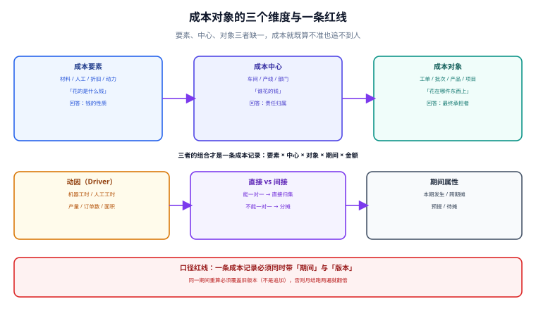

# 成本对象与归集维度

「这个月车间花了 180 万」这句话对会计没有用——它既不能算到产品上，也追不到人。一条成本记录只有在同时钉住**花的是什么钱（要素）、谁花的（中心）、花在哪件东西上（对象）、哪一期（期间）、哪一版（版本）** 这五件事之后，才成为一条可用的成本数据。少任何一列，后面的分摊、勾稽、差异分析都会缺一块拼图。

::: tip 一句话理解
**成本记录不是「金额」，是「五元组」**：`(要素, 中心, 对象, 期间, 版本) → 金额`。五列缺一，这条记录就只能进费用、进不了成本。
:::

本页判据族 `CAC-A` ~ `CAC-H`，共 8 条，定义在最后一节。



## 一、三个维度：要素、中心、对象

| 维度 | 回答什么问题 | 典型值 | 谁维护 | 少了它会怎样 |
| --- | --- | --- | --- | --- |
| 成本要素 | 花的是什么钱 | 直接材料、直接人工、制造费用（水电、折旧、机修） | 财务（科目表） | 无法按要素分析，也做不了要素守恒 |
| 成本中心 | 谁花的钱 | 一车间、SMT 产线、机修班、质检部 | 组织架构 | 无法追责、无法考核、无法分摊 |
| 成本对象 | 花在哪件东西上 | 工单、批次、产品、项目、客户定制单 | 生产 / 项目系统 | 算不出单位成本，只能算总费用 |

三者的关系不是「包含」，而是**一次交叉**：

```text
一条成本记录 = 要素 × 中心 × 对象 × 期间 × 版本
例：2026-10 / 直接材料 / 一车间 / 工单 WO-20261012-007 / v1 = 12,340.00
```

::: warning 成本中心 ≠ 部门
部门是**行政单位**（有人、有预算），成本中心是**归集单位**（有费用、有动因）。一个部门可以对应多个成本中心（如「生产部」下有 3 条产线），一个成本中心也可以跨部门（如「共用动力」由设备部维护、由生产部分摊）。把两者合成一张表，组织一调整，历史成本就全部错位——**组织架构会变，成本中心不能跟着改历史**。
:::

## 二、直接与间接：一条记录该不该分摊

归集的第一步是判断「能不能一对一」：

| 情况 | 归集方式 | 判据 | 例子 |
| --- | --- | --- | --- |
| 能一对一 | 直接归集 | 领料单上写明工单号 | 专用料、专用模具 |
| 不能一对一但可计量 | 按动因分摊 | 有独立计量（电表、工时卡） | 电费、机时 |
| 不能一对一也不可计量 | 按约定比例分摊 | 有书面约定并定期复核 | 厂房租金、管理人员工资 |

第二类和第三类的界线是**有没有计量来源**。没有计量来源却硬要「按产量分摊」，本质上是用产量代替了真实动因——产量平稳时看不出问题，一旦小批量多品种，成本就会严重错配（小批量产品的实际机时远高于产量占比）。

## 三、落库：五列唯一键的那张表

```sql
-- 成本明细：一条记录 = 一个五元组 + 金额
CREATE TABLE cost_detail (
  id            INTEGER PRIMARY KEY,
  period        TEXT    NOT NULL,              -- '2026-10'
  version       INTEGER NOT NULL DEFAULT 1,    -- 重算版本，覆盖式递增
  element       TEXT    NOT NULL,              -- material / labor / overhead
  center_code   TEXT    NOT NULL,              -- 成本中心
  object_type   TEXT    NOT NULL,              -- wo / batch / product / project
  object_code   TEXT    NOT NULL,              -- 工单号 / 批次号
  amount        NUMERIC NOT NULL CHECK (amount >= 0),
  src_doc_type  TEXT    NOT NULL,              -- 来源单据类型
  src_doc_no    TEXT    NOT NULL,              -- 来源单号（可反查）
  is_direct     INTEGER NOT NULL CHECK (is_direct IN (0, 1)),
  created_at    TEXT    NOT NULL DEFAULT (datetime('now')),
  UNIQUE (period, version, element, center_code, object_type, object_code, src_doc_no)
);

CREATE INDEX idx_cost_detail_obj ON cost_detail (period, object_type, object_code);
CREATE INDEX idx_cost_detail_ctr ON cost_detail (period, center_code, element);
```

四个设计决定，每一个都对应一类真实事故：

1. **`period` 是字符串 `YYYY-MM` 而不是日期**：成本期间是「账期」不是「时间点」，用日期会让跨期调整变得含糊（10 月 31 日的单据算 10 月还是 11 月？）。
2. **`version` 参与唯一键**：同一期间重算得到新版本，**旧版本保留可查，但聚合只取最新版**。这样「重跑」既是幂等的、又是可追溯的。
3. **`src_doc_no` 进唯一键**：防同一张领料单被重复归集（接口重试、人工补录都会造成）。这条比 `UNIQUE(id)` 有用得多。
4. **`is_direct` 显式落库**：不要靠「有没有分摊记录」推断，推断逻辑会在数据迁移时全错。

::: danger 三个把成本表设计坏的写法
1. **用 `NULL` 表示「未分摊」**：`center_code IS NULL` 的行既进不了中心报表，也不触发任何告警，最后变成「账上有、表上没有」的幽灵金额。未分摊要有一个显式的中心编码（如 `UNALLOC`）。
2. **金额用 `FLOAT`**：0.1 + 0.2 不等于 0.3，分摊 100 万到 3 个对象后合计差 1 分，勾稽永远不平。用定点数（`NUMERIC` / `DECIMAL(18,2)`），并在应用层用十进制类型。
3. **唯一键里放 `created_at`**：看起来「每次都新增不会冲突」，实际是**把幂等性彻底放弃**——重跑一次就多一份，且无法分辨哪份是最终版。
:::

## 四、组织的变动不能改历史

组织架构平均每年调整一次，成本中心编码必须**只增不改**：

```sql
-- 成本中心：有效期区间，不改历史
CREATE TABLE cost_center (
  code        TEXT PRIMARY KEY,
  name        TEXT NOT NULL,
  parent_code TEXT,
  valid_from  TEXT NOT NULL,          -- '2026-01-01'
  valid_to    TEXT,                   -- NULL 表示至今有效
  is_aux      INTEGER NOT NULL DEFAULT 0  -- 1 = 辅助生产（供电/机修）
);

-- 组织调整：旧中心关掉，新中心开一条，并记录继承关系
INSERT INTO cost_center (code, name, parent_code, valid_from, is_aux)
VALUES ('CC-SMT-02', 'SMT 二线', 'CC-SMT', '2026-07-01', 0);
UPDATE cost_center SET valid_to = '2026-06-30' WHERE code = 'CC-SMT-01';
```

两条纪律：

- **查「某个期间的成本中心清单」必须按 `valid_from/valid_to` 过滤**，不能用「当前有效的中心」去渲染历史报表——否则 6 月的报表会因为 7 月的组织调整而变空。
- **辅助生产标志 `is_aux` 一旦置位就不能随便改**：它决定了分摊顺序，改标志等于改算法，历史期间的结果会漂移。

## 五、期间：账期、过账日与单据日

三个日期经常被混用，混用的后果是「成本串月」：

| 日期 | 含义 | 用它做期间归属的后果 |
| --- | --- | --- |
| 单据日（document_date） | 业务发生的日子 | 月底最后一天的单据与下月第一天的单据差别巨大，且可被手工改 |
| 过账日（posting_date） | 系统记账的日子 | **推荐**：由系统在事务里生成，不可改，且与账期绑定 |
| 开票日（invoice_date） | 发票开具的日子 | 最差：发货与开票可以跨月，成本会跟着发票走 |

判据很简单：**同一张出库单，无论何时过账，落入的账期必须由过账日唯一决定**，并且在月结「截止」之后不能再产生本期过账记录（只能进下一期或进调整期）。

## 六、判据族

| 编号 | 判据 | 怎么验 |
| --- | --- | --- |
| `CAC-A` | 每条成本明细带齐五列，无 `NULL` | `SELECT count(*) FROM cost_detail WHERE period IS NULL OR version IS NULL OR center_code IS NULL;` 期望 0 |
| `CAC-B` | `(period, version, element, center, object, src_doc_no)` 唯一 | 插入同单号两次，第二次被约束拒绝 |
| `CAC-C` | 聚合只取最新 `version` | 两版本共存时汇总金额等于最新版之和 |
| `CAC-D` | 金额列为定点数，无浮点列 | `PRAGMA table_info(cost_detail)` 中无 `REAL`/`FLOAT` |
| `CAC-E` | 成本中心按有效期过滤，历史报表不因组织调整而变 | 取 6 月清单，不含 7 月新建的中心 |
| `CAC-F` | 未分摊金额有显式中心编码，不以 `NULL` 表达 | `UNALLOC` 行数可在报表中单列 |
| `CAC-G` | 期间归属由过账日决定，且过账日不可人工写入 | 接口层拒收 `posting_date` 参数 |
| `CAC-H` | 每条明细可反查来源单据（`src_doc_type` + `src_doc_no`） | 任取一条能打开源单 |

## 验证方式

```shell
# 1) 五列齐全：应输出 0
sqlite3 /tmp/cost.db "SELECT count(*) FROM cost_detail
  WHERE period IS NULL OR version IS NULL OR element IS NULL
     OR center_code IS NULL OR object_code IS NULL;"
# 期望：0

# 2) 唯一键生效：第二条应报 UNIQUE constraint failed
sqlite3 /tmp/cost.db "INSERT INTO cost_detail (period,version,element,center_code,object_type,object_code,amount,src_doc_type,src_doc_no,is_direct)
  VALUES ('2026-10',1,'material','CC-SMT','wo','WO-001',100,'issue','ISS-001',1);"
sqlite3 /tmp/cost.db "INSERT INTO cost_detail (period,version,element,center_code,object_type,object_code,amount,src_doc_type,src_doc_no,is_direct)
  VALUES ('2026-10',1,'material','CC-SMT','wo','WO-001',100,'issue','ISS-001',1);"
# 期望：Error: UNIQUE constraint failed

# 3) 组织调整不改历史：6 月清单里不应出现 7 月新建的中心
sqlite3 /tmp/cost.db "SELECT group_concat(code) FROM cost_center
  WHERE valid_from <= '2026-06-30' AND (valid_to IS NULL OR valid_to >= '2026-06-30');"
# 期望：不含 CC-SMT-02
```

## 参考资料

- [总览：七段成本链与三条守恒式](../Overview/index.md)：本页那张表要支撑的三条等式
- [辅助生产与分摊](../Allocation/index.md)：`is_aux` 标志的下游消费者
- [月末结账的顺序与幂等](../MonthEndClose/index.md)：`version` 列的真正用途
- 财政部：企业产品成本核算制度（试行）（财会〔2013〕17 号）：<https://www.mof.gov.cn/>
