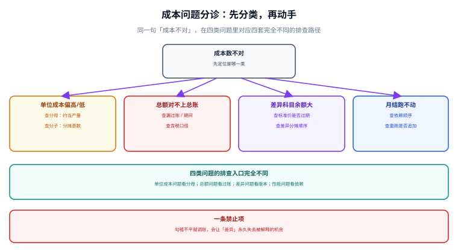

# 常见问题与分诊

成本问题最难的地方不是修复，而是**先分清是哪一类**。同一句「这个月成本不对」，可能指单位成本偏高、总额与总账差钱、差异科目余额巨大、或者月结根本跑不完——四类问题的排查入口完全不同，用错入口会查一整天。本页先给分诊表，再逐条给处置。

::: tip 一句话理解
**先问「差在分子还是分母」，再问「差在期间还是金额」**。这两个问题能把八成成本问题锁进四个格子里的一个。
:::

本页判据族 `CAQ-A` ~ `CAQ-H`，共 8 条，定义在最后一节。



## 一、分诊表：四类症状与入口

| 症状 | 先查什么 | 判据 | 常见真因 |
| --- | --- | --- | --- |
| 单位成本偏高 / 偏低 | **分母**：约当产量、产量报告 | 完工 + 期末在制约当 = 本期投入吗 | 完工程度拍脑袋、把投产当分母 |
| 总额与总账对不上 | **过账**：漏过账、期间、含税 | 三道等式哪一条断了 | 手工凭证、跨期入库、含税口径 |
| 差异科目余额巨大 | **版本**：标准价是否过期、差异是否分摊 | 差异期末余额为 0 吗 | 标准长期不更新、差异只挂不分 |
| 月结跑不动 / 跑不完 | **依赖**：顺序、悬挂任务、基数 0 | 有没有 `running` 任务、基数是否 0 | 死锁、除零被吞、增量漏算 |

分诊的第一步不是查数据，而是**确认你看到的是哪一类**。「成本上升了 3%」属于第一类，「成本比上月多了 12 万但毛利没变」可能是第二类（分类错了），「利润表营业成本对不上」是第三类。

## 二、Q1：单位成本比上月高了 8%，是材料涨价吗

先别去看采购价，先看**分母**：

```sql
-- 两期的约当产量与单位成本
SELECT period, object_no, eu_labor,
       ROUND((SELECT SUM(amount) FROM cost_detail d
               WHERE d.period = w.period AND d.object_code = w.object_no) / eu_labor, 2) AS unit_cost
  FROM v_wip_eu w ORDER BY period;
```

三种情况的判读完全不同：

| 现象 | 判读 | 处置 |
| --- | --- | --- |
| 分子涨、分母平 | 真的是投入涨了 | 查材料价 / 工时 / 分摊率 |
| 分子平、分母降 | 产量降导致固定费用摊薄不足 | 看产量差，不追采购 |
| 分子分母都涨但单位涨 | 分子涨得比分母快 | 查固定费用（不随产量变的那部分） |

第三类最容易被误判成涨价：**固定制造费用总额不变、产量降 10%，单位成本必然上升**，这与采购毫无关系。

## 三、Q2：总账和台账差 47.22，要调账吗

先回答「这个差能不能被解释」。能解释就不调，不能解释才查：

```text
差 = 台账期末 − 总账余额 = 47.22
对照：两种计价方法的出库成本之差 = 4,122.22 − 4,075.00 = 47.22  → 能解释（口径差）
```

处置分三种：

1. **口径差**（如上）：统一口径，或在总账侧设「计价方法差异」科目过渡；
2. **期间差**：把跨期单据按过账日重新归属，然后重跑受影响的两个期间；
3. **真差错**：按「期间 → SKU → 单据类型 → 单号」四层二分定位，改单据后重跑，**不要改余额**。

::: danger 不允许的三种处置
1. **手工凭证调平**：下次月结差额会以同样金额再次出现，而且这次说不清是哪来的。
2. **改台账**：总账平了、账实脱节，下一次盘点差异更大。
3. **摊到某个产品**：这个产品的毛利分析从此不可信，且没有留痕。
:::

## 四、Q3：差异科目余额越滚越大怎么办

差异余额只有三种合法归宿：**分摊进存货与损益**、**转当期损益**、**因标准修订而结转**。挂在账上不是归宿。

```sql
-- 看余额的账龄分布：超过 2 个期间未处理的，先结清
SELECT period, ROUND(SUM(amount),2) FROM cost_variance_balance
 GROUP BY period ORDER BY period;
```

处置顺序：① 先补算「该摊未摊」的部分（按存销比例）；② 再处理「标准过期」造成的系统性偏差（修订标准 + 记影响数）；③ 最后把残留的一次性差异转损益，并在差异台账里写清结论。

## 五、Q4：分摊分不完，总有一笔余额挂着

九成是**分母没剔除自耗**：

```sql
-- 顺序法第二步：分母应为 driver_qty − exclude_qty
SELECT center_code, amount, driver_qty, exclude_qty,
       ROUND(amount / (driver_qty - exclude_qty), 6) AS rate_ok,
       ROUND(amount / driver_qty, 6) AS rate_bad
  FROM cost_pool WHERE center_code = 'CC-MAINT';
```

用 `rate_bad` 去乘「给基本生产的量」，剩下的就是那笔永远分不完的余额（本专题演算里是 11,666.67）。第二种可能是**基数为 0 被静默跳过**——查一下有没有中心的 `driver_qty = 0`。

## 六、Q5：重跑之后金额翻倍了

这是「重跑 = 追加」的典型症状。判据：

```sql
-- 同一期间同一对象的行数是否 > 1
SELECT period, object_no, count(*) FROM cost_cogs GROUP BY period, object_no HAVING count(*) > 1;
```

修法不是删一半，而是**把写入方式改成同事务先删后插**，并给表加 `(period, object_no)` 主键。加完主键后，追加式写入会直接失败——**用约束兜住，而不是靠代码自觉**。

## 七、Q6：关账关不掉，但四条门禁都显示 0

常见三种：

| 原因 | 判据 | 处置 |
| --- | --- | --- |
| `UPDATE` 的条件里 `status` 不是 `open` | 查 `fiscal_period` 当前状态 | 先反结账再关 |
| 视图在事务外读到旧快照 | 门禁查询与 `UPDATE` 不在同一事务 | 放进同一事务 |
| 存在 `running` 的悬挂任务 | `close_task_run` 里有 `running` | 先置 `failed` 再重跑 |

第三条最隐蔽：**一个跑挂了的任务会让后续所有步骤「等」而不是「报错」**，界面上只看到「正在处理」。所以门禁里必须有「无 `running` 任务」这一条。

## 八、Q7：多品种小批量时成本总是偏高

这是**分摊动因选错**的经典表现。产量作为动因，会让小批量产品占便宜（分摊少），但如果小批量产品的实际机时占比很高，它的真实成本远高于按产量分摊的结果。

判据：**用机时动因重算一次，与产量动因的结果比较**。若两者差异超过 30%，说明动因必须换成机时（或作业基础成本法）。这不是「算错」，而是「算得不合适」——但结论一样：用它做定价会亏。

## 九、Q8：跨期入库怎么处理才不留尾巴

唯一正解是**暂估 + 冲销 + 实际入账**三件套，且三者必须在同一套单据链里：

| 步 | 动作 | 判据 |
| --- | --- | --- |
| 1 | 上月按暂估价入库 | 暂估单带 `is_estimate=1` |
| 2 | 本月发票到，冲暂估 | 冲销单金额 = 暂估单金额，方向相反 |
| 3 | 按实际价入账 | 差额记入「材料成本差异」或调整本期入库成本 |

三件套齐全时，**暂估余额在上月末 = 0 或有明确对应关系**；缺任何一环，暂估余额就会变成「永远挂着的应付款」。

## 十、判据族

| 编号 | 判据 | 怎么验 |
| --- | --- | --- |
| `CAQ-A` | 分诊表覆盖四类症状，每类有唯一入口查询 | 四类各跑一条，均返回可用结果 |
| `CAQ-B` | 单位成本问题先查分母（判据是约当产量） | Q1 的查询能给出两期对照 |
| `CAQ-C` | 勾稽差额必须先被「三种已知差」解释再处置 | 差额与计价差 / 税差 / 期间差之一相等 |
| `CAQ-D` | 差异余额有账龄分布，且每期必须结清 | 余额表按期间分组可查，期末为 0 |
| `CAQ-E` | 分摊余额为 0（自耗已剔除或基数非 0） | `v_alloc_check` 全为 0 |
| `CAQ-F` | 重跑不会产生重复行（主键兜底） | 分组 `HAVING count(*) > 1` 为 0 行 |
| `CAQ-G` | 关账门禁包含「无 `running` 任务」 | 人为造一条 `running`，关账 `changes()=0` |
| `CAQ-H` | 暂估三件套成对出现，暂估余额可解释 | 暂估单与冲销单一一对应 |

## 验证方式

```shell
# 1) 重跑没有重复行：应输出 0 行
sqlite3 cost.db "SELECT period, object_no, count(*) FROM cost_cogs GROUP BY period, object_no HAVING count(*) > 1;"
# 期望：无输出

# 2) 分摊余额为 0：应输出 0 行
sqlite3 cost.db "SELECT * FROM v_alloc_check WHERE ABS(diff) > 0.001;"
# 期望：无输出

# 3) 悬挂任务为 0：应输出 0
sqlite3 cost.db "SELECT count(*) FROM close_task_run WHERE status='running';"
# 期望：0

# 4) 差异余额结清：应输出 0.0
sqlite3 cost.db "SELECT ROUND(SUM(amount),2) FROM cost_variance_balance WHERE period='2026-10';"
# 期望：0.0

# 5) 自耗分母校验：rate_ok 应等于 amount/(driver_qty-exclude_qty)
sqlite3 cost.db "SELECT ROUND(amount/(driver_qty-exclude_qty),6) FROM cost_pool WHERE center_code='CC-MAINT';"
# 期望：14.0
```

## 参考资料

- [总览：七段成本链与三条守恒式](../Overview/index.md)：三道等式是分诊的公共底座
- [三方勾稽：台账、明细与总账](../Reconciliation/index.md)：差额二分定位的完整流程
- [月末结账的顺序与幂等](../MonthEndClose/index.md)：门禁的四个查询
- [实战：一个月成本核算的全流程](../Practice/index.md)：本页所有查询的可运行底座
