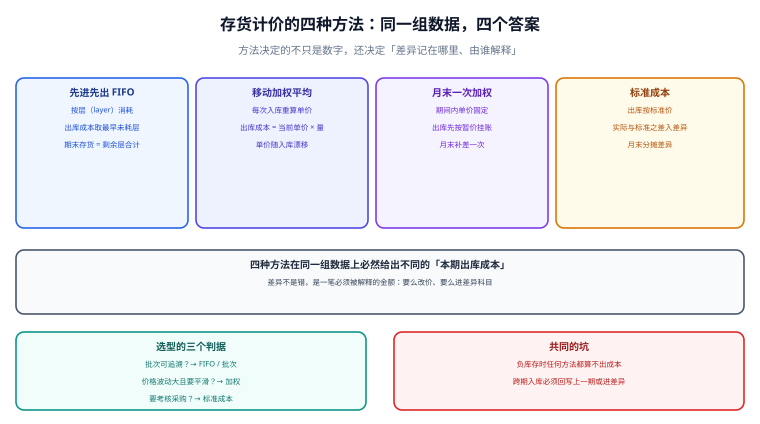

# 存货计价与出库成本

存货计价方法决定的不是一个数字，而是**差异记在哪里、由谁解释**。同一组收发数据，先进先出算出出库成本 4,075.00 元，月末一次加权算出 4,122.22 元，标准成本算出 3,850.00 元外加 272.22 元待分摊差异——三个数都合规，差别在于「价格波动这笔账，你是让它跟着货走（先进先出）、摊平到全月（加权）、还是显式记成差异（标准成本）」。

::: tip 一句话理解
**计价方法不是「选了就完事」的开关**，而是一份契约：它规定了出库成本怎么算、期末结存怎么留、价格波动怎么处理。换方法等于换契约，必须走变更流程并算出影响数。
:::

本页判据族 `CAV-A` ~ `CAV-H`，共 8 条，定义在最后一节。



## 一、四种方法的机制差异

| 方法 | 出库成本怎么取 | 期末结存 | 价格波动的影响 | 实施成本 |
| --- | --- | --- | --- | --- |
| 先进先出（FIFO） | 取最早未耗尽的层 | 剩余层合计 | 直接反映在出库成本上 | 中（要维护层） |
| 移动加权平均 | 每次入库后重算单价 | 当前单价 × 数量 | 被平滑，但单次波动仍会传导 | 低（一个单价字段） |
| 月末一次加权 | 全月一个单价 | 全月单价 × 数量 | 完全平滑 | 最低（月底算一次） |
| 标准成本 | 标准价 × 数量 | 标准价 × 数量 | 全部进差异科目 | 高（要维护标准与差异分摊） |

::: warning 后进先出（LIFO）在国际准则下已被禁止
IAS 2 自 2005 年起不允许 LIFO，中国 CAS 1 也不允许。库里如果还有按 LIFO 计价的历史数据，只能作为存量口径保留并标注，**新业务不得再用**。
:::

## 二、同一组数据，四个答案（本机演算）

数据：期初 100 件 @10.00；本期入库 200 件 @12.00、100 件 @13.50、50 件 @11.00；出库 250 件 + 100 件。标准价取 11.00 元。

| 方法 | 出库成本 | 期末结存 | 合计 | 与一次加权之差 |
| --- | --- | --- | --- | --- |
| 先进先出 | 4,075.00 | 1,225.00 | 5,300.00 | −47.22 |
| 移动加权平均 | 4,066.67 | 1,233.33 | 5,300.00 | −55.55 |
| 月末一次加权 | 4,122.22 | 1,177.78 | 5,300.00 | — |
| 标准成本 11.00 | 3,850.00（+272.22 差异） | 1,100.00（+77.78 差异） | 5,300.00 | −272.22（未分摊前） |

四行「合计」完全相同（5,300.00），这正是**金额守恒式**的表现：方法只改变「出库」与「期末」之间的切分点，不改变总额。所以判据不能是「合计对不对」，只能是「切分规则有没有被遵守」。

- 先进先出把 250 件的出库拆成 `100×10 + 150×12 = 2,800`，第二批 100 件拆成 `50×12 + 50×13.5 = 1,275`，合计 4,075.00。
- 移动加权在第一次出库时的单价是 `(1,000 + 2,400) / 300 = 11.3333`，出库成本 `250 × 11.3333 = 2,833.33`。
- 月末一次加权的单价是 `5,300 / 450 = 11.7778`，出库 `350 × 11.7778 = 4,122.22`。
- 标准成本的总差异是 `5,300 − 11.00 × 450 = 350.00`，按出库量分摊 350 件得到 272.22。

## 三、层的实现：先进先出怎么落库

FIFO 的难点不是算法，而是**层的持久化**：出库必须能追溯「吃掉了哪几层」，否则退货、重算、审计都无从下手。

```sql
-- 存货层：每一批入库是一层，remaining 随出库递减
CREATE TABLE stock_layer (
  id          INTEGER PRIMARY KEY,
  sku         TEXT NOT NULL,
  warehouse   TEXT NOT NULL,
  in_doc_no   TEXT NOT NULL,          -- 入库单号（层的身份）
  in_date     TEXT NOT NULL,
  qty_in      NUMERIC NOT NULL CHECK (qty_in > 0),
  qty_left    NUMERIC NOT NULL CHECK (qty_left >= 0),
  unit_cost   NUMERIC NOT NULL CHECK (unit_cost >= 0),
  UNIQUE (sku, warehouse, in_doc_no)
);

-- 出库明细：一条出库可以吃多层，所以是「一对多」
CREATE TABLE stock_issue_line (
  id         INTEGER PRIMARY KEY,
  issue_no   TEXT NOT NULL,
  layer_id   INTEGER NOT NULL REFERENCES stock_layer(id),
  qty        NUMERIC NOT NULL CHECK (qty > 0),
  unit_cost  NUMERIC NOT NULL,
  amount     NUMERIC NOT NULL,
  UNIQUE (issue_no, layer_id)
);
```

出库时按 `in_date, id` 排序逐层扣减，**扣减与写 `issue_line` 必须在同一事务里**：

```sql
BEGIN;
-- 取最早未耗尽的层（应用层循环，直到 need = 0）
SELECT id, qty_left, unit_cost FROM stock_layer
 WHERE sku = :sku AND warehouse = :wh AND qty_left > 0
 ORDER BY in_date, id;
-- 每层写入一行 issue_line，并更新 qty_left
UPDATE stock_layer SET qty_left = qty_left - :take WHERE id = :layer_id;
COMMIT;
```

::: danger 四个会算错却不报错的写法
1. **只更新 `qty_left` 不写 `issue_line`**：金额对得上，但**无法回答「这 250 件吃的是哪几层」**，退货时只能整批冲，审计直接卡住。
2. **出库跨事务扣层**：读到层、扣层之间没有锁，两个并发出库会同时消耗同一层的余量，出现负层或金额重复。
3. **允许 `qty_left` 为负**：数据库不拦，业务就永远不会报错；负层意味着成本被算成了负数或零，勾稽时才暴露。
4. **用 `ROUND` 抹平每层单价的小数**：每层都四舍五入，多层累计后与总额差几分钱；正确做法是**保留全精度计算，只在写凭证时取整，并把尾差记到最后一层**。
:::

## 四、负库存：任何方法都算不出成本的时刻

负库存不是「数量为负」这么简单，它的本质是**先出后进**：货发了，入库单还没录。此时：

| 处理方式 | 后果 | 适用场景 |
| --- | --- | --- |
| 硬拦（拒绝出库） | 业务停摆，但账永远是对的 | 严格管理的仓库 |
| 按暂估价出库，入库后补差 | 需要一张「补差」记录，否则金额永远偏低 | 常见做法 |
| 允许负库存，月末统一重算 | 月结前必须清零，否则勾稽必炸 | 快消 / 电商 |

第三种做法的关键是**月末必须清零**，并且要有判据：`SELECT count(*) FROM stock_balance WHERE qty < 0` 必须为 0，否则月结拒绝执行。

## 五、暂估与补差：跨期入库的唯一正解

上月到货、本月开票的料，标准做法是**暂估入库**，本月发票到了再**冲暂估 + 按实际入账**。补差有两种处理，差别很大：

| 处理 | 会计后果 | 何时用 |
| --- | --- | --- |
| 差额调整本期入库成本 | 影响本期出库成本 | 差异小、且该批货大部分还在库 |
| 差额直接进「材料成本差异」 | 不影响本期出库单价 | 差异大、或货已售出 |

第一种简单但会「污染」本期成本，第二种干净但需要差异科目与分摊机制。选哪种要在制度里写死，**不能按心情切换**——切换一次，历史可比性就断了。

## 六、判据族

| 编号 | 判据 | 怎么验 |
| --- | --- | --- |
| `CAV-A` | 每种方法单独守恒：出库 + 期末 = 期初 + 入库 | 按方法分组求和比对，差 0.00 |
| `CAV-B` | FIFO 的每条出库行都能追到具体层 | `issue_line` 无 `layer_id` 为空的行 |
| `CAV-C` | `qty_left` 恒 ≥ 0，且 ≤ `qty_in` | 两条 `CHECK` + 一次全表扫描 |
| `CAV-D` | 同一 SKU + 仓库 + 入库单只有一层 | `UNIQUE (sku, warehouse, in_doc_no)` 生效 |
| `CAV-E` | 负库存月末必须清零 | 月结前置检查查 `qty < 0` 为 0 |
| `CAV-F` | 暂估与补差成对出现，冲销后余额为 0 | 暂估单与冲销单一一对应 |
| `CAV-G` | 计价方法变更留有生效日与影响数 | 配置表含 `effective_from` 与 `impact_amount` |
| `CAV-H` | 尾差记到最后一层，全库尾差合计 ≤ 0.01 × 层数 | 层金额之和与总额差在校验阈值内 |

## 验证方式

```shell
# 1) 四法守恒：四行合计都应等于 5300.00
sqlite3 /tmp/cost.db "SELECT method, ROUND(SUM(CASE WHEN kind='out' THEN amount ELSE 0 END),2) out_amt,
  ROUND(SUM(CASE WHEN kind='end' THEN amount ELSE 0 END),2) end_amt,
  ROUND(SUM(amount),2) total FROM cost_by_method GROUP BY method;"
# 期望：每行 total 都是 5300.0

# 2) 层不越界：应输出 0
sqlite3 /tmp/cost.db "SELECT count(*) FROM stock_layer WHERE qty_left < 0 OR qty_left > qty_in;"
# 期望：0

# 3) 出库可追溯：应输出 0（没有孤儿出库行）
sqlite3 /tmp/cost.db "SELECT count(*) FROM stock_issue_line l
  LEFT JOIN stock_layer s ON s.id = l.layer_id WHERE s.id IS NULL;"
# 期望：0

# 4) 负库存清零：应输出 0
sqlite3 /tmp/cost.db "SELECT count(*) FROM stock_balance WHERE qty < 0;"
# 期望：0
```

## 参考资料

- [成本对象与归集维度](../CostObject/index.md)：本页的金额最终写进哪张表
- [在制品、约当产量与联产品](../WipYield/index.md)：出库之后进入生产的那一段
- [库存快照与批次](../../WarehouseOps/StockSnapshot/index.md)：数量口径的对应页
- IAS 2 Inventories（IFRS 基金会）：<https://www.ifrs.org/issued-standards/list-of-standards/ias-2-inventories/>
