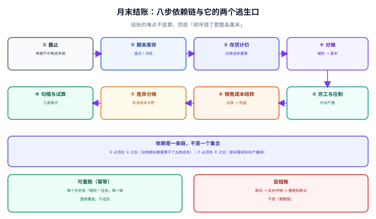

# 月末结账的顺序与幂等

月末结账是成本核算里唯一「**顺序错了就得整条重来**」的环节。八步之间不是并列关系，而是一条依赖链：没有期末库存就出不了出库成本，没有完工产量就摊不了差异，没有差异就结不平销售成本。而这条链最脆弱的地方不在算，在**重跑**——月底总要改几张单据、重算两三遍，如果重跑是「追加」而不是「覆盖」，第二遍就把金额翻了一倍。

::: tip 一句话理解
**结账 = 一组合法的顺序 + 一个幂等的重跑**。顺序保证每一步的输入都已就绪，幂等保证「重跑」不会变成「重记」。
:::

本页判据族 `CAM-A` ~ `CAM-H`，共 8 条，定义在最后一节。



## 一、八步依赖链

| 步 | 任务 | 输入 | 输出 | 为什么必须在这一步 |
| --- | --- | --- | --- | --- |
| ① 截止 | 冻结本期单据 | 业务单据 | 截止标记 | 后面所有的数都以「不再变化」为前提 |
| ② 期末库存 | 盘点 / 冻结数量 | 库存流水 | 期末数量与金额 | 出库成本要按「期初 + 入库 − 出库 = 期末」反算校验 |
| ③ 存货计价 | 重算出库成本 | 层 / 单价 | 出库成本明细 | 分摊之前要先把材料成本定下来 |
| ④ 分摊 | 辅助 → 基本 → 对象 | 成本池 | 对象成本 | 完工成本要含分摊进来的制造费用 |
| ⑤ 完工与在制 | 约当产量切分 | 对象成本、产量 | 完工成本 + 在制余额 | 销售成本只能结转完工部分 |
| ⑥ 销售成本结转 | 出库 → 主营业务成本 | 出库明细 | 结转凭证 | 要有完工成本才结得对 |
| ⑦ 差异分摊 | 标准成本差异 | 差异池、存销比例 | 差异明细 | 要在产量确定之后才能按比例摊 |
| ⑧ 勾稽与试算 | 三道等式 | 全部结果 | 勾稽报告 | 最后一道门，不平不许关账 |

依赖不是「先做哪个比较顺」，而是**输入依赖**。把它写成图，任何一条边断了，后面的步骤都必须等待：

```text
① → ② → ③ → ④ → ⑤ → ⑥
                    ↘ ⑦
③ ④ ⑤ ⑥ ⑦ → ⑧
```

::: danger 三个「顺序看起来没问题」的错法
1. **⑤ 用上月产量摊差异**：差异分摊要用**本期实际产量**做分母，用上月产量会让本期的效率变化完全体现不出来。
2. **③ 在 ② 之前跑**：没有期末数量，出库成本只能按「发出即耗用」倒推，一旦有盘盈盘亏就对不上。
3. **⑧ 与其他步骤并行**：勾稽必须读到全部结果写完之后的一致快照，否则会读到「半成品」——前半段是旧版本、后半段是新版本。
:::

## 二、幂等：唯一键比代码更重要

幂等的实现方式只有一种可靠的：**每个任务的产物都带一个可重算的键，重跑时按键覆盖**。

```sql
-- 一步一个产物表，键里必须有「期间 + 任务 + 版本」
CREATE TABLE close_task_run (
  id          INTEGER PRIMARY KEY,
  period      TEXT    NOT NULL,
  task        TEXT    NOT NULL,       -- cutoff / stock / costing / alloc / wip / cogs / variance / recon
  version     INTEGER NOT NULL,
  status      TEXT    NOT NULL CHECK (status IN ('running','done','failed')),
  started_at  TEXT    NOT NULL,
  finished_at TEXT,
  row_count   INTEGER,
  amount_sum  NUMERIC,
  UNIQUE (period, task, version)
);

-- 产物表以「期间 + 任务」为业务唯一键，重跑按 DELETE + INSERT 在同一事务
CREATE TABLE cost_cogs (
  id        INTEGER PRIMARY KEY,
  period    TEXT NOT NULL,
  object_no TEXT NOT NULL,
  amount    NUMERIC NOT NULL,
  UNIQUE (period, object_no)
);
```

重跑的正确写法（**同一事务里先删后插**）：

```sql
BEGIN IMMEDIATE;
DELETE FROM cost_cogs WHERE period = :period;
INSERT INTO cost_cogs (period, object_no, amount)
SELECT :period, object_no, ROUND(SUM(amount), 2)
  FROM cost_detail
 WHERE period = :period AND object_type = 'wo'
 GROUP BY object_no;
COMMIT;
```

「先删后插」在事务里是原子的：**要么整批换掉，要么完全没动**。这比「按主键 upsert」更难写错，也比「追加 + 标记有效」更容易验证（追加方案的判据要写成「有效版本唯一」，而这条约束在并发下经常漏）。

::: warning 为什么不能用「追加 + is_latest 标记」做幂等
三个理由：① 需要额外一条「同期间只有一个 `is_latest=1`」的约束，很多数据库不支持部分唯一索引，只能靠触发器；② 一旦两个进程同时置位，会出现两行都是最新；③ 所有查询都要带 `is_latest=1`，漏一处就是翻倍。**能删就先删**。
:::

## 三、反结账：不是「删数据」

反结账是月底最容易被写坏的功能。正确形态是**反向冲销 + 断点重跑**，不是「把上一步的表清空」：

| 做法 | 后果 | 是否可接受 |
| --- | --- | --- |
| 直接 `DELETE FROM cost_* WHERE period=?` | 审计无痕，无法回答「上个月到底算过什么」 | 否 |
| 生成反向冲销凭证，保留原记录 | 可追、可审、可解释 | 是 |
| 版本号 +1，旧版本只读保留 | 可对比两版差异，最适合排查 | 是（推荐） |
| 复制到调整期（P13）处理 | 不动已发布的期间，最合规 | 是（年报期常用） |

反结账后的重跑必须**从断点开始**：改了 ③ 的计价方法，就从 ③ 开始往下重跑 ③~⑧，前两步不动。这要求每一步都能独立启动，且能读到自己上游的「已完成版本号」。

## 四、结账门禁：不平就不许过

门禁不是「跑一遍看看」，而是**拒绝进入下一步**：

```sql
-- 门禁 1：本期勾稽必须全平（三条等式）
SELECT count(*) FROM v_recon_check WHERE period = :period AND ABS(diff) > 0.01;
-- 期望 0，否则拒绝关账

-- 门禁 2：负库存必须清零
SELECT count(*) FROM stock_balance WHERE period = :period AND qty < 0;
-- 期望 0

-- 门禁 3：不存在卡在 running 的任务
SELECT count(*) FROM close_task_run WHERE period = :period AND status <> 'done';
-- 期望 0

-- 门禁 4：差异科目余额为 0（已分摊或已转损益）
SELECT ROUND(SUM(amount), 2) FROM cost_variance_balance WHERE period = :period;
-- 期望 0.0
```

四条全过才允许把期间状态从 `open` 改成 `closed`。**这条状态变更必须是一条带条件的 UPDATE**：

```sql
UPDATE fiscal_period SET status = 'closed'
 WHERE period = :period AND status = 'open'
   AND NOT EXISTS (SELECT 1 FROM v_recon_check WHERE period = :period AND ABS(diff) > 0.01);
-- rowcount = 1 才算关账成功；0 说明门禁没过
```

## 五、性能：重跑只跑脏区间

一个月 20 万条成本明细时，全量重跑 ③~⑧ 需要十几分钟。可用的优化只有一种：**记录脏区间**。

- ③ 只重算「本期有入库或出库的 SKU」；
- ④ 只重算「成本池发生变化」的中心；
- ⑤ 只重算「产量或成本变化」的对象。

判据随之变成：**部分重跑与全量重跑的结果必须逐行相同**。这条判据比性能更重要——优化一旦引入「少算了某个对象」的缺陷，全量重跑是唯一能发现它的方式。所以实践里通常保留「月结做全量、日常调试做增量」两条路径，且**每月至少跑一次全量**。

## 六、判据族

| 编号 | 判据 | 怎么验 |
| --- | --- | --- |
| `CAM-A` | 八步按依赖顺序执行，前一步未 `done` 时后一步拒绝启动 | 人为把 ③ 置 failed，④ 返回失败 |
| `CAM-B` | 每步产物带 `(period, task, version)` 唯一键 | 同一键插入两次被拒 |
| `CAM-C` | 重跑为「同事务先删后插」，不追加 | 连跑两次行数与金额不变 |
| `CAM-D` | 反结账保留原记录（版本 +1 或反向冲销） | 反结账后旧版本仍可查 |
| `CAM-E` | 关账是一条带门禁条件的 UPDATE，`rowcount=1` | 人为造 1 分差异，关账 `rowcount=0` |
| `CAM-F` | 四条门禁查询在关账前全部为 0 | 逐条跑，全为 0 才继续 |
| `CAM-G` | 增量重跑与全量重跑结果逐行相同 | 两条路径各跑一次，`diff` 为空 |
| `CAM-H` | 每一步记录耗时与行数，可用于定位慢步 | `close_task_run` 有 `row_count` 与时间 |

## 验证方式

```shell
# 1) 顺序门禁：把 ③ 置为 failed 后，④ 应拒绝启动
sqlite3 /tmp/cost.db "UPDATE close_task_run SET status='failed' WHERE task='costing';"
# 期望：应用层返回「上游 costing 未完成」，不写入任何 alloc 行

# 2) 幂等：连跑两次，输出必须完全一致
sqlite3 /tmp/cost.db "SELECT count(*), ROUND(SUM(amount),2) FROM cost_cogs WHERE period='2026-10';"
sqlite3 /tmp/cost.db "DELETE FROM cost_cogs WHERE period='2026-10';" \
  && sqlite3 /tmp/cost.db "INSERT INTO cost_cogs(period,object_no,amount) SELECT '2026-10',object_code,ROUND(SUM(amount),2) FROM cost_detail WHERE period='2026-10' AND object_type='wo' GROUP BY object_code;"
sqlite3 /tmp/cost.db "SELECT count(*), ROUND(SUM(amount),2) FROM cost_cogs WHERE period='2026-10';"
# 期望：两次输出相同

# 3) 关账门禁：构造 1 分差异后关账必须失败（rowcount=0）
sqlite3 /tmp/cost.db "INSERT INTO gl_balance(period,account,amount) VALUES('2026-10','1401',1.00);"
sqlite3 /tmp/cost.db "UPDATE fiscal_period SET status='closed' WHERE period='2026-10' AND status='open'
  AND NOT EXISTS (SELECT 1 FROM v_recon_check WHERE period='2026-10' AND ABS(diff) > 0.01);"
sqlite3 /tmp/cost.db "SELECT changes();"
# 期望：0（关账被拒绝）

# 4) 无悬挂任务：应输出 0
sqlite3 /tmp/cost.db "SELECT count(*) FROM close_task_run WHERE period='2026-10' AND status='running';"
# 期望：0
```

## 参考资料

- [总览：七段成本链与三条守恒式](../Overview/index.md)：八步链要守住的三条等式
- [三方勾稽：台账、明细与总账](../Reconciliation/index.md)：门禁 1 的具体实现
- [实战：一个月成本核算的全流程](../Practice/index.md)：把八步跑成六条命令
