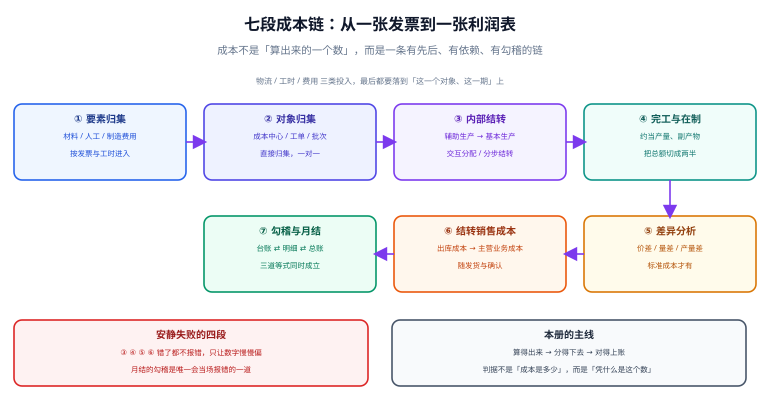

# 总览：七段成本链与三条守恒式

「这个产品的成本是多少」这句话，在同一个系统里可以问出四个答案：**单位标准成本**、**本月实际单位成本**、**这批工单的实际成本**、**这批货的出库成本**。四个数都合法，差别在于它们各自锚定了哪一个对象、哪一段期间、哪一种计价方法。分不清这四个答案的人，会把「成本上升」解释成采购涨价，而真正的原因可能是这个月多分摊了一笔机修费。

::: tip 一句话理解
**成本核算的本质是三条守恒式同时成立**：数量守恒（进 − 出 = 存）、金额守恒（期初 + 投入 = 出库 + 期末）、要素守恒（Σ 各要素 = 总成本）。任何一条破了，后面的差异分析全是空谈。
:::

本页判据族 `CAO-A` ~ `CAO-H`，共 8 条，定义在最后一节。

## 一、三条守恒式：判「算得对不对」只用这三条

成本核算里没有「绝对正确的成本」，只有「守恒的账」。三条等式把「对」定义成可验证的形式：

| 守恒式 | 形式 | 破了会怎样 | 一般由哪一步破 |
| --- | --- | --- | --- |
| 数量守恒 | 期初数量 + 本期入库 − 本期出库 = 期末数量 | 负库存、盘点永远差几件 | 出库单漏记 / 重复出库 |
| 金额守恒 | 期初金额 + 本期投入 = 本期出库成本 + 期末金额 | 存货科目与台账差钱 | 计价方法切换、暂估补差、跨期入库 |
| 要素守恒 | 直接材料 + 直接人工 + 制造费用 = 总成本 | 成本算出来比料工费相加少一截 | 分摊只分了一部分、差异没结清 |

三条式子里，**金额守恒最容易被破而没人发现**：数量守恒有盘点兜底（差几件立刻能看见），要素守恒有借贷平衡兜底（差一分钱过不了账），只有金额守恒，两边都是「看起来合理」的数。



## 二、七段链：哪几段的失败是安静的

| 段 | 谁在做 | 交给下一段的东西 | 这一段独有的失败 | 谁来发现 |
| --- | --- | --- | --- | --- |
| ① 要素归集 | 财务 / 仓储 | 材料领用、工时、费用发票 | 领料单挂错成本中心 | 成本中心报表（**没人看**） |
| ② 对象归集 | 车间统计 | 按工单 / 批次的明细 | 共用料按「平均」摊，谁都不准 | 单位成本异常（**事后**） |
| ③ 内部结转 | 成本会计 | 辅助生产结转单 | 分母没剔自耗，循环分配 | 分步报表（**没人看**） |
| ④ 完工与在制 | 系统 | 完工成本 + 在制余额 | 约当产量分母口径混用 | 存货与损益（**月末才查**） |
| ⑤ 差异分析 | 成本会计 | 价差 / 量差 / 产量差 | 差异科目只挂不分摊 | 差异余额（**越滚越大**） |
| ⑥ 销售成本结转 | 系统 | 主营业务成本 | 出库成本按开票日而非发货日 | 毛利率异常（**事后**） |
| ⑦ 勾稽与月结 | 成本会计 / 内审 | 勾稽报告、试算平衡 | 不平就手工调账 | 这道门本身 |

七段里有**五段的失败是安静的**。安静的失败有一个共同特征：**它不产生异常，只产生偏差**。

## 三、同一个月的四个「成本」

以本专题的演算数据为例（期初 100 件 @10.00，本期入库 200@12.00 / 100@13.50 / 50@11.00，出库 250 + 100 件）：

| 你问的是 | 答案 | 这个数回答了什么 |
| --- | --- | --- |
| 这批货的出库成本（先进先出） | 4,075.00 | 实际耗用的是哪几层货 |
| 这批货的出库成本（移动加权） | 4,066.67 | 每次入库后的平均价 |
| 这批货的出库成本（月末一次加权） | 4,122.22 | 全月一个价 |
| 这批货的出库成本（标准价 11.00 + 差异分摊） | 3,850.00 + 272.22 | 标准是多少、差在哪 |

四个数最大差 55.55 元，占 1.35%。金额不大，但**方向不一致**：先进先出比一次加权低 47.22，移动加权比一次加权低 55.55。如果月末总账按一次加权过账、台账按先进先出结存，差额 47.22 元就会永远挂在那里——它既不是错账，也不是漏账，而是**两种口径的合法差**。

::: danger 三个「把成本口径混起来」的高频写法
1. **用出库成本反推单位成本**：出库成本里含了上期结存的低价层，除以本期产量得到的「单位成本」既不属本期也不属上期。
2. **标准成本与实际成本混在一张表里加总**：标准成本页的合计 + 实际成本页的合计 ≠ 任何有意义的数，必须先统一到「标准 + 差异」或「实际」一侧。
3. **跨期入库直接写本期**：上月到货、本月开票的料，写进本月会让上月的出库成本偏低，而且**上月的报表已经出了**，只能靠差异科目吸收。
:::

## 四、47.22 元是怎么来的

月末勾稽最常见的差异形态不是「大数不平」，而是「小数长期挂账」。以本专题的演算为例：

```text
台账期末（先进先出）      = 1,225.00
总账存货余额（一次加权）  = 1,177.78
差额                      =    47.22
```

47.22 = 1,225.00 − 1,177.78，恰好等于两种计价方法的出库成本之差（4,122.22 − 4,075.00 = 47.22）的相反数。**这个差不需要「调平」，需要的是「选一个口径并写下来」**：

1. 台账与总账必须同源：要么都按先进先出，要么都按一次加权；
2. 计价方法变更要走会计政策变更，且**变更当期要算出影响数**；
3. 变更后第一次月结的勾稽差额必须能对上「变更影响数」，否则说明变更没算干净。

## 五、成熟度：从「能算」到「能证明」

成本核算系统的成熟度不是按功能多少分级，而是按「出了问题能不能自己说清」分级：

| 级别 | 特征 | 一个月结要几个人 | 出问题时 |
| --- | --- | --- | --- |
| L0 手工 | Excel 算，邮件传 | 2~3 人 × 3 天 | 追溯靠翻聊天记录 |
| L1 能算 | 系统出数，明细在库里 | 1 人 × 1 天 | 能查明细，查不出「为什么是这个数」 |
| L2 可重跑 | 每步幂等，重跑结果一致 | 0.5 人 × 半天 | 重跑一遍看差异，差异即线索 |
| L3 可勾稽 | 三道等式自动校验，不平拒绝关账 | 0 人（自动） | 报出「哪个对象、哪个期间、差多少」 |
| L4 可解释 | 每条差异能指到责任中心与单据 | 0 人 | 差异有归属、有处理结论、有留痕 |

多数团队停在 L1：**数出得来，但没人能证明它是对的**。从 L1 到 L2 的关键动作只有一个——**把每一步做成幂等**；从 L2 到 L3 的关键动作也只有一个——**把勾稽做成门禁**，不通过就不许关账。

## 六、五个必失点

这五处是成本核算里「一定会踩、且踩了不会报错」的地方：

1. **约当产量的分母**：用「本期投入量」代替「约当产量」，完工成本会系统性偏低（本专题演算里差 26,666.67 元）。
2. **辅助生产自耗**：分摊分母没剔除「辅助车间自己用掉的部分」，每一轮都会多分一点，代数法能算出真实值、顺序法必须手工剔除。
3. **期间归属**：出库成本按开票日算，跨月发货就串月；正确锚点是**发货过账日**（或业务确认的交付日），并在契约里写死。
4. **重跑不覆盖**：分摊结果按「期间 + 任务」唯一键写入才能重跑；用追加方式写，跑两次金额翻倍（本专题演算：100 行变 200 行，160,000 变 320,000）。
5. **差异不分摊**：标准成本下算出的差异如果一直挂在差异科目，存货与损益就同时失真；差异必须按**当期出库量 / 期末结存量**分摊干净。

## 七、判据族

| 编号 | 判据 | 怎么验 |
| --- | --- | --- |
| `CAO-A` | 三条守恒式在月结报告里各有独立校验项 | 勾稽报告含三条结论，缺一条即不通过 |
| `CAO-B` | 数量、金额、要素三条式的数据来自同一批单据 | 抽查 10 张出库单，三处数量一致 |
| `CAO-C` | 「四个成本」在页面上分列，不出现混算 | 报表里单位成本带口径后缀 |
| `CAO-D` | 计价方法记录在配置里，可追溯变更历史 | 查配置表有 `effective_from` |
| `CAO-E` | 成本对象、期间、版本三要素进每条明细的唯一键 | 唯一索引覆盖三列 |
| `CAO-F` | 每一步可单独重跑，重跑前后结果逐行相同 | 连续跑两次，`diff` 为空 |
| `CAO-G` | 勾稽不平即拒绝关账（不是告警） | 构造 1 分差异，关账接口返回失败 |
| `CAO-H` | 差异能指到「对象 + 期间 + 单据类型」三者 | 任取一笔差异可反查到源单 |

## 验证方式

```shell
# 1) 三条守恒式各给一条查询，全部应返回 0 行
sqlite3 /tmp/cost.db "SELECT 1 WHERE (
  (SELECT qty FROM stock_ledger WHERE period='2026-10' AND kind='begin')
+ (SELECT COALESCE(SUM(qty),0) FROM stock_ledger WHERE period='2026-10' AND kind='in')
- (SELECT COALESCE(SUM(qty),0) FROM stock_ledger WHERE period='2026-10' AND kind='out')
) <> (SELECT qty FROM stock_ledger WHERE period='2026-10' AND kind='end');"
# 期望：无输出（数量守恒成立）

# 2) 要素守恒：三要素之和应等于总成本，差 0.00
sqlite3 /tmp/cost.db "SELECT ROUND(SUM(CASE WHEN element IN ('material','labor','overhead') THEN amount END)
  - (SELECT SUM(amount) FROM cost_detail WHERE period='2026-10'), 2) FROM cost_detail WHERE period='2026-10';"
# 期望：0.0

# 3) 重跑幂等：连跑两次，明细行数与金额都不变
sqlite3 /tmp/cost.db "SELECT count(*), SUM(amount) FROM cost_alloc WHERE period='2026-10';"
# 期望：两次输出完全相同
```


## 与「设备维护与可靠性」专题的分工（第 233 天补充）

本册把「停机」当成一个**金额**：停机损失、维修成本、折旧分摊，最后都要进成本对象。那一册把「停机」当成一段**时间**：从几点到几点、落在哪个原因、跨了几个班。金额是时间的下游，时间错了金额一定错，反过来不成立。

| 你关心的问题 | 该读哪一册 | 为什么不是另一册 |
| --- | --- | --- |
| 这批产品的制造费用摊多少 | 本册（[三阶分摊](../Allocation/index.md)） | 那一册只提供「设备停机小时」这个分摊动因 |
| 这台设备一年停了多少小时 | [设备维护与可靠性](../../EquipmentMaintenance/Downtime/index.md) | 本册不判时长，只判金额 |
| 维修工时记到哪个成本对象 | 本册（[成本对象](../CostObject/index.md)） | 那一册记的是「谁修的、修了多久」，不是「记给谁」 |
| 停机损失要不要进产品成本 | 本册（[标准成本与差异](../StandardCost/index.md)） | 那一册只给时长与原因，不做会计判断 |

::: warning 一个让分析彻底失效的归集方式：维修工时进「制造费用」一个池
把全部维修工时塞进一个「制造费用—维修」科目，账是平的，但**按设备分析从此不可能**：你不知道哪台设备吃掉了 40% 的维修工时。

正确的最小改动是给维修工时加两个维度：`asset_id` 与 `cause`（机械 / 电气 / 等件 / 换型）。这样月底既能出「维修费用总额」，也能出「停机成本 Top 5 设备」——后者才是改善的输入。加维度的成本是一次字段变更，不加的代价是每年都在猜。
:::

## 与本专题的分工

成本核算判的是**金额守恒**（材料 + 人工 + 制造费用 = 转入成本），合并判的是**这笔成本该不该出现在集团报表上**。

| 你关心的问题 | 该读哪一册 | 为什么 |
| --- | --- | --- |
| 本月产品成本怎么归集、差异怎么分解 | 本册 | 三阶分摊、四类差异 |
| 集团内部交易产生的毛利留在存货里算不算成本 | [合并报表与内部抵销](../../Consolidation/Intercompany/index.md) | 未实现利润要从存货与成本同时减 |
| 合并后单位成本为什么会变 | 合并册 | 内部采购价被抵销，合并成本回到集团视角 |
| 内部服务（总部管理费）怎么处理 | 合并册 | 属内部交易，成对抵销 |
| 月末结账与合并的先后 | 本册先结账 | 单体关账后才有报表包 |

::: danger 本页特有的一处坑：用「综合毛利率」估算内部毛利
成本册里常用综合毛利率做快速估算，这个习惯带到合并层会系统性少抵。本机实测：逐笔法算出的未实现利润 4,059,446.38 元，用「期末存货 × 综合毛利率」估算只有 1,548,000 元，**少抵 61.9%**。

原因很直接：估算口径把「全部存货」都乘了毛利率，而实际上只有一部分存货来自内部采购。这个偏差随采购结构变化，无法用固定系数修正——所以内部交易表必须带 `gm_rate` 与 `retained_ratio` 两个字段。
:::

## 与本专题的分工

| 你关心的问题 | 该读哪一册 | 为什么不是本页 |
| --- | --- | --- |
| 「产品成本怎么算、月末怎么结」 | 本页 | 判**金额守恒**：材料 + 人工 + 费用 = 转入成本 |
| 「这笔钱有没有被授权、能不能花」 | [全面预算与经营分析](../../Budgeting/Overview/index.md) | 那册判**额度授权**，对象是责任中心而不是产品 |
| 「差异怎么分解」 | 两册各一半 | 本页的差异是「实际成本 vs 标准成本」，那册是「实际支出 vs 授权额度」 |
| 「部门超支了谁负责」 | [全面预算与经营分析](../../Budgeting/Variance/index.md) | 那册判**可行动归属**，本页只管成本对象的差异 |

::: warning 一页一坑：把「成本差异」当「预算差异」用
本机有一组数：总差 2,760，价格 +960 / 数量 +3,000 / 结构 −1,200。按成本核算的标准成本法分解，这三支都能落到产品上；但拿同一组数去回答「部门为什么超支」，结构差 −1,200 会被并进数量差，于是结论变成「量买多了」——而真实原因是高价品占比上升。

两册的分解公式长得一样，**归属对象完全不同**：成本差异归产品/订单，预算差异归责任中心与人。混用会让「材料涨价」被记成「用量超支」，采购与生产互相推责。
:::

## 与「碳排放核算与 ESG 披露」的分工（第 237 天补充）

| 你关心的问题 | 该读哪一册 | 为什么不是本页 |
| --- | --- | --- |
| 「产品成本怎么算、月末怎么结」 | 本页 | 判的是**金额守恒**（材料 + 人工 + 费用 = 转入成本） |
| 「单位产品带多少碳」 | [分配与产品碳足迹](../../CarbonAccounting/Allocation/index.md) | 那册判**物理量的分摊与守恒**，分母是功能单位 |
| 「组织这一年的碳清单」 | [碳排放核算总览](../../CarbonAccounting/Overview/index.md) | 那册判**边界与范围**，不进产品成本 |
| 「碳价怎么进成本」 | [披露、重述与履约](../../CarbonAccounting/Disclosure/index.md) | 那册判**配额缺口与碳关税**，本页只把它当一项费用 |

::: warning 一页一坑：分配守恒 ≠ 分配正确
本页与碳核算都讲「分摊」，两者都能做到「分出去的和 = 待分总量」——所以守恒本身不能证明方法对。

本机实测：一座热电厂输入 120,000 GJ、产出电 40,000 GJ 与汽 55,000 GJ，排放 60,000 tCO₂e。按能量法电力分到 42.11%（25,263 t），按火用法分到 70.80%（42,478 t），**两种方法都严格守恒**，但电力的排放差了 17,215 t（相对 68.1%）。若这家企业的电力产品要出口欧盟，这 17,215 t 直接进 CBAM 的嵌入排放。守恒式只能证明「没漏数」，不能证明「分对了」。
:::

## 参考资料

- [成本对象与归集维度](../CostObject/index.md)：三条守恒式落库时的那张表
- [月末结账的顺序与幂等](../MonthEndClose/index.md)：让「重跑」成为可能的那套键
- 财政部：企业会计准则第 1 号——存货：<https://www.mof.gov.cn/>
- 财政部：企业产品成本核算制度（试行）（财会〔2013〕17 号）：<https://www.mof.gov.cn/>
