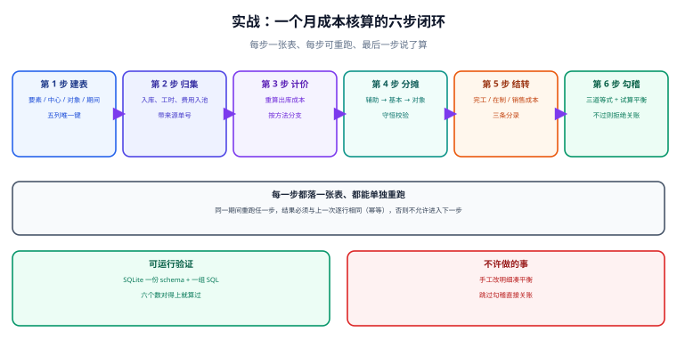

# 实战：一个月成本核算的全流程

前面九篇讲的都是「一段」，这一篇把它们连起来跑一遍。目标很小：**一个车间、两个辅助中心、一个工单、一个月**，从建表到关账，六步跑完，八个数对得上。所有 SQL 都在 SQLite 3.44 上实测通过（读数附在每条命令后面），你可以原样复制执行。

::: tip 一句话理解
**能跑通的判据不是「有数」，而是「反例必须失败」**：重复归集要被唯一键拒、进度越界要被 CHECK 拒、有一分钱差异要关不上账。三条都成立，这套流程才算真的上了门禁。
:::

本页判据族 `CAX-A` ~ `CAX-H`，共 8 条，定义在最后一节。



## 一、场景与数据

| 项目 | 数值 |
| --- | --- |
| 供电车间 | 费用 100,000.00，供 100,000 kWh（给机修 10,000，给产线 80,000，给厂部 10,000） |
| 机修车间 | 费用 60,000.00，6,000 h（给供电 1,000，给产线 4,000，给厂部 1,000） |
| 产线工单 WO-001 | 直接材料 120,000.00、直接人工 20,000.00、分摊制造费用 60,000.00 |
| 产量 | 投产 120 件，完工 80 件，期末在制 40 件（材料 100%、工费 50%） |

预期结果：工单总成本 200,000.00，完工成本 160,000.00，在制余额 40,000.00。

## 二、第 1 步：建表（10 张）

```sql
PRAGMA foreign_keys = ON;

CREATE TABLE cost_center (
  code TEXT PRIMARY KEY, name TEXT NOT NULL,
  is_aux INTEGER NOT NULL DEFAULT 0 CHECK (is_aux IN (0,1)),
  valid_from TEXT NOT NULL, valid_to TEXT);

CREATE TABLE cost_pool (
  period TEXT NOT NULL, center_code TEXT NOT NULL REFERENCES cost_center(code),
  amount NUMERIC NOT NULL, driver TEXT NOT NULL,
  driver_qty NUMERIC NOT NULL CHECK (driver_qty > 0),
  exclude_qty NUMERIC NOT NULL DEFAULT 0,
  PRIMARY KEY (period, center_code));

CREATE TABLE cost_detail (
  id INTEGER PRIMARY KEY, period TEXT NOT NULL, version INTEGER NOT NULL DEFAULT 1,
  element TEXT NOT NULL CHECK (element IN ('material','labor','overhead')),
  center_code TEXT NOT NULL, object_type TEXT NOT NULL, object_code TEXT NOT NULL,
  amount NUMERIC NOT NULL CHECK (amount >= 0),
  src_doc_type TEXT NOT NULL, src_doc_no TEXT NOT NULL,
  is_direct INTEGER NOT NULL DEFAULT 1,
  UNIQUE (period, version, element, center_code, object_type, object_code, src_doc_no));

CREATE TABLE cost_alloc (
  period TEXT NOT NULL, run_no INTEGER NOT NULL, version INTEGER NOT NULL DEFAULT 1,
  from_center TEXT NOT NULL, to_center TEXT NOT NULL, driver TEXT NOT NULL,
  driver_qty NUMERIC NOT NULL, rate NUMERIC NOT NULL, amount NUMERIC NOT NULL,
  PRIMARY KEY (period, run_no, version, from_center, to_center));

CREATE TABLE wip_report (
  period TEXT NOT NULL, object_no TEXT NOT NULL,
  qty_begin NUMERIC NOT NULL DEFAULT 0, qty_start NUMERIC NOT NULL DEFAULT 0,
  qty_finish NUMERIC NOT NULL DEFAULT 0, qty_end NUMERIC NOT NULL DEFAULT 0,
  mat_progress NUMERIC NOT NULL DEFAULT 1 CHECK (mat_progress BETWEEN 0 AND 1),
  lab_progress NUMERIC NOT NULL DEFAULT 0 CHECK (lab_progress BETWEEN 0 AND 1),
  PRIMARY KEY (period, object_no),
  CHECK (qty_begin + qty_start - qty_finish = qty_end));

CREATE TABLE cost_wip_balance (
  period TEXT NOT NULL, object_no TEXT NOT NULL, amount NUMERIC NOT NULL,
  PRIMARY KEY (period, object_no));

CREATE TABLE cost_cogs (
  period TEXT NOT NULL, object_no TEXT NOT NULL,
  qty NUMERIC NOT NULL, amount NUMERIC NOT NULL,
  PRIMARY KEY (period, object_no));

CREATE TABLE gl_balance (
  period TEXT NOT NULL, account TEXT NOT NULL, amount NUMERIC NOT NULL,
  PRIMARY KEY (period, account));

CREATE TABLE pl_line (
  period TEXT NOT NULL, item TEXT NOT NULL, amount NUMERIC NOT NULL,
  PRIMARY KEY (period, item));

CREATE TABLE fiscal_period (
  period TEXT PRIMARY KEY,
  status TEXT NOT NULL CHECK (status IN ('open','closed')));
```

十个表分别负责：**主数据**（`cost_center`）、**成本池**（`cost_pool`）、**明细**（`cost_detail`）、**分摊**（`cost_alloc`）、**产量**（`wip_report`）、**在制**（`cost_wip_balance`）、**结转**（`cost_cogs`）、**总账**（`gl_balance`）、**损益**（`pl_line`）、**期间状态**（`fiscal_period`）。

## 三、第 2 步：归集（成本池 + 明细）

```sql
INSERT INTO cost_center (code, name, is_aux, valid_from) VALUES
  ('CC-POWER','供电车间',1,'2026-01-01'),
  ('CC-MAINT','机修车间',1,'2026-01-01'),
  ('CC-SMT','SMT 产线',0,'2026-01-01'),
  ('CC-ADMIN','厂部管理',0,'2026-01-01');

INSERT INTO cost_pool (period, center_code, amount, driver, driver_qty, exclude_qty) VALUES
  ('2026-10','CC-POWER',100000,'kwh',100000,0),
  ('2026-10','CC-MAINT', 60000,'hour',  6000,1000);

INSERT INTO cost_detail (period, element, center_code, object_type, object_code,
                         amount, src_doc_type, src_doc_no, is_direct) VALUES
  ('2026-10','material','CC-SMT','wo','WO-001',120000,'issue','ISS-20261001',1),
  ('2026-10','labor',   'CC-SMT','wo','WO-001', 20000,'timecard','TC-20261001',1),
  ('2026-10','overhead','CC-SMT','wo','WO-001', 60000,'alloc','AL-20261001',0);
```

`exclude_qty` 那一列是给顺序法留的：机修 6,000 h 里有 1,000 h 是给供电的，分摊分母要用 `driver_qty − exclude_qty`。

## 四、第 3 步：分摊（顺序法，先供电后机修）

```sql
-- 一阶：供电
INSERT INTO cost_alloc (period, run_no, from_center, to_center, driver, driver_qty, rate, amount) VALUES
  ('2026-10',1,'CC-POWER','CC-MAINT','kwh', 10000, 1.00,  10000),
  ('2026-10',1,'CC-POWER','CC-SMT',  'kwh', 80000, 1.00,  80000),
  ('2026-10',1,'CC-POWER','CC-ADMIN','kwh', 10000, 1.00,  10000);

-- 二阶：机修（分母剔除给供电的 1,000 h）
INSERT INTO cost_alloc (period, run_no, from_center, to_center, driver, driver_qty, rate, amount)
SELECT '2026-10', 2, 'CC-MAINT', 'CC-SMT', 'hour', 4000,
       ROUND((60000 + 10000) / (6000 - 1000), 6), 56000
UNION ALL
SELECT '2026-10', 2, 'CC-MAINT', 'CC-ADMIN', 'hour', 1000,
       ROUND((60000 + 10000) / (6000 - 1000), 6), 14000;
```

## 五、第 4 步：产量与约当产量

```sql
INSERT INTO wip_report (period, object_no, qty_begin, qty_start, qty_finish, qty_end, mat_progress, lab_progress)
VALUES ('2026-10','WO-001', 0, 120, 80, 40, 1.0, 0.5);

CREATE VIEW v_wip_eu AS
SELECT period, object_no,
       qty_finish + qty_end * mat_progress AS eu_material,
       qty_finish + qty_end * lab_progress AS eu_labor
  FROM wip_report;
```

`CHECK (qty_begin + qty_start - qty_finish = qty_end)` 在这一步就开始拦：数量守恒不成立的行根本插不进来。

## 六、第 5 步：切分完工与在制，结转销售成本

```sql
INSERT INTO cost_wip_balance (period, object_no, amount)
SELECT '2026-10', d.object_code,
       ROUND(SUM(d.amount) * (w.qty_end * w.lab_progress)
             / (w.qty_finish + w.qty_end * w.lab_progress), 2)
  FROM cost_detail d
  JOIN wip_report w ON w.object_no = d.object_code AND w.period = d.period
 WHERE d.period = '2026-10'
 GROUP BY d.object_code;

INSERT INTO cost_cogs (period, object_no, qty, amount)
SELECT '2026-10', d.object_code, w.qty_finish,
       ROUND(SUM(d.amount) - (SELECT amount FROM cost_wip_balance b
                               WHERE b.period = '2026-10' AND b.object_no = d.object_code), 2)
  FROM cost_detail d
  JOIN wip_report w ON w.object_no = d.object_code AND w.period = d.period
 WHERE d.period = '2026-10'
 GROUP BY d.object_code;
```

## 七、第 6 步：过账并关账

```sql
INSERT INTO gl_balance (period, account, amount) VALUES
  ('2026-10','1401', 40000),      -- 生产成本（在制）
  ('2026-10','6001', 160000);     -- 主营业务成本

INSERT INTO pl_line (period, item, amount) VALUES ('2026-10','cogs', 160000);

INSERT INTO fiscal_period (period, status) VALUES ('2026-10','open');
```

关账是一条带门禁条件的 `UPDATE`，`changes()` 为 1 才表示真的关上了：

```sql
UPDATE fiscal_period SET status = 'closed'
 WHERE period = '2026-10' AND status = 'open'
   AND NOT EXISTS (SELECT 1 FROM v_recon WHERE ABS(diff) > 0.001);
SELECT changes();
```

## 八、校验视图（三条等式 + 分摊守恒）

```sql
CREATE VIEW v_alloc_check AS
SELECT a.period, a.run_no, a.from_center,
       ROUND(SUM(a.amount), 2) AS allocated,
       ROUND(p.amount + COALESCE((SELECT SUM(x.amount) FROM cost_alloc x
              WHERE x.period = a.period AND x.to_center = a.from_center
                AND x.run_no < a.run_no), 0), 2) AS pool,
       ROUND(SUM(a.amount) - p.amount - COALESCE((SELECT SUM(x.amount) FROM cost_alloc x
              WHERE x.period = a.period AND x.to_center = a.from_center
                AND x.run_no < a.run_no), 0), 2) AS diff
  FROM cost_alloc a
  JOIN cost_pool p ON p.period = a.period AND p.center_code = a.from_center
 GROUP BY a.period, a.run_no, a.from_center;

CREATE VIEW v_recon AS
SELECT '1_production' AS eq,
       ROUND((SELECT SUM(amount) FROM cost_detail WHERE period='2026-10')
           - (SELECT COALESCE(SUM(amount),0) FROM cost_wip_balance WHERE period='2026-10')
           - (SELECT COALESCE(SUM(amount),0) FROM cost_cogs WHERE period='2026-10'), 2) AS diff
UNION ALL
SELECT '2_cogs_pl',
       ROUND((SELECT COALESCE(SUM(amount),0) FROM cost_cogs WHERE period='2026-10')
           - (SELECT COALESCE(amount,0) FROM pl_line WHERE period='2026-10' AND item='cogs'), 2)
UNION ALL
SELECT '3_wip_gl',
       ROUND((SELECT COALESCE(SUM(amount),0) FROM cost_wip_balance WHERE period='2026-10')
           - (SELECT COALESCE(amount,0) FROM gl_balance WHERE period='2026-10' AND account='1401'), 2);
```

## 九、判据族

| 编号 | 判据 | 怎么验 |
| --- | --- | --- |
| `CAX-A` | 建库一次成功，表数为 10 | `count(*) FROM sqlite_master` 得 10 |
| `CAX-B` | 工单总成本 = 三要素之和 = 200,000.00 | `SUM(amount) FROM cost_detail` |
| `CAX-C` | 完工 160,000.00 + 在制 40,000.00 = 200,000.00 | `cost_cogs` 与 `cost_wip_balance` 相加 |
| `CAX-D` | 分摊守恒：每个中心 `diff = 0` | 查 `v_alloc_check` |
| `CAX-E` | 三条等式 `diff` 全为 0 | 查 `v_recon` |
| `CAX-F` | 重复归集被唯一键拒绝 | 重复插入同一 `src_doc_no` 报错 |
| `CAX-G` | 完工程度越界被 `CHECK` 拒绝 | `UPDATE lab_progress=1.2` 报错 |
| `CAX-H` | 一分钱差异导致关账失败（`changes()=0`） | 改 `pl_line` 加 0.01 后关账 |

## 十、验证方式（实测输出）

前置：`sqlite3 cost.db < schema.sql`（把第二到八节按顺序存成一个文件）。

```shell
# 1) 表数：应为 10
sqlite3 cost.db "SELECT count(*) FROM sqlite_master WHERE type='table' AND name NOT LIKE 'sqlite_%';"
# 实测：10

# 2) 分摊守恒：两行 diff 都应为 0.0
sqlite3 -header -column cost.db "SELECT * FROM v_alloc_check;"
# 实测：CC-POWER 100000.0/100000.0/0.0；CC-MAINT 70000.0/70000.0/0.0

# 3) 三条等式：三行 diff 都应为 0.0
sqlite3 -header -column cost.db "SELECT * FROM v_recon;"
# 实测：1_production 0.0；2_cogs_pl 0.0；3_wip_gl 0.0

# 4) 约当产量：材料 120、工费 100
sqlite3 -header -column cost.db "SELECT * FROM v_wip_eu;"
# 实测：WO-001 | 120 | 100.0

# 5) 完工与在制：160000.0 与 40000.0
sqlite3 cost.db "SELECT (SELECT ROUND(SUM(amount),2) FROM cost_cogs), (SELECT ROUND(SUM(amount),2) FROM cost_wip_balance);"
# 实测：160000.0|40000.0

# 6) 重跑幂等：删后重插，两次结果相同
sqlite3 cost.db "BEGIN IMMEDIATE; DELETE FROM cost_cogs WHERE period='2026-10';
  INSERT INTO cost_cogs(period,object_no,qty,amount)
  SELECT '2026-10',object_code,80,
         ROUND(SUM(amount)-(SELECT amount FROM cost_wip_balance b
                            WHERE b.object_no=object_code AND b.period='2026-10'),2)
    FROM cost_detail WHERE period='2026-10' GROUP BY object_code; COMMIT;"
sqlite3 cost.db "SELECT count(*), ROUND(SUM(amount),2) FROM cost_cogs;"
# 实测：1|160000.0（与重跑前完全一致）

# 7) 负向 1：重复归集必须失败
sqlite3 cost.db "INSERT INTO cost_detail (period,element,center_code,object_type,object_code,amount,src_doc_type,src_doc_no)
  VALUES ('2026-10','material','CC-SMT','wo','WO-001',120000,'issue','ISS-20261001');"
# 实测：Error: UNIQUE constraint failed: cost_detail.period, ... , cost_detail.src_doc_no

# 8) 负向 2：完工程度越界必须失败
sqlite3 cost.db "UPDATE wip_report SET lab_progress=1.2;"
# 实测：Error: CHECK constraint failed: lab_progress BETWEEN 0 AND 1

# 9) 负向 3：一分钱差异必须关不上账
sqlite3 cost.db "UPDATE pl_line SET amount=amount+0.01 WHERE item='cogs';"
sqlite3 cost.db "UPDATE fiscal_period SET status='closed' WHERE period='2026-10' AND status='open'
  AND NOT EXISTS (SELECT 1 FROM v_recon WHERE ABS(diff) > 0.001);"
sqlite3 cost.db "SELECT changes();"
# 实测：0（关账被拒绝），且 v_recon 的 2_cogs_pl 变为 -0.01
```

九条里 1~6 是正向（数要对），7~9 是反向（**必须失败**）。只跑正向的验收是不完整的：它证明不了门禁真的关着。

::: warning 这套 schema 的边界
它是「最小可跑集」，故意省掉了三样东西：**存货层（FIFO 的实现）**、**标准成本差异分摊**、**多期间并发**。三者在 [存货计价与出库成本](../InventoryCosting/index.md)、[标准成本与差异分析](../StandardCost/index.md)、[月末结账的顺序与幂等](../MonthEndClose/index.md) 各有独立的表设计，直接拼进来会让本页从 300 行涨到 800 行，反而不好验证。
:::

## 参考资料

- [存货计价与出库成本](../InventoryCosting/index.md)：本页省略的存货层实现
- [标准成本与差异分析](../StandardCost/index.md)：差异表与责任中心
- [三方勾稽：台账、明细与总账](../Reconciliation/index.md)：`v_recon` 的完整形态
- [月末结账的顺序与幂等](../MonthEndClose/index.md)：六步背后的八步依赖链
- SQLite 数据类型与 `NUMERIC` 亲和性：<https://www.sqlite.org/datatype3.html>
