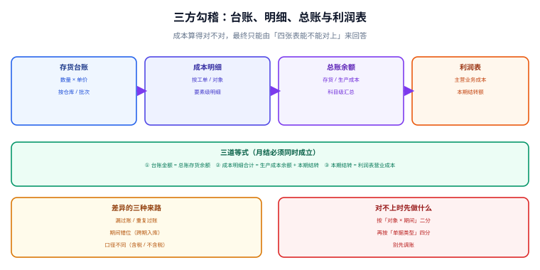

# 三方勾稽：台账、明细与总账

成本算得对不对，最终只能由「**几张表能不能对上**」来回答。存货台账、成本明细、总账余额、利润表，这四处的数字来自四条不同的写入路径，任何一条路径上的漏、重、错期，都会表现为一个「不大不小、说不清来路」的差额。勾稽的全部价值，就是把这类差额**变成一个有定位的坐标**，而不是一个需要「调平」的数字。

::: tip 一句话理解
**勾稽不是「对一下总额」，而是「按对象和期间二分，直到差额落到一张单据上」**。对不上的时候先别调账——差额本身就是线索。
:::

本页判据族 `CAR-A` ~ `CAR-H`，共 8 条，定义在最后一节。



## 一、三道等式

| # | 等式 | 断了说明什么 | 常见来路 |
| --- | --- | --- | --- |
| ① | 存货台账金额 = 总账存货科目余额 | 台账与总账不同源 | 计价方法不一致、漏过账、重复过账 |
| ② | 成本明细合计 = 生产成本余额 + 本期结转 | 明细没结清 | 差异未分摊、在制未结转、分摊只做了一半 |
| ③ | 本期结转 = 利润表营业成本 | 结转与报表错位 | 结转按开票日、报表按发货日 |

三道等式之间是**互相约束**的：① 平了、③ 平了，② 却可能仍然不平（因为 ② 涉及生产成本这个中间科目）。所以三条必须分别校验，不能用一条「总资产 = 总负债 + 权益」代替。

## 二、47.22 元：一个可以完全解释的差额

本机演算里，台账按先进先出结存、总账按月末一次加权过账：

```text
台账期末（先进先出）   = 1,225.00
总账存货余额（一次加权） = 1,177.78
差额                    =    47.22
```

这个差**不是错账**，而是两种计价方法的合法差。验证方式很简单：把差额与「两种方法的出库成本之差」比一下——

```text
一次加权出库 4,122.22 − 先进先出出库 4,075.00 = 47.22
```

两者恰好相等且方向相反，说明差异 100% 来自计价方法。**能这样解释的差额不用调**，需要的是把口径统一（或把差异记入专门的「计价方法差异」科目）。反过来，如果差额与任何一种方法的差都对不上，那才是真问题。

::: danger 三个「先调平再说」的后果
1. **差异进了「其他应收 / 其他应付」**：科目越挂越大，第二年审计时没人能说清这几十万是什么。
2. **直接改台账**：总账平了，但台账与实物脱节，下一次盘点会以更大的差异出现。
3. **把差额摊到某个产品上**：这个产品的单位成本被污染，且**没有任何记录说明它被污染过**，毛利分析从此不可信。
:::

## 三、二分定位：从「差 47 元」到「哪张单」

差额定位靠二分，不靠猜：

| 层 | 二分维度 | 判据 | 典型结果 |
| --- | --- | --- | --- |
| 第一层 | 按**期间**分 | 差额集中在某一个月吗 | 集中在 10 月 → 期间问题 |
| 第二层 | 按**对象 / SKU** 分 | 差额集中在某几个物料吗 | 集中在 3 个 SKU → 计价或单据问题 |
| 第三层 | 按**单据类型**分 | 入库、出库、调整哪一类 | 集中在「入库」→ 暂估 / 跨期 |
| 第四层 | 逐单比对 | 单号能否一一对应 | 找到具体那张单 |

写成 SQL 就是四次分组查询，每次只缩小范围，不做任何修改：

```sql
-- 第一层：按期间看差额分布
SELECT period, ROUND(SUM(ledger_amt) - SUM(gl_amt), 2) AS diff
  FROM v_recon_by_period GROUP BY period ORDER BY ABS(diff) DESC;

-- 第二层：锁定期间后按 SKU 看
SELECT sku, ROUND(SUM(ledger_amt) - SUM(gl_amt), 2) AS diff
  FROM v_recon_by_sku WHERE period = '2026-10'
 GROUP BY sku HAVING ABS(diff) > 0.001 ORDER BY ABS(diff) DESC;

-- 第三层：按单据类型看
SELECT doc_type, ROUND(SUM(ledger_amt) - SUM(gl_amt), 2) AS diff
  FROM v_recon_by_doc WHERE period = '2026-10'
 GROUP BY doc_type HAVING ABS(diff) > 0.001;
```

::: tip 为什么必须是「只读查询」
定位阶段的任何一次写操作都会改变现场。**先跑完四次查询、把结论写下来，再决定改什么**——顺序反了，第二次查询的结果就不可比了。
:::

## 四、含税与不含税：最隐蔽的口径差

很多「差一点点」的勾稽问题来自含税口径：

| 环节 | 常拿到的数 | 该用的数 | 差多少 |
| --- | --- | --- | --- |
| 采购入库 | 发票含税额 | 不含税 + 可抵扣进项 | 13% |
| 运费分摊 | 含税运费 | 不含税运费 | 9% |
| 受托加工 | 含税加工费 | 不含税 | 13% |

如果一个物料按含税入账、另一个按不含税，总额差会呈现「既不是整比例、也不集中在某个月」的形态——这正是最难查的一类。判据很直接：**入库金额必须由「不含税单价 × 数量 + 分摊运费（不含税）」构成，税额单独一列**。

## 五、期间错位：跨期入库与跨期出库

| 场景 | 错误做法 | 后果 | 正确做法 |
| --- | --- | --- | --- |
| 上月到货、本月开票 | 本月入账 | 上月出库成本偏低，且上月报表已出 | 上月暂估入库，本月冲暂估 + 实际入账 |
| 本月发货、下月开票 | 按开票日结转成本 | 收入与成本不配比（收入本月、成本下月） | 按发货过账日结转 |
| 月末最后一天过账 | 手工改过账日到次月 | 账期被人为操纵 | 过账日由系统生成，接口不接收该参数 |

三种情况的共同点是**单据日期本身没错，错的是「用哪个日期决定归属」**。所以系统里必须只有一个「期间归属依据」，且这个字段不可被前端写入。

## 六、判据族

| 编号 | 判据 | 怎么验 |
| --- | --- | --- |
| `CAR-A` | 三道等式各自有独立校验查询，结果均为 0 | 逐条跑，全部为 0 |
| `CAR-B` | 差额可被「计价方法差 / 税差 / 期间差」解释 | 差额与三种已知差之一相等 |
| `CAR-C` | 勾稽视图按期间、SKU、单据类型三个维度可分组 | 三个视图都能查 |
| `CAR-D` | 定位阶段零写操作（查询只读） | 复查操作日志无 UPDATE/DELETE |
| `CAR-E` | 入库金额为不含税，税额单独列 | 表结构含 `tax_amount`，`amount` 不含税 |
| `CAR-F` | 期间归属由过账日唯一决定 | 接口拒绝手工传日期 |
| `CAR-G` | 勾稽不平禁止关账（不是告警） | 构造差异后关账 `rowcount=0` |
| `CAR-H` | 每笔差异有处置结论与留痕 | 差异台账含 `resolution` 与处理人 |

## 验证方式

```shell
# 1) 三道等式：三条都应输出 0 或 0.0
sqlite3 /tmp/cost.db "SELECT ROUND((SELECT SUM(amount) FROM stock_ledger WHERE kind='end')
  - (SELECT amount FROM gl_balance WHERE account='1401'), 2);"
# 期望：0.0

sqlite3 /tmp/cost.db "SELECT ROUND((SELECT SUM(amount) FROM cost_detail WHERE period='2026-10')
  - (SELECT COALESCE(SUM(amount),0) FROM cost_wip_balance WHERE period='2026-10')
  - (SELECT COALESCE(SUM(amount),0) FROM cost_cogs WHERE period='2026-10'), 2);"
# 期望：0.0

sqlite3 /tmp/cost.db "SELECT ROUND((SELECT SUM(amount) FROM cost_cogs WHERE period='2026-10')
  - (SELECT amount FROM pl_line WHERE period='2026-10' AND item='cogs'), 2);"
# 期望：0.0

# 2) 差额可解释：47.22 应等于两种计价方法之差
sqlite3 /tmp/cost.db "SELECT ROUND((SELECT SUM(amount) FROM cost_by_method WHERE method='fifo' AND kind='out')
  - (SELECT SUM(amount) FROM cost_by_method WHERE method='month_avg' AND kind='out'), 2);"
# 期望：-47.22（与台账减总账的 47.22 绝对值相等）

# 3) 定位视图可用：应能分组输出
sqlite3 /tmp/cost.db "SELECT count(*) FROM v_recon_by_sku WHERE period='2026-10';"
# 期望：> 0
```

## 参考资料

- [总览：七段成本链与三条守恒式](../Overview/index.md)：三道等式的原始表述
- [月末结账的顺序与幂等](../MonthEndClose/index.md)：把勾稽做成门禁
- [复式记账与分录](../../Ledger/DoubleEntry/index.md)：总账侧的口径
- 财政部：企业会计准则第 1 号——存货：<https://www.mof.gov.cn/>
