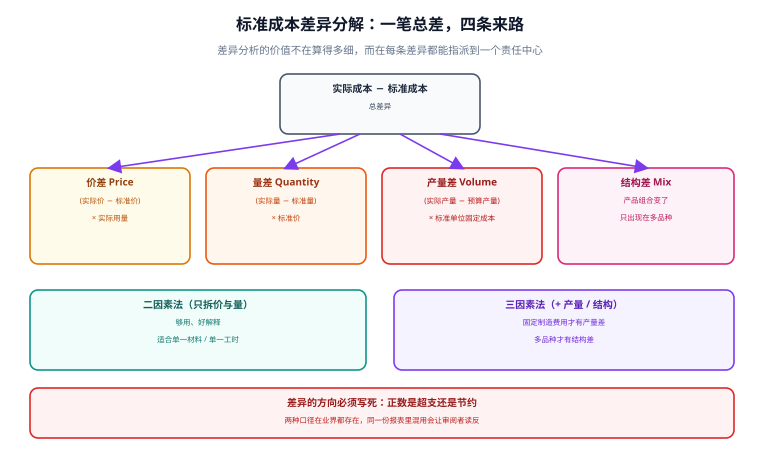

# 标准成本与差异分析

标准成本法的价值不在「算得快」，而在**把「价格波动」和「用量浪费」这两件事拆开**。同样是本月材料超支 1,950 元，价差 950 元是采购部的事，量差 1,000 元是车间的事——如果不拆，两者混在一个「材料超支」里，考核就变成了扯皮。而拆开的前提是一个很容易被忽略的约定：**差异的正负号代表什么**。

::: tip 一句话理解
**标准成本 = 一个承诺 + 一笔差异**。承诺是「按这个价、这个量应该花多少」，差异是「实际与承诺的偏离」，而差异必须能**分解且相加等于总差**，否则它只是一个更好听的「不知道」。
:::

本页判据族 `CAS-A` ~ `CAS-H`，共 8 条，定义在最后一节。



## 一、标准怎么定：三个输入与一个有效期

| 输入 | 典型来源 | 更新频率 | 定错的后果 |
| --- | --- | --- | --- |
| 标准单价 | 采购协议价 / 市场价 / 预算价 | 年度或季度 | 价差常年单向偏大，失去考核意义 |
| 标准用量（BOM） | 工艺文件 / 试产实测 | 工艺变更时 | 量差被结构性放大，车间「永远超标」 |
| 标准产能 | 设计产能 / 历史最好水平 | 年度 | 产量差失真，固定费用分摊率错了 |

三条纪律：

1. **标准必须有生效日**，历史期间用当时的标准重算，不能用最新标准倒推——否则上个月的报表会因为本月改标准而变化。
2. **标准变更要留影响数**：新标准上线时，把「按旧标准算」与「按新标准算」的差额单独记一笔，否则差异分析里会混进「标准变更」这个非业务因素。
3. **标准不是目标**：标准成本是「应该花多少」的度量尺，不是「必须花到」的 KPI。把标准当 KPI 会诱导改 BOM 而不是改工艺。

## 二、差异分解：二因素与三因素

以本机演算的数据为例：

```text
标准：单价 10.00 元/kg，用量 2 kg/件，预算产量 1,000 件
实际：单价 10.50 元/kg，用量 1,900 kg，实际产量   900 件

材料总差异 = 1,900 × 10.50 − 900 × 2 × 10.00 = 19,950 − 18,000 = 1,950.00（超支）
价差 = (10.50 − 10.00) × 1,900        =   950.00
量差 = (1,900 − 900 × 2) × 10.00      = 1,000.00
校验 = 950.00 + 1,000.00              = 1,950.00 ✓
```

固定制造费用则要用三因素（或二因素）拆：

```text
预算固定制造费用 50,000.00，标准分配率 50.00 元/件，预算产量 1,000 件
实际固定制造费用 48,000.00，实际产量 900 件

耗费差 = 48,000 − 50,000                = −2,000.00（少花）
产量差 = (900 − 1,000) × 50.00          = −5,000.00（少产，固定费用没被吸收完）
合计   = −7,000.00
```

| 差异 | 公式 | 谁负责 | 常见误判 |
| --- | --- | --- | --- |
| 价差 | （实际价 − 标准价）× 实际量 | 采购 | 把「急单加价」算成采购无能 |
| 量差 | （实际量 − 标准量）× 标准价 | 生产 | 把「标准过时」算成车间浪费 |
| 耗费差 | 实际固定费用 − 预算固定费用 | 费用归属部门 | 把「产量低导致的吸收不足」算成超支 |
| 产量差 | （实际产量 − 预算产量）× 单位标准固定成本 | 计划 / 销售 | 完全没人认领（最常见） |

::: warning 产量差是最容易被丢掉的一条
它既不是采购的、也不是车间的，而是「没生产那么多」造成的固定费用吸收不足。很多系统只算价差与量差，导致**固定费用差异凭空少一块**，最后靠「其他」科目兜住。判据很简单：四条差异相加必须等于总差异，不等就说明漏了一条。
:::

## 三、方向约定：正数是超支还是节约

这是标准成本实施里最容易埋雷的一处。两种约定在业界都存在：

| 约定 | 价差 = (实际 − 标准) × 实际量 | 优点 | 缺点 |
| --- | --- | --- | --- |
| 正数为超支 | 10.50 − 10.00 > 0 → 正 | 与「差异 = 实际 − 标准」直觉一致 | 与「借正贷负」的记账习惯相反 |
| 正数为节约（贷方） | 同上算出来是正，但记账为借方 | 与分录方向一致 | 阅读报表时要反着理解 |

**选一种并在全库统一**，写进制度、写进字段注释、写进报表表头。同一份报表里混用两种约定，审阅者会把「节约 950」读成「超支 950」，而且**没有任何校验能发现**——因为两个数都合法。

## 四、差异怎么处理：分摊还是直接进损益

标准成本下，期末必须处理差异，否则存货与损益同时失真：

| 处理方式 | 做法 | 适用 | 后果 |
| --- | --- | --- | --- |
| 全部进当期损益 | 差异科目余额一次结转到营业成本 | 差异小、或标准接近实际 | 简单，但存货按标准价计，与实物流偏离 |
| 按存销比例分摊 | 差异按「期末结存 : 本期出库」分摊 | 差异较大且存货较多 | 存货与损益都更接近实际 |
| 逐项重算实际成本 | 放弃标准成本 | 差异巨大 | 等于没用标准成本法 |

本专题演算里，标准价 11.00 元、总差异 350.00 元，按出库 350 件 / 总 450 件分摊，出库承担 272.22 元、期末结存承担 77.78 元。分摊后出库成本 4,122.22 元，与月末一次加权完全一致——**这不是巧合**：当只有一个成本池、且差异按数量比例分摊时，标准成本 + 差异分摊在数学上等价于加权平均。

## 五、落库

```sql
-- 标准：按「物料 + 工厂 + 生效期」定版
CREATE TABLE cost_standard (
  id            INTEGER PRIMARY KEY,
  sku           TEXT NOT NULL,
  plant         TEXT NOT NULL,
  std_price     NUMERIC NOT NULL,
  std_qty       NUMERIC NOT NULL,      -- 单位标准用量
  effective_from TEXT NOT NULL,
  effective_to   TEXT,
  UNIQUE (sku, plant, effective_from)
);

-- 差异：一条总差必须能拆成四条，且带责任中心
CREATE TABLE cost_variance (
  id           INTEGER PRIMARY KEY,
  period       TEXT NOT NULL,
  sku          TEXT NOT NULL,
  kind         TEXT NOT NULL CHECK (kind IN ('price','qty','spend','volume')),
  amount       NUMERIC NOT NULL,
  resp_center  TEXT NOT NULL,          -- 责任中心，不许为空
  UNIQUE (period, sku, kind)
);
```

`resp_center` 不许为空是刻意的：**没有责任中心的差异等于没有差异**，它只会变成月底的一句「差异较大，已在跟进」。

::: danger 三个让差异分析失效的写法
1. **差异只记总额不分项**：报表上只有一个「材料差异 1,950」，没人能拆，考核时只能平均分摊给所有部门——等于没考核。
2. **差异科目只挂不分摊**：余额越滚越大，第二年就没人记得它是怎么来的。差异必须每期结清（分摊或转损益），期末余额应为 0。
3. **标准价长期不更新**：标准价停在两年前，价差常年单向偏大，最后所有人都学会「忽略价差」，这套体系就废了。
:::

## 六、判据族

| 编号 | 判据 | 怎么验 |
| --- | --- | --- |
| `CAS-A` | 四条差异相加 = 总差异（容差 0.01） | 分组求和比对 |
| `CAS-B` | 每条差异有非空责任中心 | `SELECT count(*) ... WHERE resp_center IS NULL` 为 0 |
| `CAS-C` | 正负号约定在全库唯一 | 抽查报表与分录方向一致 |
| `CAS-D` | 标准有生效区间，历史期间用当时标准 | 取两期标准，值不同且各区间的量按各自标准算 |
| `CAS-E` | 差异期末余额为 0（已分摊或已转损益） | 期末差异科目余额查询为 0 |
| `CAS-F` | 标准变更留影响数 | 变更表含 `impact_amount` |
| `CAS-G` | 产量差必须存在（有固定费用时） | 差异种类集合包含 `volume` |
| `CAS-H` | 差异分摊按存销比例，且分摊后合计守恒 | 分摊前后总额差 0.00 |

## 验证方式

```shell
# 1) 分解可加：应输出 0 行（不相加等于总差的行）
sqlite3 /tmp/cost.db "
WITH v AS (SELECT period, sku, SUM(amount) s FROM cost_variance GROUP BY period, sku)
SELECT v.*, t.total FROM v JOIN cost_variance_total t USING (period, sku)
WHERE ABS(v.s - t.total) > 0.01;"
# 期望：无输出

# 2) 责任中心齐全：应输出 0
sqlite3 /tmp/cost.db "SELECT count(*) FROM cost_variance WHERE resp_center IS NULL OR resp_center='';"
# 期望：0

# 3) 期末差异清零：应输出 0.0
sqlite3 /tmp/cost.db "SELECT ROUND(SUM(amount),2) FROM cost_variance_balance WHERE period='2026-10';"
# 期望：0.0

# 4) 四条差异的具体读数（对账用）
sqlite3 /tmp/cost.db "SELECT kind, ROUND(amount,2) FROM cost_variance WHERE period='2026-10' ORDER BY kind;"
# 期望：price|950.0  qty|1000.0  spend|-2000.0  volume|-5000.0
```

## 参考资料

- [存货计价与出库成本](../InventoryCosting/index.md)：标准成本与加权平均在单池下的等价性
- [辅助生产与分摊](../Allocation/index.md)：固定制造费用的分配率来源
- 财政部：企业产品成本核算制度（试行）（财会〔2013〕17 号）：<https://www.mof.gov.cn/>
