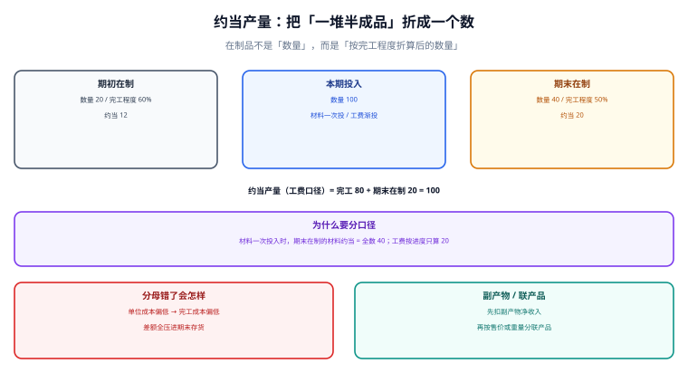

# 在制品、约当产量与联产品

「这个月投产 120 件，完工 80 件，剩下的 40 件做到一半」——这句话里没有任何一个数字能直接用来算单位成本。因为**半成品不能按件算**：一件做到 50% 的产品，消耗的材料可能是 100%、人工只有 50%。把它折算成一个可加总的当量，就是约当产量（equivalent units）的全部意义。

::: tip 一句话理解
**约当产量 = 完工数量 + Σ（在制数量 × 完工程度）**。它是成本分配的分母，分母错一位，完工成本与在制余额就同时错，而且**两者之和永远是对的**——这就是它最难被发现的原因。
:::

本页判据族 `CAW-A` ~ `CAW-H`，共 8 条，定义在最后一节。



## 一、分母错一位，差 26,666.67

本机演算：本月投入成本 200,000.00 元，完工 80 件，期末在制 40 件（完工程度 50%）。

```text
正确口径（加权平均法）：
约当产量 = 80 + 40 × 50% = 100
单位成本 = 200,000 / 100 = 2,000.00
完工成本 = 80 × 2,000.00 = 160,000.00
在制余额 = 200,000 − 160,000.00 =  40,000.00
```

如果把分母错用成「本期投入量 120」：

```text
单位成本 = 200,000 / 120 = 1,666.67
完工成本 = 80 × 1,666.67 = 133,333.33
在制余额 = 200,000 − 133,333.33 = 66,666.67
差额 = 133,333.33 − 160,000.00 = −26,666.67
```

**完工成本少计 26,666.67，在制多留 26,666.67，两者之和仍然是 200,000.00**。这意味着：

- 存货总额对得上（总账不会被打破）；
- 生产成本科目余额对得上（借贷平衡）；
- 只有**完工产品的单位成本**错了，而它会随着销售逐月进入损益。

::: danger 三个让「分母」失真的写法
1. **用投产数量当分母**：等价于假设「所有在制都 100% 完工」，在制品越多、错得越多。
2. **材料与工费共用一个完工程度**：材料常常是一次投入（在制的材料约当 = 全数），工费是渐进的；共用一个比例会让材料成本被系统性低估。
3. **完工程度由车间口头报**：没有工序报工数据支撑的「大概 50%」，实际可能是 30% 或 70%，误差直接进成本。
:::

## 二、两个口径：加权平均法与先进先出法

同一个车间，两种算法给出不同的单位成本：

| 口径 | 分母怎么算 | 本期成本 200,000 的单位成本 | 适用 |
| --- | --- | --- | --- |
| 加权平均法 | 完工 + 期末在制约当（不区分期初） | 200,000 / 100 = 2,000.00 | 期初在制金额小、工序短 |
| 先进先出法 | 期初在制**本期追加**约当 + 本期投产完工 + 期末在制约当 | 200,000 / 88 = 2,272.73 | 期初在制金额大、要分清「谁的成本」 |

先进先出法的 88 是这样来的（期初在制 20 件、已完工程度 60%）：

```text
期初在制本期追加 = 20 × (1 − 60%) =   8
本期投产并完工   = 80 − 20        =  60
期末在制约当     = 40 × 50%       =  20
合计             = 88
```

**两种口径的差别不在「谁更准」，而在「期初在制的成本算谁的」**：加权平均把它和本期成本混在一起，先进先出把它单独留在期初、只算本期追加部分。选哪种要在制度里写死，且**同一期间不能混用**——混用会让单位成本在两个月之间来回跳。

## 三、材料与工费必须分列

| 成本要素 | 投入方式 | 期末在制的约当 | 例 |
| --- | --- | --- | --- |
| 直接材料 | 开工时一次投入 | 等于在制**全部数量**（40） | 注塑件的原料 |
| 直接材料 | 按工序分批投入 | 按已投工序比例 | 装配件的分组件 |
| 直接人工 | 随工序渐进 | 按完工程度（40 × 50% = 20） | 装配工时 |
| 制造费用 | 通常随人工 | 与人工同口径 | 设备折旧、动力 |

所以一页成本表至少要给出**两组约当产量**（材料一组、工费一组），单位成本也至少两个。只给一个「综合单位成本」的报表，无法回答「材料涨了还是工费涨了」。

## 四、副产物、联产品与损耗

这三类东西会从成本池里「拿走」或「分走」一部分金额，处理规则完全不同：

| 类型 | 定义 | 处理 | 常见错误 |
| --- | --- | --- | --- |
| 副产物 | 主产品之外顺带产出的低价值物 | **先扣减**：按可变现净值冲减主产品成本 | 当联产品分摊，导致主产品成本虚高 |
| 联产品 | 同一工艺产出的多个主要产品 | 按**售价法**或**实物量法**分摊联合成本 | 按重量分摊高价值产品吃大亏 |
| 废品 / 损耗 | 不合格品与工艺损耗 | 正常损耗进成本，非正常损耗进营业外 | 全部进成本，掩盖质量问题 |

副产物的正确处理顺序是**先扣后分**：

```text
联合成本 500,000.00
副产物 A：产出 2 吨，可变现净值 8,000.00（售价 − 进一步加工费 − 销售费）
主产品可分配成本 = 500,000.00 − 8,000.00 = 492,000.00
再按售价法在主产品之间分摊
```

如果顺序反了（先分再扣），副产物会分到一份联合成本，同时主产品也多摊了一份——**总成本不变，但每个产品的单位成本都错了**。

## 五、落库

```sql
-- 产量报告：一个对象一个期间一条，材料与工费分别记完工程度
CREATE TABLE wip_report (
  id            INTEGER PRIMARY KEY,
  period        TEXT NOT NULL,
  object_no     TEXT NOT NULL,
  qty_begin     NUMERIC NOT NULL DEFAULT 0,
  qty_start     NUMERIC NOT NULL DEFAULT 0,   -- 本期投产
  qty_finish    NUMERIC NOT NULL DEFAULT 0,   -- 本期完工
  qty_end       NUMERIC NOT NULL DEFAULT 0,   -- 期末在制（数量）
  mat_progress  NUMERIC NOT NULL CHECK (mat_progress BETWEEN 0 AND 1),
  lab_progress  NUMERIC NOT NULL CHECK (lab_progress BETWEEN 0 AND 1),
  UNIQUE (period, object_no),
  CHECK (qty_begin + qty_start - qty_finish = qty_end)   -- 数量守恒写进约束
);

-- 约当产量是算出来的，不落库（避免与产量报告不一致）
CREATE VIEW v_wip_eu AS
SELECT period, object_no,
       qty_finish + qty_end * mat_progress AS eu_material,
       qty_finish + qty_end * lab_progress AS eu_labor
FROM wip_report;
```

把数量守恒写成 `CHECK` 是有意的：**产量报告是唯一一处能同时看到「期初 + 投产 − 完工 = 期末」的地方**，在这里拦住比在月结时发现要好得多。

## 六、判据族

| 编号 | 判据 | 怎么验 |
| --- | --- | --- |
| `CAW-A` | 数量守恒：期初 + 投产 − 完工 = 期末 | `CHECK` 约束，或查询违规行数为 0 |
| `CAW-B` | 材料与工费分别有完工程度，且取值在 0~1 | 列约束 + 全表扫描 |
| `CAW-C` | 约当产量由视图计算，不落库 | 表结构中无 `eu_*` 列 |
| `CAW-D` | 完工成本 + 在制余额 = 本期投入，差 0.00 | 求和比对 |
| `CAW-E` | 同一期间只用一种口径（加权或先进先出） | 配置表按期间记录口径 |
| `CAW-F` | 副产物先扣后分，扣减额可追到可变现净值表 | 抽查一条，链路完整 |
| `CAW-G` | 联产品分摊方法写明（售价法 / 实物量法） | 配置项 + 分摊表带 `method` |
| `CAW-H` | 非正常损耗单独列示，不进产品成本 | 损耗表有 `is_normal` 列并可在报表中分开 |

## 验证方式

```shell
# 1) 数量守恒：应输出 0 行
sqlite3 /tmp/cost.db "SELECT * FROM wip_report WHERE qty_begin + qty_start - qty_finish <> qty_end;"
# 期望：无输出

# 2) 约当产量与单位成本：eu 应为 100 / 单位成本 2000.00
sqlite3 /tmp/cost.db "SELECT object_no, eu_material, eu_labor FROM v_wip_eu WHERE period='2026-10';"
sqlite3 /tmp/cost.db "SELECT ROUND(200000.0 / eu_labor, 2) FROM v_wip_eu WHERE period='2026-10';"
# 期望：100.0 / 2000.0

# 3) 完工 + 在制 = 投入：应输出 0.0
sqlite3 /tmp/cost.db "SELECT ROUND(SUM(CASE WHEN kind='finish' THEN amount ELSE -amount END),2)
  FROM wip_split WHERE period='2026-10';"
# 期望：0.0

# 4) 完工程度越界必须被拒：应报 CHECK constraint failed
sqlite3 /tmp/cost.db "UPDATE wip_report SET lab_progress = 1.2 WHERE period='2026-10';"
# 期望：Error: CHECK constraint failed
```

## 参考资料

- [存货计价与出库成本](../InventoryCosting/index.md)：进入生产的材料成本从哪里来
- [辅助生产与分摊](../Allocation/index.md)：进入对象的制造费用怎么摊
- [成本对象与归集维度](../CostObject/index.md)：产量报告的挂账对象
- 财政部：企业产品成本核算制度（试行）（财会〔2013〕17 号）：<https://www.mof.gov.cn/>
