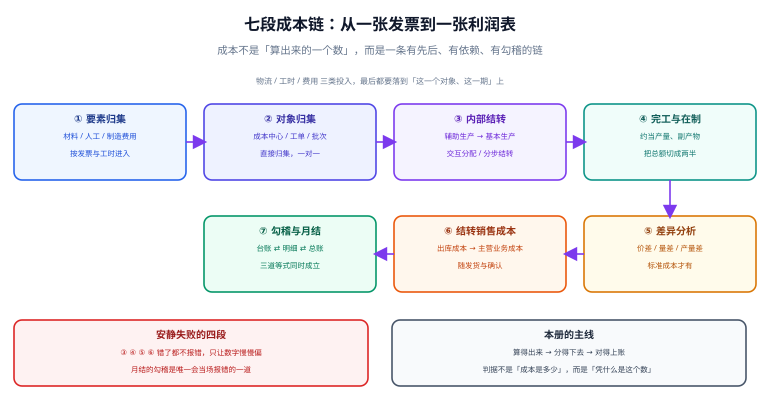

# 成本核算与月末结账

<p style="text-align:center;"></p>

成本核算最容易出的错，不是「算错了」，而是**算对了却不是同一个口径**。同一批物料、同一个月份，先进先出算出出库成本 4,075.00 元、月末一次加权算出 4,122.22 元，两个数都「对」——它们只是回答了不同的问题。真正让人头疼的是：**这两套数可以同时在系统里成立，而且没有任何一步会报错**，直到月末勾稽时总账和台账差 47.22 元，谁也说不清是哪笔业务带进来的。

::: tip 一句话理解
**成本核算不是「算出成本是多少」，而是「证明这个数凭什么是它」**——成本对象、期间、计价方法、分摊动因四件事同时钉死，数字才有意义；否则它只是一个看起来很专业的随机数。
:::

## 这个专题讲什么

一件产品从「买了料」到「卖了货」，成本要在七个环节里被搬运七次。本专题按这七段组织，每一段都标出它的产物与失败方式：

| 段 | 这一段在做什么 | 产物 | 失败是否安静 |
| --- | --- | --- | --- |
| ① 要素归集 | 材料、人工、制造费用入池 | 要素发生额 | **显性**（借贷不平立刻炸） |
| ② 对象归集 | 按成本中心 / 工单 / 批次挂账 | 成本明细 | 安静（挂错了对象也能平衡） |
| ③ 内部结转 | 辅助生产 → 基本生产 | 结转单 | 安静（分母漏剔自耗） |
| ④ 完工与在制 | 约当产量、副产物、联产品 | 完工成本 + 在制余额 | **安静**（分母错一位差 26,666.67） |
| ⑤ 差异分析 | 标准成本下的价差 / 量差 | 差异明细 | 安静（差异科目越滚越大） |
| ⑥ 结转销售成本 | 出库成本 → 主营业务成本 | 结转凭证 | 安静（期间错位就串月） |
| ⑦ 勾稽与月结 | 台账 ⇄ 明细 ⇄ 总账 | 勾稽报告 | **最后一道** |



七段里有**五段的失败是安静的**。安静的失败有一个共同特征：**它不违反任何规则，只让数字慢慢偏**——单位成本低了 1 块、在制余额多了 2 万、差异科目挂着 35 万说不清来路，但每一笔分录都借贷平衡、每一个报表都能打开。

## 与其它专题的分工

库里已经有一批在写「钱」和「物」的册子，但问的问题都不一样。先看这张表再决定读哪一册：

| 你关心的问题 | 该读哪一册 | 为什么不是本册 |
| --- | --- | --- |
| 「这笔支出该记借还是贷」 | [复式记账与分录](../Ledger/DoubleEntry/index.md) | 那册讲**一笔业务怎么拆两腿**，本册讲**这两腿里的成本怎么归到对象上** |
| 「设备折旧怎么按月摊」 | [折旧方法与月度引擎](../FixedAsset/Depreciation/index.md) | 那册讲**资产价值的分期消耗**，本册只把折旧当成一个已算好的成本要素 |
| 「库存有几件、在哪个库位」 | [库存快照与批次](../WarehouseOps/StockSnapshot/index.md) | 那册盘**数量与位置**，本册要的是**数量乘单价之后的金额** |
| 「存货盘点差异怎么处理」 | [循环盘点与差异处理](../WarehouseOps/CycleCount/index.md) | 那册的差异是**数量差异**，本册的差异是**金额差异**（同数量不同单价） |
| 「采购三单匹配怎么容差」 | [三单匹配与容差](../ProcureToPay/InvoiceMatch/index.md) | 那册决定**这笔钱该不该付**，本册决定**付完之后进哪个成本对象** |
| 「外币采购按哪天汇率」 | [换算路径与取整分摊](../MultiCurrency/Conversion/index.md) | 那册讲**折算**，本册讲**折算完的金额怎么摊到产品上** |
| 「收入什么时候确认」 | [收入确认与五步法](../RevenueRecognition/Overview/index.md) | 那册定**收入**的时点，本册定**与收入配比的成本**的金额 |
| 「订阅制每月怎么算收入」 | [周期与闭账窗口](../SubscriptionBilling/Cycle/index.md) | 那册按**时间**分摊收入，本册按**产量**分摊成本，两者的分摊基数完全不同 |

::: info 为什么不并入「存货管理」
两册的判据没有一条可以复用：那册的核心是「**数量守恒**」（入库 − 出库 = 结存），本册的核心是「**金额守恒**」（期初 + 本期投入 = 出库 + 期末）。数量对了金额仍可能错——负库存回滚、暂估后补差、跨期入库，三种情况数量都平、金额都不平。合并只会让两条互不相干的等式混在一页里。
:::

## 本专题的章节

- [总览：七段成本链与三条守恒式](Overview/index.md)
- [成本对象与归集维度](CostObject/index.md)
- [存货计价与出库成本](InventoryCosting/index.md)
- [辅助生产与分摊](Allocation/index.md)
- [标准成本与差异分析](StandardCost/index.md)
- [月末结账的顺序与幂等](MonthEndClose/index.md)
- [在制品、约当产量与联产品](WipYield/index.md)
- [三方勾稽：台账、明细与总账](Reconciliation/index.md)
- [实战：一个月成本核算的全流程](Practice/index.md)
- [常见问题与分诊](FAQ/index.md)

## 版本与标准

成本核算这一块**没有「大版本」概念**，因此本专题不建版本目录（如 `Spring5/`、`Spring6/` 那种）。三条理由：

1. **换代的是准则与制度**（中国《企业会计准则第 1 号——存货》、财政部《企业产品成本核算制度（试行）》、国际 IAS 2），而判据未变：不管在哪套规则下，「期初 + 本期投入 = 本期出库 + 期末」一字不差。
2. **并存的差异是行业口径而不是代际**：制造业按工单、流程业按分步、项目型按项目归集，差异是同一页上的几个分支，不是两套内容线。
3. **真正需要版本目录的是「同一份代码两套写法」**，而本专题写的是账模型与数据契约。可参考按大版本组织的先例：[Spring5](../Java/Frame/Spring/Spring5/index.md)、[Vue2](../../Frontend/Frame/Vue/Vue2/index.md)。

涉及外部依据时，本专题引用的是**长期稳定的编号**，而非某一年的版本号：

| 依据 | 编号 | 本专题用它说明什么 |
| --- | --- | --- |
| 企业会计准则第 1 号 | CAS 1（存货） | 存货成本构成、发出计价方法的可选择性 |
| 企业产品成本核算制度（试行） | 财会〔2013〕17 号 | 成本项目三分类（直接材料 / 直接人工 / 制造费用）与归集分配的一般要求 |
| 国际会计准则第 2 号 | IAS 2（Inventories） | 禁止后进先出（LIFO）、可变现净值的下界 |
| 企业会计准则第 14 号 | CAS 14（收入） | 成本与收入的配比原则（结转销售成本的时点依据） |

::: warning 本册只写「算得对」，不写「报得出去」
存货跌价准备、税务口径的视同销售、政府补助的冲减，都属于「算完之后怎么报」的问题，散落在 [收入确认](../RevenueRecognition/Overview/index.md) 与 [资产减值](../FixedAsset/Movement/index.md) 两册。本册的边界是：**一个金额从发生到进入损益表，中间每一步的算法与守恒式**。
:::

## 判据纪律

| 页 | 判据族 | 这一族管什么 | 条数 |
| --- | --- | --- | --- |
| 总览 | `CAO-A` ~ `CAO-H` | 七段产物齐全、三条守恒式、失败可归因 | 8 |
| 成本对象与归集维度 | `CAC-A` ~ `CAC-H` | 五列唯一键、对象可达、期间与版本必带 | 8 |
| 存货计价与出库成本 | `CAV-A` ~ `CAV-H` | 四法各自守恒、负库存拦截、暂估可补差 | 8 |
| 辅助生产与分摊 | `CAL-A` ~ `CAL-H` | 分出去的等于收到的、基数为 0 必报错 | 8 |
| 标准成本与差异分析 | `CAS-A` ~ `CAS-H` | 差异可分解且相加等于总差、方向唯一 | 8 |
| 月末结账的顺序与幂等 | `CAM-A` ~ `CAM-H` | 依赖有序、重跑覆盖、反结账可追 | 8 |
| 在制品、约当产量与联产品 | `CAW-A` ~ `CAW-H` | 分母口径分列、副产物先扣、联产品守恒 | 8 |
| 三方勾稽：台账、明细与总账 | `CAR-A` ~ `CAR-H` | 三道等式同时成立、差异二分可定位 | 8 |
| 实战 | `CAX-A` ~ `CAX-H` | 建库一次成功、六个数对得上、负向用例必须失败 | 8 |
| 常见问题与分诊 | `CAQ-A` ~ `CAQ-H` | 分诊可落地、止血有序、禁止项明确 | 8 |

每条判据回答三件事：**看什么现象、判成什么、不满足时改哪里**。编号逐页唯一，可被 `utils/audit` 下的判据类巡检机械核对。

## 验证方式

```shell
# 1) 专题结构：应为 11（目录页 + 10 章），每个子目录都有 index.md
find docs/Backend/CostAccounting -name "index.md" | wc -l
# 期望：11

# 2) 每页判据族 8 条、目录页 80 条
for f in docs/Backend/CostAccounting/*/index.md; do
  echo "$(grep -oE '`CA[A-Z]-[A-H]`' "$f" | sort -u | wc -l | tr -d ' ') $f"; done
# 期望：10 行，每行前面都是 8
grep -oE '`CA[A-Z]-[A-H]`' docs/Backend/CostAccounting/index.md | sort -u | wc -l
# 期望：80

# 3) 配图齐全：应为 10 张 SVG + 1 张 Logo
ls docs/Backend/CostAccounting/assets/*.svg | wc -l && ls docs/Backend/CostAccounting/assets/*.png
# 期望：11 与 ca-logo.png
```

## 参考资料

- [总览：七段成本链与三条守恒式](Overview/index.md)
- [实战：一个月成本核算的全流程](Practice/index.md)
- 财政部：企业会计准则第 1 号——存货：<https://www.mof.gov.cn/>
- 财政部：企业产品成本核算制度（试行）（财会〔2013〕17 号）：<https://www.mof.gov.cn/>
- IAS 2 Inventories（IFRS 基金会）：<https://www.ifrs.org/issued-standards/list-of-standards/ias-2-inventories/>
