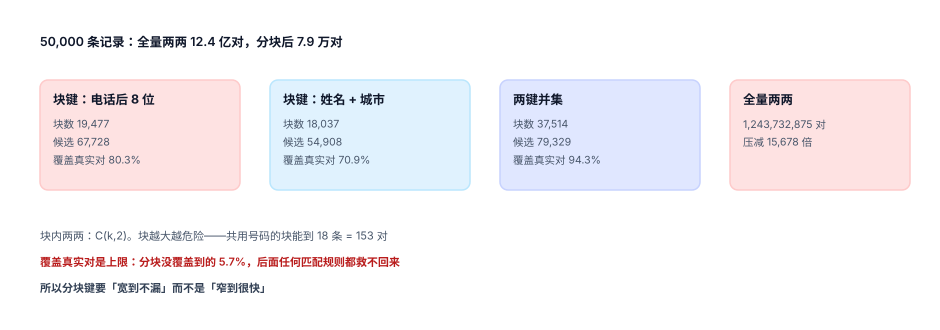

# 分块与候选对：把平方级压成线性级

归并的第一个真问题是算术：5 万条记录两两比较是 12.4 亿对，10 万条是 50 亿对，100 万条是 5000 亿对。就算每次比较只要 1 微秒，5 万条也要跑 20 分钟——而这只是「一次全量」，增量每天都在发生。

分块（blocking）就是用「廉价的键相等」先把不可能匹配的对扔掉。它永远有代价：**扔掉的里面必然有真的一对**。所以分块这一步的产出不是「候选对」，而是「召回上限」——后面所有规则再准，也救不回这里丢掉的人。

::: tip 一句话理解
分块的唯一指标是**覆盖率**（候选对里包含多少真实对），不是「快」。快是副产品，漏是永久损失。
:::

## 一、全量比较到底有多贵



| 记录数 | 全量两两对数 | 1 µs/对 的耗时 | 分块后（按本机比例） | 耗时 |
| --- | --- | --- | --- | --- |
| 5 万 | 1,243,732,875 | 约 20.7 分钟 | 79,329 | 约 0.08 秒 |
| 10 万 | 4,999,950,000 | 约 83 分钟 | 约 15.9 万 | 约 0.16 秒 |
| 100 万 | 499,999,500,000 | 约 5.8 天 | 约 159 万 | 约 1.6 秒 |

本机实测（49,875 条）：全量 **1,243,732,875** 对，双键分块后 **79,329** 对，压减 **15,678 倍**。这个倍数看着很爽，但它同时意味着**每 15,678 对里只有 1 对有机会被看见**——压减比越高，越要问一句「压掉的是什么」。

## 二、块键怎么选：四种键的实测

| 块键 | 块数 | 候选对 | 覆盖真实对 | 最大块 |
| --- | --- | --- | --- | --- |
| 手机后 8 位 | 19,477 | 67,728 | 80.3% | 18 |
| 姓名（归一化） | 17,174 | 79,498 | 87.7% | 19 |
| 姓名 + 城市 | 18,037 | 54,908 | 70.9% | 11 |
| 邮箱（小写） | 14,891 | 43,441 | 56.3% | 11 |
| 两键并集（手机 ∪ 姓名+城市） | 37,514 | 79,329 | **94.3%** | 18 |

三条读法：

1. **单键没有能过 90% 的**。手机后 8 位最直觉，但 68,000 对候选只覆盖 80.3%——漏掉的 19.7% 是「换了号」「没填号」「号输错了」的人。
2. **并集不是简单相加**。手机键 67,728 对 + 姓名城市键 54,908 对 = 122,636 对，去重后 79,329 对，**35.3% 是重复的**——同一个人同时命中两个键，是好事（互为佐证），也是去重的工作量。
3. **覆盖率有个天花板**。分块之后的 94.3% 就是这套键的上限。本机剩下的 5.7% 真实对（**4,358 对**）是「只有邮箱相同、姓名与手机都不同」以及「姓名带错字且换了号」的人——**任何只在这两个键里打分的规则都不可能找到他们**。

::: danger 三个分块坑

1. **用未归一化的字段做键**。`phone_key` 从 `+86 138-0000-1111` 直接取后 8 位会得到 `00-1111`（含横线），从 `13800001111` 取到 `00001111`，两个块。召回从 80.3% 掉到 38.5%。
2. **块内两两忘了去重**。两个键命中同一对人时，同一条边被算两次；并查集不报错，但 `candidate_pair` 的主键 `(a,b)` 会冲突，而重试逻辑通常把它当「已存在」跳过——统计出来的候选对数虚高 35.3%。
3. **块大小不设上限**。共用号码（前台、家庭、学校）能造出 18~20 条的块，`C(20,2)=190` 对；若某个「客服电话」被 3,000 条记录填过，一个块就是 450 万对——分块退化成全量，而且是在最热的那一块上。
:::

### 块大小必须监控

块大小是长尾分布：绝大多数块只有 1~2 条，少数块十几条，极端情况下几千条。

```sql
-- 块大小分布：一眼看出长尾
SELECT size, count(*) AS blocks
  FROM (SELECT phone_key, count(*) AS size
          FROM customer_record
         WHERE phone_key IS NOT NULL
         GROUP BY phone_key)
 GROUP BY size
 ORDER BY size DESC
 LIMIT 10;
```

本机读数：最大块 18 条、平均块 1.33 条（37,514 个块 / 49,875 条记录）。落到「每条约 3.2 个候选对」（79,329 × 2 ÷ 49,875 = 3.18）——这个数字是分块效率的直接度量：**它应该是个位数，不该是几十**。

超过阈值的块（比如 > 500 条）应当**降级为「不参与自动合并」**：这些块里几乎全是共用号码，自动合并必定错，正确做法是列进人工池或直接跳过。

## 三、三种实现，一种语义

| 实现 | 写法 | 适用 | 注意事项 |
| --- | --- | --- | --- |
| SQL 分组 | `GROUP BY phone_key HAVING count(*) > 1` | 数据在库里、量在百万级 | 需要对块键建索引 |
| 内存字典 | `defaultdict(list)` 后 `combinations` | 单机、全量重跑 | 峰值内存与最大块成正比 |
| 排序扫描 | 按块键排序，相邻比较 | 流式、超大数据 | 排序键要稳定，否则边界漏对 |

三者语义完全一样：**同一个块键下的任意两条都成候选对**。差别只在内存与 IO。本机用内存字典跑 49,875 条耗时 **171 ms**（含归一化与去重），可以接受；到 500 万条时要换成排序扫描。

```python
from collections import defaultdict
from itertools import combinations

def candidate_pairs(rows, key_fn):
    blocks = defaultdict(list)
    for rid, row in rows:
        k = key_fn(row)
        if k:                                  # 键为空不参与，别把「没填」并成一堆
            blocks[k].append(rid)
    pairs = set()
    for ids in blocks.values():
        if 2 <= len(ids) <= 500:               # 超长块直接跳过，交给人工池
            pairs.update(combinations(sorted(ids), 2))
    return pairs
```

两个细节值得单独说：`if k` 必须有，否则所有「手机号为空」的记录会被并成一个巨型块；`len(ids) <= 500` 必须有，否则一个客服电话就能让分块失效。

## 四、增量：新记录只和存量比

全量重跑是兜底，日常是增量。增量分块的语义是「新记录 × 它命中的块内既有成员」，不是「新记录 × 全库」：

```sql
-- 新增一条记录后，它产生的候选对
INSERT INTO candidate_pair(a_id, b_id, score, state)
SELECT min(NEW.id, r.id), max(NEW.id, r.id), 0, 'open'
  FROM customer_record r
 WHERE r.id <> NEW.id
   AND (r.phone_key = NEW.phone_key OR r.name_city_key = NEW.name_city_key)
   AND r.phone_key IS NOT NULL
   AND NOT EXISTS (SELECT 1 FROM candidate_pair c
                    WHERE c.a_id = min(NEW.id, r.id) AND c.b_id = max(NEW.id, r.id));
```

`min/max` 那两下不是多余的：它保证无向边只存一个方向，配合 `CHECK (a_id < b_id)` 让「同一条边存两次」在数据库层就不可能。

::: warning 增量会累积「过期候选」
合并之后，原本的候选对可能指向已被合并的记录。若不清理，`candidate_pair` 会越来越脏，打分时对着一堆 `status='merged'` 的记录算分。正确做法是合并时把涉及该簇的 open 候选对标记为 `merged`，并在每天的对账里核对「open 候选对的两端都是 active」。
:::

## 判据

本页判据族 `CIB-A` ~ `CIB-H`，共 8 条，逐条可判定：

| 编号 | 判据 | 怎么判 |
| --- | --- | --- |
| `CIB-A` | 存在块键列并建索引，分块不现场计算 | `EXPLAIN` 显示走 `phone_key` 索引 |
| `CIB-B` | 块键基于归一化字段，版本与归一化规则一致 | `norm_ver` 与 `phone_key` 同批重算 |
| `CIB-C` | 空键不参与分块 | 键为 `NULL`/`''` 的记录不进任何块 |
| `CIB-D` | 候选对无向边只存一个方向，且有 `CHECK (a_id < b_id)` | 插入反向边失败 |
| `CIB-E` | 覆盖率有基线并有回归：改动块键后覆盖率不下降 | 每次改键重跑覆盖率，记录在案 |
| `CIB-F` | 块大小有上限，超限块降级人工池 | 存在 > 500 条的块时，该块不产出自动合并 |
| `CIB-G` | 增量候选对与全量重跑的结果一致（同一时点） | 增量跑完再全量跑，差集为空 |
| `CIB-H` | 候选对数与「每记录候选数」有监控 | 每记录候选数落在个位数区间 |

## 验证方式

先量覆盖率与压减比，再验证「块大小长尾」这个论断能被自己的数据复现：

```shell
# 1) 全量 vs 分块：算术核对
python3 - <<'PY'
n = 49875
print("全量两两 =", n * (n - 1) // 2)        # 期望 1243732875
print("压减倍数 =", round(n * (n - 1) // 2 / 79329))   # 期望 15678
PY

# 2) 本页判据 8 条
grep -o 'CIB-[A-H]' docs/Backend/CustomerIdentity/Blocking/index.md | sort -u | wc -l

# 3) 块大小长尾：最大块与前 10 个块
python3 utils/audit/judgeidcheck.py --root . | tail -1
```

预期输出：第一条打印 `全量两两 = 1243732875` 与 `压减倍数 = 15678`；第二条 `8`；第三条 `E=0`。若压减倍数明显偏小（比如几百），说明块键选得太细（把该在一起的人切开了）。

## 参考资料

- [记录模型：三层结构与四类归一化](../RecordModel/index.md)
- [匹配规则与打分](../Matching/index.md)
- Papadakis 等《Blocking and Filtering Techniques for Entity Resolution: A Survey》（ACM Computing Surveys, 2020）：<https://dl.acm.org/doi/10.1145/3377455>
- PostgreSQL 官方文档《Partial Indexes》（块键索引与部分索引）：<https://www.postgresql.org/docs/current/indexes-partial.html>
