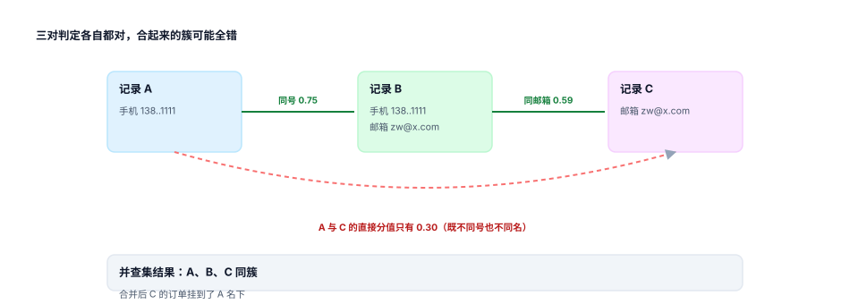

# 成簇与传递闭包：三对都对，簇可能全错

上一页的产出是「这一对是/不是同一个人」。业务要的却是「这些人是一伙的」。中间这一步叫闭包，它是最容易被跳过、也最容易出事的一步——因为**成对判定可以局部正确，成簇结果却会全局错误**。

::: tip 一句话理解
传递性不是事实，是假设。A 像 B、B 像 C，不代表 A 像 C；但并查集不管这件事，它会毫不犹豫地把三个人塞进一个簇。
:::

## 一、链式合并的最小反例



```text
记录 A：手机 138****1111                     姓名 张伟
记录 B：手机 138****1111   邮箱 zw@x.com      姓名 张伟
记录 C：手机 138****1111   邮箱 zw@x.com      姓名 李娜

（把阈值调到 0.55，模拟一次「为了提召回」的调参）
判定：score(A,B) = 0.45（手机）+ 0.30（姓名）= 0.75  → 同一个人
判定：score(B,C) = 0.45（手机）+ 0.14（邮箱）= 0.59  → 同一个人
判定：score(A,C) = 0.45（手机）              = 0.45  → 不同一个人

并查集结果：A、B、C 同一个簇。
```

三对判定各有各的道理，合起来却把「张伟」和「李娜」并成了一个人。原因只有一个：**B 同时握有两段证据，成了桥**。桥在真实数据里极其常见——一个家庭共用手机号，其中一人又用同一邮箱注册了第二个账号，于是「张伟」和「李娜」被一条 0.59 的边连起来，而他们之间的直接证据只有 0.45。

本机在低阈值下把这件事量化了：阈值 **0.45** 时，17,580 个簇里最大簇 **68 条**，落入不纯簇的记录 **3,079 条（6.2%）**。而在 0.70 时，不纯簇降为 0。

## 二、并把查集写对：三行代码，两个坑

```python
def cluster(pairs, n):
    parent = list(range(n))

    def find(x):
        while parent[x] != x:
            parent[x] = parent[parent[x]]      # 路径压缩：一行，省掉 O(n) 的链
            x = parent[x]
        return x

    for a, b in pairs:
        ra, rb = find(a), find(b)
        if ra != rb:
            parent[ra] = rb                    # 只连根，不连节点
    groups = {}
    for i in range(n):
        groups.setdefault(find(i), []).append(i)
    return list(groups.values())
```

两个坑：**只连根**（`parent[ra] = rb` 而不是 `parent[a] = b`），否则同一个簇会长出多条指向不同父节点的边，成环；**必须路径压缩**，否则链一长，`find` 退化成 O(n)，10 万条记录能跑成分钟级。

::: danger 闭包最贵的一种错：把「同一个人」做成「同一家人」
一个家庭共用手机号、共用一个邮箱、地址相同。这四条记录两两之间全部命中，并查集把它们并成一簇——**从数据上看完全正确**，从业务上看是四个不同的人（不同身份证、不同年龄、不同偏好）。

这类簇的特征是「簇内两两都像」，所以任何基于「簇内最低分」的检查都发现不了它。唯一的信号是**证件号不同**：一个簇里出现 ≥ 2 个不同的证件号，几乎一定是家庭/公司/中介，不是一个人。
:::

## 三、四种簇的形态与读数

| 规则 | 簇数 | 多记录簇 | 最大簇 | 不纯簇 | 落入不纯簇的记录 |
| --- | --- | --- | --- | --- | --- |
| R1 手机号 | 19,510 | 12,445 | 18 | 150 | 1,405（2.8%） |
| R2 只按姓名 | 17,174 | 12,274 | 19 | 1,318 | 7,318（14.7%） |
| R5 号后 4 位 + 姓名 | 20,148 | 12,420 | 8 | 7 | 14（0.0%） |
| R6 打分 ≥ 0.45 | 17,580 | 12,139 | **68** | 141 | 3,079（6.2%） |
| R6 打分 ≥ 0.60 | 20,732 | 12,328 | 8 | 7 | 14（0.0%） |
| R6 打分 ≥ 0.70 | 20,990 | 12,240 | 8 | 0 | 0（0.0%） |

两条读法：

1. **最大簇是最灵敏的报警器**。R1 的最大簇 18 = 一个共用号码；R6@0.45 的最大簇 68 = 桥接 + 低阈值叠加。日常监控只要盯「最大簇大小」，超过 20 就该人工看。
2. **簇数不是越多越好，也不是越少越好**。R2 簇数最少（17,174）但最脏（14.7% 记录在不纯簇里）——因为姓名重复率太高，合并过头。R6@0.70 簇数最多（20,990），干净但召回低。

## 四、三种收敛策略

闭包不是只能「全并」。业务上可以选三种策略，代价完全不同：

| 策略 | 做法 | 优点 | 代价 |
| --- | --- | --- | --- |
| 全闭包 | 并查集，见边就并 | 召回最高 | 桥接导致巨簇 |
| 星型 | 只允许「主记录」吸收成员，成员之间不合并 | 无桥接 | 主记录选错会带走一簇 |
| 约束闭包 | 闭包后做簇内一致性检查，冲突则拆边 | 兼顾 | 需要可解释的拆边规则 |

第三条最实用。拆边规则要能回答「为什么拆」，常见三条：

- **证件号冲突**：簇内 ≥ 2 个不同证件号 → 按证件号重新分簇。
- **姓名全不同**：簇内没有任何两条记录姓名编辑距离 ≤ 1 → 拆掉分值最低的那条边。
- **跨度异常**：簇内记录的时间跨度 > 10 年且无任何证件号 → 降级人工。

```sql
-- 簇内证件号冲突：一天跑一次的巡检
SELECT cluster_id, count(DISTINCT id_no) AS ids, count(*) AS records
  FROM customer_record
 WHERE cluster_id IS NOT NULL AND id_no IS NOT NULL
 GROUP BY cluster_id
HAVING count(DISTINCT id_no) > 1
 ORDER BY ids DESC;
```

## 五、簇根必须是确定的

簇内要选一个「主记录」写金记录、挂订单。选法必须**全序**：任何一个字段并列时都要有最终的打破规则（通常是 `min(record_id)`），否则同一簇两次跑出两个主记录。

本机实测：把 `record_id` 兜底去掉、只按「来源 + 日期」排序，**0.7%（78 / 11,228）** 的簇在金记录上改主意。比例不高，但每个改主意的簇都挂着至少一条订单——合并再拆分一次，订单归属就错一次。

::: warning 「最新优先」不等于「最可信」
最近一次提交往往来自最不认真的入口（活动页抽奖表单）。本机对比两套存活规则：「来源优先」（web > app > store > import）与「最新优先」在 **41.1%** 的簇上给出不同结果。这不是谁对谁错的问题，而是**必须先定规则再合并**——两套规则并存时，同一个客户在客服系统和营销系统里会是两个手机号。
:::

## 判据

本页判据族 `CIC-A` ~ `CIC-H`，共 8 条，逐条可判定：

| 编号 | 判据 | 怎么判 |
| --- | --- | --- |
| `CIC-A` | 成对判定与成簇是两步，簇可重算 | 存在独立的成簇任务，输入是候选对 |
| `CIC-B` | 并查集只连根并做路径压缩 | 代码审查 + 大簇场景不超时 |
| `CIC-C` | 最大簇大小有监控与阈值告警 | 超过 20 条即告警 |
| `CIC-D` | 簇内证件号 ≥ 2 时触发拆分 | 巡检查询返回 0 行 |
| `CIC-E` | 簇根选择是全序，有最终打破规则 | 两次重算得到同一簇根 |
| `CIC-F` | 闭包策略显式声明（全闭包/星型/约束闭包） | 配置项有值，且与实现一致 |
| `CIC-G` | 拆边有可解释规则，且记录拆边原因 | 拆分日志含 `reason` |
| `CIC-H` | 簇的质量指标（不纯率、最大簇、冲突数）有基线 | 每次调阈值都有前后对比 |

## 验证方式

先复现「三对都对、簇全错」，再验证并查集的正确性（同一输入两次结果一致）：

```shell
# 1) 链式闭包：三对判定 + 一个簇
python3 - <<'PY'
edges = [("A","B",0.75), ("B","C",0.59), ("A","C",0.45)]
par = {k: k for k in "ABC"}
def find(x):
    while par[x] != x:
        x = par[x]
    return x
for a, b, s in edges:
    if s >= 0.55:                       # 只有前两条过阈值
        ra, rb = find(a), find(b)
        if ra != rb: par[ra] = rb
print("簇 =", len({find(k) for k in "ABC"}), "（期望 1）")
print("A 与 C 的直接分值 =", edges[2][2], "（期望 0.45，低于阈值）")
PY

# 2) 本页判据 8 条
grep -o 'CIC-[A-H]' docs/Backend/CustomerIdentity/Clustering/index.md | sort -u | wc -l

# 3) 全库判据不撞号
python3 utils/audit/judgeidcheck.py --root . | tail -1
```

预期输出：第一条打印 `簇 = 1` 与 `A 与 C 的直接分值 = 0.45`——**一个簇、两条过阈值的边、一条没过的边**，三句话同时成立就是闭包的代价；第二条 `8`；第三条 `E=0`。

## 参考资料

- [匹配规则与打分](../Matching/index.md)
- [金记录：每个字段各自存活](../GoldenRecord/index.md)
- Getoor & Machanavajjhala《Entity Resolution: Theory, Practice & Open Challenges》（PVLDB 2012，传递闭包与簇质量）：<https://www.vldb.org/pvldb/vol5/p2018_lengetoor_vldb2012.pdf>
- Union-Find 的路径压缩与按秩合并（Tarjan 1975 复杂度分析）：<https://dl.acm.org/doi/10.1145/321879.321884>
