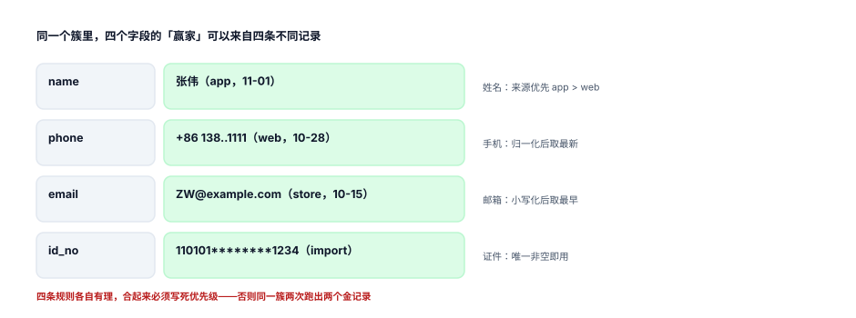

# 金记录：每个字段各自存活

一个簇里有 4 条记录，手机号两个版本、姓名三种写法、邮箱有两条是空的。合并之后对外只能有一个「张伟」——那么手机号取谁的？这个问题没有唯一正确答案，但它必须有**唯一确定的答案**：同一份数据、同一套规则，跑两次结果必须一模一样。

::: tip 一句话理解
金记录不是「挑一条最好的记录」，是**每个字段各自投票**。合起来可能来自四条不同记录——这恰恰是对的。
:::

## 一、四类存活规则



| 规则 | 说法 | 适合字段 | 风险 |
| --- | --- | --- | --- |
| 来源优先 | `web > app > store > import` | 手机、姓名 | 来源质量会随版本变 |
| 最新优先 | `updated_at` 最大 | 地址、偏好 | 最近提交常来自最不认真的入口 |
| 最完整 | 非空、长度最长、格式最规范 | 邮箱、证件 | 会把脏数据选成「最完整」 |
| 共识 | 取出现次数最多的值 | 姓名写法、城市 | 少数派（新改的）会被压掉 |

四条规则可以叠，但**必须写成一条全序**：先按规则一，并列按规则二，再并列按规则三，最后按主键兜底。少一层兜底就不是全序，金记录就不可复现。

## 二、规则选择会改变 41.1% 的结论

同一份数据、同一个簇集合，只换存活规则：

| 规则对 | 结论不同的簇 | 占比 |
| --- | --- | --- |
| 「来源优先」vs「最新优先」 | 4,618 / 11,228 | **41.1%** |
| 并列打破用 `record_id` 升序 vs 降序 | 78 / 11,228 | 0.7% |

第一条读数说明：**规则不是细节，是结论**。四成的客户在两种规则下会拿到不同的手机号。这不是「哪个更准」的问题，而是**必须先定规则、再把规则写进合同与客服话术**——否则客服系统显示 138...1111、营销系统显示 139...2222，同一个人收到两条不同的话术。

第二条读数说明：兜底规则只影响 0.7%，但**不能省**。省掉它，同一个簇两次跑出两个结果，而这 0.7% 里每一个都挂着订单。逐字段看：手机 51 个簇、邮箱 37 个、姓名 33 个——手机号最容易并列（同一来源同一天提交的多条记录）。

## 三、优先级怎么写才叫「全序」

```python
SRC_RANK = {"web": 0, "app": 1, "store": 2, "import": 3}

def golden_value(records, field):
    """records: 同一簇的记录列表；返回 (值, 来源记录 id)。"""
    cands = [(r[field], SRC_RANK[r["src"]], -r["updated_ts"], r["id"])
             for r in records if r[field]]
    if not cands:
        return None, None
    # 三层排序：来源 → 更新时间（新的优先）→ 记录 id（兜底，保证全序）
    val, _, _, rid = min(cands, key=lambda t: (t[1], t[2], t[3]))
    return val, rid
```

四个要素缺一不可：**候选过滤**（空值不参与）、**主规则**（来源优先级）、**次规则**（时间）、**兜底**（`record_id`）。返回 `rid` 是为了可解释——客服问「这个手机号哪来的」，你要能答出「2026-10-28 官网表单那条」。

::: danger 三个金记录坑

1. **把归一化值写进金记录**。`phone_key = 13800001111` 是好键、坏展示值：短信网关要 `+86`、面单要 `138-0000-1111`。金记录存**原始写法**，归一化只用于比较（判据 `CIR-D`）。
2. **按整条记录投票，而不是按字段**。「这条记录最可信，所以它的所有字段都赢」会带来一个荒谬结果：一条 `import` 来的记录若恰好来源优先级最高，它那空着的邮箱也会「赢」，覆盖掉别人填好的邮箱。必须逐字段判空。
3. **合并后不回写金记录**。新记录进来、簇变大了，金记录却还是合并那天的值。正确做法是：簇变更即重算，并记录 `golden_ver` 与变更历史（谁、什么时候、从什么变成什么）。
:::

## 四、变更是要留痕的

金记录会变：客户换了手机号、补了邮箱、改了姓名。每一次变化都影响下游（短信发到哪、发票抬头写谁），所以变更必须是**可回溯的事件**，不是一次 `UPDATE`。

```sql
CREATE TABLE customer_golden_history(
  id          INTEGER PRIMARY KEY,
  customer_id INTEGER NOT NULL REFERENCES customer(id),
  field       TEXT NOT NULL,
  old_value   TEXT,
  new_value   TEXT,
  src_record  INTEGER,
  rule_ver    TEXT NOT NULL,
  changed_at  TEXT NOT NULL DEFAULT (datetime('now'))
);
```

三个用途：客服能查「这个号码什么时候变的」；风控能查「改名事件是否异常集中」；审计能查「某次批量合并改了多少人的手机号」。

本机实测的一个小场景：阈值从 0.70 降到 0.60，簇的划分只多并了几千人，金记录手机号跟着变的记录是 **181 条（0.4%）**。比例不大，但绝对数有 181——如果这次变更没有留痕，事后没人能解释「为什么那天有 181 个客户的手机号变了」。**留痕的价值不在比例，在「每一条都能回答」。**

## 五、金记录与「客户视图」

金记录是**存储层**的答案：一个客户一行，字段各自最优。业务上还需要**视图层**的答案：客服打开客户详情，看到的应该是「当前手机号 + 历史手机号 + 每个号码的来源与时间」，而不是一个干巴巴的值。

| 层 | 内容 | 谁维护 |
| --- | --- | --- |
| 存储层 `customer.golden_*` | 每个字段一个值 | 合并任务 |
| 变更层 `customer_golden_history` | 每次变化一条 | 触发器 |
| 视图层 | 当前值 + 历史 + 来源 + 置信度 | 查询时拼 |

三层分开的好处是：存储层保持简单（一个值，便于 join 与索引），视图层可以随业务变化（今天展示 3 个历史号，明天展示 10 个），变更层永不丢。

## 判据

本页判据族 `CIG-A` ~ `CIG-H`，共 8 条，逐条可判定：

| 编号 | 判据 | 怎么判 |
| --- | --- | --- |
| `CIG-A` | 金记录逐字段存活，不是整条记录胜出 | 空值字段不会覆盖非空字段 |
| `CIG-B` | 存活规则是全序：主规则 + 次规则 + 主键兜底 | 两次重算结果一致 |
| `CIG-C` | 规则有版本号，历史金记录可按旧版本重放 | `rule_ver` 落库 |
| `CIG-D` | 金记录存原始写法，归一化值只用于比较 | `golden_phone` 可含 `+86`/分隔符 |
| `CIG-E` | 每个金记录值可回溯到来源记录 | 有 `src_record` 或可 join 出唯一来源 |
| `CIG-F` | 金记录变更写历史表，含旧值、新值、规则版本 | `customer_golden_history` 有行 |
| `CIG-G` | 簇变更触发金记录重算，不是一次性写死 | 合并后自动重跑 |
| `CIG-H` | 规则变更前有影响面预估（多少客户会变） | 调参前先跑 dry-run 出变更数 |

## 验证方式

先验证「全序」这件事，再验证两套规则的结论差异真实存在：

```shell
# 1) 全序：三次打乱输入顺序，金记录必须一致
python3 - <<'PY'
import itertools
rows = [{"v":"13800001111","src":"web","ts":100,"id":7},
        {"v":"+8613800001111","src":"web","ts":100,"id":3},
        {"v":"13900002222","src":"app","ts":200,"id":9}]
RANK = {"web":0,"app":1,"store":2,"import":3}
def pick(rs):
    c = [(r["v"], RANK[r["src"]], -r["ts"], r["id"]) for r in rs if r["v"]]
    return min(c, key=lambda t:(t[1],t[2],t[3]))[0]
print({pick(p) for p in itertools.permutations(rows)})   # 期望只有一个元素
PY

# 2) 本页判据 8 条
grep -o 'CIG-[A-H]' docs/Backend/CustomerIdentity/GoldenRecord/index.md | sort -u | wc -l

# 3) 全库判据不撞号
python3 utils/audit/judgeidcheck.py --root . | tail -1
```

预期输出：第一条打印一个**只有一个元素**的集合（三次打乱得到同一个号码）；若打印出两个不同的号码，说明兜底规则没写或写错。第二条 `8`；第三条 `E=0`。

## 参考资料

- [成簇与传递闭包](../Clustering/index.md)
- [合并与别名](../MergeAlias/index.md)
- DAMA International《DAMA-DMBOK 2nd Edition》第 8 章（Reference & Master Data，金记录与存活规则）：<https://www.dama.org/cpages/body-of-knowledge>
- ISO 8000-110:2020《Data quality — Master data: Exchange of quality identifiers》（主数据质量与来源可追溯）：<https://www.iso.org/standard/72270.html>
