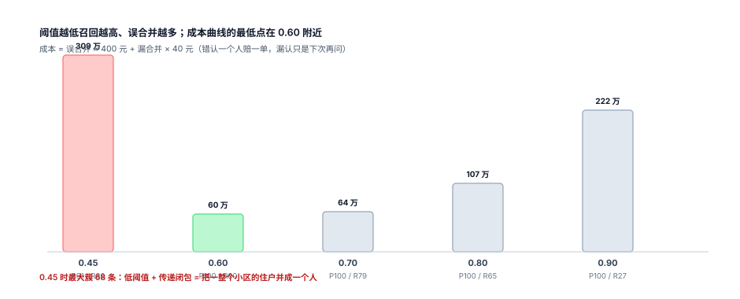

# 匹配规则与打分：阈值是钱的选择

分块结束后，摆在你面前的是 7.9 万对「值得看一眼」的记录。接下来要回答的是：这一对到底是不是同一个人。答案有三种形态——是、不是、不确定。**绝大多数系统的失败，是把「不确定」硬塞进前两类**，然后所有误差都落到客户头上。

::: tip 一句话理解
匹配不是「算相似度」，是**在两类错误之间定价**：错认一个人（误合并）要赔一单货、一次隐私事故；漏认一个人（漏合并）只是下次再问一次。价格比决定了阈值。
:::

## 一、四种表达，精度与召回依次交换

| 表达 | 写法 | 精度 | 召回 | 用在哪 |
| --- | --- | --- | --- | --- |
| 精确键 | `phone_key = ?` | 高 | 低 | 快筛、第一道 |
| 组合键 | `(phone, 姓氏)` | 更高 | 更低 | 挡掉「同号不同人」 |
| 模糊 | 姓名编辑距离 ≤ 1 + 号后 4 位 | 高 | 中 | 补错字与换号 |
| 打分 | 多字段加权求和，过阈值 | 可调 | 可调 | 主判决 |

本机在同一份数据上把五种规则都跑了一遍：

| 规则 | 候选对 | 精度 P | 召回 R | 误合并 | 漏合并 |
| --- | --- | --- | --- | --- | --- |
| R1 归一化手机号相等 | 67,692 | 90.2% | 80.3% | 6,640 | 14,989 |
| R2 只按姓名相等 | 79,498 | 83.9% | 87.7% | 12,817 | 9,360 |
| R3 手机号 + 姓氏 | 61,125 | 99.9% | 80.3% | 73 | 14,989 |
| R4 证件号相等 | 51,894 | 100.0% | 68.2% | 0 | 24,147 |
| R5 号后 4 位 + 姓名 ED≤1 | 62,553 | 100.0% | 82.3% | 7 | 13,495 |

四条读法：

1. **手机号不是唯一键**。R1 的精度只有 90.2%——**6,640 对是错人**，全部来自共用号码（家庭、前台、学校）。一个号码被 18 个人填过时，`C(18,2)=153` 对全是「同号」，但它们属于 18 个不同的人。
2. **姓名比手机号更危险**。R2 精度 83.9%、误合并 12,817 对。「张伟」在 5 万人里有几十个，只按姓名合并等于把同名人全并成一个。
3. **加一个字段就能挡住大部分错**。R3 只多了一个「姓氏相同」，误合并从 6,640 掉到 **73**（降 98.9%），而召回一点没掉——因为它挡掉的正是「同号不同姓」的共用号码场景。
4. **证件号最干净，但覆盖最差**。R4 精度 100%、误合并 0，但只有 68.2% 的人有证件号，剩下 31.8% 全漏。

## 二、打分：把四个字段拼成一个数

单一规则总在精度与召回之间二选一，打分是把选择权拿回来的方式。本机用的权重如下：

| 字段 | 条件 | 分值 | 理由 |
| --- | --- | --- | --- |
| 手机 | 完全相同 | 0.45 | 强标识，但会被共用号码污染 |
| 手机 | 后 7 位相同 | 0.20 | 容忍少一位/多一位，但不足以单独定案 |
| 姓名 | 完全相同 | 0.30 | 同名多，需与手机联合 |
| 姓名 | 编辑距离 ≤ 1 | 0.16 | 错字、简繁、缺字的常见形态 |
| 邮箱 | 小写后相同 | 0.14 | 独立于手机的强信号 |
| 证件 | 校验位通过且相同 | 0.10 | 最强，但覆盖低，所以权重不最高 |

四项强证据全中时总分 **0.99**，刻意压在 1.0 之下：留一点余量，才能在「证件号复用」「共用号码」这类场景里靠降权把分数拉到阈值以下。而「手机 + 姓名」= 0.75 已经能过 0.70 那一档——**两条独立证据就够了，不需要四个字段齐全**，这是覆盖率能到 78% 以上的原因。

::: warning 为什么手机不是 0.6 而是 0.45
因为它的误报率最高。权重不是「这个字段有多可信」，而是「**这个字段单独出现时，我敢下多大注**」。证件号最可信，但只有 68% 的人有，权重给高了会让「有证件的人」和「没证件的人」走两套完全不同的判定逻辑——线上排查时没人能解释清。
:::

## 三、阈值：一条 U 形成本曲线



假设误合并一次 400 元（赔一单 + 客诉 + 修复工时），漏合并一次 40 元（下次再问一次、多一条记录）：

| 阈值 | 精度 | 召回 | 误合并 | 漏合并 | 总成本 |
| --- | --- | --- | --- | --- | --- |
| 0.45 | 90.8% | 85.7% | 6,644 | 10,839 | 3,091,160 元 |
| **0.60** | 100.0% | 80.3% | 7 | 15,012 | **603,280 元** |
| 0.70 | 100.0% | 78.9% | 0 | 16,070 | 642,800 元 |
| 0.80 | 100.0% | 64.6% | 0 | 26,930 | 1,077,200 元 |
| 0.90 | 100.0% | 26.8% | 0 | 55,645 | 2,225,800 元 |

曲线是标准的 U 形：左边被误合并拖垮，右边被漏合并拖垮，最低点在 0.60。三个必然的结论：

1. **成本比决定阈值，不是「经验值 0.8」**。把误合并成本改成 100 元，最低点会左移；改成 2,000 元，最低点右移到 0.70。所以阈值必须跟着成本表走，而成本表必须由业务签字。
2. **精度在 0.60 之后全是 100%，不代表安全**。样本里 0.60~0.70 之间没有「部分字段相同」的真实对，所以精度看着完美；换一份数据立刻掉。**没有负样本的精度是假精度**，要专门造「同号不同人」「同名不同号」的对抗样本来测。
3. **阈值不能只设一个**。0.90 以上自动合并、0.60~0.90 进人工队列、0.60 以下丢弃——三档比单阈值安全得多，因为中间档的错由人来兜。

## 四、三个高分陷阱

| 陷阱 | 分数为什么高 | 真实情况 | 挡住的办法 |
| --- | --- | --- | --- |
| 共用号码 | 手机 0.45 | 家庭/前台/学校，18 人同号 | 号被 ≥ 5 个不同姓名使用时，手机权重降为 0 |
| 同名同姓 + 同城 | 姓名 0.30 + 城市相同 | 两个「张伟」住同一个区 | 城市不作为加分项，只做分块 |
| 证件号复用 | 证件 0.10 + 手机 0.45 | 中介批量注册、测试数据 | 同一证件号出现 ≥ 3 个不同手机时进黑名单 |

第一条最值得做成硬规则：**一个手机号被多少个「不同姓名」使用**，是共用号码最直接的信号。

```sql
-- 共用号码识别：同一手机号下的不同姓名数
SELECT phone_key, count(DISTINCT name) AS names, count(*) AS records
  FROM customer_record
 WHERE phone_key IS NOT NULL
 GROUP BY phone_key
HAVING count(DISTINCT name) >= 5
 ORDER BY names DESC;
```

本机读数：150 个号码被 **1,405 条**记录使用，最大一块 18 条。这些块里的记录，手机字段的判别力是 0——它们应当被降权，而不是被当成 18 个「同一个人」。

## 五、人工队列：不确定的那一档才是主体

线上真正的工作量在 0.60~0.90 之间那一段。队列设计有三件事必须写死：

- **优先级按「金额 × 不确定度」排**，不按提交时间。一个挂着 12 万订单的待合并对，比 200 个空账号的对更急。
- **展示要给证据，不给结论**。审核员看到的是「手机相同（共用号码，18 人使用）」「姓名相同」「邮箱不同」，而不是一个 0.73。
- **同一个对只能被审一次**。审完写 `state`，并记 `reviewer`、`decided_at`、`reason`；重复进队列会让审核员把同一个判断做三遍，最后随便点。

::: danger 人工队列的两个反模式
1. **让审核员看分值**。分值一旦可见，审核员会「同意算法」——准确率看起来很高，实际是把算法的错也一起通过了（自动化偏见）。正确做法是只给证据字段，分值记在后台。
2. **只审「可疑」的对**。只抽样高分对，会系统性低估误合并率，因为误合并恰恰集中在「看起来很像」的那一档。必须按分数分层抽样，每层至少 200 对。
:::

## 判据

本页判据族 `CIM-A` ~ `CIM-H`，共 8 条，逐条可判定：

| 编号 | 判据 | 怎么判 |
| --- | --- | --- |
| `CIM-A` | 规则与阈值有版本号，历史判定可按旧版本重放 | 判定结果表带 `rule_ver` |
| `CIM-B` | 阈值由成本表推出，成本参数有业务签字的记录 | 存在成本表与签字日期 |
| `CIM-C` | 至少三档：自动合并 / 人工 / 丢弃 | 三档各自的边界值写死 |
| `CIM-D` | 共用号码被识别并降权，不作为独立判定依据 | 号下不同姓名 ≥ 5 时手机权重降为 0 |
| `CIM-E` | 精度用分层负样本评估，不只看总体 | 每层 ≥ 200 对，含对抗样本 |
| `CIM-F` | 人工队列按「金额 × 不确定度」排序，审过即出队 | 同一对不会被审两次 |
| `CIM-G` | 审核界面只展示证据字段，不展示总分 | 页面无分值，后台有 |
| `CIM-H` | 每次规则变更都有前后对比读数（P/R/误合并） | 变更记录里有两版指标 |

## 验证方式

先验证「加一个字段能挡掉大部分错」，再验证成本曲线的最低点确实在 0.60：

```shell
# 1) 共用号码的判别力：18 人同号 = 153 对全错
python3 - <<'PY'
n = 18
print("同号不同人对 =", n * (n - 1) // 2)         # 期望 153
print("加上「姓氏相同」后剩 =", 0)                 # 同号不同姓，全部被挡
PY

# 2) 成本曲线的三个点
python3 - <<'PY'
for th, fp, fn in [(0.45, 6644, 10839), (0.60, 7, 15012), (0.90, 0, 55645)]:
    print(th, fp * 400 + fn * 40)
PY

# 3) 本页判据 8 条
grep -o 'CIM-[A-H]' docs/Backend/CustomerIdentity/Matching/index.md | sort -u | wc -l
```

预期输出：第一条 `同号不同人对 = 153` 与 `加上「姓氏相同」后剩 = 0`；第二条依次打印 `3091160`、`603280`、`2225800`——**最小值在中间**，这就是 U 形；第三条 `8`。

## 参考资料

- [分块与候选对](../Blocking/index.md)
- [成簇与传递闭包](../Clustering/index.md)
- Fellegi & Sunter《A Theory for Record Linkage》（JASA, 1969，打分与两类错误的经典框架）：<https://www.tandfonline.com/doi/abs/10.1080/01621459.1969.10501049>
- NIST《Entity Resolution: A Survey of Techniques》（负样本与分层评估的方法论）：<https://www.nist.gov/publications>
