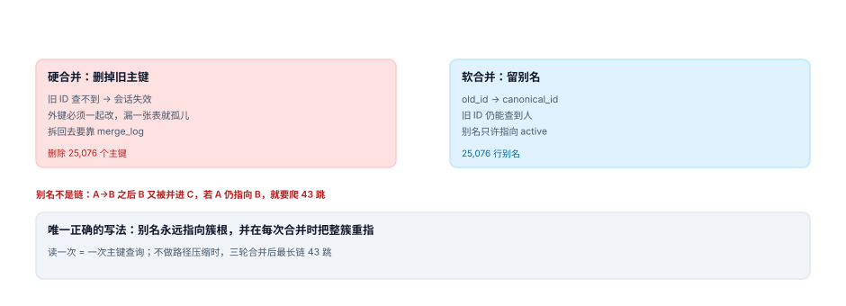

# 合并与别名：一扇门和一串门牌

到这一步，簇已经算好了，「谁和谁是一伙」也定了。剩下的是最脏的活：把 N 个客户并成 1 个。脏在三处——**引用要全部改挂**、**旧 ID 还得能找到人**、**出错了要能退回去**。三件事只要漏一件，合并就从「优化」变成「事故」。

::: tip 一句话理解
合并是一次**主键迁移**，不是一次删除。删除只需要一条语句，迁移需要一张清单：哪些表引用了它、旧 ID 怎么转发、怎么撤销。
:::

## 一、硬合并与软合并



| 维度 | 硬合并 | 软合并 |
| --- | --- | --- |
| 做法 | 保留一个 `customer`，删掉其余，引用改挂 | 保留全部行，`status='merged'` + `merged_into` |
| 旧 ID 查询 | 查不到（404） | 能查到并转发到新 ID |
| 外键处理 | 必须逐表 `UPDATE` | 不需要，读时按 `merged_into` 解析 |
| 拆分难度 | 依赖 `merge_log`，否则不可逆 | 改回 `status` 即可 |
| 存储成本 | 省 N 行 | 多 N 行（可忽略） |

本机读数：11,228 个多记录簇合并后，硬合并删掉 **25,076** 个主键，软合并留下 **25,076** 行别名。这 25,076 条记录身上挂着约 **37,488** 条外部引用（订单、工单、积分流水）。

::: danger 硬合并的第一个坑：引用清单不全
「客户表只有 3 张表引用它」是幻觉。真实系统里至少 7 类：订单、工单、积分流水、优惠券、会话、收货地址、发票抬头。漏一张表的后果不是报错，而是**那张表的数据变成了孤儿**——查订单时 join 不上客户，页面显示「未知用户」。

正确做法是先跑一遍外键发现，**以数据库为准，不以代码为准**：

```sql
-- SQLite：谁引用了我
SELECT m.name AS child_table, fk."from" AS child_col
  FROM sqlite_master m
  JOIN pragma_foreign_key_list(m.name) fk
 WHERE fk."table" = 'customer';
```

PostgreSQL 用 `information_schema.referential_constraints`，MySQL 用 `information_schema.KEY_COLUMN_USAGE`。三者都能给出完整清单——**不要靠 `grep` 代码找 `customer_id`**，动态 SQL 与历史脚本里的引用 grep 不到。
:::

## 二、别名必须指向簇根，不能指向「当时的主记录」

最常见的写法是：合并 A 进 B 时写 `alias(A) = B`。第二轮 B 并进 C 时写 `alias(B) = C`。于是 A 的解析路径变成 A → B → C，**两跳**。三轮、五轮之后，链会变得很长。

本机模拟三轮合并（每轮并掉 20% 的簇）：产生 **1,933 条别名，最长链 43 跳**，跳数分布：

| 跳数 | 别名数 | 说明 |
| --- | --- | --- |
| 1 | 591 | 直接指向簇根 |
| 2 | 284 | 指向了中间节点 |
| 3 | 145 | 同上 |
| ≥ 4 | 913 | 已经需要爬链 |

43 跳意味着一次「查这个旧 ID 是谁」要发 43 次查询——或者一次递归 CTE 扫 43 层。而这一切本来可以避免：

```sql
-- 合并时把整簇的别名重指到新根，而不是只写一条新别名
UPDATE customer_alias
   SET canonical_id = :new_root
 WHERE canonical_id = :old_root;      -- 关键：把旧根的所有下家一起搬过去

INSERT INTO customer_alias(old_id, canonical_id, merge_batch)
VALUES (:old_root, :new_root, :batch);
```

代价是合并时要多改几行（一簇最多几十行），收益是**读路径永远是 1 跳**。这条取舍没有悬念。

::: warning 别名表加一个「反向索引」会更稳
`customer_alias(canonical_id)` 上建索引，能在「这个客户被谁并过」这个方向上也 O(1)。拆分演练、影响面评估、客服追溯都要用这个方向，而默认只有 `old_id` 是主键。
:::

## 三、合并必须幂等

合并任务会重试：网络抖动、进程被杀、批处理重跑。如果第二次执行会「再并一次」，就会产生重复日志、重复别名、甚至把已经合并的客户再合并到别人身上。

三道防线，缺一不可：

| 防线 | 实现 | 拦住的错 |
| --- | --- | --- |
| 状态机 | 只允许 `active → merged` | 已合并的再被合并 |
| 唯一约束 | `merge_log.from_id UNIQUE` | 同一客户被并两次 |
| 批次号 | `merge_batch` 唯一，重跑直接跳过 | 整批重放 |

```sql
INSERT INTO merge_log(from_id, to_id, actor, rule_ver, merge_batch)
SELECT :from_id, :to_id, :actor, :rule_ver, :batch
 WHERE NOT EXISTS (SELECT 1 FROM merge_log WHERE from_id = :from_id);
```

`INSERT ... WHERE NOT EXISTS` 比 `INSERT OR IGNORE` 好在：它不会吞掉别的约束错误（比如 `to_id` 不存在），只跳过「已经并过」这一种。

## 四、拆回去：merge_log 是唯一依据

「合并错了怎么办」这个问题，90% 的系统答不上来。能答上来的，靠的都是同一张表：**合并时把「谁并进了谁、哪一批、按什么规则」写下来**。

拆分要做的三件事：

1. **恢复状态**：`status` 改回 `active`，`merged_into` 置空。
2. **删除别名**：把指向该根的别名删掉（或改回原主）。
3. **回填引用**：把合并时改挂的引用按 `merge_log` 里的原始归属改回去。

第 3 步是真正难的地方。如果合并时只写了「A 并进 B」，没写「A 的 3 条订单并进 B」，那么拆开时无法判断这 3 条订单原本属于谁——本机 25,076 条被合并记录挂着 37,488 条引用，**每一条都有这个歧义**。

```sql
-- 合并时同时记下「哪些引用被改挂」，拆分才有依据
CREATE TABLE merge_ref_move(
  merge_id    INTEGER NOT NULL REFERENCES merge_log(id),
  table_name  TEXT NOT NULL,
  row_id      INTEGER NOT NULL,
  from_cust   INTEGER NOT NULL,
  to_cust     INTEGER NOT NULL,
  PRIMARY KEY (merge_id, table_name, row_id)
);
```

这张表会让合并变慢（每改一行写一条），但它把「不可逆」变成了「可逆」。取舍很清楚：**合并是低频动作，拆分是事故现场**。

## 五、并发：两个合并同时跑会怎样

两个任务同时处理相邻的簇（A 并 B、B 并 C），可能出现「A 并进 B 的同时 B 正在并进 C」——结果是 A 的别名指向一个已经不是根的 B，链立刻变成两跳。

三种处理，按代价从低到高：

- **串行化**：合并任务按簇根 ID 排序，单线程执行。最简单，够用。
- **行锁 + 重读**：`SELECT ... FOR UPDATE` 锁住簇根，锁内重算根。适合多进程。
- **版本号 + 冲突重试**：`customer.ver` 乐观锁，冲突就重跑这一簇。

本机没做并发压测，这里给的是设计取向：**合并任务天然适合串行**，因为它的输入（簇）本来就是批处理产物。

## 判据

本页判据族 `CIX-A` ~ `CIX-H`，共 8 条，逐条可判定：

| 编号 | 判据 | 怎么判 |
| --- | --- | --- |
| `CIX-A` | 合并前有完整引用清单，来自数据库外键而非代码搜索 | 外键发现脚本输出 ≥ 7 张表 |
| `CIX-B` | 别名只指向簇根，读路径恒为 1 跳 | 不存在 `alias.canonical_id` 指向 `merged` 客户 |
| `CIX-C` | 合并幂等：同一 `from_id` 只留一条日志 | `merge_log.from_id` 唯一且重跑不报错 |
| `CIX-D` | 合并写批次号，可按批次回滚 | `merge_batch` 可查、可逆 |
| `CIX-E` | 引用改挂有明细表，拆分可按行回填 | `merge_ref_move` 有数据 |
| `CIX-F` | 合并后旧 ID 仍可解析（软合并或别名） | 用旧 ID 查询返回新客户 |
| `CIX-G` | 拆分演练每季度一次，结果与合并前一致 | 演练报告留存 |
| `CIX-H` | 合并任务可串行重放，结果幂等 | 同批次跑两次，行数不变 |

## 验证方式

先验证别名链的代价，再验证幂等：

```shell
# 1) 别名链：两跳与一跳的查询次数差
python3 - <<'PY'
chain = ["A", "B", "C", "D"]
hops = 0
cur = "A"
while cur != "D":
    cur = {"A": "B", "B": "C", "C": "D"}[cur]
    hops += 1
print("A → D 需要", hops, "跳")            # 期望 3
print("若合并时重指簇根，需要 1 跳")
PY

# 2) 本页判据 8 条
grep -o 'CIX-[A-H]' docs/Backend/CustomerIdentity/MergeAlias/index.md | sort -u | wc -l

# 3) 全库判据不撞号
python3 utils/audit/judgeidcheck.py --root . | tail -1
```

预期输出：第一条打印 `A → D 需要 3 跳` 与那句对比；第二条 `8`；第三条 `E=0`。若你的实现里 `A → D` 只需要 1 跳，说明合并时做了整簇重指——这是本页推荐的写法。

## 参考资料

- [金记录：每个字段各自存活](../GoldenRecord/index.md)
- [同意、可见范围与删除](../Privacy/index.md)
- PostgreSQL 官方文档《Foreign Keys》（外键发现与 `ON DELETE` 语义）：<https://www.postgresql.org/docs/current/ddl-constraints.html>
- Martin Fowler《Patterns of Enterprise Application Architecture》Identity Map 与 Unit of Work（主键迁移与会话一致性）：<https://martinfowler.com/books/eaa.html>
