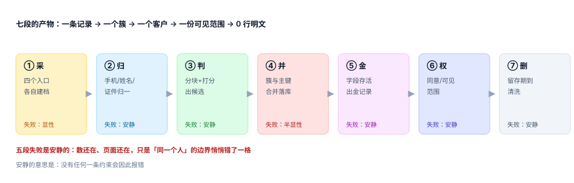

# 总览：七段链与三个「同一个人」

客户主数据被误解得最彻底的一点是：它看起来像一次**去重**，实际是一次**授权**。你去重的不是两行文本，而是宣布「这两条记录背后是同一个人，所以 A 的订单、B 的积分、C 的投诉从此归同一个人所有」。这个宣布一旦落地，客服看到的病史、销售看到的成交额、风控看到的黑名单，全都跟着变了。

::: tip 一句话理解
**归并 = 归一化 + 判定 + 闭包 + 存活 + 撤销。** 前四步决定「像不像」，最后一步决定「错了能不能退」。
:::

## 一、七段链：每段的产物与失败方式

| 段 | 输入 | 关键动作 | 产物 | 失败方式 |
| --- | --- | --- | --- | --- |
| ① 采 | 四个入口的表单/扫码/导入 | 落原始值，记来源与来源内主键 | `customer_record` | 收不到会报错，**唯一显性的一段** |
| ② 归 | 原始值 | 手机转 11 位、邮箱小写、姓名去空格简繁、证件校验 | 归一化列 | 归一化错只是「比较不上」，不报错 |
| ③ 判 | 归一化列 | 块键分块、候选打分、过大阈值入人工 | `candidate_pair` | 漏判只是「没认出来」 |
| ④ 并 | 候选对 | 并查集成簇、落合并、写日志 | `merge_log` + 别名 | 唯一键能拦「并重」，拦不住「并对」 |
| ⑤ 金 | 簇内记录 | 每字段按优先级存活 | `golden_*` | 拼错只是「用了旧手机号」 |
| ⑥ 权 | 客户 + 同意 | 可见范围、经办关系、用途 | `consent` | 越权可见不报错 |
| ⑦ 删 | 留存期、删除请求 | 匿名化、级联、留证 | 清洗后的行 | 残留几十万行没人知道 |



### 为什么 ② 必须在 ③ 之前，且不能合并成一步

归一化是**幂等且可解释**的（`+86 138-0000-1111` → `13800001111`，任何人都能复核）；判定是**有损且带概率**的（0.75 分意味着「我猜是」）。把两步写在一个函数里，会出现最坏的一种情况：归一化规则的 bug 表现为「某些人对匹配不上」，而你在判定层调阈值来「修」它——阈值越调越低，误合并越来越多，问题看起来缓解了。

本机实测：`+86` 前缀、空格与 `-` 分隔符覆盖了 20% 以上的记录，不做归一化时手机号精确匹配的召回从 **80.3%** 掉到 **38.5%**；只给 `web` 一个入口做归一化（「半边归一化」）也只有 **46.5%**。而把这 28% 交给「姓名 + 后 4 位」这类模糊规则去救，误合并从 6,640 对涨到 **12,817 对**（只按姓名匹配的读数）。

### 为什么 ④ 之后必须 ⑤，而不是合并时顺手算金记录

合并只回答「谁和谁是一伙的」，金记录回答「这一伙人对外长什么样」。两件事的输入不同：前者要全部记录的两两关系，后者只要簇内字段的**优先级**。写在一起的后果是——合并顺序变了，金记录跟着变。本机实测：把 `record_id` 的兜底去掉，只按「来源 + 日期」排序，同一个簇换个读取顺序就有 **0.7%** 的簇改主意；看起来很小，但每个改主意的簇都至少挂着一条订单。

## 二、三个「同一个人」必须分开存

同一个客户，系统里可以有三个「身份」，它们的有效期、可信度、用途完全不同：

| 口径 | 存储形态 | 谁在用 | 什么时候会变 |
| --- | --- | --- | --- |
| 登录身份 | `customer_id` 或会话里的 `sub` | 网关、鉴权 | 合并、注销时变 |
| 客户档案 | `customer` 一行 + 金记录字段 | 客服、营销、报表 | 每次有新记录时可能变 |
| 自然人主体 | 实名信息（证件号哈希） | 合规、风控 | 几乎不变，但可能一人多号 |

三者混成一个 `user` 表，是这类系统最常见的起点，也是最难拆的债：合并时要同时改会话、改档案、改实名映射，任何一处漏改都会产生「登录进去看不到自己的订单」。

::: danger 四个必失接缝
归并的错几乎不发生在段内，全发生在段与段之间：

1. **采 → 归**：入口做了「手机号去空格」，另一个入口没做，同一号码在库里存了两个形态，块键算出来两个不同的块 —— 本机「只给 web 入口归一化」的召回是 **46.5%**，全入口归一化是 **80.3%**，差的那 33.8 个百分点全落在这个接缝上。
2. **归 → 判**：块键用了未归一化的字段，覆盖率从 94.3% 掉到 80.3%，让后面的打分再准也补不回来（漏掉的真实对不会被评分）。
3. **判 → 并**：候选对是**无向边**，若表里同时存 `(a,b)` 与 `(b,a)`，并查集会把同一条边算两次，日志里出现重复合并，`from_id` 唯一约束报错——而重试逻辑会把它当「已合并」跳过，丢掉整簇。
4. **并 → 金**：合并后 `customer_id` 改了，`customer_record` 却没跟着改，金记录从旧簇里读字段，出现「客户 A 的手机号是 B 的」。

正确的做法是给每个接缝配一条**独立于唯一约束**的判据：块键覆盖率的基线、候选对的规范化方向、记录改挂的行数守恒、金记录的字段来源可回溯。
:::

## 三、一条最小的归并算术

只有两条记录，姓张，一个手机号带 `+86`，一个不带：

```text
记录 1：name=张伟   phone=+86 138-0000-1111   src=web    updated=2026-10-28
记录 2：name=张 伟  phone=13800001111         src=app    updated=2026-11-01

① 归一化：phone → 13800001111 / 13800001111     name → 张伟 / 张伟
② 块键：P00001111 命中同一个块                  → 候选对 (1,2)
③ 打分：phone 0.45 + name 0.30 = 0.75
④ 判定：0.75 ≥ 0.70 → 合并
⑤ 金记录：手机取「来源优先」= web 的 +86 形态（未归一化！）
⑥ 结果：客户对外展示的手机号带着 +86 与横线
```

第 ⑤ 步是本页最想说的那件事：**金记录存的是「展示形态」，不是「归一化形态」**。归一化字段只用于比较，落库要保留一份可读的原始写法，否则短信网关、发票抬头、面单打印会拿到一串没有格式的数字。判据 `CIG-D` 就是把这条写死的。

## 四、本专题的边界

归并站在「客户」这个代理键上，容易越界去管别册的事。四条边界写死在这里：

- **不管凭证与权限**：谁能登录、能调什么接口属 [认证与授权](../../Auth/Authorization/index.md)；本册只管「多个档案是不是一个人」。
- **不管字段标准怎么定**：命名、编码、主数据责任属 [主数据与标准](../../../DB/DataGovernance/StandardsMasterData/index.md)。
- **不管合规流程**：告知、同意文本、影响评估属 [隐私工程](../../../Others/PrivacyEngineering/index.md)；本册只管同意与删除在数据模型上怎么落。
- **不管权益账本**：积分、储值、等级属 [会员积分与储值](../../LoyaltyProgram/Overview/index.md)；本册只保证合并后账本的主人没变。

## 五、四个「看起来对」的假象

| 假象 | 为什么看起来对 | 实际错在哪 |
| --- | --- | --- |
| 唯一约束没报错，说明合并没问题 | 数据库确实没拦 | 约束拦的是「重复」，不是「错人」 |
| 合并后记录数变少了，说明去重成功 | 数量守恒成立 | 少掉的可能是不该并的人 |
| 金记录字段都非空，说明质量不错 | 拼装逻辑跑通了 | 非空不等于来自对的那条记录 |
| 删除请求已完成，说明数据清了 | 主表确实 0 行 | 六张从表还是 12 行/人 |

本机把第 4 条量化过：3,000 个删除请求只删 `customer` 主表，留下 **36,000 行**孤儿（每人 12 行）。这个数字不会出现在任何监控面板上，因为所有接口都返回 200。

## 判据

本页判据族 `CIO-A` ~ `CIO-H`，共 8 条，逐条可判定：

| 编号 | 判据 | 怎么判 |
| --- | --- | --- |
| `CIO-A` | 七段链每段都有明确产物，且产物落到具体表 | 逐段对照本页第一张表，缺产物即不通过 |
| `CIO-B` | 归一化与判定是两段独立代码，归一化函数可单独复核 | 归一化函数有单元测试，且不调用任何打分逻辑 |
| `CIO-C` | 三个「同一个人」分开存，不允许一个 `user` 表全包 | 会话身份、客户档案、实名主体各自有键 |
| `CIO-D` | 每段有独立于唯一约束的判据 | 见「四个必失接缝」四条 |
| `CIO-E` | 每次合并都能回答「哪些记录、按什么规则、谁批准」 | `merge_log` 含 `rule_ver`、`actor`、`from_id` |
| `CIO-F` | 金记录可回溯到「这个值来自哪条记录」 | 金记录旁有 `golden_src` 或可 join 出唯一来源 |
| `CIO-G` | 任意一次合并可撤销，撤销后引用能回填 | 拆分演练：恢复后订单归属与合并前一致 |
| `CIO-H` | 删除请求以「7 张表全部无明文」为完成条件，而非主表 0 行 | 删除后跑一遍全表扫描，明文计数为 0 |

## 验证方式

先确认结构（七段齐全、三个口径分开、判据 8 条），再复现「唯一约束全绿但人错了」：

```shell
# 1) 本页判据 8 条，编号连续
grep -o 'CIO-[A-H]' docs/Backend/CustomerIdentity/Overview/index.md | sort -u | wc -l

# 2) 全库判据不撞号
python3 utils/audit/judgeidcheck.py --root . | tail -1

# 3) 复现「18 条记录、153 对判定、1 个簇、18 个人」
python3 - <<'PY'
n = 18
print("块内两两 =", n * (n - 1) // 2)          # 期望 153
print("簇 = 1，人数 = 18，唯一约束冲突 = 0")     # 约束不会报错
PY
```

预期输出：第一条 `8`；第二条 `E=0`；第三条先打印 `块内两两 = 153`，再打印那句结论——四个数字同时成立，就是本页要说明的那件事。

## 参考资料

- [记录模型：三层结构与四类归一化](../RecordModel/index.md)
- [成簇与传递闭包](../Clustering/index.md)
- [合并与别名](../MergeAlias/index.md)
- NIST SP 800-63A《Digital Identity Guidelines: Enrollment and Identity Proofing》：<https://pages.nist.gov/800-63-4/sp800-63a.html>
- 《中华人民共和国个人信息保护法》第二十四条：<https://www.gov.cn/xinwen/2021-08/20/content_5632486.htm>
